# SF32LB57-DevKit-LCD Development Board User Guide

## Board Overview

The SF32LB57-DevKit-LCD development board is built around the high-performance **SF32LB57-MOD-WD** module and is tailored for multimedia AIoT application scenarios such as **DPI-RGB parallel display**, **DCMI camera**, **audio playback/recording**, and **Wi-Fi**. The board integrates an SF32LB57 chip with a dual-core Arm Cortex-M33 STAR-MC1 @240MHz, and features onboard Wi-Fi / Bluetooth Combo, QSPI boot Flash, an LCD connector, a camera connector, an audio power amplifier, PDM microphones, a TF card slot, and a Raspberry Pi-compatible 40P expansion header, fully meeting the development needs of products such as smart HMI, video intercom, and smart wearables.

In terms of hardware interface configuration, the board provides rich expansion resources: USB Type-C serial debugging, USB2.0 FS, a 40P 0.5mm-pitch DPI-RGB888 FPC display interface, a 24P 0.5mm-pitch DCMI camera interface, a TF card slot, a 1.25mm speaker connector, dual PDM microphones, 3 GPADC keys, a Raspberry Pi-compatible 40P 2.54mm dual-row header, etc., making it convenient for developers to perform program debugging, data transfer, and peripheral expansion.

Leveraging its well-established hardware architecture and interface design, this development board can efficiently help developers complete driver development for various peripheral interfaces, significantly reducing hardware development difficulty and simplifying the R&D process, thereby shortening the product cycle from R&D to mass production.


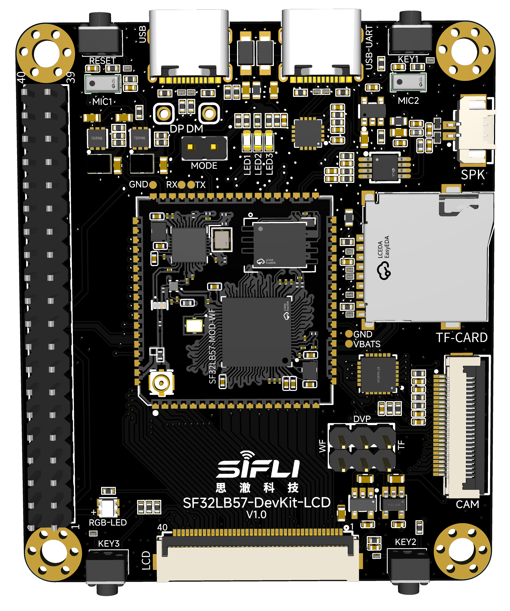 

<div align="center"> Front view of the SF32LB57_DevKit-LCD development board </div>   <br> <br>

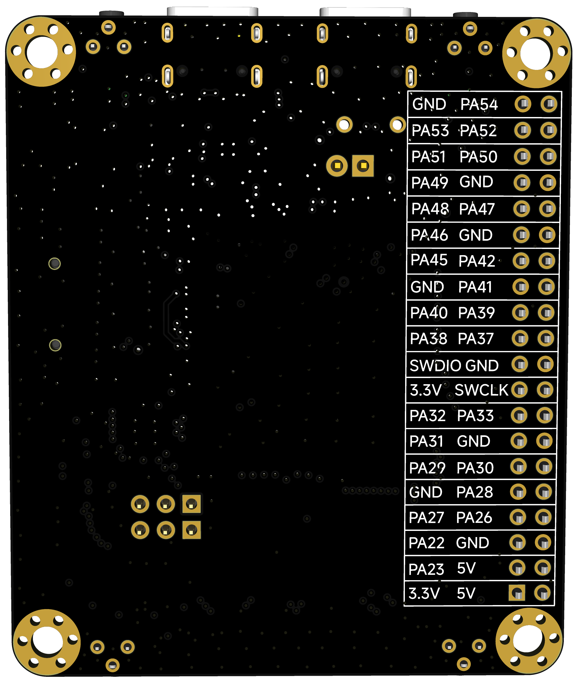 

<div align="center"> Back view of the SF32LB57_DevKit-LCD development board </div>   <br> <br>


### Feature List

The development board has the following features:

1. **Core module**
   - Onboard **SF32LB57-MOD-WD** module; the module integrates:
     - SF32LB57X series chip (3.3V supply series), dual-core Arm Cortex-M33 STAR-MC1 @240MHz, 1968 CoreMark
     - On-chip SRAM **592KB** (HPSYS 512KB + LPSYS 80KB, all with Retention)
     - Packaged QSPI-NOR Flash (boot Flash) and optional OPI-PSRAM (depending on the specific module part number)
     - Packaged **AIC8800D40LS-N series Wi-Fi** chip with SDIO interface
     - 48MHz crystal (SF32LB57X) + 40MHz crystal (AIC8800D40LS-N)
   - The module is packaged in a stamp-hole/pad form, making it easy to mount or solder directly onto the base board
2. **Display interface**
   - Large-core **DPI-RGB parallel display interface**, 40P 0.5mm-pitch FPC connector (FPC1)
   - ALIENTEK standard 40P RGB pin sequence interface, supporting FreeIO configuration; QSPI, MCU8080, EPD, and JDI interfaces can all be adapted and tested from this 40P FPC.
   - Default support for **RGB888** (24-bit data), configurable by software to RGB565 and other bit widths
   - Supports ePicasso 3.0 2D/2.5D graphics hardware acceleration, up to 2048×2048 full-screen refresh at 60fps
3. **Camera interface**
   - **DCMI DVP camera interface**, 24P 0.5mm-pitch FPC connector (FPC4)
   - Supports common DVP camera modules such as GC032A, OV2640, OV5640, and OV3660
   - Onboard camera power supply: DVDD_1V5 / DVDD_2V8 / AVDD_2V8 independent LDOs
4. **Audio interface**
   - 1× 24-bit high-fidelity DAC output, driving a speaker through the onboard Class-D audio amplifier (NS4150B)
   - Onboard 1.25mm-pitch 2P speaker connector (J7)
   - 2× PDM digital microphones (MSM261DGT007 / same-package compatible model LMD4020T261-AC23), supporting a dual-microphone array
5. **USB**
   - USB Type-C interfaces ×2:
     - One is **USB-to-UART** (CH343P), used for program download and software debugging, and can also supply power
     - One is **USB2.0 FS** (directly connected to the chip PA35/PA36), used for USB device development, and can also supply power
6. **TF card**
   - Supports TF cards with a 1-bit SDIO interface, onboard Micro SD card slot (J6)
7. **Bluetooth/Wi-Fi**
   - The module integrates an AIC8800D40LS-N series Wi-Fi chip
   - Onboard IPEX generation-1 antenna connector (ANT)
   - Reserved SDIO Wi-Fi control signals and IOs such as Host wake-up and antenna switching
8. **Expansion interfaces**
   - 40-pin 2.54mm-pitch dual-row header (J3), compatible with the Raspberry Pi 40P power and ground pin sequence
   - Exposes multiple GPIO, I2C, SPI, UART, and SWD debug signals
9. **Human-machine interaction**
   - 3 GPADC resistor-divider keys (KEY-1 / KEY-2 / KEY-3)
   - 1 hardware reset key (KEY-RSTN)
   - 3 user LEDs (red / green / blue, driven by the IO expander)
   - 1 WS2812B addressable RGB LED (driven by PA11)
10. **Power supply**
    - Supports USB Type-C 5V power supply
    - Main 3.3V power supply: ETA3425D2G Buck (U4)
    - Independent Wi-Fi 3.3V power supply: ETA3425D2G Buck (U7), controlled by IOEX_WF_PWREN
    - IO expander: AW9523BTOR (U11), I2C interface, expanding 16 controllable IOs

### Block Diagram
  
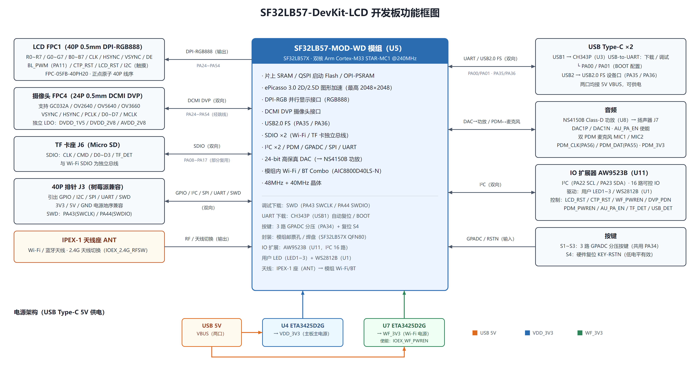 

<div align="center"> Development board block diagram </div>   <br> <br>  


## Component Introduction

The main board of the SF32LB57-DevKit-LCD development board is the core of the whole kit. It integrates the SF32LB57-MOD-WD module and provides DPI display, camera, audio, TF card, USB, and other interfaces.
   
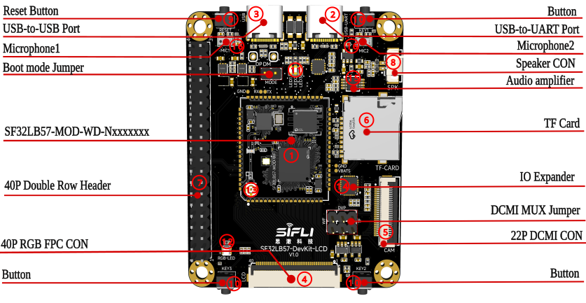 

<div align="center"> Front-side component annotations of the development board </div>   <br> <br>

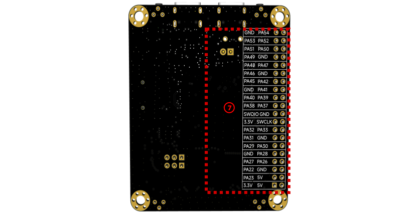 

<div align="center"> Back-side component annotations of the development board </div>   <br> <br>

```{table}
:width: 100%
:align: center
| No. | Component | Description |
|:----:|:-----|:-----|
| 1 | SF32LB57-MOD-WD module | Core processing module, integrating the SF32LB57X chip, Wi-Fi/BT, boot Flash, and crystals |
| 2 | USB Type-C debug port | CH343P USB-to-UART, used for firmware download and serial debugging |
| 3 | USB Type-C device port | SF32LB57 native USB2.0 FS (PA35/PA36) |
| 4 | LCD FPC connector FPC1 | 40P 0.5mm pitch, DPI-RGB888 display interface |
| 5 | Camera FPC connector FPC4 | 24P 0.5mm pitch, DCMI DVP camera interface |
| 6 | TF card slot J6 | Micro SD card slot, SDIO interface |
| 7 | 40P dual-row header J3 | Raspberry Pi-compatible expansion interface |
| 8 | Speaker connector J7 | MX1.25-2P, for connecting an external speaker |
| 9 | Reset key S4 | KEY-RSTN, active-low reset |
| 10 | GPADC keys S1~S3 | 3 resistor-divider keys, sharing PA34 |
| 11 | User LEDs LED1~LED3 | Red / green / blue LEDs, driven by AW9523B |
| 12 | WS2812B LED U1 | Addressable RGB LED, driven by PA11 |
| 13 | IPEX antenna connector | Wi-Fi / Bluetooth antenna interface |
| 14 | AW9523B IO expander U11 | I2C interface with 16-channel IO expansion |
| 15 | Audio PA U8 | NS4150B, drives the speaker |
| 16 | PDM microphones MIC1/MIC2 | Dual digital microphones |
```

## Application Development

This section mainly introduces how to set up the hardware and software, as well as how to develop applications and flash firmware.

### Required Hardware

- 1 x SF32LB57-DevKit-LCD development board
- 1 x DPI-RGB interface LCD module (40P 0.5mm FPC)
- 1 x USB2.0 data cable (standard Type-A to Type-C)
- 1 x PC (Windows, Linux, or macOS)

```{note}
  1. If you need both UART debugging and USB2.0 FS functionality, two USB2.0 data cables are required;
  2. Make sure to use a USB data cable that supports data transfer; some cables can only be used for charging and cannot be used for data transfer or firmware flashing;
  3. When using peripherals such as a camera, speaker, or microphone, make sure the connector orientation and wire sequence definitions match.
```

### Optional Hardware

- 1 x DCMI DVP camera module (GC032A / OV2640 / OV5640 / OV3660)
- 1 x TF card
- 1 x 8Ω speaker
- 1 x Wi-Fi / Bluetooth antenna (IPEX-1 interface)

### Hardware Setup

Prepare the development board and load the first sample application:

1. Connect the LCD module to the FPC1 connector, paying attention to the orientation of the FPC gold fingers and the position of pin 1;
2. If networking is required, install the IPEX-1 antenna onto the antenna connector;
3. Open SiFli's SifliTrace tool software and select the correct COM port;
4. Plug in the USB data cable to connect the PC to the board's **USB-to-UART** port;
5. After the screen is powered on, the default picture should be displayed, and you can interact with the touchscreen with your finger (if the LCD module has touch functionality).

After the hardware setup is complete, you can proceed with the software setup.

### Software Setup

For how to quickly set up the development environment, please refer to the software documentation. The typical process includes:

1. Install the Sifli SDK and the build toolchain;
2. Select the `SF32LB57-DevKit-LCD` board support package in the SDK;
3. Build the sample projects (such as `lvgl_demo`, `camera_demo`, `audio_player`, etc.);
4. Use the SifliTrace / Impeller tools to select the corresponding COM port and download the firmware;
5. If you need to use USB2.0 FS, confirm that the corresponding driver has been installed on the PC.

## Hardware Reference

This section provides more information about the development board hardware.

### Power Supply

The SF32LB57-DevKit-LCD development board supports USB Type-C power supply. Both USB Type-C ports on the board are connected to the 5V VBUS and can power the board, but their functions are divided as follows:

- **USB-to-UART port**: used for program download, serial debugging, and power supply;
- **USB2.0 FS port**: used for USB device function development and power supply.

For download and debugging, it is recommended to use the **USB-to-UART** port.

The power tree is shown in the figure below (illustrative):

```{table}
:width: 80%
:align: center
| Input | Power chip | Output | Load |
|:----:|:---------|:----:|:-----|
| 5V USB | U4 ETA3425D2G | VDD_3V3 3.3V | Main board main power supply, MCU, LCD, peripherals |
| 5V USB | U7 ETA3425D2G | WF_3V3 3.3V | Wi-Fi / Bluetooth Combo inside the module |
```

The enable of U7 is controlled by the IO expander signal **IOEX_WF_PWREN**, allowing the software to independently turn off the Wi-Fi power to reduce power consumption.

### SF32LB57-MOD-WD Module GPIO Assignment

The table below shows the main pin assignments routed from the module to the development board, used to control specific components or functions of the board.

```{table}
:width: 100%
:align: center
| Pin | Pin Name | Function |
|:----:|:---------|:-----|
| 1  | PA_41 | GPIO, connected to DPI_G6 on the board |
| 2  | PA_40 | GPIO, connected to DPI_G5 on the board |
| 3  | PA_39 | GPIO, connected to DPI_G4 on the board |
| 4  | PA_38 | GPIO, connected to DPI_G3 on the board |
| 5  | PA_37 | GPIO, connected to DPI_G2 on the board |
| 6  | PA_36 | GPIO, connected to USB_DM on the board |
| 7  | PA_35 | GPIO, connected to USB_DP on the board |
| 8  | PA_34 | GPIO, connected to GPADC keys on the board |
| 9  | PA_33 | GPIO, connected to DPI_G1 and DVP_D0 on the board |
| 10 | PA_32 | GPIO, connected to DPI_G0 and DVP_D4 on the board |
| 11 | PA_31 | GPIO, connected to DPI_R7 on the board |
| 12 | PA_30 | GPIO, connected to DPI_R6 on the board |
| 13 | PA_29 | GPIO, connected to DPI_R5 on the board |
| 14 | PA_28 | GPIO, connected to DPI_R4 on the board |
| 15 | PA_27 | GPIO, connected to DPI_R3 on the board |
| 16 | PA_26 | GPIO, connected to DPI_R2 and DVP_PCLK on the board  |
| 17 | PA_25 | GPIO, connected to DPI_R1 and DVP_D5 on the board  |
| 18 | PA_24 | GPIO, connected to DPI_R0 and DVP_D6 on the board  |
| 19 | GND   | Ground   |
| 20 | PA_23 | GPIO, I2C_SDA |
| 21 | PA_22 | GPIO, I2C_SCL |
| 22 | 3.3V  | 3.3V power input |
| 23 | VBATS | Battery voltage detection input |
| 24 | GND   | Ground   |
| 25 | PA_21 | GPIO, connected to the INT signal of the IO expander chip |
| 26 | PA_20 | GPIO, connected to the INT signal of the touchscreen |
| 27 | PA_19 | GPIO, default debug signal DBG_TX, connected to the RXD of CH343P on the board |
| 28 | PA_18 | GPIO, default debug signal DBG_RX, connected to the TXD of CH343P on the board |
| 29 | PA_17 | GPIO, internally connected to Flash in the module, NC on the development board |
| 30 | PA_16 | GPIO, internally connected to Flash in the module, NC on the development board |
| 31 | PA_15 | GPIO, internally connected to Flash in the module, NC on the development board |
| 32 | PA_14 | GPIO, internally connected to Flash in the module, NC on the development board |
| 33 | PA_13 | GPIO, internally connected to Flash in the module, NC on the development board |
| 34 | PA_12 | GPIO, internally connected to Flash in the module, NC on the development board |
| 35 | PA_11 | GPIO, connected to the backlight signal of the LCD |
| 36 | PA_10 | GPIO, selected via jumper, connected to the TF card slot SD_D0 or DVP_HSYNC on the board  |
| 37 | GND   | Ground   |
| 38 | DAC1N | Audio DAC differential output N |
| 39 | DAC1P | Audio DAC differential output P |
| 40 | GND   | Ground   |
| 41 | PA_55 | Audio ADC input P / PDM_DAT |
| 42 | PA_56 | Microphone bias power / PDM_CLK |
| 43 | GND   | Ground   |
| 44 | PA_09 | GPIO, selected via jumper, connected to the TF card slot SD_CMD or DVP_VSYNC on the board  |
| 45 | PA_08 | GPIO, connected to the TF card slot SD_CLK and RGB_LED on the board  |
| 46 | PA_07 | GPIO, connected to DVP_MCLK on the board |
| 47 | PA_06 | GPIO, connected to DVP_D7 on the board   |
| 48 | PA_00 | GPIO, internally connected to WiFi SD_D2 in the module; on the board, connected via jumper to DVP_HSYNC, and the BOOT signal is controlled by CH343P |
| 49 | PA_01 | GPIO, internally connected to WiFi SD_D3 in the module; on the board, connected via jumper to DVP_VSYNC |
| 50 | WF-UART-TXD  | WiFi debug UART TXD   |
| 51 | WF_UART-RXD  | WiFi debug UART RXD   |
| 52 | HST-WAK-WF   | Host Wake WiFi input |
| 53 | WF_3V3       | WiFi 3.3V power input  |
| 54 | GND   | Ground   |
| 55 | WF-PWRKEY    | WiFi power key input     |
| 56 | 2.4G-RFSW    | Switching control signal between the 57X 2.4G and WiFi 2.4G; when high, switches to the 57X 2.4G antenna, and when low, switches to the WiFi 2.4G antenna   |
| 57 | PA_54 | GPIO, connected to DPI_B5 on the board |
| 58 | PA_53 | GPIO, connected to DPI_B4 on the board |
| 59 | PA_52 | GPIO, connected to DPI_B3 on the board |
| 60 | PA_51 | GPIO, connected to DPI_VSYNC on the board |
| 61 | PA_50 | GPIO, connected to DPI_DE on the board    |
| 62 | PA_49 | GPIO, connected to DPI_HSYNC on the board |
| 63 | PA_48 | GPIO, connected to DPI_CLK on the board   |
| 64 | PA_47 | GPIO, connected to DPI_B7 on the board |
| 65 | PA_46 | GPIO, connected to DPI_B6 on the board |
| 66 | PA_45 | GPIO, connected to DPI_B2 and DVP_D2 on the board |
| 67 | PA_44 | GPIO, connected to DPI_B1 and DVP_D1 on the board |
| 68 | PA_43 | GPIO, connected to DPI_B0 and DVP_D3 on the board |
| 69 | PA_42 | GPIO, connected to DPI_G7 on the board |
| 70 | GND   | Ground   |
| 71 | ANT   | Antenna interface; the antenna is connected to the IPEX connector on the module by default, this pin is NC   |
| 72 | GND   | Ground   |

```

> Note: The specific module package (QFN80 / BGA112) determines whether PA45~PA57 are exposed; this development board uses a module part number with full RGB888 and DVP interfaces.

### 40P Header Interface Definition

J3 is a Raspberry Pi-compatible 40P 2.54mm dual-row header (S-2100S40P-S110), with signals defined as follows:

```{table}
:width: 100%
:align: center
| Pin | Pin Name | Function |
|:----:|:---------|:-----|
| 1 | 3V3 | 3.3V power |
| 2 | 5V | 5V power |
| 3 | IO2 / I2C_SDA | PA_23, I2C_SDA, DVP/CTP touch I2C |
| 4 | 5V | 5V power |
| 5 | IO3 / I2C_SCL | PA_22, I2C_SCL, DVP/CTP touch I2C |
| 6 | GND | Ground |
| 7 | IO4 | PA_27, DPI_R3 |
| 8 | IO14 | PA_26, DPI_R2 / DVP_PCLK |
| 9 | GND | Ground |
| 10 | IO15 | PA_28, DPI_R4 / GPADC_CH0 |
| 11 | IO17 | PA_29, DPI_R5 / GPADC_CH1 |
| 12 | IO18 | PA_30, DPI_R6 / GPADC_CH2 |
| 13 | IO27 | PA_31, DPI_R7 |
| 14 | GND | Ground |
| 15 | IO22 | PA_32, DPI_G0 / DVP_D4 |
| 16 | IO23 | PA_33, DPI_G1 / DVP_D0 / WKUP |
| 17 | 3V3 | 3.3V power |
| 18 | IO24 / SWCLK | PA_43, DPI_B0 / SWCLK / DVP_D3 |
| 19 | IO10 / SWDIO | PA_44, DPI_B1 / SWDIO / DVP_D1 |
| 20 | GND | Ground |
| 21 | IO9 | PA_38, DPI_G3 / SPI2_DI |
| 22 | IO25 | PA_37, DPI_G2 / SPI2_DIO |
| 23 | IO11 | PA_40, DPI_G5 / SPI2_CS |
| 24 | IO8 | PA_39, DPI_G4 / SPI2_CLK |
| 25 | GND | Ground |
| 26 | IO7 | PA_41, DPI_G6 |
| 27 | IO0 | PA_45, DPI_B2 / DVP_D2 |
| 28 | IO1 | PA_42, DPI_G7 |
| 29 | IO5 | PA_46, DPI_B6 |
| 30 | GND | Ground |
| 31 | IO6 | PA_48, DPI_CLK / SD2_CMD |
| 32 | IO12 | PA_47, DPI_B7 / SD2_CLK |
| 33 | IO13 | PA_49, DPI_HSYNC / SD2_DIO0 |
| 34 | GND | Ground |
| 35 | IO19 | PA_50, DPI_DE / SD2_DIO1 |
| 36 | IO16 | PA_51, DPI_VSYNC |
| 37 | IO26 | PA_52, DPI_B3 |
| 38 | IO20 | PA_53, DPI_B4 |
| 39 | GND | Ground |
| 40 | IO21 | PA_54, DPI_B5 |
```

> Note: Some signals on the 40P header are multiplexed with the LCD DPI, camera DVP, TF card SDIO, or Wi-Fi SDIO. When using them, please consult the `chip datasheet` and confirm the software Pinmux configuration to avoid bus conflicts.

### 40P DPI-RGB FPC Interface Definition

FPC1 is a 40P 0.5mm-pitch top-contact/bottom-contact FPC connector (FPC-05FB-40PH20), used to connect a DPI-RGB LCD module.

```{table}
:width: 100%
:align: center
| Pin | Pin Name | Function |
|:----:|:---------|:-----|
|1   | 5V       | 5V power output            |     
|2   | 5V       | 5V power output            |
|3   | R0       | PA_24, LCDC1_DPI_R0   |
|4   | R1       | PA_25, LCDC1_DPI_R1   |     
|5   | R2       | PA_26, LCDC1_DPI_R2   | 
|6   | R3       | PA_27, LCDC1_DPI_R3   | 
|7   | R4       | PA_28, LCDC1_DPI_R4   | 
|8   | R5       | PA_29, LCDC1_DPI_R5   | 
|9   | R6       | PA_30, LCDC1_DPI_R6   | 
|10  | R7       | PA_31, LCDC1_DPI_R7   | 
|11  | GND      | Ground                  |
|12  | G0       | PA_32, LCDC1_DPI_G0   |
|13  | G1       | PA_33, LCDC1_DPI_G1   |             
|14  | G2       | PA_37, LCDC1_DPI_G2   |      
|15  | G3       | PA_38, LCDC1_DPI_G3   |    
|16  | G4       | PA_39, LCDC1_DPI_G4   |              
|17  | G5       | PA_40, LCDC1_DPI_G5   |    
|18  | G6       | PA_41, LCDC1_DPI_G6   | 
|19  | G7       | PA_42, LCDC1_DPI_G7   | 
|20  | GND      | Ground                  |
|21  | B0       | PA_43, LCDC1_DPI_B0   |    
|22  | B1       | PA_44, LCDC1_DPI_B1   |    
|23  | B2       | PA_45, LCDC1_DPI_B2   |    
|24  | B3       | PA_52, LCDC1_DPI_B3   |    
|25  | B4       | PA_53, LCDC1_DPI_B4   |    
|26  | B5       | PA_54, LCDC1_DPI_B5   |    
|27  | B6       | PA_46, LCDC1_DPI_B6   |    
|28  | B7       | PA_47, LCDC1_DPI_B7   |    
|29  | GND      | Ground                  |
|30  | CLK      | PA_48, LCDC1_DPI_CLK    |    
|31  | HSYNC    | PA_49, LCDC1_DPI_HSYNC  |     
|32  | VSYNC    | PA_51, LCDC1_DPI_VSYNC  |     
|33  | DE       | PA_50, LCDC1_DPI_DE     |  
|34  | BL       | PA_11, BL_PWM         |  
|35  | CTP_RST  | IO expander chip P1_6      | 
|36  | CTP_SDA  | PA_23, I2C_SDA        |
|37  | NC       | -                     |
|38  | CTP_SCL  | PA_22, I2C_SCL        |
|39  | CTP_INT  | PA_20                 |
|40  | RESET    | IO expander chip P1_7      |

```

> Note:
>
> 1. Full RGB888 bit width requires a QFN80 / BGA112 package module; if lower bit-width modes such as RGB565 are used, some data lines can be freed as GPIOs or for other peripherals.
> 2. PA35/PA36 are multiplexed with the USB2.0 FS device port on FPC1; do not use the USB device port function at the same time when connecting an LCD.
> 3. The control-signal area of Pins 37~40 contains 5 signals in total: BL_PWM, CTP_RST, LCD_RST, I2C_SDA, and I2C_SCL, while FPC1 has only 4 remaining pins. The actual pin sequence is subject to `57x LCD-DevKit ioconfig-08192026.xlsx` and the latest schematic.


### 24P DCMI Camera FPC Interface Definition

FPC4 is a 24P 0.5mm-pitch FPC connector, used to connect DVP camera modules.

```{table}
:width: 100%
:align: center
| Pin | Pin Name | Function |
|:----:|:---------|:-----|
| 1 | NC | Floating |
| 2 | GND | Ground |
| 3 | I2C_SDA | Camera configuration I2C SDA |
| 4 | VDD_2V8 | Camera digital power 2.8V |
| 5 | I2C_SCL | Camera configuration I2C SCL |
| 6 | RESET | Camera reset (controlled by IOEX_DVP_PDN/RESET) |
| 7 | VSYNC | DVP frame sync |
| 8 | PWDN | Camera power-down control (IOEX_DVP_PDN) |
| 9 | HSYNC | DVP line sync |
| 10 | NC/DVDD | Floating / or camera core voltage; refer to the camera datasheet for the specific voltage. The development board defaults to 1.5V |
| 11 | DOVDD_2V8 | Camera IO power 2.8V |
| 12 | NC/D7  | NC for QSPI cameras; data bit 7 for DVP cameras |
| 13 | MCLK   | Camera master clock |
| 14 | NC/D6  | NC for QSPI cameras; data bit 6 for DVP cameras |
| 15 | GND    | Ground |
| 16 | NC/D5  | NC for QSPI cameras; data bit 5 for DVP cameras |
| 17 | PCLK   | DVP pixel clock |
| 18 | NC/D4  | NC for QSPI cameras; data bit 4 for DVP cameras |
| 19 | SD0/D0 | SD0 for QSPI cameras; data bit 0 for DVP cameras |
| 20 | SD3/D3 | SD3 for QSPI cameras; data bit 3 for DVP cameras |
| 21 | SD1/D1 | SD1 for QSPI cameras; data bit 1 for DVP cameras |
| 22 | SD2/D2 | SD2 for QSPI cameras; data bit 2 for DVP cameras |
| 23 | NC | Floating |
| 24 | NC | Floating |
```

> Note: The DCMI data lines occupy pins shared with Wi-Fi SDIO or TF card SDIO via jumpers; refer to the actual ioconfig and software configuration. In the default ioconfig, some DVP signals are multiplexed with Wi-Fi/TF and cannot be used simultaneously.

### Keys and LEDs

**Keys**

```{table}
:width: 80%
:align: center
| Designator | Name | Control Signal | Description |
|:----:|:-----|:---------|:-----|
| S4 | KEY-RSTN | KEY_RSTN | Hardware reset, active-low |
| S1 | KEY-1 | PA_34 (GPADC_CH6) | Resistor-divider key, generating about 2.97V when pressed |
| S2 | KEY-2 | PA_34 (GPADC_CH6) | Resistor-divider key, generating about 2.58V when pressed |
| S3 | KEY-3 | PA_34 (GPADC_CH6) | Resistor-divider key, generating about 2.19V when pressed |
```

**LEDs**

```{table}
:width: 80%
:align: center
| Designator | Name | Control Signal | Color |
|:----:|:-----|:---------|:-----|
| LED1 | IOEX_LED_R | AW9523B P1_1 | Red |
| LED2 | IOEX_LED_G | AW9523B P1_2 | Green |
| LED3 | IOEX_LED_B | AW9523B P1_3 | Blue |
| U1 | WS2812B | PA_08 | Addressable RGB |
```
```{note}
On the SF32LB57-DevKit-LCD-V1.0 development board, WS2812B is connected to PA_11; on SF32LB57-DevKit-LCD-V1.1 it is changed to PA_08.
```

### IO Expander AW9523B Default States

U11 (AW9523BTOR) communicates with the SF32LB57 via I2C (PA_22 SCL / PA_23 SDA) and expands 16 controllable IOs. The default states of each port are as follows:

```{table}
:width: 100%
:align: center
| Port | Signal Name | Default State | Direction | Purpose |
|:----:|:-------|:--------:|:----:|:-----|
| P1_0 | IOEX_2.4G_RFSW | 3.3V | Output | 2.4G antenna switching |
| P1_1 | IOEX_LED_R | 3.3V | Output | Red LED |
| P1_2 | IOEX_LED_G | 3.3V | Output | Green LED |
| P1_3 | IOEX_LED_B | 3.3V | Output | Blue LED |
| P1_4 | IOEX_WF_PWRKEY | 0V | Output | Wi-Fi module power key |
| P1_5 | IOEX_WF_PWREN | 0V | Output | Wi-Fi 3.3V Buck enable |
| P1_6 | IOEX_CTP_RST | 0V | Output | Touchscreen reset |
| P1_7 | IOEX_LCD_RESET | 0V | Output | LCD reset |
| P0_0 | IOEX_USB_DET | Hi-Z | Input | USB insertion detection |
| P0_1 | IOEX_TF_DET | Hi-Z | Input | TF card insertion detection |
| P0_4 | IOEX_PDM_PWREN | 0V | Output | PDM microphone power enable |
| P0_5 | IOEX_AU_PA_EN | 0V | Output | Audio PA enable |
| P0_6 | IOEX_DVP_PDN | 0V | Output | Camera power-down control |
| P0_7 | IOEX_HST_WAK_WF | 0V | Output | Host wakes up Wi-Fi |
```

### Debug Interface

The development board supports two debugging/download methods:

1. **USB-to-UART download (recommended)**
   - Use the USB-to-UART Type-C port to connect to the PC;
   - Configure BOOT MODE to enter download mode;
   - Use the SifliTrace / Impeller tools to download firmware.
2. **SWD debugging**
   - SWDIO: PA_44
   - SWCLK: PA_43
   - An external debugger such as J-Link / DAP-Link can be connected;
   - Connect the debugger VCC to the board's 3.3V and share GND.

## Flashing Test Firmware

### Flashing Test Firmware via Impeller

Connect the USB cable through the USB-to-UART port, open the SiFli Technologies program download tool, and select the corresponding COM port and program.

1. **Download mode**
   - Plug in the BOOT MODE jumper cap (J1) and power on; the board enters download mode at startup, and program download can be completed.
2. **Software development mode**
   - Remove the BOOT MODE jumper cap and power on; the board enters run mode at startup and outputs logs via the serial port, facilitating software debugging.

**For details, please refer to**: [Firmware flashing tool Impeller](https://wiki.sifli.com/tools/%E7%83%A7%E5%BD%95%E5%B7%A5%E5%85%B7.html)

### JLink SWD Tool Download and Debugging
 
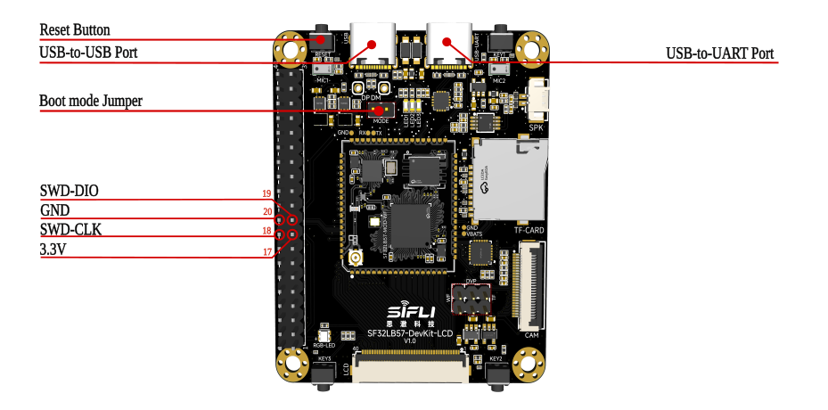 

<div align="center"> Development board JLink debugging wiring diagram </div>   <br> <br>
   
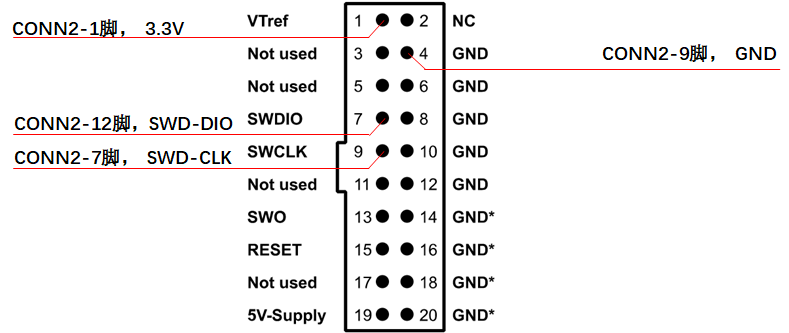 

<div align="center"> JLink debugger wiring diagram </div>   <br> <br>

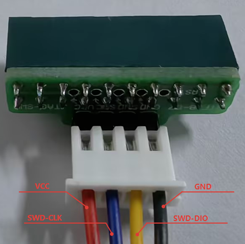 

<div align="center"> SWD debugger wiring diagram </div>   <br> <br>

For convenient connection, one end of a DuPont wire can be connected to the JLink debugger and the other end to the corresponding pins in the board's 40P header: SWDIO (PA_44), SWCLK (PA_43), where VCC is the 3.3V pin and GND can be connected to any GND.

### LCD Display Interface

- Interface type: 40P 0.5mm-pitch FPC connector (FPC1)
- Default support for RGB888; RGB565 / RGB666 configurable by software
- Supported resolution and refresh rate depend on the specific LCD module specifications; ePicasso 3.0 hardware acceleration supports up to 2048×2048
- Backlight control: PA_11 / BL_PWM

### DPI-RGB Parallel Display Interface

**Flat cable for pushing RGB888 data. Choose the top-contact (0.5A) FPC connector type for panels with top-contact seats, and the bottom-contact (0.5B) type for panels with bottom-contact seats:**
- [Generic 40p-0.5mm](https://item.szlcsc.com/3056935.html?fromZone=s_s__%2522C2856837%2522&spm=sc.gbn.xh1.zy.n___sc.it.hd.ss&lcsc_vid=QAcLUgJQQlQLU1RQEQQKBVEAFAIIU1NQQ1ZZAgJVFVYxVlNTR1FZVFZTTlRfUTsOAxUeFF5JWBIBSRccGwIdBEoFGAxB)

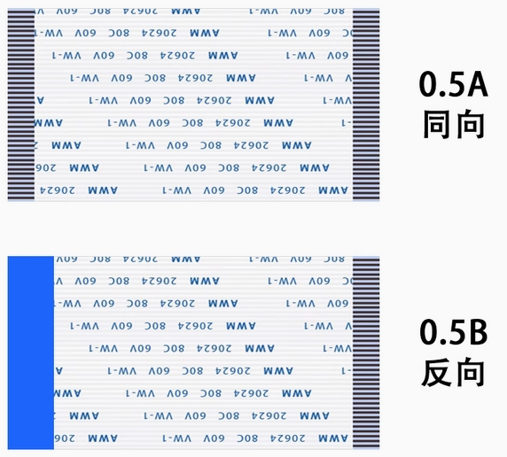 

<div align="center"> RGB888 direct-connection FPC flat cable </div>   <br> <br>

**Flat cable for pushing RGB565 data (in this case, the DVP interface can be used at the same time):**
- [Dedicated 40p-0.5mm](https://downloads.sifli.com/hardware/files/documentation/ProPrj_FPC_57_40p_to_RGB565%E8%BD%AF%E6%8E%92%E7%BA%BF_2026-11-09.epro2)

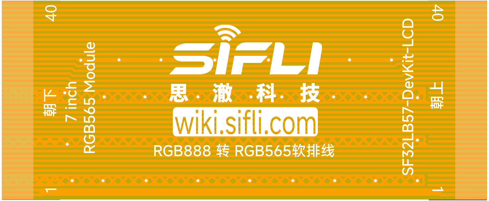 

<div align="center"> RGB565 adapter FPC flat cable </div>   <br> <br>

**Connecting a 7-inch RGB interface panel**

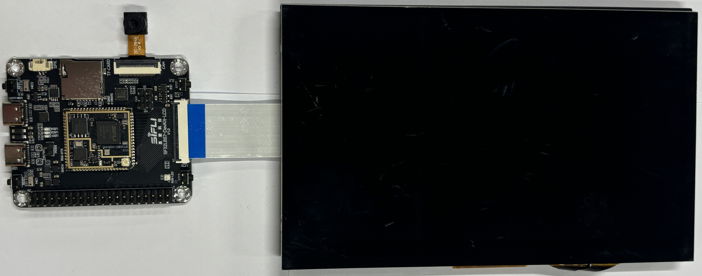 

<div align="center"> Wiring diagram of the 7-inch RGB display </div>   <br> <br>

```{note}
The RGB interface pin sequence of the SiFli Technologies SF32LB5xx-DevKit-LCD development boards is compatible with the ALIENTEK 40p pin sequence. For panels with other pin sequences, please refer to the [SiFli Development Board LCM Adapter Board Making Guide](../sf32lb52x/SF-DevKit-LCM-Adapter.md) to make an adapter board or FPC flat cable adapter by yourself.
```

### QSPI Display Interface

**Flat cable for connecting the SFLCM_1p85 Huangshan Pi panel:**
- [Dedicated 40p-0.5mm](https://downloads.sifli.com/hardware/files/documentation/ProPrj_FPC_57_40p_to_SFLCM1p85%E8%BD%AF%E6%8E%92%E7%BA%BF_2026-11-09.epro2)

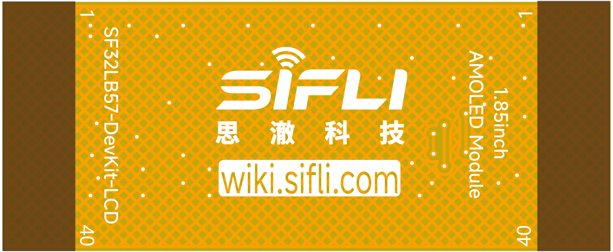 

<div align="center"> FPC flat cable for the SFLCM1p85 QSPI interface panel </div>   <br> <br>

**Connecting the SFLCM1p85 QSPI interface panel**

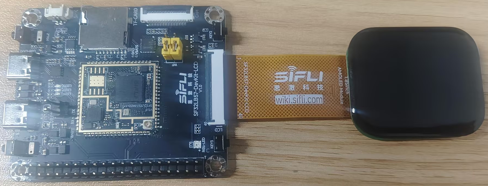 

<div align="center"> Wiring diagram of the 1.85-inch QSPI display </div>   <br> <br>

**For details, please refer to:** [Screen debugging tool](https://wiki.sifli.com/tools/%E5%B1%8F%E5%B9%95%E6%A8%A1%E7%BB%84%E8%B0%83%E8%AF%95.html)

### Camera Interface

The SF32LB57-DevKit-LCD supports the **DCMI DVP camera interface**:

- Interface type: 24P 0.5mm-pitch FPC connector (FPC4)
- Supported common modules: GC032A, OV2640, OV5640, OV3660; OV2640 and OV5640 are supported by default. For other modules, please refer to the schematic annotations to modify the corresponding power supply
- Note: DVP data lines are multiplexed with some Wi-Fi SDIO / TF SDIO signals via jumpers. When using the camera, please confirm the corresponding Case configuration in the ioconfig

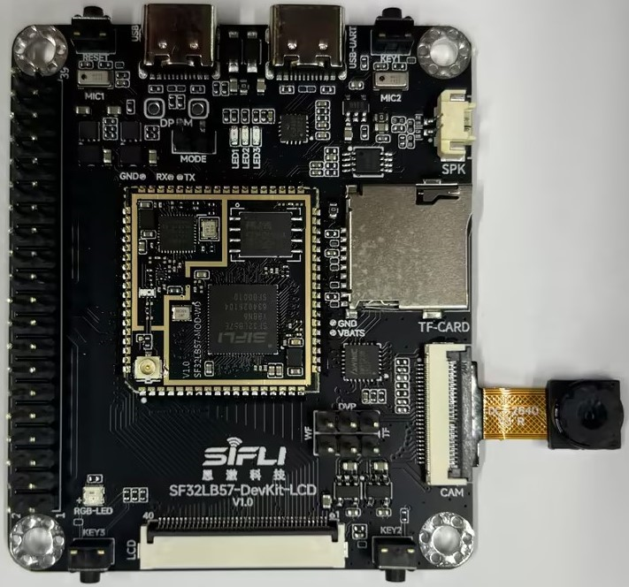 

<div align="center"> Camera wiring diagram </div>   <br> <br>

### Audio Interface

The audio part of the SF32LB57-DevKit-LCD includes:

- **DAC output**: The SF32LB57 has a built-in 24-bit high-fidelity DAC, which drives an external speaker through the U8 (NS4150B) Class-D amplifier;
- **Speaker connector J7**: MX1.25-2P, connected to an 8Ω speaker by default;
- **PDM microphones**: Dual digital microphones, powered under the control of IOEX_PDM_PWREN, with data and clock signals on PA_55 (PDM_DAT) and PA_56 (PDM_CLK) respectively.

## Obtaining Samples

Retail samples and small batches can be purchased directly on Taobao; batch customers can send an email to <sales@sifli.com> or contact customer service on Taobao for sales contact information. Contributing to the open-source project entitles you to free samples. You can join QQ group 674699679 for discussion.

## Related Documents

- [SF32LB57x Chip Datasheet](https://wiki.sifli.com/docs/product-index.html)
- [SF32LB57x User Manual](https://wiki.sifli.com/docs/product-index.html)
- [SF32LB57x Hardware Design Guide](https://wiki.sifli.com/hardware/SF32LB57x-HW-Application.html)
- [SF32LB57x Chip Introduction](https://wiki.sifli.com/docs/product-index.html)
- [SF32LB57-MOD-WD Core Board Hardware Materials](https://downloads.sifli.com/hardware/files/documentation/SF32LB57-MOD-WD-HW-Docs.zip)
- [SF32LB57-DevKit-LCD Development Board Hardware Materials](https://downloads.sifli.com/hardware/files/documentation/SF32LB57-DevKit-LCD-HW-Docs.zip)
