# SF32LB57x Hardware Design Guide

This document provides technical guidance for hardware design based on the SF32LB57x series chips, focusing on core hardware design specifications and key pitfalls to avoid, effectively reducing development effort and accelerating time to market.

## 1. Chip Overview

The SF32LB57x is an ultra-low-power AIoT-specific highly integrated high-performance MCU. It adopts an Arm Cortex-M33 STAR-MC1 dual-core + small-core architecture, and integrates a 2D/2.5D graphics engine, an AI neural network accelerator, dual-mode Bluetooth 6.3, and audio codecs. It is suitable for wrist-worn wearables, portable smart terminals, smart home products, and more.

Processor peripheral resources are as follows:

- Up to 58 GPIOs + 6 GPOs or MPI interface IOs
- 3x UART
- 4x I2C
- 2x GPTIM (4CH)
- 2x LPTIM
- 2x ATIM (3-channel differential or 4-channel single-ended)
- 1x PWM (5CH)
- 4x RTC clock outputs
- 4x low-frequency clock outputs in sleep state (16KHz Max)
- 2x SPI
- 2x I2S audio interfaces
- 1x PTM (16CH)
- 2x SDIO
- 3x MPI memory interfaces
- 2x PDM audio interfaces
- 2x CAN
- 1x USB2.0 FS
- 1x GPADC (12CH)
- 1x differential analog audio output
- 2x differential analog audio inputs
- 1x LCDC (24bit DPI, 16bit 8080, QSPI, 16bit EPD, serial JDI and parallel JDI)
- 1x DCMI (16bit DVP and 4-data QSPI)
- 10x hardware wake-up sources
- Supports DBG-UART and SWD debugging
- Supports DBG-UART, SWD, UART and USB downloads

### 1.1. Chip Part Numbering

<!-- Please refer to the chip datasheet.-->


<br> <br>

```{note}
The SF32LB57x series chips include two types: lithium battery powered and 3.3V conventional powered. \
570/3/5/6/7/8/9 are the lithium battery powered versions, hereinafter referred to as the `battery-powered series`. \
57Z/C/E/F/G/H/J are the 3.3V conventional powered versions, hereinafter referred to as the `3.3V-powered series`.
```

### 1.2. Package Dimensions


<div align="center"> Table 1-2-1 Package Information Table </div>

```{table}
:align: center
:class: color-header-table

|Package Name|Dimensions|Chip Thickness|Pin Pitch|
|--|--|--|--|
|QFN68L | 7x7 mm     | 0.9 mm  | 0.35 mm |
|QFN68L | 7x7 mm     | 1.1 mm  | 0.35 mm |
|QFN80L | 8x8 mm     | 0.9 mm  | 0.35 mm |
|QFN80L | 8x8 mm     | 1.1 mm  | 0.35 mm |
|BGA112 | 5.4x4.4 mm | 0.98 mm | 0.4 mm  |
|BGA112 | 5.4x4.4 mm | 1.03 mm | 0.4 mm  |
```

```{note}
For the specific package form of the chip, refer to the description in the Ordering Information section of the datasheet.
```
### 1.3. Pinout


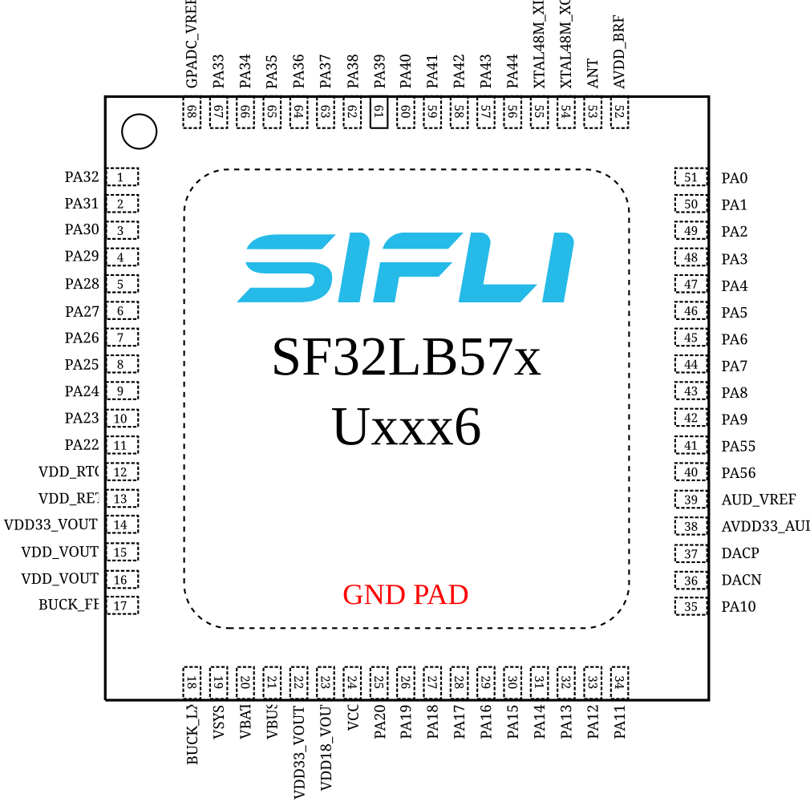

<div align="center"> Figure 1-3-1 QFN68L battery-powered series pinout </div>  <br> <br>

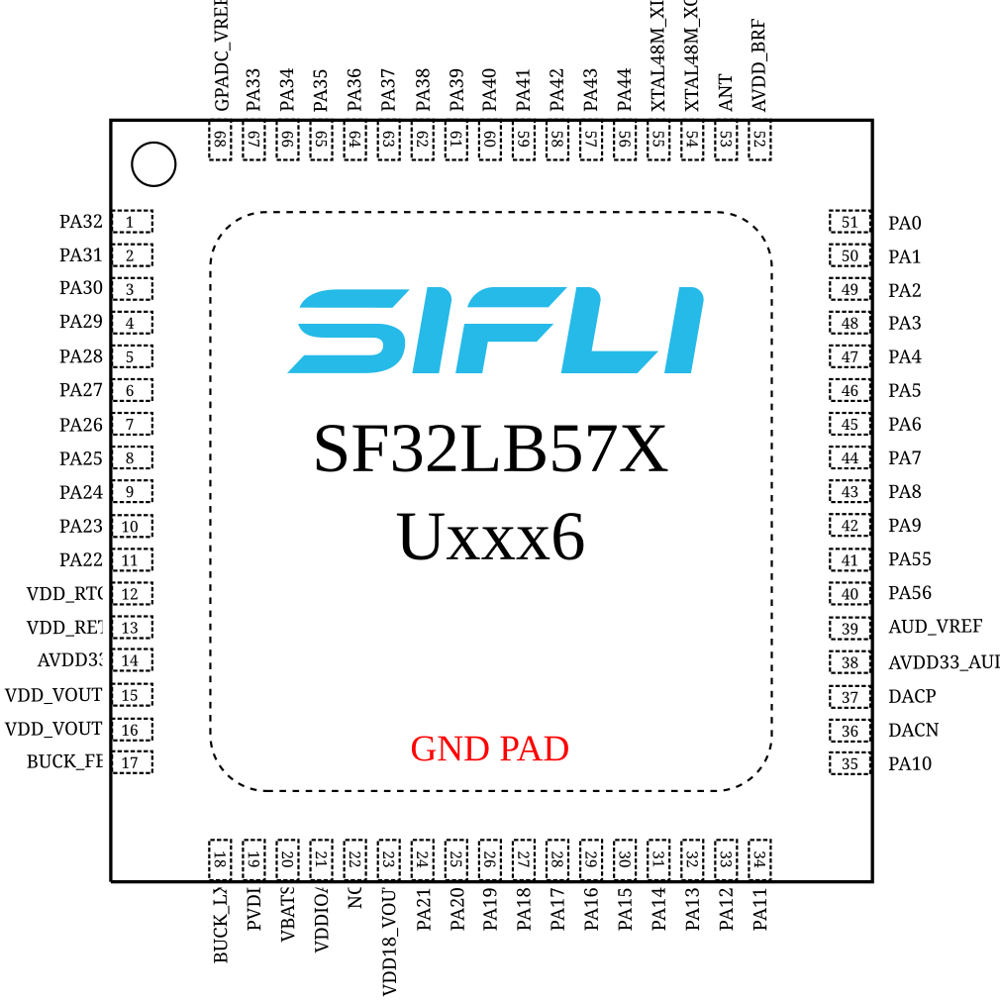

<div align="center"> Figure 1-3-2 QFN68L 3.3V-powered series pinout </div>  <br> <br>


<div align="center"> Figure 1-3-3 QFN80L battery-powered series pinout </div>  <br> <br>


<div align="center"> Figure 1-3-4 QFN80L 3.3V-powered series pinout </div>  <br> <br>

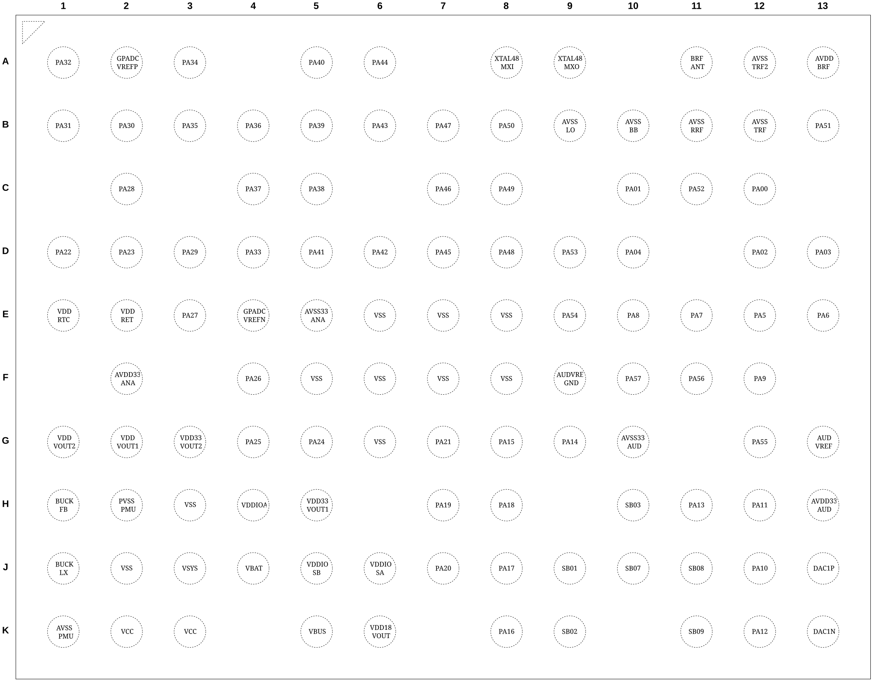

<div align="center"> Figure 1-3-5 BGA112 battery-powered series pinout </div>  <br> <br>

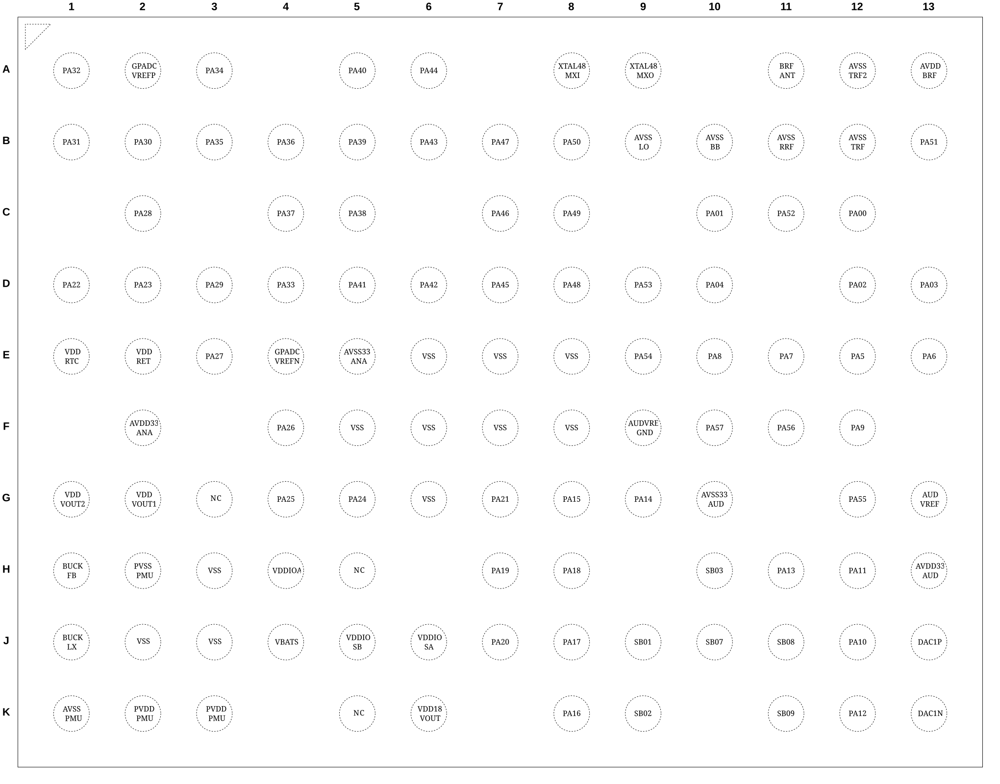

<div align="center"> Figure 1-3-6 BGA112 3.3V-powered series pinout </div>  <br> <br>

```{note}
For the POD dimension drawings of the chip, refer to the relevant sections of the datasheet.
```

## 2. Schematic Design Guidance

### 2.1. Power Supply

#### 2.1.1. QFN68L Package Chip Power Supply Requirements

<div align="center"> Table 2-1-1 QFN68L battery-powered series power supply requirements </div>

```{table}
:align: center
:class: color-header-table

|Power Pin| Min Voltage(V) | Typical Voltage(V) | Max Voltage(V) | Max Current(mA) |   Description |
|:--|:--|:--|:--|:--|:----------------------------------------------------|
|VBUS       |4.5    |5.0    |5.5    |400    |VBUS power input, the power input port of the internal charging module
|VBAT       |3.0    |-      |4.7    |400    |VBAT power output, connected to the battery; an internal ADC is also used to check the battery voltage
|VSYS       |-      |3.3    |-      |150    |3.0V power output, with an external capacitor to ground<span style="color:red;">$^{[1]}$</span>
|BUCK_LX    |-      |3.3    |-      |50     |Buck inductor switch, connected to one end of the inductor
|BUCK_FB    |-      |1.25   |-      |50     |Buck output, connected to the other end of the inductor with a capacitor to ground
|VDD_VOUT1  |-      |1.1    |-      |50     |Internal LDO with an external capacitor, internal power supply, not for peripherals
|VDD_VOUT2  |-      |0.9    |-      |20     |Internal LDO with an external capacitor, internal power supply, not for peripherals
|VDD_RET    |-      |0.9    |-      |1      |Internal LDO with an external capacitor, internal power supply, not for peripherals
|VDD_RTC    |-      |1.1    |-      |1      |Internal LDO with an external capacitor, internal power supply, not for peripherals
|VCC        |3.0    |-      |4.7    |200    |System power input, connected to the battery<span style="color:red;">$^{[2]}$</span>
|VDD18_VOUT |-      |1.8    |-      |30     |1.8V LDO output, internal power supply, connected with a capacitor to ground, not for peripherals
|VDD33_VOUT1|-      |3.3    |-      |150    |3.3V LDO output 1, connected with a capacitor to ground, 150mA load capability, enabled and output by default<span style="color:red;">$^{[3]}$</span>
|VDD33_VOUT2|-      |3.3    |-      |150    |3.3V LDO output 2, no output by default; 3.3V output only after software configuration<span style="color:red;">$^{[4]}$</span>
|GPADC_VREF |-      |-      |-      |-      |GPADC VREF input, connected with a capacitor to ground, no external power supply required
|AVDD_BRF   |2.97   |3.3    |3.63   |100    |RF power input, connected to VSYS
|AUD_VREF   |-      |-      |-      |-      |Audio reference voltage input, connected with a capacitor to ground, no external power supply required
|AVDD33_AUD |2.97   |3.3    |3.63   |50     |Audio power input, connected to VDD33_VOUT1
|MIC_BIAS   |1.4    |-      |2.8    |2      |MIC power output, connected to the MIC power supply
```

```{note}
<span style="color:red;">[1]</span> : VSYS power, supplies AVDD_BRF. \
<span style="color:red;">[2]</span> : VCC power input, powered by a lithium battery, power-on voltage 3.5V±10%, default software-configured low-voltage threshold = 3.48V; when powered by a constant-voltage power supply, the supply range is 3.6~4.7V, 3.8V is recommended. \
<span style="color:red;">[3]</span> : The LDO of VDD33_VOUT1 has an internal soft-start current-limiting function. When enabling the LDO, the load current must not exceed 30mA, otherwise the LDO will fail to start. When the LDO is fully enabled, it has a 150mA load capability, supplying the external Flash and AVDD33_AUD. \
<span style="color:red;">[4]</span> : The LDO of VDD33_VOUT2 has an internal soft-start current-limiting function. When enabling the LDO, the load current must not exceed 30mA, otherwise the LDO will fail to start. When the LDO is fully enabled, it has a 150mA load capability, supplying the motor or LCD panel.
```


<div align="center"> Table 2-1-2 QFN68L 3.3V-powered series power supply requirements </div>

```{table}
:align: center
:class: color-header-table

|Power Pin| Min Voltage(V) | Typical Voltage(V) | Max Voltage(V) | Max Current(mA) |   Description |
|:--|:--|:--|:--|:--|:----------------------------------------------------|
|VDDIOA     |1.62   |1.8/3.3|3.63   |100    |GPIO power input, connected to a 1.8V or 3.3V power supply
|VBATS      |0      |-      |4.7    |1      |Battery voltage detection input; an internal ADC is used to check the battery voltage
|PVDD       |2.97   |3.3    |3.63   |200    |PMU power input, connected to a 3.3V power supply
|BUCK_LX    |-      |3.3    |-      |50     |Buck inductor switch, connected to one end of the inductor
|BUCK_FB    |-      |1.25   |-      |50     |Buck output, connected to the other end of the inductor with a capacitor to ground
|VDD_VOUT1  |-      |1.1    |-      |50     |Internal LDO with an external capacitor, internal power supply, not for peripherals
|VDD_VOUT2  |-      |0.9    |-      |20     |Internal LDO with an external capacitor, internal power supply, not for peripherals
|VDD_RET    |-      |0.9    |-      |1      |Internal LDO with an external capacitor, internal power supply, not for peripherals
|VDD_RTC    |-      |1.1    |-      |1      |Internal LDO with an external capacitor, internal power supply, not for peripherals
|AVDD33     |2.97   |3.3    |3.63   |20     |Analog power input, connected to a 3.3V power supply
|VDD18_VOUT |-      |1.8    |-      |30     |1.8V LDO output, internal power supply, connected with a capacitor to ground, not for peripherals
|GPADC_VREF |-      |-      |-      |-      |GPADC VREF input, connected with a capacitor to ground, no external power supply required
|AVDD_BRF   |2.97   |3.3    |3.63   |100    |RF power input, connected to a 3.3V power supply
|AUD_VREF   |-      |-      |-      |-      |Audio reference voltage input, connected with a capacitor to ground, no external power supply required
|AVDD33_AUD |2.97   |3.3    |3.63   |50     |Audio power input, connected to a 3.3V power supply
|MIC_BIAS   |1.4    |-      |2.8    |2      |MIC power output, connected to the MIC power supply
```

```{note}
When VDDIOA is connected to 1.8V, the read/write speed of the internal Flash must be lower than 80MHz; when VDDIOA is connected to 3.3V, the read/write speed of the internal Flash can be configured to the default 104MHz.
PVDD, AVDD33, AVDD_BRF and AVDD33_AUD are all connected to a 3.3V power supply. For PCB routing, a star topology should be adopted, with each pin routed individually from the power source.
```

#### 2.1.2. QFN80L Package Chip Power Supply Requirements

<div align="center"> Table 2-1-3 QFN80L battery-powered series power supply requirements </div>

```{table}
:align: center
:class: color-header-table

|Power Pin| Min Voltage(V) | Typical Voltage(V) | Max Voltage(V) | Max Current(mA) |   Description |
|:--|:--|:--|:--|:--|:----------------------------------------------------|
|VDDIOA     |1.62   |1.8/3.3|3.63   |100    |GPIO power input, connected to a 1.8V or 3.3V power supply
|VBATS      |0      |-      |4.7    |1      |Battery voltage detection input; an internal ADC is used to check the battery voltage
|VSYS       |-      |3.3    |-      |150    |3.0V power output, with an external capacitor to ground<span style="color:red;">$^{[1]}$</span>
|BUCK_LX    |-      |3.3    |-      |50     |Buck inductor switch, connected to one end of the inductor
|BUCK_FB    |-      |1.25   |-      |50     |Buck output, connected to the other end of the inductor with a capacitor to ground
|VDD_VOUT1  |-      |1.1    |-      |50     |Internal LDO with an external capacitor, internal power supply, not for peripherals
|VDD_VOUT2  |-      |0.9    |-      |20     |Internal LDO with an external capacitor, internal power supply, not for peripherals
|VDD_RET    |-      |0.9    |-      |1      |Internal LDO with an external capacitor, internal power supply, not for peripherals
|VDD_RTC    |-      |1.1    |-      |1      |Internal LDO with an external capacitor, internal power supply, not for peripherals
|AVDD33     |2.97   |3.3    |3.63   |20     |Analog power input, connected to a 3.3V power supply
|VCC        |3.0    |-      |4.7    |200    |System power input, connected to the battery<span style="color:red;">$^{[2]}$</span>
|VDD18_VOUT |-      |1.8    |-      |30     |1.8V LDO output, internal power supply, connected with a capacitor to ground, not for peripherals
|VDD33_VOUT1|-      |3.3    |-      |150    |3.3V LDO output 1, connected with a capacitor to ground, 150mA load capability, enabled and output by default<span style="color:red;">$^{[3]}$</span>
|GPADC_VREF |-      |-      |-      |-      |GPADC VREF input, connected with a capacitor to ground, no external power supply required
|AVDD_BRF   |2.97   |3.3    |3.63   |100    |RF power input, connected to VSYS
|AUD_VREF   |-      |-      |-      |-      |Audio reference voltage input, connected with a capacitor to ground, no external power supply required
|AVDD33_AUD |2.97   |3.3    |3.63   |50     |Audio power input, connected to VDD33_VOUT1
|MIC_BIAS   |1.4    |-      |2.8    |2      |MIC power output, connected to the MIC power supply
```

```{note}
<span style="color:red;">[1]</span> : VSYS power, supplies AVDD_BRF. \
<span style="color:red;">[2]</span> : VCC power input, powered by a lithium battery, power-on voltage 3.5V±10%, default software-configured low-voltage threshold = 3.48V; when powered by a constant-voltage power supply, the supply range is 3.6~4.7V, 3.8V is recommended. \
<span style="color:red;">[3]</span> : The LDO of VDD33_VOUT1 has an internal soft-start current-limiting function. When enabling the LDO, the load current must not exceed 30mA, otherwise the LDO will fail to start. When the LDO is fully enabled, it has a 150mA load capability, supplying the external Flash and AVDD33_AUD. This LDO also supplies the Flash stacked in MPI2 or MPI3; refer to the chip part number description for details.
```


<div align="center"> Table 2-1-4 QFN80L 3.3V-powered series power supply requirements </div>

```{table}
:align: center
:class: color-header-table

|Power Pin| Min Voltage(V) | Typical Voltage(V) | Max Voltage(V) | Max Current(mA) |   Description |
|:--|:--|:--|:--|:--|:----------------------------------------------------|
|VDDIOA     |1.62   |3.3    |3.63   |100    |GPIO power input, connected to a 1.8V or 3.3V power supply
|VBATS      |0      |-      |4.7    |1      |Battery voltage detection input; an internal ADC is used to check the battery voltage
|BUCK_LX    |-      |3.3    |-      |50     |Buck inductor switch, connected to one end of the inductor
|BUCK_FB    |-      |1.25   |-      |50     |Buck output, connected to the other end of the inductor with a capacitor to ground
|VDD_VOUT1  |-      |1.1    |-      |50     |Internal LDO with an external capacitor, internal power supply, not for peripherals
|VDD_VOUT2  |-      |0.9    |-      |20     |Internal LDO with an external capacitor, internal power supply, not for peripherals
|VDD_RET    |-      |0.9    |-      |1      |Internal LDO with an external capacitor, internal power supply, not for peripherals
|VDD_RTC    |-      |1.1    |-      |1      |Internal LDO with an external capacitor, internal power supply, not for peripherals
|AVDD33     |2.97   |3.3    |3.63   |20     |Analog power input, connected to a 3.3V power supply
|PVDD       |2.97   |3.3    |3.63   |200    |PMU power input, connected to a 3.3V power supply<span style="color:red;">$^{[1]}$</span>
|VDD18_VOUT |-      |1.8    |-      |30     |1.8V LDO output, internal power supply, connected with a capacitor to ground, not for peripherals
|VDDIOSB    |-      |1.8/3.3|-      |30     |SIP SB IO power input; the voltage varies with the chip part number. For specific requirements, refer to the note<span style="color:red;">$^{[2]}$</span>
|GPADC_VREF |-      |-      |-      |-      |GPADC VREF input, connected with a capacitor to ground, no external power supply required
|AVDD_BRF   |2.97   |3.3    |3.63   |100    |RF power input, connected to a 3.3V power supply
|AUD_VREF   |-      |-      |-      |-      |Audio reference voltage input, connected with a capacitor to ground, no external power supply required
|AVDD33_AUD |2.97   |3.3    |3.63   |50     |Audio power input, connected to a 3.3V power supply
|MIC_BIAS   |1.4    |-      |2.8    |2      |MIC power output, connected to the MIC power supply
```

```{note}
<span style="color:red;">[1]</span> : PVDD, AVDD33, AVDD_BRF, AVDD33_AUD and VDDIOA are all connected to a 3.3V power supply. For PCB routing, a star topology should be adopted, with each pin routed individually from the power source. \
<span style="color:red;">[2]</span> : Refer to the chip part number description: for MPI2 and MPI3 part numbers with stacked PSRAM, VDDIOSB is connected to the 1.8V VDD18_VOUT power supply; for those with stacked NOR Flash, this pin is supplied with an external 3.3V power supply.
```

#### 2.1.3. BGA112 Package Chip Power Supply Requirements

<div align="center"> Table 2-1-5 BGA112 battery-powered series power supply requirements </div>

```{table}
:align: center
:class: color-header-table

|Power Pin| Min Voltage(V) | Typical Voltage(V) | Max Voltage(V) | Max Current(mA) |   Description |
|:--|:--|:---|:--|:--|:----------------------------------------------------|
|VBUS        |4.5    |5.0    |5.5    |400    |VBUS power input, the power input port of the internal charging module
|VBAT        |3.0    |-      |4.7    |400    |VBAT power output, connected to the battery; an internal ADC is also used to check the battery voltage
|VSYS        |-      |3.3    |-      |150    |3.0V power output, with an external capacitor to ground<span style="color:red;">$^{[1]}$</span>
|BUCK_LX     |-      |3.3    |-      |50     |Buck inductor switch, connected to one end of the inductor
|BUCK_FB     |-      |1.25   |-      |50     |Buck output, connected to the other end of the inductor with a capacitor to ground
|VDD_VOUT1   |-      |1.1    |-      |50     |Internal LDO with an external capacitor, internal power supply, not for peripherals
|VDD_VOUT2   |-      |0.9    |-      |20     |Internal LDO with an external capacitor, internal power supply, not for peripherals
|VDD_RET     |-      |0.9    |-      |1      |Internal LDO with an external capacitor, internal power supply, not for peripherals
|VDD_RTC     |-      |1.1    |-      |1      |Internal LDO with an external capacitor, internal power supply, not for peripherals
|VCC         |3.0    |-      |4.7    |200    |System power input, connected to the battery<span style="color:red;">$^{[2]}$</span>
|VDD18_VOUT  |-      |1.8    |-      |30     |1.8V LDO output, internal power supply, connected with a capacitor to ground, not for peripherals
|VDD33_VOUT1 |-      |3.3    |-      |150    |3.3V LDO output 1, connected with a capacitor to ground, 150mA load capability, enabled and output by default<span style="color:red;">$^{[3]}$</span>
|VDD33_VOUT2 |-      |3.3    |-      |150    |3.3V LDO output 2, no output by default; 3.3V output only after software configuration<span style="color:red;">$^{[4]}$</span>
|PVSS_PMU    |-      |-      |-      |-      |PMU power ground
|AVSS_PMU    |-      |-      |-      |-      |PMU analog power ground
|VDDIOA      |1.62   |1.8/3.3|3.63   |100    |GPIO power input, connected to a 1.8V or 3.3V power supply
|VDDIOSA     |-      |1.8    |-      |30     |SIP SA IO power input, connected to the VDD18_VOUT power supply
|VDDIOSB     |-      |1.8/3.3|-      |30     |SIP SB IO power input; the voltage varies with the chip part number. For specific requirements, refer to the note<span style="color:red;">$^{[5]}$</span>
|AVDD33_ANA  |2.97   |3.3    |3.63   |20     |Analog power input, connected to a 3.3V power supply
|AVSS33_ANA  |-      |-      |-      |-      |Analog ground
|GPADC_VREFP |-      |-      |-      |-      |GPADC VREF input, connected with a capacitor to ground, no external power supply required
|GPADC_VREFN |-      |-      |-      |-      |GPADC VREF input, connected to ground
|AVDD_BRF    |2.97   |3.3    |3.63   |100    |RF power input, connected to VSYS
|AVSS_BB、AVSS_LO、AVSS_RRF、AVSS_TRF and AVSS_TRF2 |-      |-      |-      |-      |RF ground
|AUD_VREF    |-      |-      |-      |-      |Audio reference voltage input, connected with a capacitor to ground, no external power supply required
|AUD_VREF_GND|-      |-      |-      |-      |Audio ground
|AVDD33_AUD  |2.97   |3.3    |3.63   |50     |Audio power input, connected to VDD33_VOUT1
|AVSS33_AUD  |-      |-      |-      |-      |Audio ground
|MIC_BIAS    |1.4    |-      |2.8    |2      |MIC power output, connected to the MIC power supply
```

```{note}
<span style="color:red;">[1]</span> : VSYS power, supplies AVDD_BRF. \
<span style="color:red;">[2]</span> : VCC power input, powered by a lithium battery, power-on voltage 3.5V±10%, default software-configured low-voltage threshold = 3.48V; when powered by a constant-voltage power supply, the supply range is 3.6~4.7V, 3.8V is recommended. \
<span style="color:red;">[3]</span> : The LDO of VDD33_VOUT1 has an internal soft-start current-limiting function. When enabling the LDO, the load current must not exceed 30mA, otherwise the LDO will fail to start. When the LDO is fully enabled, it has a 150mA load capability, supplying the external Flash and AVDD33_AUD. \
<span style="color:red;">[4]</span> : The LDO of VDD33_VOUT2 has an internal soft-start current-limiting function. When enabling the LDO, the load current must not exceed 30mA, otherwise the LDO will fail to start. When the LDO is fully enabled, it has a 150mA load capability, supplying the motor or LCD panel. \
<span style="color:red;">[5]</span> : Refer to the chip part number description: for MPI2 and MPI3 part numbers with stacked PSRAM, VDDIOSB is connected to the 1.8V VDD18_VOUT power supply; for those with stacked NOR Flash, this pin is connected to the 3.3V VDD33_VOUT1 power supply.
```

<div align="center"> Table 2-1-6 BGA112 3.3V-powered series power supply requirements </div>

```{table}
:align: center
:class: color-header-table

|Power Pin| Min Voltage(V) | Typical Voltage(V) | Max Voltage(V) | Max Current(mA) |   Description |
|:--|:--|:---|:--|:--|:----------------------------------------------------|
|VBATS       |0      |-      |4.7    |1      |Battery voltage detection input; an internal ADC is used to check the battery voltage
|BUCK_LX     |-      |3.3    |-      |50     |Buck inductor switch, connected to one end of the inductor
|BUCK_FB     |-      |1.25   |-      |50     |Buck output, connected to the other end of the inductor with a capacitor to ground
|VDD_VOUT1   |-      |1.1    |-      |50     |Internal LDO with an external capacitor, internal power supply, not for peripherals
|VDD_VOUT2   |-      |0.9    |-      |20     |Internal LDO with an external capacitor, internal power supply, not for peripherals
|VDD_RET     |-      |0.9    |-      |1      |Internal LDO with an external capacitor, internal power supply, not for peripherals
|VDD_RTC     |-      |1.1    |-      |1      |Internal LDO with an external capacitor, internal power supply, not for peripherals
|PVDD_PMU    |2.97   |3.3    |3.63   |200    |PMU power input, connected to a 3.3V power supply<span style="color:red;">$^{[1]}$</span>
|VDD18_VOUT  |-      |1.8    |-      |30     |1.8V LDO output, internal power supply, connected with a capacitor to ground, not for peripherals
|PVSS_PMU    |-      |-      |-      |-      |PMU power ground
|AVSS_PMU    |-      |-      |-      |-      |PMU analog power ground
|VDDIOA      |1.62   |1.8/3.3|3.63   |100    |GPIO power input, connected to a 1.8V or 3.3V power supply
|VDDIOSA     |-      |1.8    |-      |30     |SIP SA IO power input, connected to the VDD18_VOUT power supply
|VDDIOSB     |-      |1.8/3.3|-      |30     |SIP SB IO power input; the voltage varies with the chip part number. For specific requirements, refer to the note<span style="color:red;">$^{[2]}$</span>
|AVDD33_ANA  |2.97   |3.3    |3.63   |20     |Analog power input, connected to a 3.3V power supply
|AVSS33_ANA  |-      |-      |-      |-      |Analog ground
|GPADC_VREFP |-      |-      |-      |-      |GPADC VREF input, connected with a capacitor to ground, no external power supply required
|GPADC_VREFN |-      |-      |-      |-      |GPADC VREF input, connected to ground
|AVDD_BRF    |2.97   |3.3    |3.63   |100    |RF power input, connected to a 3.3V power supply
|AVSS_BB、AVSS_LO、AVSS_RRF、AVSS_TRF and AVSS_TRF2 |-      |-      |-      |-      |RF ground
|AUD_VREF    |-      |-      |-      |-      |Audio reference voltage input, connected with a capacitor to ground, no external power supply required
|AUD_VREF_GND|-      |-      |-      |-      |Audio ground
|AVDD33_AUD  |2.97   |3.3    |3.63   |50     |Audio power input, connected to a 3.3V power supply
|AVSS33_AUD  |-      |-      |-      |-      |Audio ground
|MIC_BIAS    |1.4    |-      |2.8    |2      |MIC power output, connected to the MIC power supply
```

```{note}
<span style="color:red;">[1]</span> : PVDD, AVDD33, AVDD_BRF, AVDD33_AUD and VDDIOA are all connected to a 3.3V power supply. For PCB routing, a star topology should be adopted, with each pin routed individually from the power source. \
<span style="color:red;">[2]</span> : Refer to the chip part number description: for MPI2 and MPI3 part numbers with stacked PSRAM, VDDIOSB is connected to the 1.8V VDD18_VOUT power supply; for those with stacked NOR Flash, this pin is supplied with an external 3.3V power supply.
```

#### 2.1.4. Power-On Sequence

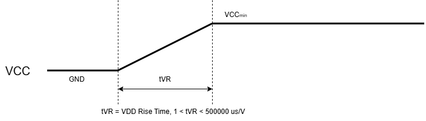

<div align="center"> Figure 2-1-4-1 Power-on sequence diagram of the battery-powered chip </div>   <br>  <br>

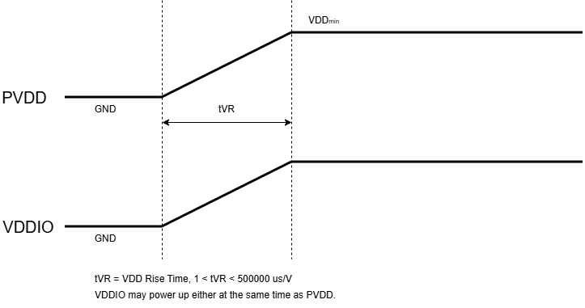

<div align="center"> Figure 2-1-4-2 Power-on sequence diagram of the 3.3V-powered chip </div>   <br>  <br>

#### 2.1.5. BUCK Inductor Selection Requirements

**Key Parameters of the Power Inductor**
```{important}
L (inductance) = 4.7uH ± 20%, DCR (DC resistance) ≦ 0.4 ohm, Isat (saturation current) ≧ 450mA.
```

#### 2.1.6. Battery and Charging Control

The charging circuit is divided into two application schemes: an external charging management IC scheme and a chip-internal charging management module scheme.

##### 2.1.6.1. External Charging Management IC

External charging management ICs are divided into two types: without Power Path Management (PPM) and with Power Path Management (PPM):

1. Without PPM scheme (typical circuit see `Figure 2-1-6-1-1`): the battery directly supplies power to the VBAT and VCC pins of the SF32LB57x;
2. With PPM scheme (typical circuit see `Figure 2-1-6-1-2`): the VSYS pin of the charging IC supplies power to the VCC pin of the SF32LB57x, and the VBAT pin of the charging IC is connected to both the battery and the VBAT pin of the SF32LB57x.

Both schemes rely on the VBAT pin to detect the battery voltage. This pin has a built-in GPADC channel with a voltage sampling accuracy of ±30mV.

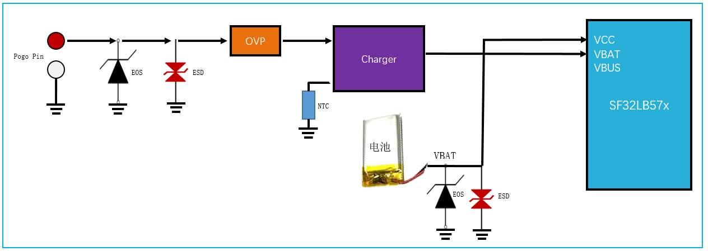

<div align="center"> Figure 2-1-6-1-1 Schematic of the external charging IC circuit without PPM function </div>   <br>  <br>

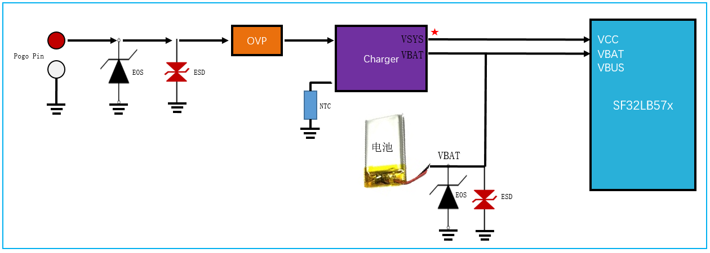

<div align="center"> Figure 2-1-6-1-2 Schematic of the external charging IC circuit with PPM function </div>   <br>  <br>

##### 2.1.6.2. Chip-Internal Charging Management Module

When using the charging management module built into the SF32LB57x chip (typical circuit see `Figure 2-1-6-2-1`), if the device is powered off due to battery depletion, after connecting the charger, the battery must be charged up to the power-on voltage before the system can power on normally and display the charging screen.

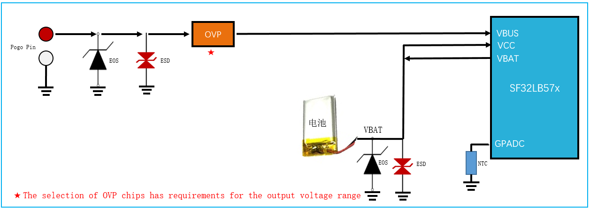

<div align="center"> Figure 2-1-6-2-1 Schematic of the integrated charging management circuit </div>   <br>  <br>

##### 2.1.6.3. OVP IC Selection When Using the Chip-Internal Charging Management Module

The VBUS pin input voltage range of the SF32LB57x is 4.5V~5.5V, so only the following two types of OVP protection ICs can be selected:

- OVP ICs with adjustable OVLO, reference part numbers: AW32905FCR
- OVP ICs with integrated regulated output, reference part numbers: SGM4064YDE8G, LP5305AQVF

`Figure 2-1-6-3-1` shows the typical application circuit of an OVP IC with adjustable OVLO. The output voltage VIN_OVLO of the OVP IC must be set within the range of 5.2V～5.5V. The error introduced by the chip itself and the voltage divider resistors must be taken into account in the parameter calculation. The calculation formula is as follows:


<div align="center">

$\Large V_{\mathrm{IN\_OVLO}} = \frac{R_1+R_2}{R_2} V_{\mathrm{OVLO\_TH}}$

</div>


**Requirement: the error of VOVLO_TH must be ≦ 3%, and the resistance errors of R1 and R2 must be ≦ 1%**

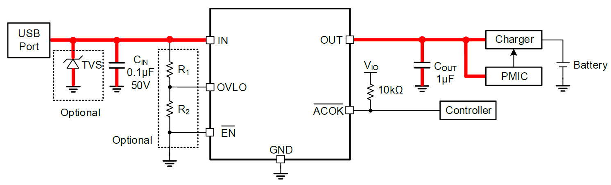

<div align="center"> Figure 2-1-6-3-1 Application circuit of an OVP IC with adjustable OVLO </div>   <br>  <br>

`Figure 2-1-6-3-2` shows the typical application circuit of an OVP IC with regulated output. The regulated output voltage of this type of OVP IC must be lower than 5.5V to supply power to the VBUS pin of the SF32LB57x.

**Requirement: the LDO output voltage of the OVP IC must be within 4.5V ~ 5.4V**

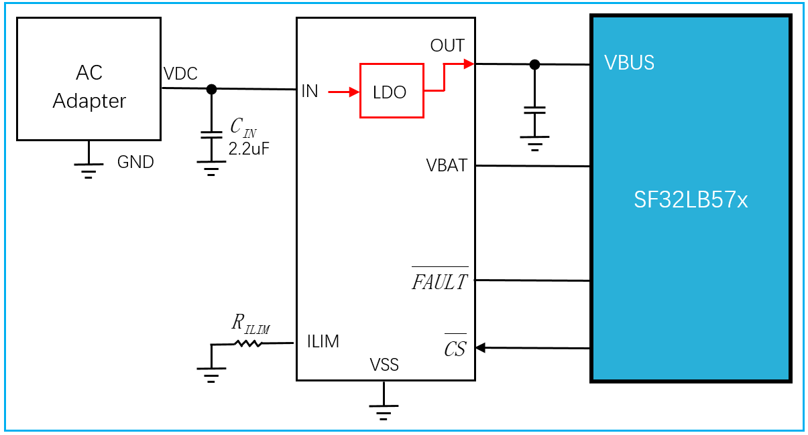

<div align="center"> Figure 2-1-6-3-2 Application circuit of an OVP IC with Regulator output </div>   <br>  <br>


#### 2.1.7. How to Reduce Standby Power Consumption

To meet the long battery life design requirements of wearable devices, it is recommended that the hardware use load switches to implement dynamic power management of each functional module; for modules or signal paths that are always on, components with low quiescent current specifications should be preferentially selected to reduce power consumption.

As shown in `Figure 2-1-7-1`, in the typical system power architecture of the SF32LB57x, the recommended power distribution scheme is as follows: VDD33_VOUT2 is used for motor power supply, VDD33_VOUT1 supplies external Flash, sensors and other peripherals, and the LCD panel must be powered by a separate external LDO.

Hardware design key points:

- Properly configure the default level of the power switch control GPIO, combined with megaohm-level pull-up/pull-down resistors, to ensure that the load switch is off by default at power-on;
- When selecting LDOs and load switches, components with excellent quiescent current Iq and shutdown current Istb parameters should be preferentially chosen; for always-on power ICs, the quiescent current Iq specification must be carefully checked.

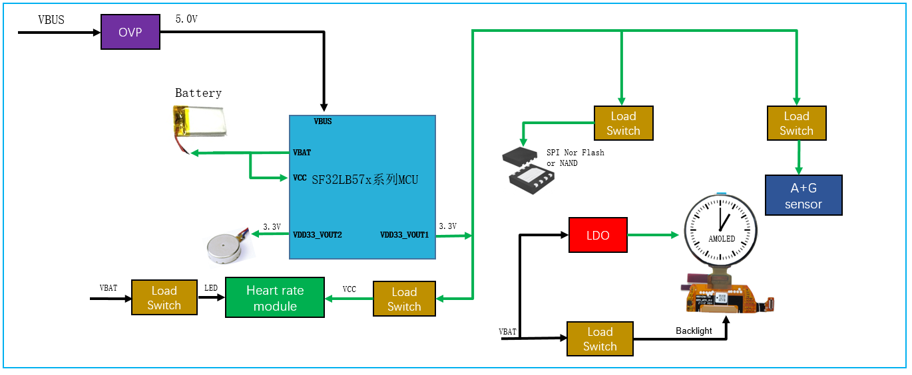

<div align="center"> Figure 2-1-7-1 SF32LB57x battery-powered system power architecture diagram </div>   <br>  <br>

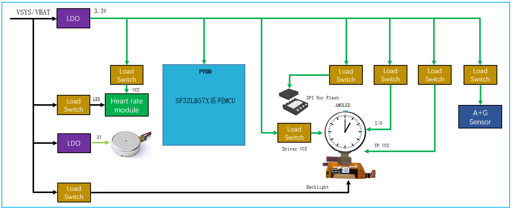

<div align="center"> Figure 2-1-7-2 SF32LB57x 3.3V-powered system power architecture diagram </div>   <br>  <br>

### 2.2. Processor Working Modes and Wake-up Sources

<div align="center"> Table 2-2-1 CPU Mode Table </div>

```{table}
:align: center
:class: color-header-table

|Working Mode|CPU |Peripherals  |SRAM |IO   |LPTIM |Wake-up Source |Wake-up Time |
|:--|:-------|:----|:----|:----|:---- |:---- |:----   |
|Active    |Run   |Run   |Accessible           |Can toggle   |Run   |- |- |
|Sleep     |Stop  |Run   |Accessible           |Can toggle   |Run   |Any interrupt                       |<0.5us |
|DeepSleep |Stop  |Stop  |Not accessible, fully retained |Level retained |Run   |RTC, wake-up IO, GPIO, LPTIM, Bluetooth |250us  |
|Standby   |Reset |Reset |Not accessible, fully retained |Level retained |Run   |RTC, wake-up IO, LPTIM, Bluetooth       |1ms    |
|Hibernate |Reset |Reset |Not accessible, not retained |High-impedance     |Reset |RTC, wake-up IO                    |>2ms   |
```

As shown in `Table 2-2-2`, the whole chip series supports 10 interrupt wake-up sources available in Standby and Hibernate modes.

<div align="center">Table 2-2-2 Interrupt wake up source Table </div>

```{table}
:align: center
:class: color-header-table

|Interrupt Source|Pin   |Description  |
|:--|:-------|:--------|
|WKUP_PIN0 |PA33 |Interrupt signal 0 |
|WKUP_PIN1 |PA34 |Interrupt signal 1 |
|WKUP_PIN2 |PA35 |Interrupt signal 2 |
|WKUP_PIN3 |PA36 |Interrupt signal 3 |
|WKUP_PIN4 |PA37 |Interrupt signal 4 |
|WKUP_PIN5 |PA38 |Interrupt signal 5 |
|WKUP_PIN6 |PA39 |Interrupt signal 6 |
|WKUP_PIN7 |PA40 |Interrupt signal 7 |
|WKUP_PIN8 |PA41 |Interrupt signal 8 |
|WKUP_PIN9 |PA42 |Interrupt signal 9 |
```

### 2.3. Clock

#### 2.3.1 Crystals
The chip requires two external clock sources: a 48MHz main crystal and a 32.768KHz RTC crystal. The specific specification requirements and selection of the crystals are as follows:

<div align="center"> Table 2-3-1-1 Crystal Specification Requirements </div>

```{table}
:align: center
:class: color-header-table

|Crystal|Specification Requirements   |Description  |
|:--|:-------|:--------|
|48MHz |7pF≦CL≦12pF (recommended value 8.8pF) △F/F0≦±10ppm ESR≦30 ohms (recommended value 22ohms)|Crystal power consumption is related to CL and ESR; the smaller the CL and ESR, the lower the power consumption. For the best power performance, it is recommended to select components with relatively small CL and ESR values within the required ranges. Reserve parallel matching capacitors next to the crystal; when CL<12pF, no capacitors need to be soldered|
|32.768KHz |CL=7pF or 11.5pF (chip default is 11.5pF; 7pF requires modifying the register configuration) △F/F0≦±20ppm ESR≦80k ohms (recommended value 38Kohms)|Crystal power consumption is related to CL and ESR; the smaller the CL and ESR, the lower the power consumption. For the best power performance, it is recommended to select components with relatively small CL and ESR values within the required ranges. Reserve parallel matching capacitors next to the crystal; for 7pF and 11.5pF crystals, no capacitors need to be soldered; for crystals with other specifications, the required matching capacitor values must be tested by yourself|
```

<div align="center"> Table 2-3-1-2 Recommended Crystal List </div>

```{table}
:align: center
:class: color-header-table

|Part Number                 |Manufacturer    |Parameters                                                                                                             |
| ------------------- | ------ | --------------------------------------------------------------------------------------------------------------- |
|E1SB48E001G00E       |Hosonic |F0 = 48.000000MHz，△F/F0 = -6 ~ 8 ppm，CL = 8.8 pF，ESR = 22 ohms Max TOPR = -30 ~ 85℃，Package = (2016 metric)  |
|ETST00327000LE       |Hosonic |F0 = 32.768KHz，△F/F0 = -20 ~ 20 ppm，CL = 7 pF，ESR = 70K ohms Max TOPR = -40 ~ 85℃，Package = (3215 metric)    |
|SX20Y048000B31T-8.8  |TKD     |F0 = 48.000000MHz，△F/F0 = -10 ~ 10 ppm，CL = 8.8 pF，ESR = 40 ohms Max TOPR = -20 ~ 75℃，Package = (2016 metric)|
|SF32K32768D71T01     |TKD     |F0 = 32.768KHz，△F/F0 = -20 ~ 20 ppm，CL = 7 pF，ESR = 70K ohms Max TOPR = -40 ~ 85℃，Package = (3215 metric)    |
|SF32WK32768D71T005   |TKD     |F0 = 32.768KHz，△F/F0 = -20 ~ 20 ppm，CL = 7 pF，ESR = 70K ohms Max TOPR = -40 ~ 85℃，Package = (3215 metric)    |
|CN4048M000885C822000 |JWT     |F0 = 48.000000MHz，△F/F0 = -8 ~ 8 ppm，CL = 8.8 pF，ESR = 22 ohms Max TOPR = -30 ~ 85℃，Package = (2016 metric)  |
|DH2032K76807T2719002 |JWT     |F0 = 32.768KHz，△F/F0 = -20 ~ 20 ppm，CL = 7 pF，ESR = 70K ohms Max TOPR = -40 ~ 85℃，Package = (3215 metric)    |
```

```{note}
- The ESR of SX20Y048000B31T-8.8 is slightly larger, so the static power consumption will also be slightly higher. \
- For PCB routing, remove at least the GND copper of the second layer beneath the crystal to reduce the parasitic load capacitance on the clock signal.
- Register settings corresponding to the CL of the 32.768KHz crystal:
    - 7pF:   PMUC->LXT_CR->CAP_SEL = 0;
    - 11.5pF PMUC->LXT_CR->CAP_SEL = 1;
```

For detailed component certification information, please refer to:
[SIFLI-MCU-AVL Certification List](index)

#### 2.3.2 Low-Power Clock Output

In Sleep, DeepSleep, Standby and Hibernate modes, the PA24 ~ PA27 pins can output RC10K or 32.768KHz clock signals.

In Sleep, DeepSleep and Standby modes, the PA24 ~ PA27 pins can output a PWM clock set by the LPTIM2 timer, with a maximum frequency of 16KHz.


### 2.4. Memory
#### 2.4.1. Memory Connection Interface Description

The chip supports four types of storage media: external SPI Nor Flash, SPI NAND Flash, SD NAND Flash and eMMC.

As shown in `Table 2-4-1-1`, only the MPI3 interface on pins PA12 ~ PA17 supports SPI Nor Flash and SPI NAND Flash memories.

<div align="center"> Table 2-4-1-1 SPI Nor/Nand Flash Signal Connections </div>

```{table}
:align: center
:class: color-header-table

| Flash Signal | I/O Signal | Description                                    |
| ---------- | ------- | ------------------------------------------- |
| CS#        | PA12    | Chip select, active low.                    |
| SO         | PA13    | Data Input (Data Input Output 1)            |
| WP#        | PA14    | Write Protect Output (Data Input Output  2) |
| SI         | PA15    | Data Output (Data Input Output 0)           |
| SCLK       | PA16    | Serial Clock Output                         |
| Hold#      | PA17    | Data Output (Data Input Output 3)           |
```

Any SDIO interface can be connected to SD Nand Flash and eMMC storage. Pins P12 ~ PA17 are recommended by default, as shown in `Table 2-4-1-2`.

<div align="center"> Table 2-4-1-2 SD Nand Flash and eMMC Signal Connections </div>

```{table}
:align: center
:class: color-header-table

| Flash Signal | I/O Signal | Description |
| ---------- | ------- | -------- |
| SD2_CMD    | PA15    | Command signal |
| SD2_D1     | PA17    | Data 1    |
| SD2_D0     | PA16    | Data 0    |
| SD2_CLK    | PA14    | Clock signal |
| SD2_D2     | PA12    | Data 2    |
| SD2_D3     | PA13    | Data 3    |
```

```{note}
The eMMC chip has two power domains, VCC and VCCQ. Method 1: both power supplies can be controlled together, resulting in low shutdown power consumption, but the eMMC recovers slowly from sleep and the average CPU power consumption is high. Method 2: VCC can be controlled separately while VCCQ is always powered, resulting in higher shutdown power consumption than Method 1, but the eMMC recovers faster from sleep and the average CPU power consumption is lower than Method 1.
```

#### 2.4.2. Boot Settings

The chip can boot from the following media: internal stacked SPI Nor Flash, external SPI Nor Flash, external SPI Nand Flash and external SD Nand Flash. Details are as follows:
- For chip part numbers with internal stacked SPI Nor Flash, boot from the internal stacked Flash by default;
- For chip part numbers without internal stacked SPI Nor Flash, boot can only be achieved via external storage media.

<!-- The images here need to be modified, A3 and B3 need different versions -->

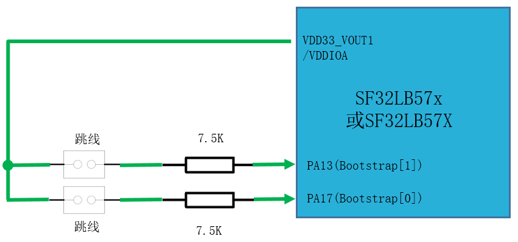

<div align="center"> Figure 2-4-2-1 Recommended Bootstrap pin circuit diagram </div>   <br>  <br>


<div align="center"> Table 2-4-2-1 Boot Option Settings </div>

```{table}
:align: center
:class: color-header-table

|Bootstrap[1] (PA13) |Bootstrap[0] (PA17)    |Boot From ext memory  |
| ------------ | ------------ | -------------- |
| L            | L            | SPI Nor Flash  |
| L            | H            | SPI Nand Flash |
| H            | L            | SD Nand Flash  |
| H            | H            | eMMC           |
```

#### 2.4.3. Power Control of the Boot Storage Media

The chip supports power switch control of the boot storage media, which can effectively reduce the device shutdown power consumption. The enable pin of the power switch is fixed to PA21, with a control level logic of high level for on and low level for off.

```{important}
- Battery-powered series chips: when the external boot media is `NOR FLASH`, the storage media power is supplied by `VDD33_VOUT1`; when the external boot media is `SPI NAND FLASH`, a power switch circuit must be added after `VDD33_VOUT1` for power supply.
- Battery-powered series chips: when the external boot media is `SD NAND FLASH` or `eMMC`, the storage media power is supplied by an external `LDO`; the LDO enable pin is recommended to be controlled by `PA21`; for package part numbers without a `PA21` pin, a pin with a default pull-up can be selected as the control pin.
- 3.3V-powered series chips: the external boot storage media is uniformly powered by an external `LDO`, and the LDO enable pin is recommended to be controlled by `PA21`.
- In the reference design, pull-up resistor positions are reserved for both the `PA13` and `PA17` pins. Suitable resistors can be selected according to the actual type of storage media used; the recommended value is `7.5kΩ`.
```


### 2.5. RF

RF traces should be designed with a `50Ω` characteristic impedance. If the antenna has already been impedance-matched, no additional matching components are needed on the RF lines. To accommodate spurious filtering and antenna tuning/matching requirements, it is recommended to reserve a π-type matching network during the design process.

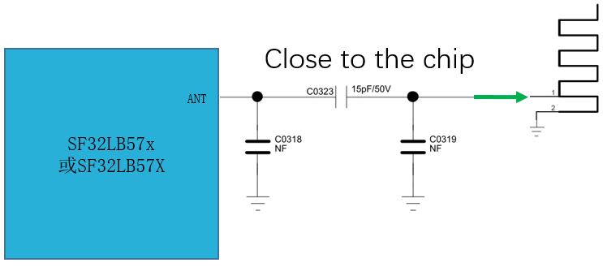

<div align="center"> Figure 2-5-1 RF circuit diagram </div>   <br>  <br>


### 2.6. GPIO

The chip can complete GPIO function configuration through the IO MUX table or the Matrix table:
- The IO MUX is the dedicated configuration path for GPIO peripherals, supporting function multiplexing numbers 0~15;
- The Matrix table enables arbitrary interconnection of matrix input and output pins, supporting flexible signal pin assignment;
- Function multiplexing numbers 16~175 are all configured through the Matrix table path, involving peripherals including I2C, SPI, UART, CAN, PTA/BT, general-purpose timers, low-power timers, advanced timers, PWM, I2S, PTM, LCD controller, PDM, DCMI;
- For detailed configuration of the IO MUX and the GPIO pin switch matrix, refer to the IO MUX and Matrix table sections in the chip datasheet and user manual.

For detailed pin multiplexing configuration information, see `Table 2-6-1`, `Table 2-6-2` and `Table 2-6-3`.

<div align="center"> Table 2-6-1 IO MUX Table </div>

```{table}
:align: center
:class: color-header-table

| PAD  | PUPD | Function 0       | Function 1       | Function 2  | Function 3 | Function 4 | Function 5    | Function 6     | Function 15 | Function 16 ~ 255  |
| ---- | ---- | ------------     | ---------------- | ----------- | ---------- | ---------- | ------------- | -------------- | ----------- | ------------------ |
| PA00 | PD   | **GPIO_A0**      | LCDC1_SPI_RSTB   |             | SD2_DIO2   |            |               |                |             | Matrix Index Table |
| PA01 | PD   | **GPIO_A1**      |                  |             | SD2_DIO3   |            |               |                |             | Matrix Index Table |
| PA02 | PD   | **GPIO_A2**      | LCDC1_SPI_TE     |             | SD2_CLK    |            |               |                |             | Matrix Index Table |
| PA03 | PU   | **GPIO_A3**      | LCDC1_SPI_CS     |             | SD2_CMD    |            |               |                |             | Matrix Index Table |
| PA04 | PD   | **GPIO_A4**      | LCDC1_SPI_CLK    |             | SD2_DIO0   |            |               |                |             | Matrix Index Table |
| PA05 | PD   | **GPIO_A5**      | LCDC1_SPI_DIO0   |             | SD2_DIO1   |            |               |                |             | Matrix Index Table |
| PA06 | PD   | **GPIO_A6**      | LCDC1_SPI_DIO1   | SD1_DIO2    |            |            |               |                |             | Matrix Index Table |
| PA07 | PD   | **GPIO_A7**      | LCDC1_SPI_DIO2   | SD1_DIO3    |            |            |               |                |             | Matrix Index Table |
| PA08 | PD   | **GPIO_A8**      | LCDC1_SPI_DIO3   | SD1_CLK     |            |            |               |                |             | Matrix Index Table |
| PA09 | PD   | **GPIO_A9**      |                  | SD1_CMD     |            |            |               |                | #ADC1N      | Matrix Index Table |
| PA10 | PD   | **GPIO_A10**     |                  | SD1_DIO0    |            |            |               |                | #ADC2P      | Matrix Index Table |
| PA11 | PU   | **GPIO_A11**     | MPI3_CS2         | SD1_DIO1    |            |            |               |                | #ADC2N      | Matrix Index Table |
| PA12 | PU   | **GPIO_A12**     | MPI3_CS          | SD1_DIO2    |            |            |               |                |             | Matrix Index Table |
| PA13 | PD   | **GPIO_A13**     | MPI3_DIO1        | SD1_DIO3    |            |            |               |                |             | Matrix Index Table |
| PA14 | PD   | **GPIO_A14**     | MPI3_DIO2        | SD1_CLK     |            |            |               |                |             | Matrix Index Table |
| PA15 | PD   | **GPIO_A15**     | MPI3_DIO0        | SD1_CMD     |            |            |               |                |             | Matrix Index Table |
| PA16 | PD   | **GPIO_A16**     | MPI3_CLK         | SD1_DIO0    |            |            |               |                |             | Matrix Index Table |
| PA17 | PD   | **GPIO_A17**     | MPI3_DIO3        | SD1_DIO1    |            |            |               |                |             | Matrix Index Table |
| PA18 | PU   | GPIO_A18         | **USART1_RXD**   | SWCLK       |            |            |               |                |             | Matrix Index Table |
| PA19 | PU   | GPIO_A19         | **USART1_TXD**   | SWDIO       |            |            |               |                |             | Matrix Index Table |
| PA20 | PD   | **GPIO_A20**     | SWO              |             |            |            |               |                |             | Matrix Index Table |
| PA21 | PD   | **GPIO_A21**     |                  |             |            |            |               |                |             | Matrix Index Table |
| PA22 | -    | **GPIO_A22**     |                  | SD1_DIO2    | SD2_DIO2   |            |               |                | #XTAL32K_XI | Matrix Index Table |
| PA23 | -    | **GPIO_A23**     |                  | SD1_DIO3    | SD2_DIO3   |            |               |                | #XTAL32K_XO | Matrix Index Table |
| PA24 | PD   | **GPIO_A24**     | SPI1_DIO         | SD1_CLK     | SD2_CLK    | #RTC_CLK   | #LPTIM2_OUT   | #LPTIM2_OUTB   |             | Matrix Index Table |
| PA25 | PD   | **GPIO_A25**     | SPI1_DI          | SD1_CMD     | SD2_CMD    | #RTC_CLK   | #LPTIM2_OUT   | #LPTIM2_OUTB   | #XTAL32K_EXT| Matrix Index Table |
| PA26 | PU   | **GPIO_A26**     |                  | SD1_DIO0    | SD2_DIO0   | #RTC_CLK   | #LPTIM2_OUT   | #LPTIM2_OUTB   |             | Matrix Index Table |
| PA27 | PU   | **GPIO_A27**     |                  | SD1_DIO1    | SD2_DIO1   | #RTC_CLK   | #LPTIM2_OUT   | #LPTIM2_OUTB   |             | Matrix Index Table |
| PA28 | PD   | **GPIO_A28**     | SPI1_CLK         |             | SD2_DIO2   |            |               |                | #GPADC_CH0  | Matrix Index Table |
| PA29 | PD   | **GPIO_A29**     | SPI1_CS          |             | SD2_DIO3   |            |               |                | #GPADC_CH1  | Matrix Index Table |
| PA30 | PD   | **GPIO_A30**     |                  |             | SD2_CLK    | #EFUSE_PWR |               |                | #GPADC_CH2  | Matrix Index Table |
| PA31 | PD   | **GPIO_A31**     |                  |             | SD2_CMD    |            |               |                | #GPADC_CH3  | Matrix Index Table |
| PA32 | PD   | **GPIO_A32**     |                  |             | SD2_DIO0   |            |               |                | #GPADC_CH4  | Matrix Index Table |
| PA33 | PD   | **GPIO_A33**     |                  |             | SD2_DIO1   | #WKUP_PIN  |               |                | #GPADC_CH5  | Matrix Index Table |
| PA34 | PD   | **GPIO_A34**     |                  |             |            | #WKUP_PIN  |               |                | #GPADC_CH6  | Matrix Index Table |
| PA35 | PD   | **GPIO_A35**     |                  |             | USB_DP     | #WKUP_PIN  |               |                | #GPADC_CH7  | Matrix Index Table |
| PA36 | PD   | **GPIO_A36**     |                  |             | USB_DM     | #WKUP_PIN  |               |                | #GPADC_CH8  | Matrix Index Table |
| PA37 | PD   | **GPIO_A37**     | SPI2_DIO         | SD1_DIO2    |            | #WKUP_PIN  |               |                | #GPADC_CH9  | Matrix Index Table |
| PA38 | PD   | **GPIO_A38**     | SPI2_DI          | SD1_DIO3    |            | #WKUP_PIN  |               |                | #GPADC_CH10 | Matrix Index Table |
| PA39 | PU   | **GPIO_A39**     | SPI2_CLK         | SD1_CLK     |            | #WKUP_PIN  |               |                |             | Matrix Index Table |
| PA40 | PU   | **GPIO_A40**     | SPI2_CS          | SD1_CMD     |            | #WKUP_PIN  |               |                |             | Matrix Index Table |
| PA41 | PU   | **GPIO_A41**     |                  | SD1_DIO0    |            | #WKUP_PIN  |               |                |             | Matrix Index Table |
| PA42 | PU   | **GPIO_A42**     |                  | SD1_DIO1    |            | #WKUP_PIN  |               |                |             | Matrix Index Table |
| PA43 | PD   | GPIO_A43         | **SWCLK**        |             |            |            |               |                |             | Matrix Index Table |
| PA44 | PD   | GPIO_A44         | **SWDIO**        |             |            |            |               |                |             | Matrix Index Table |
| PA45 | PD   | **GPIO_A45**     |                  |             | SD2_DIO2   |            |               |                |             | Matrix Index Table |
| PA46 | PD   | **GPIO_A46**     |                  |             | SD2_DIO3   |            |               |                |             | Matrix Index Table |
| PA47 | PD   | **GPIO_A47**     |                  |             | SD2_CLK    |            |               |                |             | Matrix Index Table |
| PA48 | PD   | **GPIO_A48**     |                  |             | SD2_CMD    |            |               |                |             | Matrix Index Table |
| PA49 | PD   | **GPIO_A49**     |                  |             | SD2_DIO0   |            |               |                |             | Matrix Index Table |
| PA50 | PD   | **GPIO_A50**     |                  |             | SD2_DIO1   |            |               |                |             | Matrix Index Table |
| PA51 | PD   | **GPIO_A51**     |                  |             |            |            |               |                |             | Matrix Index Table |
| PA52 | PD   | **GPIO_A52**     |                  |             |            |            |               |                |             | Matrix Index Table |
| PA53 | PD   | **GPIO_A53**     |                  |             |            |            |               |                |             | Matrix Index Table |
| PA54 | PD   | **GPIO_A54**     |                  |             |            |            |               |                |             | Matrix Index Table |
| PA55 | PD   | **GPIO_A55**     |                  |             |            |            |               |                | #ADC1P      | Matrix Index Table |
| PA56 | PD   | **GPIO_A56**     |                  |             |            |            |               |                | #MICBIAS    | Matrix Index Table |
| PA57 | PD   | **GPIO_A57**     |                  |             |            |            |               |                |             | Matrix Index Table |

```

<div align="center"> Table 2-6-2 Matrix Table </div>

```{table}
:align: center
:class: color-header-table

| module  | bit | index | sub index | func           |
| ------- | --- | ----- | --------- | -------------- |
| I2C     | 8   | 16    | 0         | I2C1_SCL       |
|         |     | 17    | 1         | I2C1_SDA       |
|         |     | 18    | 2         | I2C2_SCL       |
|         |     | 19    | 3         | I2C2_SDA       |
|         |     | 20    | 4         | I2C3_SCL       |
|         |     | 21    | 5         | I2C3_SDA       |
|         |     | 22    | 6         | I2C4_SCL       |
|         |     | 23    | 7         | I2C4_SDA       |
| SPI     | 8   | 24    | 8         | SPI1_CLK       |
|         |     | 25    | 9         | SPI1_CS        |
|         |     | 26    | 10        | SPI1_DI        |
|         |     | 27    | 11        | SPI1_DIO       |
|         |     | 28    | 12        | SPI2_CLK       |
|         |     | 29    | 13        | SPI2_CS        |
|         |     | 30    | 14        | SPI2_DI        |
|         |     | 31    | 15        | SPI2_DIO       |
| UART    | 12  | 32    | 16        | UART1_TXD      |
|         |     | 33    | 17        | UART1_RXD      |
|         |     | 34    | 18        | UART1_RTS      |
|         |     | 35    | 19        | UART1_CTS      |
|         |     | 36    | 20        | UART2_TXD      |
|         |     | 37    | 21        | UART2_RXD      |
|         |     | 38    | 22        | UART2_RTS      |
|         |     | 39    | 23        | UART2_CTS      |
|         |     | 40    | 24        | UART3_TXD      |
|         |     | 41    | 25        | UART3_RXD      |
|         |     | 42    | 26        | UART3_RTS      |
|         |     | 43    | 27        | UART3_CTS      |
| CAN     | 4   | 44    | 28        | CAN1_TXD       |
|         |     | 45    | 29        | CAN1_RXD       |
|         |     | 46    | 30        | CAN2_TXD       |
|         |     | 47    | 31        | CAN2_RXD       |
| PTA/BT  | 6   | 48    | 32        | BT_ACTIVE      |
|         |     | 49    | 33        | BT_PRIORITY    |
|         |     | 50    | 34        | BT_COLLISION   |
|         |     | 51    | 35        | WLAN_ACTIVE    |
|         |     | 52    | 36        | BT_TX          |
|         |     | 53    | 37        | BT_RX          |
| GPTIM   | 10  | 54    | 38        | GPTIM1_CH1     |
|         |     | 55    | 39        | GPTIM1_CH2     |
|         |     | 56    | 40        | GPTIM1_CH3     |
|         |     | 57    | 41        | GPTIM1_CH4     |
|         |     | 58    | 42        | GPTIM1_ETR     |
|         |     | 59    | 43        | GPTIM2_CH1     |
|         |     | 60    | 44        | GPTIM2_CH2     |
|         |     | 61    | 45        | GPTIM2_CH3     |
|         |     | 62    | 46        | GPTIM2_CH4     |
|         |     | 63    | 47        | GPTIM2_ETR     |
| LPTIM   | 6   | 64    | 48        | LPTIM1_IN      |
|         |     | 65    | 49        | LPTIM1_OUT     |
|         |     | 66    | 50        | LPTIM1_ETR     |
|         |     | 67    | 51        | LPTIM2_IN      |
|         |     | 68    | 52        | LPTIM2_OUT     |
|         |     | 69    | 53        | LPTIM2_ETR     |
| ATIM    | 20  | 70    | 54        | ATIM1_CH1      |
|         |     | 71    | 55        | ATIM1_CH2      |
|         |     | 72    | 56        | ATIM1_CH3      |
|         |     | 73    | 57        | ATIM1_CH4      |
|         |     | 74    | 58        | ATIM1_ETR      |
|         |     | 75    | 59        | ATIM1_CH1N     |
|         |     | 76    | 60        | ATIM1_CH2N     |
|         |     | 77    | 61        | ATIM1_CH3N     |
|         |     | 78    | 62        | ATIM1_BK       |
|         |     | 79    | 63        | ATIM1_BK2      |
|         |     | 80    | 64        | ATIM2_CH1      |
|         |     | 81    | 65        | ATIM2_CH2      |
|         |     | 82    | 66        | ATIM2_CH3      |
|         |     | 83    | 67        | ATIM2_CH4      |
|         |     | 84    | 68        | ATIM2_ETR      |
|         |     | 85    | 69        | ATIM2_CH1N     |
|         |     | 86    | 70        | ATIM2_CH2N     |
|         |     | 87    | 71        | ATIM2_CH3N     |
|         |     | 88    | 72        | ATIM2_BK       |
|         |     | 89    | 73        | ATIM2_BK2      |
| PWM     | 5   | 90    | 74        | PWM1_CH1       |
|         |     | 91    | 75        | PWM1_CH2       |
|         |     | 92    | 76        | PWM1_CH3       |
|         |     | 93    | 77        | PWM1_CH4       |
|         |     | 94    | 78        | PWM1_CH5       |
| I2S     | 10  | 95    | 79        | I2S1_MCLK      |
|         |     | 96    | 80        | I2S1_SDO       |
|         |     | 97    | 81        | I2S1_SDI       |
|         |     | 98    | 82        | I2S1_BCK       |
|         |     | 99    | 83        | I2S1_LRCK      |
|         |     | 100   | 84        | I2S2_MCLK      |
|         |     | 101   | 85        | I2S2_SDO       |
|         |     | 102   | 86        | I2S2_SDI       |
|         |     | 103   | 87        | I2S2_BCK       |
|         |     | 104   | 88        | I2S2_LRCK      |
| PTM     | 16  | 105   | 89        | PTM1_CH0       |
|         |     | 106   | 90        | PTM1_CH1       |
|         |     | 107   | 91        | PTM1_CH2       |
|         |     | 108   | 92        | PTM1_CH3       |
|         |     | 109   | 93        | PTM1_CH4       |
|         |     | 110   | 94        | PTM1_CH5       |
|         |     | 111   | 95        | PTM1_CH6       |
|         |     | 112   | 96        | PTM1_CH7       |
|         |     | 113   | 97        | PTM1_CH8       |
|         |     | 114   | 98        | PTM1_CH9       |
|         |     | 115   | 99        | PTM1_CH10      |
|         |     | 116   | 100       | PTM1_CH11      |
|         |     | 117   | 101       | PTM1_CH12      |
|         |     | 118   | 102       | PTM1_CH13      |
|         |     | 119   | 103       | PTM1_CH14      |
|         |     | 120   | 104       | PTM1_CH15      |
| LDCD    | 30  | 121   | 105       | LCDC_IF0       |
|         |     | 122   | 106       | LCDC_IF1       |
|         |     | 123   | 107       | LCDC_IF2       |
|         |     | 124   | 108       | LCDC_IF3       |
|         |     | 125   | 109       | LCDC_IF4       |
|         |     | 126   | 110       | LCDC_IF5       |
|         |     | 127   | 111       | LCDC_IF6       |
|         |     | 128   | 112       | LCDC_IF7       |
|         |     | 129   | 113       | LCDC_IF8       |
|         |     | 130   | 114       | LCDC_IF9       |
|         |     | 131   | 115       | LCDC_IF10      |
|         |     | 132   | 116       | LCDC_IF11      |
|         |     | 133   | 117       | LCDC_IF12      |
|         |     | 134   | 118       | LCDC_IF13      |
|         |     | 135   | 119       | LCDC_IF14      |
|         |     | 136   | 120       | LCDC_IF15      |
|         |     | 137   | 121       | LCDC_IF16      |
|         |     | 138   | 122       | LCDC_IF17      |
|         |     | 139   | 123       | LCDC_IF18      |
|         |     | 140   | 124       | LCDC_IF19      |
|         |     | 141   | 125       | LCDC_IF20      |
|         |     | 142   | 126       | LCDC_IF21      |
|         |     | 143   | 127       | LCDC_IF22      |
|         |     | 144   | 128       | LCDC_IF23      |
|         |     | 145   | 129       | LCDC_IF24      |
|         |     | 146   | 130       | LCDC_IF25      |
|         |     | 147   | 131       | LCDC_IF26      |
|         |     | 148   | 132       | LCDC_IF27      |
|         |     | 149   | 133       | LCDC_IF28      |
|         |     | 150   | 134       | LCDC_IF29      |
| PDM     | 6   | 151   | 135       | PDM1_CLK       |
|         |     | 152   | 136       | PDM2_CLK       |
|         |     | 153   | 137       | PDM1_DATA      |
|         |     | 154   | 138       | PDM1_DATA2     |
|         |     | 155   | 139       | PDM2_DATA      |
|         |     | 156   | 140       | PDM2_DATA2     |
| DCMI    | 19  | 157   | 141       | DCMI_CLK       |
|         |     | 158   | 142       | DCMI_HSYNC     |
|         |     | 159   | 143       | DCMI_VSYNC     |
|         |     | 160   | 144       | DCMI_DI0       |
|         |     | 161   | 145       | DCMI_DI1       |
|         |     | 162   | 146       | DCMI_DI2       |
|         |     | 163   | 147       | DCMI_DI3       |
|         |     | 164   | 148       | DCMI_DI4       |
|         |     | 165   | 149       | DCMI_DI5       |
|         |     | 166   | 150       | DCMI_DI6       |
|         |     | 167   | 151       | DCMI_DI7       |
|         |     | 168   | 152       | DCMI_DI8       |
|         |     | 169   | 153       | DCMI_DI9       |
|         |     | 170   | 154       | DCMI_DI10      |
|         |     | 171   | 155       | DCMI_DI11      |
|         |     | 172   | 156       | DCMI_DI12      |
|         |     | 173   | 157       | DCMI_DI13      |
|         |     | 174   | 158       | DCMI_DI14      |
|         |     | 175   | 159       | DCMI_DI15      |

```

<div align="center"> Table 2-6-3 Matrix Table - LCDC sub MUX Table </div>

```{table}
:align: center
:class: color-header-table

| Matrix sig | SPI (IF_SEL = 0) | JDI (IF_SEL = 0)  | EPD (IF_SEL = 1)  | DBI (IF_SEL = 2) | DPI (IF_SEL = 3) |
| ---------- | ---------------- | ----------------- | ----------------- | ---------------- | ---------------- |
| LCDC_IF0   | LCDC_SPI_TE      |                   | LCDC_TCON_GDSP    | LCDC_8080_TE     | LCDC_DPI_CLK     |
| LCDC_IF1   | LCDC_SPI_RSTB    |                   | LCDC_TCON_GDCLK   | LCDC_8080_RSTB   | LCDC_DPI_HSYNC   |
| LCDC_IF2   | LCDC_SPI_CS      |                   | LCDC_TCON_SDCLK   | LCDC_8080_CS     | LCDC_DPI_VSYNC   |
| LCDC_IF3   | LCDC_SPI_CLK     |                   | LCDC_TCON_SDSTL   | LCDC_8080_WR     | LCDC_DPI_DE      |
| LCDC_IF4   |                  |                   | LCDC_TCON_SDLE    | LCDC_8080_RD     | LCDC_DPI_SD      |
| LCDC_IF5   |                  |                   | LCDC_TCON_SDOE    | LCDC_8080_DC     | LCDC_DPI_CM      |
| LCDC_IF6   | LCDC_SPI_DIO0    |                   | LCDC_TCON_SDAT0   | LCDC_8080_DIO0   | LCDC_DPI_R0      |
| LCDC_IF7   | LCDC_SPI_DIO1    |                   | LCDC_TCON_SDAT1   | LCDC_8080_DIO1   | LCDC_DPI_R1      |
| LCDC_IF8   | LCDC_SPI_DIO2    |                   | LCDC_TCON_SDAT2   | LCDC_8080_DIO2   | LCDC_DPI_R2      |
| LCDC_IF9   | LCDC_SPI_DIO3    |                   | LCDC_TCON_SDAT3   | LCDC_8080_DIO3   | LCDC_DPI_R3      |
| LCDC_IF10  |                  | LCDC_JDI_SCS      | LCDC_TCON_SDAT4   | LCDC_8080_DIO4   | LCDC_DPI_R4      |
| LCDC_IF11  |                  | LCDC_JDI_SCLK     | LCDC_TCON_SDAT5   | LCDC_8080_DIO5   | LCDC_DPI_R5      |
| LCDC_IF12  |                  | LCDC_JDI_SO       | LCDC_TCON_SDAT6   | LCDC_8080_DIO6   | LCDC_DPI_R6      |
| LCDC_IF13  |                  | LCDC_JDI_DISP     | LCDC_TCON_SDAT7   | LCDC_8080_DIO7   | LCDC_DPI_R7      |
| LCDC_IF14  |                  | LCDC_JDI_EXTCOMIN | LCDC_TCON_SDAT8   | LCDC_8080_DIO8   | LCDC_DPI_G0      |
| LCDC_IF15  |                  |                   | LCDC_TCON_SDAT9   | LCDC_8080_DIO9   | LCDC_DPI_G1      |
| LCDC_IF16  |                  |                   | LCDC_TCON_SDAT10  | LCDC_8080_DIO10  | LCDC_DPI_G2      |
| LCDC_IF17  |                  |                   | LCDC_TCON_SDAT11  | LCDC_8080_DIO11  | LCDC_DPI_G3      |
| LCDC_IF18  |                  | LCDC_JDI_VCK      | LCDC_TCON_SDAT12  | LCDC_8080_DIO12  | LCDC_DPI_G4      |
| LCDC_IF19  |                  | LCDC_JDI_XRST     | LCDC_TCON_SDAT13  | LCDC_8080_DIO13  | LCDC_DPI_G5      |
| LCDC_IF20  |                  | LCDC_JDI_HCK      | LCDC_TCON_SDAT14  | LCDC_8080_DIO14  | LCDC_DPI_G6      |
| LCDC_IF21  |                  | LCDC_JDI_HST      | LCDC_TCON_SDAT15  | LCDC_8080_DIO15  | LCDC_DPI_G7      |
| LCDC_IF22  |                  | LCDC_JDI_ENB      |                   | LCDC_8080_RWN    | LCDC_DPI_B0      |
| LCDC_IF23  |                  | LCDC_JDI_VST      |                   | LCDC_8080_CS2    | LCDC_DPI_B1      |
| LCDC_IF24  |                  | LCDC_JDI_R1       |                   |                  | LCDC_DPI_B2      |
| LCDC_IF25  |                  | LCDC_JDI_G1       |                   |                  | LCDC_DPI_B3      |
| LCDC_IF26  |                  | LCDC_JDI_B1       |                   |                  | LCDC_DPI_B4      |
| LCDC_IF27  |                  | LCDC_JDI_R2       |                   |                  | LCDC_DPI_B5      |
| LCDC_IF28  |                  | LCDC_JDI_G2       |                   |                  | LCDC_DPI_B6      |
| LCDC_IF29  |                  | LCDC_JDI_B2       |                   |                  | LCDC_DPI_B7      |

```

```{note}
- Analog signals can only be configured through `function 0 ~ 15` in the IO MUX table;
- Only the `PA11 ~ PA17` and `SB01 ~ SB09` pins support the MPI interface;
- After the device enters sleep mode, only the `PA24 ~ PA27` pins can output signals normally;
- PA18 and PA19 are dedicated debug pins, supporting `DBG-UART` and `SWD` debugging functions;
- PA43 and PA44, as backup debug pins, only support the `SWD` debugging function;
- The device download mode can be configured and the `SWD` function can be switched through the PA00 and PA01 pins. For details, see Section 2.9 of this document.
```

### 2.7. Multimedia

#### 2.7.1. Display Interfaces

The chip supports `3-Line SPI`, `4-Line SPI`, `Dual data SPI`, `Quad data SPI`, `16bit RGB`, `16bit MCU 8080`, `16bit EPD (e-paper)` and `serial/parallel JDI` interfaces.
Display color depth supports RGB888 (16.7M colors), RGB666 (262K colors), RGB565 (65K colors) and RGB111 (8 colors) modes, with a maximum resolution of 1024RGBx1024.
The supported LCD driver list is shown in `Table 2-7-1-1`:

<div align="center"> Table 2-7-1-1 Supported LCD Driver List </div>

```{table}
:align: center
:class: color-header-table

| Part Number   | Manufacturer  | Resolution  | Type   | Interface |
| :-- | :-- | :-- | :-- | :-- |
| RM69090  | Raydium    | 368*448 | Amoled | 3-Line SPI，4-Line  SPI，Dual data SPI，  Quad data SPI，MIPI-DSI |
| RM69330  | Raydium    | 454*454 | Amoled | 3-Line SPI，4-Line  SPI，Dual data SPI，  Quad data SPI，8-bits  8080-Series MCU ，MIPI-DSI |
| ILI8688E | ILITEK     | 368*448 | Amoled | Quad data SPI，MIPI-DSI                                      |
| SH8601A  | Wiseview   | 454*454 | Amoled | 3-Line SPI，4-Line  SPI，Dual data SPI，  Quad data SPI，8-bits  8080-Series MCU ，MIPI-DSI |
| SPD2012  | Solomon    | 356*400 | TFT    | Quad data SPI                                                |
| GC9C01   | Galaxycore | 360*360 | TFT    | Quad data SPI                                                |
| GC9B71   | Galaxycore | 320*380 | TFT    | Quad data SPI                                                |
| ST77903  | Sitronix   | 400*400 | TFT    | Quad data SPI                                                |
| ICNA3311 | Chipone    | 454*454 | Amoled | Quad data SPI                                                |
| FT2308   | FocalTech  | 410*494 | Amoled | Quad data SPI                                                |
```


##### 2.7.1.1. SPI/QSPI Display Interface

The chip supports `3/4-wire SPI` and `Quad-SPI` display interfaces. The wiring of the interface signals is shown in `Table 2-7-1-1-1`:

<div align="center"> Table 2-7-1-1-1 SPI/QSPI Display Signal Wiring Table </div>

```{table}
:align: center
:class: color-header-table

|SPI Panel Sig |57x Sig Name |Description |
|--------|---------------|---------------------------------------------------------------------------------------|
|CSx     |LCDC1_SPI_CS   |Chip select signal                                                                     |
|WRx_SCL |LCDC1_SPI_CLK  |Clock signal                                                                           |
|DCx     |LCDC1_SPI_DIO1 |Data/command select signal in 4-wire SPI mode; DATA1 in Quad-SPI mode                  |
|SDI_RDx |LCDC1_SPI_DIO0 |Data input signal in 3/4-wire SPI mode; DATA0 in Quad‑SPI mode                         |
|SDO     |LCDC1_SPI_DIO0 |Data output signal in 3/4-wire SPI mode; connect this pin to SDI_RDx with a short wire |
|D[0]    |LCDC1_SPI_DIO2 |DATA2 in Quad‑SPI mode                                                                 |
|D[1]    |LCDC1_SPI_DIO3 |DATA3 in Quad‑SPI mode                                                                 |
|RESET   |LCDC1_SPI_RSTB |Reset signal                                                                           |
|TE      |LCDC1_SPI_TE   |Tearing effect to MCU frame signal                                                     |
```

```{note}
- Prefer the dedicated LCDC1_SPI_* multiplexed signal pins in function1 of `Table 2-6-1`;
- When using the SPI mode multiplexed signal pins with function index 121 ~ 150 in the matrix table, the clock must be limited to within 50MHz;
- The GPIO drive capability configuration parameter should be set to `DS1 = 0, DS0 = 1`.
```

##### 2.7.1.2. RGB Display Interface

The chip supports two types of RGB display interfaces, RGB888 and RGB565. The wiring of the interface signals is shown in `Table 2-7-1-2-1`:

<div align="center"> Table 2-7-1-2-1 RGB Display Signal Wiring Table </div>

```{table}
:align: center
:class: color-header-table

|RGB888 Panel Sig |RGB565 Panel Sig |57x Sig Name |Description |
| ------- | ------- | -------------- | -------------------------------------- |
| CLK     | CLK     | LCDC_DPI_CLK   | Clock Signal                           |
| DE      | DE      | LCDC_DPI_DE    | Data Enable signal when DE mode        |
| HSYNC   | HSYNC   | LCDC_DPI_HSYNC | Horizontal sync signal                 |
| VSYNC   | VSYNC   | LCDC_DPI_VSYNC | Vertical sync signal                   |
| R0      | -       | LCDC_DPI_R0    | Red data 0                             |
| R1      | -       | LCDC_DPI_R1    | Red data 1                             |
| R2      | -       | LCDC_DPI_R2    | Red data 2                             |
| R3      | R0      | LCDC_DPI_R3    | Red data 3                             |
| R4      | R1      | LCDC_DPI_R4    | Red data 4                             |
| R5      | R2      | LCDC_DPI_R5    | Red data 5                             |
| R6      | R3      | LCDC_DPI_R6    | Red data 6                             |
| R7      | R4      | LCDC_DPI_R7    | Red data 7                             |
| G0      | -       | LCDC_DPI_G0    | Green data 0                           |
| G1      | -       | LCDC_DPI_G1    | Green data 1                           |
| G2      | G0      | LCDC_DPI_G2    | Green data 2                           |
| G3      | G1      | LCDC_DPI_G3    | Green data 3                           |
| G4      | G2      | LCDC_DPI_G4    | Green data 4                           |
| G5      | G3      | LCDC_DPI_G5    | Green data 5                           |
| G6      | G4      | LCDC_DPI_G6    | Green data 6                           |
| G7      | G5      | LCDC_DPI_G7    | Green data 7                           |
| B0      | -       | LCDC_DPI_B0    | Blue data 0                            |
| B1      | -       | LCDC_DPI_B1    | Blue data 1                            |
| B2      | -       | LCDC_DPI_B2    | Blue data 2                            |
| B3      | B0      | LCDC_DPI_B3    | Blue data 3                            |
| B4      | B1      | LCDC_DPI_B4    | Blue data 4                            |
| B5      | B2      | LCDC_DPI_B5    | Blue data 5                            |
| B6      | B3      | LCDC_DPI_B6    | Blue data 6                            |
| B7      | B4      | LCDC_DPI_B7    | Blue data 7                            |
```

<div align="center"> Table 2-7-1-2-2 RGB Mode Configuration Table </div>

```{table}
:align: center
:class: color-header-table

| mode      | 0(rgb565 conf1) | 1(rgb565 conf2) | 2(rgb565 conf3) | 3(rgb666 conf1) | 4(rgb666 conf2) | 5(rgb888) | 6(rgb666 over 8bit) | 7(rgb888 over 8bit) |
| --------- | --------------- | --------------- | --------------- | --------------- | --------------- | --------- | ------------------- | ------------------- |
| LCDC_IF0  | B0              | B0              |                 | B0              | B0              | B0        | R0/G0/B0            | R0/G0/B0            |
| LCDC_IF1  | B1              | B1              | B0              | B1              | B1              | B1        | R1/G1/B1            | R1/G1/B1            |
| LCDC_IF2  | B2              | B2              | B1              | B2              | B2              | B2        | R2/G2/B2            | R2/G2/B2            |
| LCDC_IF3  | B3              | B3              | B2              | B3              | B3              | B3        | R3/G3/B3            | R3/G3/B3            |
| LCDC_IF4  | B4              | B4              | B3              | B4              | B4              | B4        | R4/G4/B4            | R4/G4/B4            |
| LCDC_IF5  | G0              |                 | B4              | B5              | B5              | B5        | R5/G5/B5            | R5/G5/B5            |
| LCDC_IF6  | G1              |                 |                 | G0              |                 | B6        |                     | R6/G6/B6            |
| LCDC_IF7  | G2              |                 |                 | G1              |                 | B7        |                     | R7/G7/B7            |
| LCDC_IF8  | G3              | G0              | G0              | G2              | G0              | G0        |                     |                     |
| LCDC_IF9  | G4              | G1              | G1              | G3              | G1              | G1        |                     |                     |
| LCDC_IF10 | G5              | G2              | G2              | G4              | G2              | G2        |                     |                     |
| LCDC_IF11 | R0              | G3              | G3              | G5              | G3              | G3        |                     |                     |
| LCDC_IF12 | R1              | G4              | G4              | R0              | G4              | G4        |                     |                     |
| LCDC_IF13 | R2              | G5              | G5              | R1              | G5              | G5        |                     |                     |
| LCDC_IF14 | R3              |                 |                 | R2              |                 | G6        |                     |                     |
| LCDC_IF15 | R4              |                 |                 | R3              |                 | G7        |                     |                     |
| LCDC_IF16 |                 | R0              |                 | R4              | R0              | R0        |                     |                     |
| LCDC_IF17 |                 | R1              | R0              | R5              | R1              | R1        |                     |                     |
| LCDC_IF18 |                 | R2              | R1              |                 | R2              | R2        |                     |                     |
| LCDC_IF19 |                 | R3              | R2              |                 | R3              | R3        |                     |                     |
| LCDC_IF20 |                 | R4              | R3              |                 | R4              | R4        |                     |                     |
| LCDC_IF21 |                 |                 | R4              |                 | R5              | R5        |                     |                     |
| LCDC_IF22 |                 |                 |                 |                 |                 | R6        |                     |                     |
| LCDC_IF23 |                 |                 |                 |                 |                 | R7        |                     |                     |
| LCDC_IF24 |                 |                 |                 |                 |                 |           |                     |                     |
| LCDC_IF25 |                 |                 |                 |                 |                 |           |                     |                     |
| LCDC_IF26 |                 |                 |                 |                 |                 |           |                     |                     |
| LCDC_IF27 |                 |                 |                 |                 |                 |           |                     |                     |
| LCDC_IF28 |                 |                 |                 |                 |                 |           |                     |                     |
| LCDC_IF29 |                 |                 |                 |                 |                 |           |                     |                     |
```

##### 2.7.1.3. MCU Display Interface

The chip supports 8/16bit MCU8080 display interfaces. The wiring of the interface signals is shown in `Table 2-7-1-3-1`:

<div align="center"> Table 2-7-1-3-1 MCU8080 Display Signal Wiring Table </div>

```{table}
 :align: center
 :class: color-header-table

|MCU8080 16bit Panel Sig |MCU8080 8bit Panel Sig |57x Sig Name |Description |
| ----------- | ----------- | --------------- | ----------------------------------- |
| CSX         | CSX         | LCDC_8080_CS    | Chip select                         |
| WR          | WR          | LCDC_8080_WR    | Writes strobe signal to  write data |
| DC          | DC          | LCDC_8080_DC    | Display data / command  selection   |
| RD          | RD          | LCDC_8080_RD    | Reads strobe signal to write  data  |
| D[0]        | D[0]        | LCDC_8080_DIO0  | Data 0                              |
| D[1]        | D[1]        | LCDC_8080_DIO1  | Data 1                              |
| D[2]        | D[2]        | LCDC_8080_DIO2  | Data 2                              |
| D[3]        | D[3]        | LCDC_8080_DIO3  | Data 3                              |
| D[4]        | D[4]        | LCDC_8080_DIO4  | Data 4                              |
| D[5]        | D[5]        | LCDC_8080_DIO5  | Data 5                              |
| D[6]        | D[6]        | LCDC_8080_DIO6  | Data 6                              |
| D[7]        | D[7]        | LCDC_8080_DIO7  | Data 7                              |
| D[8]        | -           | LCDC_8080_DIO8  | Data 8                              |
| D[9]        | -           | LCDC_8080_DIO9  | Data 9                              |
| D[10]       | -           | LCDC_8080_DIO10 | Data 10                             |
| D[11]       | -           | LCDC_8080_DIO11 | Data 11                             |
| D[12]       | -           | LCDC_8080_DIO12 | Data 12                             |
| D[13]       | -           | LCDC_8080_DIO13 | Data 13                             |
| D[14]       | -           | LCDC_8080_DIO14 | Data 14                             |
| D[15]       | -           | LCDC_8080_DIO15 | Data 15                             |
| RESET       | RESET       | LCDC_8080_RSTB  | Reset                               |
| TE          | TE          | LCDC_8080_TE    | Tearing effect to MCU frame signal  |
```

##### 2.7.1.4. EPD E-Paper Display Interface

The chip supports 8/16bit parallel EPD e-paper display interfaces. The wiring of the interface signals is shown in `Table 2-7-1-4-1`:

<div align="center"> Table 2-7-1-4-1 EPD E-Paper Display Signal Wiring Table </div>

```{table}
:align: center
:class: color-header-table

|EPD 16bit Panel Sig |EPD 8bit Panel Sig |57x Sig Name |Description |
| ------------ | ------------ | ---------------- | ----------------------------------------------------- |
| CLK          | CLK          | LCDC_TCON_SDCLK  | Clock source driver                                   |
| CKV/CPV      | CKV/CPV      | LCDC_TCON_GDCLK  | Clock gate driver                                     |
| SPH          | SPH          | LCDC_TCON_SDSTL  | Start pulse source driver                             |
| SPV/STV      | SPV/STV      | LCDC_TCON_GDSP   | Start pulse gate driver                               |
| LE           | LE           | LCDC_TCON_SDLE   | Latch enable source driver                            |
| OE           | OE           | LCDC_TCON_SDOE   | Output enable source driver                           |
| D0           | D0           | LCDC_TCON_SDAT0  | Data signal source driver bit0                        |
| D1           | D1           | LCDC_TCON_SDAT1  | Data signal source driver bit1                        |
| D2           | D2           | LCDC_TCON_SDAT2  | Data signal source driver bit2                        |
| D3           | D3           | LCDC_TCON_SDAT3  | Data signal source driver bit3                        |
| D4           | D4           | LCDC_TCON_SDAT4  | Data signal source driver bit4                        |
| D5           | D5           | LCDC_TCON_SDAT5  | Data signal source driver bit5                        |
| D6           | D6           | LCDC_TCON_SDAT6  | Data signal source driver bit6                        |
| D7           | D7           | LCDC_TCON_SDAT7  | Data signal source driver bit7                        |
| D8           | D8           | LCDC_TCON_SDAT8  | Data signal source driver bit8                        |
| D9           | -            | LCDC_TCON_SDAT9  | Data signal source driver bit9                        |
| D10          | -            | LCDC_TCON_SDAT10 | Data signal source driver bit10                       |
| D11          | -            | LCDC_TCON_SDAT11 | Data signal source driver bit11                       |
| D12          | -            | LCDC_TCON_SDAT12 | Data signal source driver bit12                       |
| D13          | -            | LCDC_TCON_SDAT13 | Data signal source driver bit13                       |
| D14          | -            | LCDC_TCON_SDAT14 | Data signal source driver bit14                       |
| D15          | -            | LCDC_TCON_SDAT15 | Data signal source driver bit15                       |
| GMODE        | GMODE        | Any GPIO         | Output mode selection gate driver                     |
| VPOS         | VPOS         | -                | EPD PMIC Sig , Positive power supply source driver    |
| VNEG         | VNEG         | -                | EPD PMIC Sig , Negative power supply source driver    |
| VGH          | VGH          | -                | EPD PMIC Sig , Positive power supply gate driver      |
| VGL          | VGL          | -                | EPD PMIC Sig , Negative power supply gate driver      |
| VCOM         | VCOM         | -                | EPD PMIC Sig , Common connection                      |
| WAKEUP       | WAKEUP       | Any GPIO         | EPD PMIC wake up                                      |
| PWRUP        | PWRUP        | Any GPIO         | EPD PMIC power up                                     |
| I2C_SDA      | I2C_SDA      | Any GPIO         | EPD PMIC I2C sda                                      |
| I2C_SCL      | I2C_SCL      | Any GPIO         | EPD PMIC I2C scl                                      |
| PWRCOM       | PWRCOM       | Any GPIO         | EPD PMIC VCOM_CTRL,vcom enable                        |
| GOOD         | GOOD         | Any GPIO         | EPD PMIC power good output                            |
```

```{note}
GPIO selection design key points for RGB, MCU8080 and e-paper (EPD) interfaces:
- When the signal rate is below 30MHz, all pins can be configured as LCDC-related signals;
- When the signal rate is above 30MHz, the LCDC signals assigned via matrix mapping can use any pin from PA22～PA50; the PA52～PA54 pins can only be assigned the B1～B6 signals;
- The GPIO drive capability should be uniformly configured as: `DS1 = 0, DS0 = 1`.
```

##### 2.7.1.5. JDI Display Interface

The chip supports JDI display interfaces. The wiring of the interface signals is shown in `Table 2-7-1-5-1` and `Table 2-7-1-5-2`:

<div align="center"> Table 2-7-1-5-1 Parallel JDI Panel Signal Wiring Table </div>

```{table}
:align: center
:class: color-header-table

|Parallel JDI  Panel Sig |57x Sig Name |Description |
| --------- | ------------- | ---------------------------------------------------- |
| VST/GSP   | LCDC_JDI_VST  | Start signal for the vertical driver                 |
| ENB/GEN   | LCDC_JDI_ENB  | Write enable signal for the pixel memory             |
| FRP/VA    | #LPTIM2_OUTB  | Liquid crystal driving signal ("Off" pixel)          |
| HST/BSP   | LCDC_JDI_HST  | Start signal for the horizontal driver               |
| R1        | LCDC_JDI_R1   | Red image data (odd pixels)                          |
| G1        | LCDC_JDI_G1   | Green image data (odd pixels)                        |
| B1        | LCDC_JDI_B1   | Blue image data (odd pixels)                         |
| VCOM      | #LPTIM2_OUT   | Common electrode driving signal                      |
| B2        | LCDC_JDI_B2   | Blue image data (even pixels)                        |
| G2        | LCDC_JDI_G2   | Green image data (even pixels)                       |
| R2        | LCDC_JDI_R2   | Red image data (even pixels)                         |
| HCK/BCK   | LCDC_JDI_HCK  | Shift  clock for the horizontal driver               |
| XFRP/VB   | #LPTIM2_OUT   | Liquid crystal driving signal ("On" pixel)           |
| XRST/INTB | LCDC_JDI_XRST | Reset signal for the horizontal and  vertical driver |
| VCK/GCK   | LCDC_JDI_VCK  | Shift clock for the vertical driver                  |
```

<div align="center"> Table 2-7-1-5-2 Serial JDI Panel Signal Wiring Table </div>

```{table}
:align: center
:class: color-header-table

|Serial JDI  Panel Sig |57x Sig Name |Description |
| --------- | ------------------ | ------------------------------------ |
| SCLK      | LCDC_JDI_SCLK      | Serial Clock Signal                  |
| SI        | LCDC_JDI_SO        | Serial Data Input Signal             |
| SCS       | LCDC_JDI_SCS       | Chip Select Signal                   |
| EXTCOMIN  | LCDC_JDI_EXTCOMIN  | COM Inversion Polarity Input         |
| DISP      | LCDC_JDI_DISP      | Display ON/OFF Switching Signal      |
```

#### 2.7.2. Touch and Backlight Interfaces

The chip supports an I2C-based touch screen control interface and a touch status interrupt input that can be used for system wake-up. It can also provide 1 PWM signal for backlight power switch control and backlight brightness adjustment. For specific parameters and pin configuration, see `Table 2-7-2-1`:

<div align="center"> Table 2-7-2-1 Touch and Backlight Signal Wiring Table </div>

```{table}
:align: center
:class: color-header-table

|CTP Panel Sig |57x Sig Name | Description                                     |
| ------------ | ----------- | ----------------------------------------------- |
| Interrupt    | Any GPIO    | Touch Status Interrupt Signal (Wake-up Capable) |
| I2C1_SCL     | Any GPIO    | Touch Screen I2C Clock Signal                   |
| I2C1_SDA     | Any GPIO    | Touch Screen I2C Data  Signal                   |
| BL_PWM       | Any GPIO    | Backlight PWM Control Signal                    |
| Reset        | Any GPIO    | Reset Signal                                    |
```

#### 2.7.3. Audio

Audio interface specifications of the chip:
- Provides 2 analog ADC inputs, supporting both differential and single-ended input modes, and can be connected to analog microphones;
- Provides 1 differential analog DAC output, which must be paired with an audio amplifier to drive a speaker or headphones;
- Integrates 2 PDM digital microphone controllers, supporting up to 4 digital microphones connected simultaneously.

<div align="center"> Table 2-7-3-1 Audio Signal Connections </div>

```{table}
:align: center
:class: color-header-table

|Audio Sig |57x Sig Name | Description                                                                          |
| -------- | ----------- | ------------------------------------------------------------------------------------ |
|MIC_BIAS  |PA56         |Microphone Power Supply                                                               |
|ADC1P     |PA55         |Single-ended Analog Microphone Signal, Differential Analog Microphone Positive Signal |
|ADC1N     |PA09         |Differential Analog Microphone Negative Signal                                        |
|ADC2P     |PA10         |Single-ended Analog Microphone Signal, Differential Analog Microphone Positive Signal |
|ADC2N     |PA11         |Differential Analog Microphone Negative Signal                                        |
|PDM1_CLK  |Any GPIO     |PDM Clock Signal                                                                      |
|PDM1_DATA |Any GPIO     |PDM Data Signal                                                                       |
|PDM2_CLK  |Any GPIO     |PDM Clock Signal                                                                      |
|PDM2_DATA |Any GPIO     |PDM Data Signal                                                                       |
|DAC1P     |DACP         |Differential Analog Audio Output Positive Signal                                      |
|DAC1N     |DACN         |Differential Analog Audio Output Negative Signal                                      |
```

For the analog microphone reference design circuit, see `Figure 2-7-3-1`; for the PDM digital microphone reference design circuit, see `Figure 2-7-3-2`.

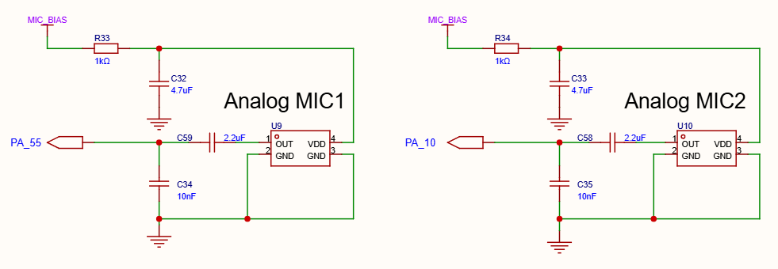

<div align="center"> Figure 2-7-3-1 Analog MIC single-ended input circuit diagram </div>   <br>  <br>


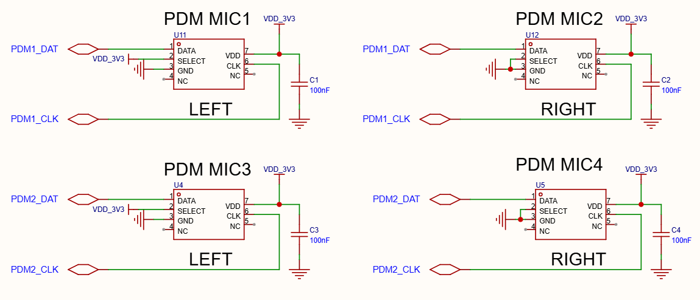

<div align="center"> Figure 2-7-3-2 PDM digital MIC input circuit diagram </div>   <br>  <br>

The analog audio output can be designed with reference to the recommended circuit shown in `Figure 2-7-3-3`. Note that the differential low-pass filter inside the dashed box must be placed close to the chip pins to suppress high-frequency interference and improve the audio output signal-to-noise ratio.

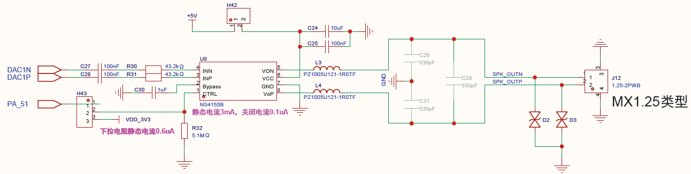

<div align="center"> Figure 2-7-3-3 Analog audio PA circuit diagram </div>   <br>  <br>

#### 2.7.4. Camera

Camera interface specifications of the chip:
- Up to 16bits DVP interface cameras;
- 2-data and 4-data SPI interface cameras.

<div align="center"> Table 2-7-4-1 Camera Interface Signal Wiring Table  </div>

```{table}
:align: center
:class: color-header-table

| GC032A SPI4 | GC032A DVP8 | GC2145 DVP8 | OV2640 DVP10 | 57x Sig Name    | Description                               |
|-------------|-------------|-------------|--------------| --------------- | ----------------------------------------- |
| SBDA        | SBDA        | SIO-D       | SIO-D        | Any GPIO        | I2C Data  Signal                          |
| SBCL        | SBCL        | SIO-C       | SIO-C        | Any GPIO        | I2C Clock Signal                          |
| RESET       | RESET       | RESET       | RESET        | Any GPIO        | Reset Signal output                       |
| NC          | VSYNC       | VSYNC       | VSYNC        | DCMI_VSYNC      | Vertical synchronization Signal input     |
| PWDN        | PWDN        | PWDN        | PWDN         | Any GPIO        | Power Down Signal (active high) output    |
| NC          | HSYNC       | HREF        | HREF         | DCMI_HSYNC      | Horizontal synchronization Signal input   |
| NC          | D7          | D7          | Y9           | DCMI_DI7        | YUV/RGB video port bit [7] input          |
| MCLK        | MCLK        | MCLK        | MCLK         | Any GPIO(GPTIM) | System clock output                       |
| NC          | D6          | D6          | Y8           | DCMI_DI6        | YUV/RGB video port bit [6] input          |
| NC          | D5          | D5          | Y7           | DCMI_DI5        | YUV/RGB video port bit [5] input          |
| SCK         | PCLK/SCK    | PCLK        | PCLK         | DCMI_CLK        | Pixel clock input                         |
| NC          | D4          | D4          | Y6           | DCMI_DI4        | YUV/RGB video port bit [4] input          |
| SD0         | D0          | D0          | Y2           | DCMI_DI0        | YUV/RGB video port bit [0] input          |
| SD3         | D3          | D3          | Y5           | DCMI_DI3        | YUV/RGB video port bit [3] input          |
| SD1         | D1          | D1          | Y3           | DCMI_DI1        | YUV/RGB video port bit [1] input          |
| SD2         | D2          | D2          | Y4           | DCMI_DI2        | YUV/RGB video port bit [2] input          |
| NC          | NC          | NC          | Y1           | NC              | -                                         |
| NC          | NC          | NC          | Y0           | NC              | -                                         |
```

```{note}
To save GPIO pin resources, it is recommended to connect a 10-bit DVP camera in 8-bit mode; if the hardware GPIO resources are sufficient, the data pins can be fully connected one-to-one.
```

### 2.8. General-Purpose Interfaces

#### 2.8.1. Buttons

##### 2.8.1.1. Power On/Off Button

The PA34 pin of the chip supports long-press reset and can be reused as the power on/off button to implement power on/off and long-press reset functions. The long-press reset of this pin is active high, and the hardware pulls it down to low level by default. After the button is pressed, the pin is set high. For the circuit design, see `Figure 2-8-1-2-1`.

##### 2.8.1.2. GPADC Buttons

The chip supports GPADC resistor-divider button design, distinguishing buttons by different divided voltages. A 0.1μF filter capacitor to ground should be placed near the pin to improve sampling accuracy. For the circuit, see `Figure 2-8-1-2-1`.

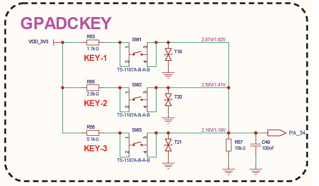

<div align="center">Figure 2-8-1-2-1 Power on/off and GPADC button circuit diagram </div>   <br>  <br>

#### 2.8.2. UART

The chip provides three UART interfaces, all supporting full-duplex mode, with baud rates up to 6Mbps and various configurable data formats. For pin multiplexing assignment, see `Table 2-6-2`. Multiplexed pins within Function 0 ~ 15 can be selected, or the UART function can be flexibly mapped to any GPIO pin through the matrix table.

```{note}
- PA18 and PA19 are the default debug UART (DBG-UART) pins, automatically configured as USART1 receive and transmit pins at power-on;
- If a frequently plugged/unplugged UART test interface needs to be reserved, it is recommended to use the PA18, PA19, PA43, PA44 pins. This group of GPIOs has a maximum voltage tolerance of 5.5V, which can prevent IO damage caused by over-voltage stress;
- When the test leads are long, a 100Ω resistor should be connected in series on the signal line to suppress signal overshoot.
```

#### 2.8.3. I2C

The chip provides four I2C interfaces, all supporting both master and slave modes. For pin multiplexing assignment, see `Table 2-6-2`. The I2C function can be flexibly mapped to any GPIO pin through the matrix table.

```{note}
- The I2C signals form an open-drain bidirectional bus, so external pull-up resistors are required:
    - Standard mode (Sm: 100kHz): 4.7kΩ recommended
    - Fast mode (Fm: 400kHz): 2.2kΩ ~ 3.3kΩ recommended
    - High-speed mode (Fm+: 1MHz): 1kΩ ~ 2.2kΩ recommended
- When multiple slave devices are connected to one I2C bus, only one set of pull-up resistors needs to be placed near the master; it is not necessary to have pull-ups for every slave device, and the device addresses of the slave devices must be distinct.
```

#### 2.8.4. SPI

The chip provides two SPI interfaces, all supporting both master and slave modes. For pin multiplexing assignment, see `Table 2-6-1`. Multiplexed pins within Function 0 ~ 15 can be selected, or the SPI function can be flexibly mapped to any GPIO pin through the matrix table.

```{note}
- When the SPI clock is below 30MHz, the SPI function can be flexibly mapped to any GPIO pin through the matrix table;
- When the SPI clock is above 30MHz, prefer the multiplexed pins within Function 0 ~ 15.
- Connect a 22~27Ω resistor in series close to the driver side, and reserve a capacitor footprint to ground on the clock signal line to suppress ringing and overshoot caused by high-speed signals and optimize interface signal integrity.
```

#### 2.8.5. SDIO


The chip has two built-in SD/MMC host controllers, which can only be used as hosts and do not support slave mode. The controllers can be connected to SD cards, SDIO peripherals and eMMC storage chips.

The SDIO-related signals are fixedly mapped to the corresponding GPIO pins through the pin multiplexer. For detailed pin multiplexing configuration, see `Table 2-6-1`.

```{note}
- When the SDIO clock is configured to 24MHz, the chip's internal GPIO pull-ups can be relied upon, and no additional external pull-up resistors are required on the CMD and Data0~Data3 pins;
- When the SDIO clock is configured to 48MHz or higher frequencies, 10kΩ pull-up resistors must be connected externally to the CMD and Data0~Data3 pins;
- All SDIO signal lines must have 27Ω～33Ω current-limiting resistors connected in series; reserve a capacitor footprint to ground on the clock signal line to suppress ringing and overshoot caused by high-speed signals and optimize interface signal integrity;
- For an external TF card socket: the card detection DET pin needs a 10kΩ pull-up resistor to 3.3V, and the corresponding MCU pin should be configured as input mode with internal pull-up;
- When using an external TF card socket, ESD protection devices must be added to the SDIO signal lines and the power supply loop to enhance electrostatic protection.
```

#### 2.8.6. USB

The chip has a built-in USB2.0 FS controller. For the hardware connection of the related signals, see `Table 2-8-6-1`.

<div align="center"> Table 2-8-6-1 USB Pin Assignment Table </div>

```{table}
:align: center
:class: color-header-table

| USB Sig  | GPIO PIN |
| -------- | -------- |
| USB_DP   | PA35     |
| USB_DM   | PA36     |
```

```{note}
- Default pin assignment: PA36 is USB_DM (D-), PA35 is USB_DP (D+); this group of pins does not support function remapping;
- The maximum communication rate is USB2.0 full-speed mode (FS, 12Mbps);
- The interface uses a 3.3V single-ended level standard;
- The chip has a built-in identification resistor. The USB working mode can be configured via software to automatically connect a 1.5kΩ pull-up resistor on the DP or DM pin, thereby identifying whether the connected device is a full-speed or low-speed device.
- It is recommended to reserve series resistors on the USB_DP and USB_DM signal lines, with an initial recommended value of 22Ω or 33Ω; also reserve a capacitor footprint to ground, which may not be mounted initially. These RC components should be placed close to the chip pins to suppress signal reflection and improve signal integrity;
- ESD protection circuits must be designed on the USB_DP and USB_DM differential signal lines to withstand electrostatic surge impacts, prevent damage to the chip's internal USB controller caused by static electricity, and ensure interface reliability.
```

#### 2.8.7. CAN

The chip provides two CAN interfaces, both compatible with the CAN 2.0b specification. For pin multiplexing assignment, see `Table 2-6-2`. The CAN function can be flexibly mapped to any GPIO pin through the matrix table.

#### 2.8.9. GPADC

For details of the GPIO pin assignment corresponding to the GPADC function, see `Table 2-8-9-1`

<div align="center"> Table 2-8-9-1 GPADC Pin Assignment Table </div>

```{table}
:align: center
:class: color-header-table

| GPIO PIN  | ADC Function |
| --------- | ------------ |
|PA28       |#GPADC_CH0    |
|PA29       |#GPADC_CH1    |
|PA30       |#GPADC_CH2    |
|PA31       |#GPADC_CH3    |
|PA32       |#GPADC_CH4    |
|PA33       |#GPADC_CH5    |
|PA34       |#GPADC_CH6    |
|PA35       |#GPADC_CH7    |
|PA36       |#GPADC_CH8    |
|PA37       |#GPADC_CH9    |
|PA38       |#GPADC_CH10   |
|VBAT/VBATS |#GPADC_CH11, this pin belongs to the battery voltage domain, and its voltage measurement range differs from the general-purpose GPADC pins.   |
```
When using the ADC function, please add a 0.1 μF filter capacitor to ground close to the pin for better accuracy.

### 2.9. Debug and Download Interfaces

The chip supports two single-step debugging methods, DBG-UART and SWD. PA18 and PA19 are the default DBG-UART debug pins, and PA43 and PA44 are the default SWD debug pins. The SWD function can also be multiplexed to the PA18 and PA19 pins.

<div align="center">Table 2-9-1 Default Debug Port Connections </div>

```{table}
:align: center
:class: color-header-table

|Debug Sig    | Pin   | Net Name  |
| ----------- | ------| --------- |
|DBG_UART_RXD |PA18   |USART1_RXD |
|DBG_UART_TXD |PA19   |USART1_TXD |
|SWD_CLK      |PA43   |SWCLK      |
|SWD_DIO      |PA44   |SWDIO      |
```

The chip supports four program download methods in total: DBG-UART, SWD, ordinary UART and USB. In normal boot mode, program download can only be completed through the DBG-UART and SWD interfaces; in BOOT boot mode, all four download interfaces can be enabled. For the specific boot mode configuration methods and the download interface parameter settings corresponding to each mode, see 'Table 2-9-2'.

<div align="center">Table 2-9-2 Boot Modes and Download Port Information Table </div>

```{table}
:align: center
:class: color-header-table

|PA00      |BOOT REG  | PA01     | Host BOOT switch |   Boot branch                 |
| -------- | -------- | -------- | -------------- | -------------------------- |
| L        | L        | H        | Any           | Normal boot, PA19 does not output boot messages, PA18/PA19 switch from DBG-UART to SWD, the SWD function of PA43/PA44 is disabled  |
| L        | L        | L        | Off           | Normal boot, PA19 outputs boot messages, PA18/PA19 are DBG-UART, PA43/PA44 are SWD  |
| L        | L        | L        | On           | BOOT MODE, PA19 outputs boot messages, supports DBG-UART/SWD/UART/USB programming, PA18/PA19 are DBG-UART, PA43/PA44 are SWD  |
| Any of PA00 and the BOOT register is 1| Any of PA00 and the BOOT register is 1| L | Any | BOOT MODE, PA19 outputs boot messages, supports DBG-UART/SWD/UART/USB programming, PA18/PA19 are DBG-UART, PA43/PA44 are SWD  |
| Any of PA00 and the BOOT register is 1| Any of PA00 and the BOOT register is 1| H | Any | BOOT MODE, PA19 does not output boot messages, supports SWD/USB programming, PA18/PA19 switch from DBG-UART to SWD, the SWD function of PA43/PA44 is disabled  |
```
For download tools, refer to [Software and Hardware Tools Summary](https://wiki.sifli.com/tools/index.html)

### 2.10. Production Line Programming and Crystal Calibration

SiFli Technology provides an offline downloader to complete production line program programming and crystal calibration. During hardware design, please make sure to reserve at least the following test points: VBAT, PVDD, GND, AVDD33, DB_UART_RXD, DB_UART_RXD, PA00 and PA01.

For detailed programming and crystal calibration, refer to [Software and Hardware Tools Summary](https://wiki.sifli.com/tools/index.html).


### 2.11. Minimum System Schematics

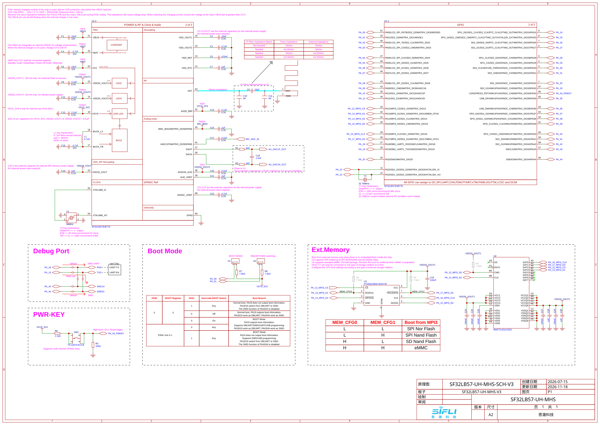

<div align="center"> Figure 2-11-1 Minimum system schematic of the QFN68L battery-powered series chip </div>   <br>  <br>

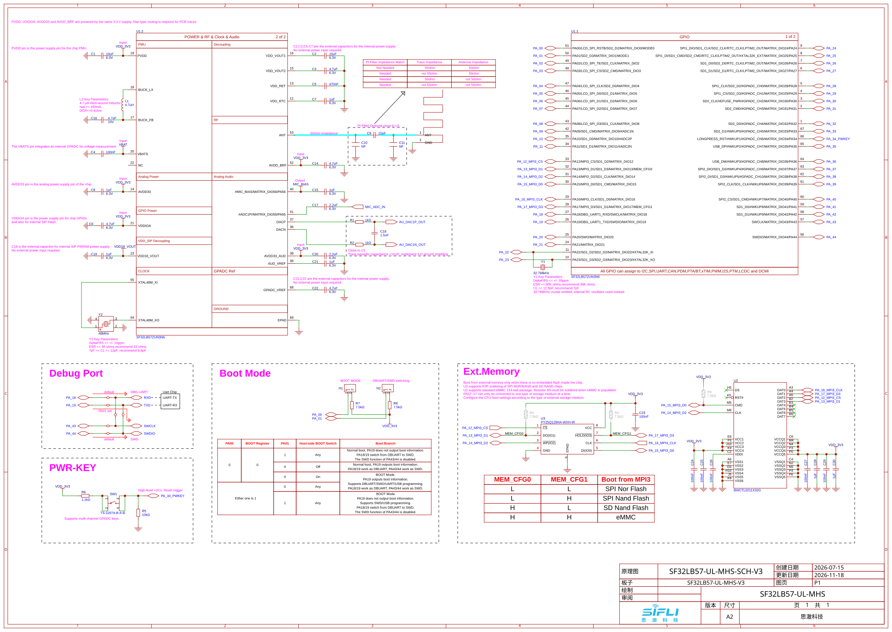

<div align="center"> Figure 2-11-2 Minimum system schematic of the QFN68L 3.3V-powered series chip </div>   <br>  <br>

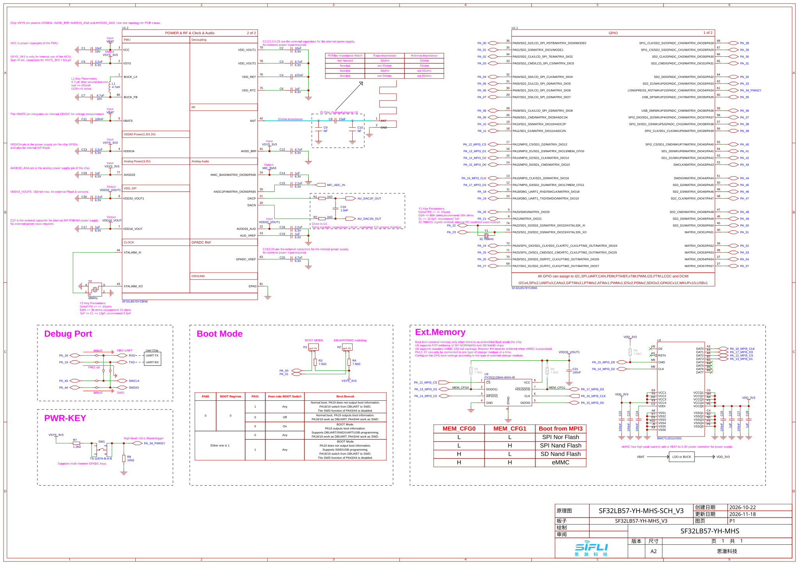

<div align="center"> Figure 2-11-3 Minimum system schematic of the QFN80L battery-powered series chip </div>   <br>  <br>

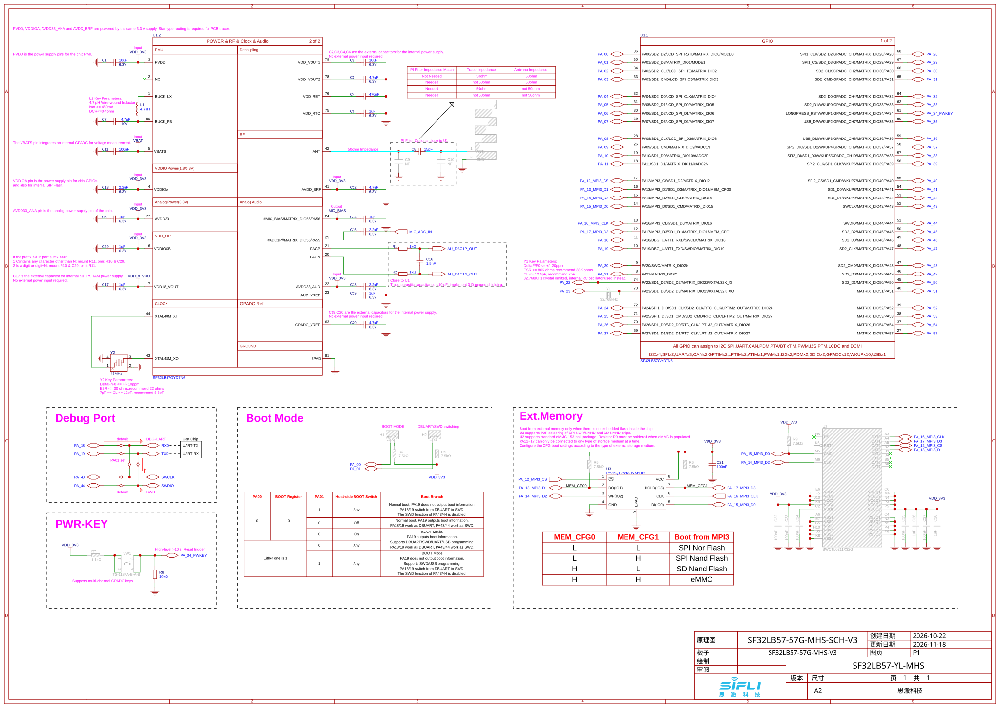

<div align="center"> Figure 2-11-4 Minimum system schematic of the QFN80L 3.3V-powered series chip </div>   <br>  <br>

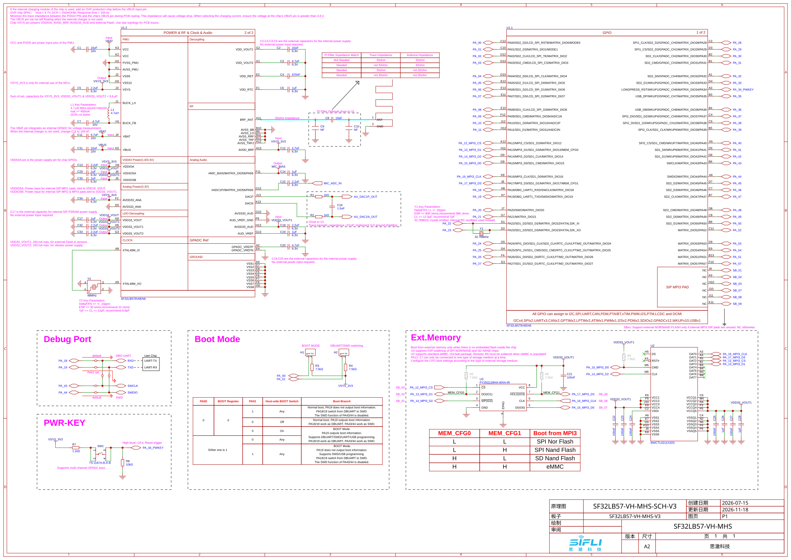

<div align="center"> Figure 2-11-5 Minimum system schematic of the BGA112 battery-powered series chip </div>   <br>  <br>

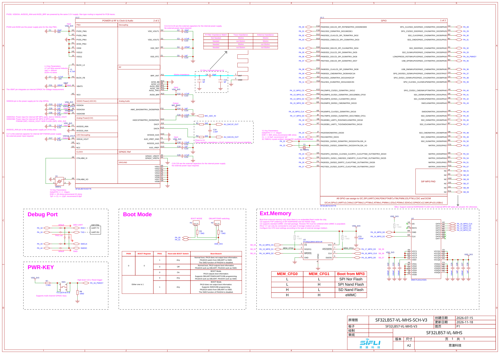

<div align="center"> Figure 2-11-6 Minimum system schematic of the BGA112 3.3V-powered series chip </div>   <br>  <br>

## 3. PCB Design Guidance

### 3.1. PCB Basic Settings

#### 3.1.1. Package Design

For the QFN68L package of the SF32LB57x series chips: package size 7mmX7mm; number of pins: 68; PIN pitch: 0.35mm. For the package dimensions, PCB pads and stencil design dimensions, refer to `Figure 3-1-1-1` ~ `Figure 3-1-1-4`.


<div align="center"> Figure 3-1-1-1 QFN68L-7x7-0.9mm package dimension drawing </div>   <br>  <br>


<div align="center"> Figure 3-1-1-2 QFN68L-7x7-1.1mm package dimension drawing </div>   <br>  <br>

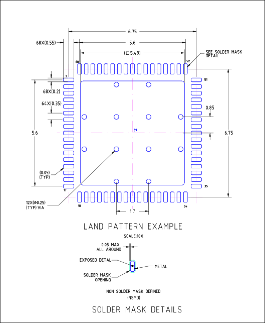

<div align="center"> Figure 3-1-1-3 QFN68L package PCB land pattern design reference </div>   <br>  <br>

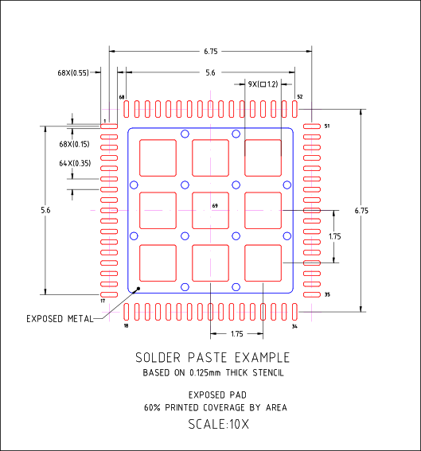

<div align="center"> Figure 3-1-1-4 QFN68L package PCB stencil design reference </div>   <br>  <br>

For the QFN80L package of the SF32LB57x series chips: package size 8mmX8mm; number of pins: 80; PIN pitch: 0.35mm. For the package dimensions, PCB pads and stencil design dimensions, refer to `Figure 3-1-1-5` ~ `Figure 3-1-1-8`.


<div align="center"> Figure 3-1-1-5 QFN80L-8x8-0.9mm package dimension drawing </div>   <br>  <br>


<div align="center"> Figure 3-1-1-6 QFN80L-8x8-1.1mm package dimension drawing </div>   <br>  <br>

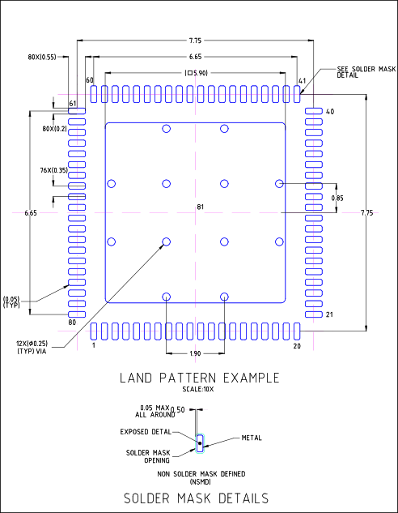

<div align="center"> Figure 3-1-1-7 QFN80L package PCB land pattern design reference </div>   <br>  <br>

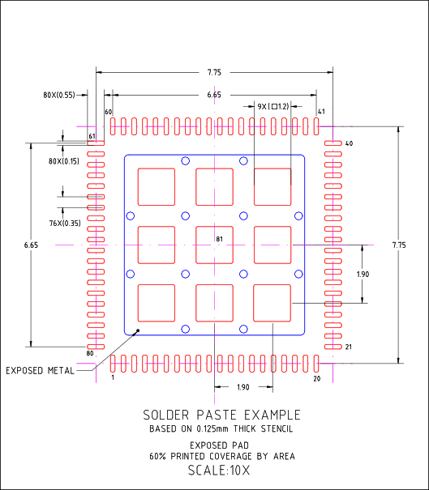

<div align="center"> Figure 3-1-1-8 QFN80L package PCB stencil design reference </div>   <br>  <br>

For the BGA112 package of the SF32LB57x series chips: package size 5.4mmX4.4mm; number of pins: 112; PIN pitch: 0.4mm. For the package dimensions, PCB pads and stencil design dimensions, refer to `Figure 3-1-1-9` ~ `Figure 3-1-1-12`.

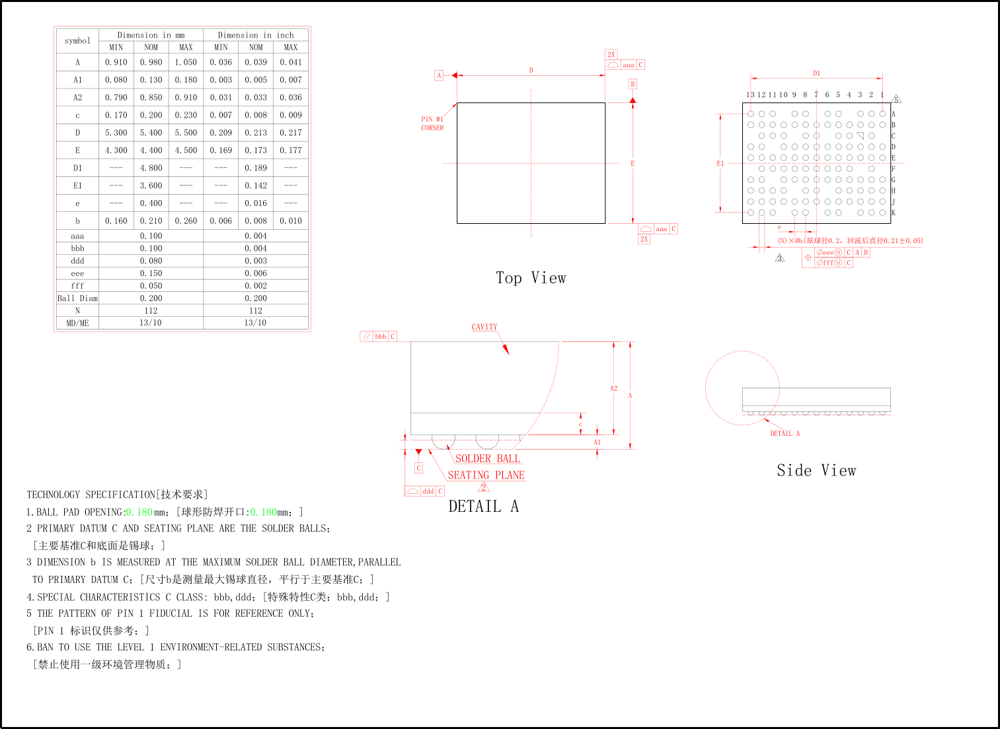

<div align="center"> Figure 3-1-1-9 BGA112-5.4x4.4-0.98mm package dimension drawing </div>   <br>  <br>

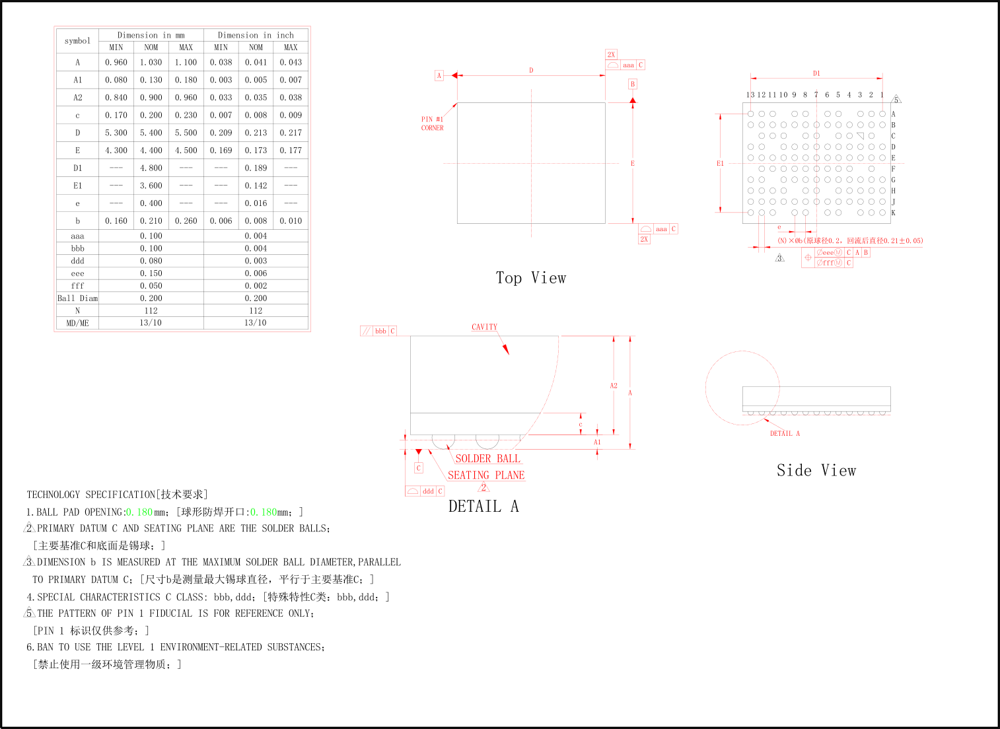

<div align="center"> Figure 3-1-1-10 BGA112-5.4x4.4-1.03mm package dimension drawing </div>   <br>  <br>

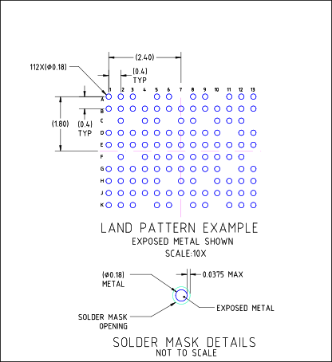

<div align="center"> Figure 3-1-1-11 BGA112 package PCB land pattern design reference </div>   <br>  <br>

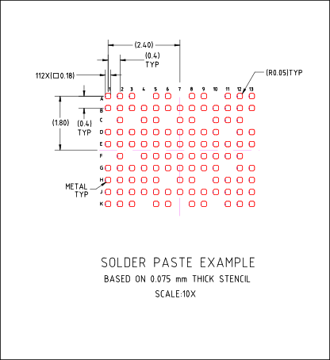

<div align="center"> Figure 3-1-1-12 BGA112 package PCB stencil design reference </div>   <br>  <br>

#### 3.1.2. Stack-up Design

The SF32LB57x QFN series chips support single-sided and double-sided PCB layouts. Components can all be placed on a single side, or capacitors and other components can be placed on the back side of the chip. The PCB supports the PTH (plated through hole) process; a 4-layer PTH board material is recommended. For the recommended stack-up structures, see `Figure 3-1-2-1` and `Figure 3-1-2-2`.

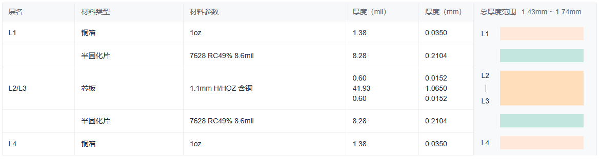

<div align="center"> Figure 3-1-2-1 Reference PCB stack-up structure for a 1.6mm thick QFN package board </div>   <br>  <br>

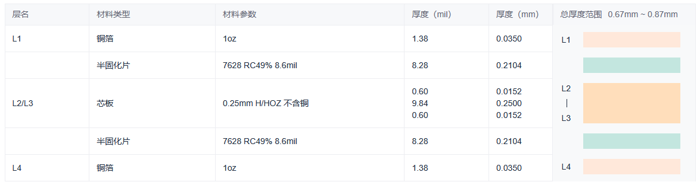

<div align="center"> Figure 3-1-2-2 Reference PCB stack-up structure for a 0.8mm thick QFN package board </div>   <br>  <br>

The SF32LB57x BGA series supports single-sided and double-sided PCB layouts. Components can be placed on a single side, or capacitor-type components can be placed on the back side of the chip. The hardware design can adopt a first-order HDI blind/buried via process, with a minimum PCB layer count of 4. For the recommended stack-up structures, see `Figure 3-1-2-3` and `Figure 3-1-2-4`.

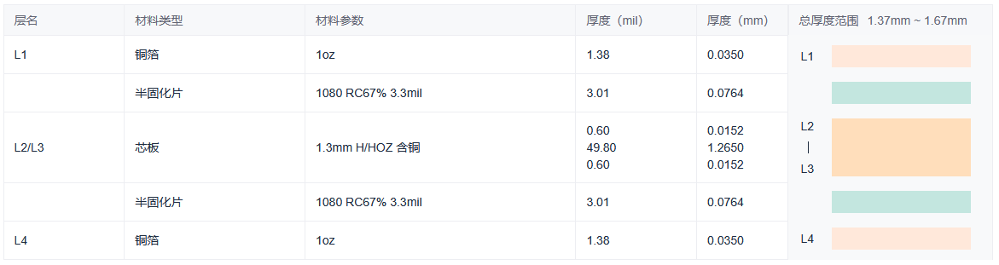

<div align="center"> Figure 3-1-2-3 Reference PCB stack-up structure for a 1.6mm thick BGA package board </div>   <br>  <br>

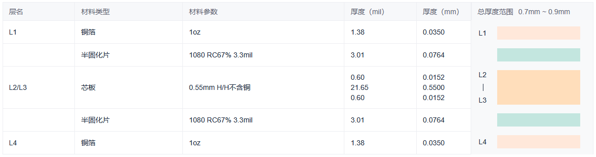

<div align="center"> Figure 3-1-2-4 Reference PCB stack-up structure for a 0.8mm thick BGA package board </div>   <br>  <br>

Requirements for the 4-layer PCB stack-up design:
- Layer 1 (top layer): solid ground copper pour, mainly for component placement and signal routing.
- Layer 2 (ground layer): complete ground plane copper pour, with no signal traces, to ensure the integrity of the reference ground.
- Layer 3 (power layer): copper pour can be partitioned into various power regions, used both for power routing and for signal traces.
- Layer 4 (bottom layer): solid ground copper pour, on which various signal traces can be routed.


#### 3.1.3. General Design Rules

PTH process PCBs must follow the general trace width and spacing design specifications shown in `Figure 3-1-3-1`, and the via-related design parameters and layout requirements must follow `Figure 3-1-3-2`.

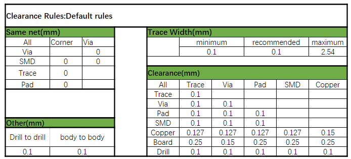

<div align="center"> Figure 3-1-3-1 General design rules for PTH boards </div>   <br>  <br>

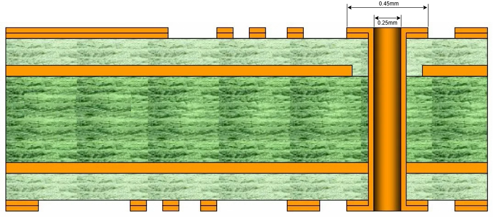

<div align="center"> Figure 3-1-3-2 VIA design rules for PTH boards </div>   <br>  <br>

HDI process PCBs must follow the general trace width and spacing design specifications shown in `Figure 3-1-3-3`, and the via-related design parameters and layout requirements must follow `Figure 3-1-3-4`.


<div align="center"> Figure 3-1-3-3 General design rules for HDI boards </div>   <br>  <br>

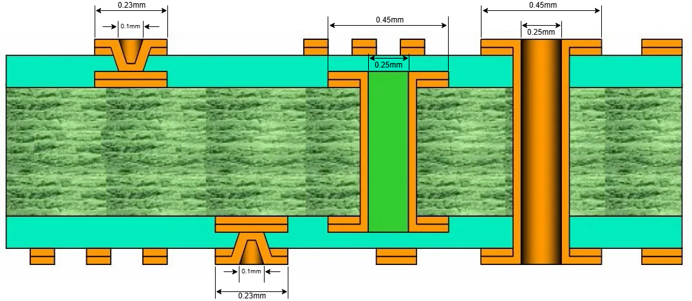

<div align="center"> Figure 3-1-3-4 General design rules for HDI boards </div>   <br>  <br>


#### 3.1.4. Trace Fanout

For the signal fanout of the QFN68 and QFN80 <!-- and BGA112 --> packages, refer to `Figure 3-1-4-1` ~ `Figure 3-1-4-3`.

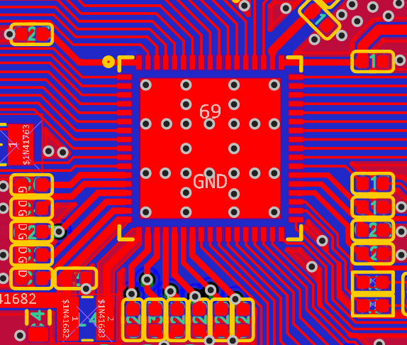

<div align="center"> Figure 3-1-4-1 QFN68 top-layer fanout reference </div>   <br>  <br>

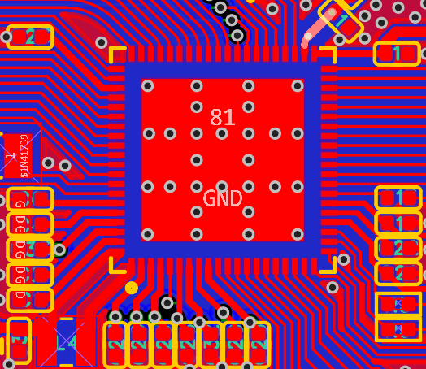

<div align="center"> Figure 3-1-4-2 QFN80 top-layer fanout reference </div>   <br>  <br>

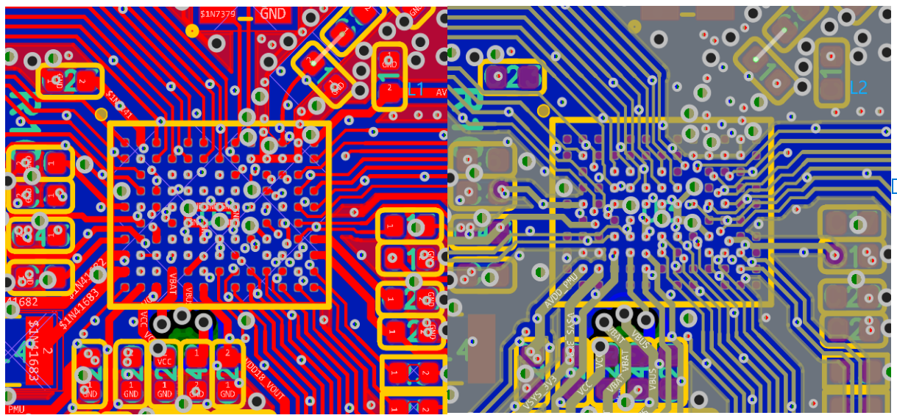

<div align="center"> Figure 3-1-4-3 BGA112 fanout reference </div>   <br>  <br>

### 3.2. Power Supply

#### 3.2.1. Main Power Supply

VCC and PVDD are the power input pins of the PMU module built into the chip. The accompanying capacitors of both must be placed as close as possible, and the power trace width must be no less than 0.4mm. Only the VCC circuit is illustrated here; PVDD should be designed following the same rules.

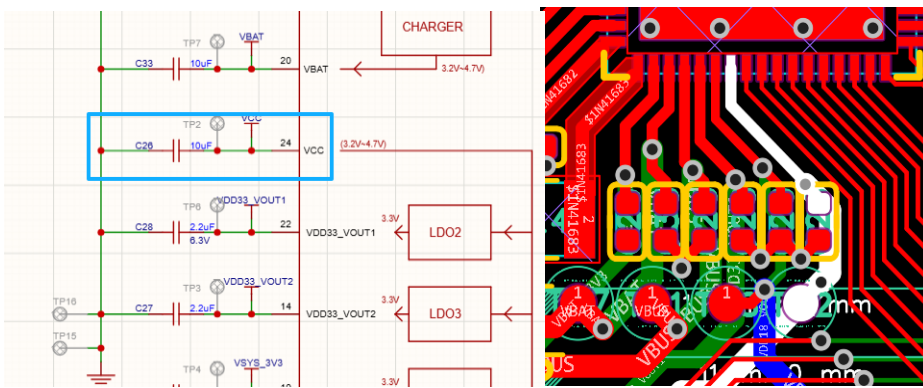

<div align="center"> Figure 3-2-1-1 QFN package VCC power routing diagram </div>   <br>  <br>

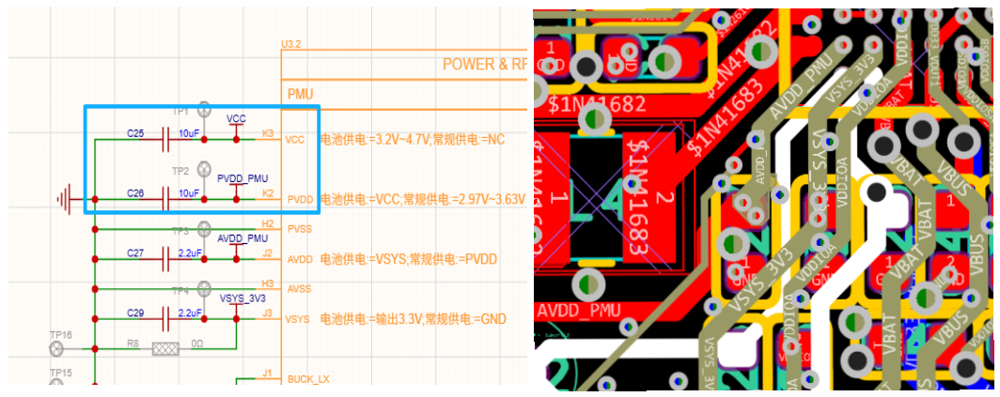

<div align="center"> Figure 3-2-1-2 BGA package VCC power routing diagram </div>   <br>  <br>

The filter capacitors of pins such as VDD_VOUT1, VDD_VOUT2, VDD_RET, VDD_RTC, VDD18_VOUT, VDD33_VOUT1, VDD33_VOUT2, AVDD33_AUD and AVDD_BRF must be placed close to the pins. The power traces should be designed as short and thick traces according to the input current, to reduce power supply ripple and improve system stability.

```{important}
When PVDD, AVDD_BRF, AVDD33 and AVDD33_AUD share one power supply, a star routing topology must be adopted, with each trace routed independently from the power source; sharing a common upstream power trace is prohibited.
```


#### 3.2.2. Charging Circuit Routing

VBUS and VBAT are the input and output pins of the charging module built into the chip; their filter capacitors must be placed close to the pins. Since the charging loop current is large, the trace width of the pins must be at least 0.4mm, and sensitive signal lines must not be routed in parallel with them. Use a star topology for the routing, and do not share paths with other lines, to prevent the charging process from interfering with other circuits.

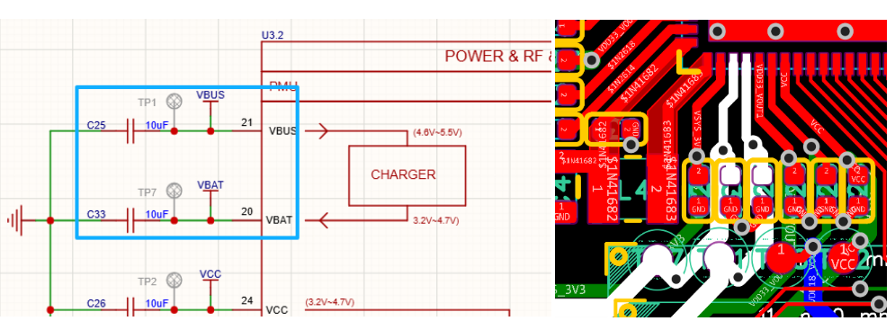

<div align="center"> Figure 3-2-2-1 QFN package VBUS&VBAT power routing diagram </div>   <br>  <br>

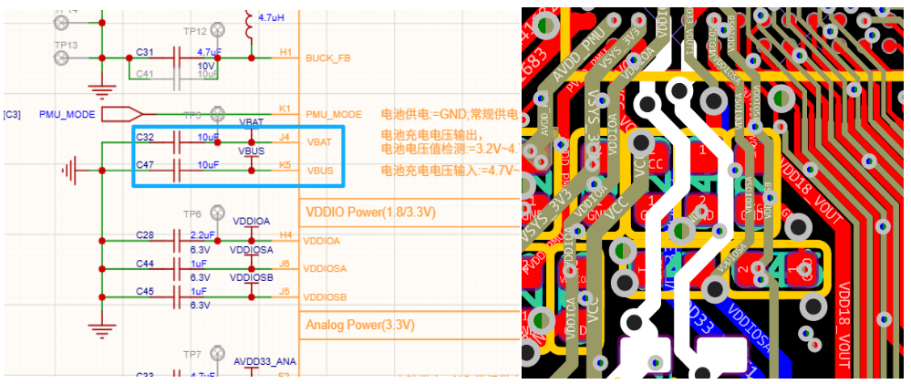

<div align="center"> Figure 3-2-2-2 BGA package VBUS&VBAT power routing diagram </div>   <br>  <br>

#### 3.2.3. DCDC Circuit

The power inductor and filter capacitors of the DC-DC circuit must be placed close to the chip pins. The BUCK_LX trace should be short and thick to reduce the power loop inductance, and the BUCK_FB feedback trace width must be greater than 0.25mm. For all DC-DC output filter capacitors, add multiple grounding vias to connect to the main ground plane; copper pour is prohibited on the top layer where the power inductor is located; a complete reference ground plane must be set on the adjacent layer, and no other signal traces are allowed to route through the inductor area.

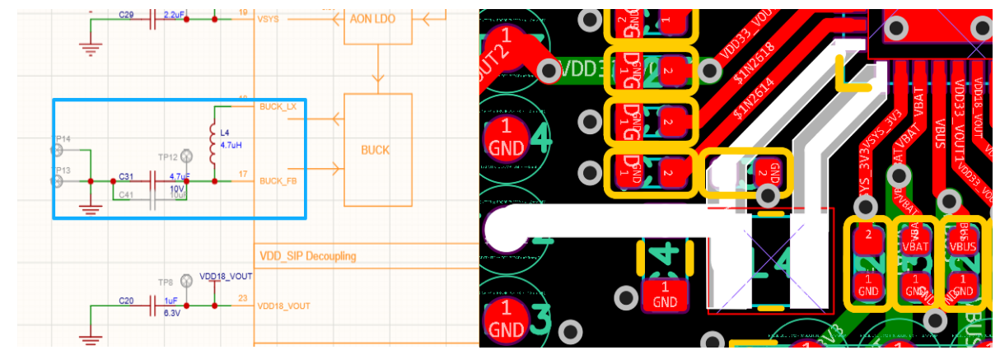

<div align="center"> Figure 3-2-3-1 QFN package DCDC power routing diagram </div>   <br>  <br>

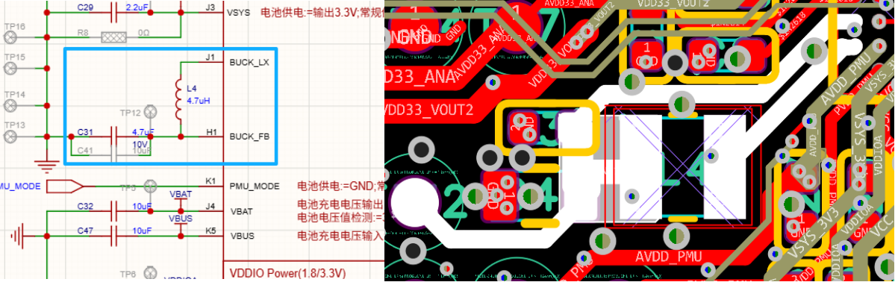

<div align="center"> Figure 3-2-3-2 BGA package DCDC power routing diagram </div>   <br>  <br>

### 3.3. Clock Interface Routing

The crystal design should follow the specifications below:
- Ground plane requirements
    - A complete and continuous reference ground plane must be maintained beneath the RF circuit, the crystal area and the main chip; ground plane splitting or slotting that breaks ground integrity is prohibited.
- Crystal layout spacing requirements
    - The crystal components must be kept at least 1.5mm away from the chip clock pins to avoid clock interference and frequency deviation anomalies caused by close-range coupling;
    - The crystal must be more than 1mm away from the PCB board edge, and no less than 5mm away from high-power heat-generating components such as the PA, charging circuit and PMU, to avoid frequency deviation caused by temperature rise.
- Crystal routing rules
    - The crystal XI/XO clock traces are only allowed on the top layer; layer transitions with vias are prohibited;
    - Define a no-copper-pour zone around the crystal on the top layer of the PCB to isolate the crystal components from the surrounding grounded copper, which on the one hand effectively reduces the parasitic capacitance of the traces, and on the other hand blocks heat conduction to avoid crystal frequency deviation caused by temperature changes, ensuring clock frequency stability;
    - Apply guard-ground (shielding) treatment along the entire clock line, with densely placed grounding vias on both sides of the line for shielding and isolation;
    - The power vias on both sides of the trace should be kept as far away from the clock signal line as possible to maximize the guard-ground shielding effect.
- Peripheral component layout specifications
    - The load capacitors to ground at both ends of the crystal should be placed on both sides of the crystal, at the end of the clock traces close to the crystal; the capacitor ground pads should be connected to the crystal ground pads nearby to shorten the grounding path.
- Regional shielding and keep-out requirements
    - High-frequency digital signal traces are prohibited in the area directly beneath the crystal; the optimal design is to place no traces at all in this area;
    - Power inductors and other magnetically induced components are strictly prohibited around the crystal; rely on a large area of complete ground plane for anti-interference to ensure clock signal purity.


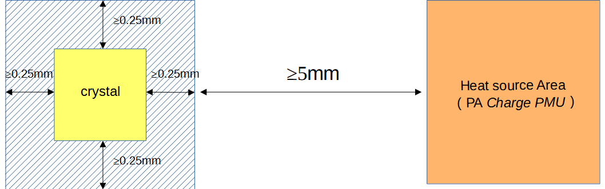

<div align="center"> Figure 3-3-1 Crystal layout diagram </div>   <br>  <br>


The 48MHz crystal is recommended to be routed on the top layer, with a trace length of 3~10mm and a trace width of 0.1mm, with guard-ground treatment; keep it away from VBAT, DC/DC and various high-speed signal lines. Set keep-out zones on the top layer and the adjacent layer of the crystal area, and no other traces are allowed to pass through this area.
<!-- 48MHz crystal routing model -->


<div align="center"> Figure 3-3-2 48MHz crystal routing model </div>   <br>  <br>

<!-- 48MHz crystal schematic + PCB routing -->


<div align="center"> Figure 3-3-3 48MHz crystal routing reference </div>   <br>  <br>


The 32.768KHz crystal is recommended to be routed on the top layer, with a trace length of no more than 10mm and a trace width of 0.1mm; the spacing between the parallel traces of 32K_XI and 32K_XO should be ≥0.15mm, with guard-ground treatment; set keep-out zones on the top layer and the adjacent layer of the crystal area, and other traces are prohibited from passing through this area.

<!-- 32KHz crystal routing model -->


<div align="center"> Figure 3-3-4 32.768KHz crystal routing model </div>   <br>  <br>

<!-- 32KHz crystal schematic + PCB routing -->


<div align="center"> Figure 3-3-5 32.768KHz crystal routing reference </div>   <br>  <br>


### 3.4. RF

The RF matching circuit should be placed close to the chip side, away from the antenna side. The filter capacitor of the AVDD_BRF RF power supply should be placed close to the chip pins, and the capacitor ground pin should be directly connected to the main ground plane through vias. For the schematic and PCB layout of the π-type matching network of the RF signal, refer to `Figure 3-4-1` and `Figure 3-4-2` respectively.

<!-- Schematic + PCB routing -->


<div align="center"> Figure 3-4-1 π-type network layout and routing reference </div>   <br>  <br>


RF signal lines are recommended to be routed on the top layer, avoiding layer transitions with vias as much as possible; the trace width should be greater than 10mil, with guard-ground treatment; acute-angle and right-angle routing is prohibited; the RF lines require 50Ω impedance control, with densely placed shielding ground vias on both sides of the lines.

<!-- Schematic + PCB routing -->


<div align="center"> Figure 3-4-2 RF signal routing reference </div>   <br>  <br>

```{note}
- The RF traces require precise 50Ω impedance control based on the PCB stack-up structure;
- The difference between the component pad size and the trace width on the RF path can easily cause impedance discontinuity. The reference ground layer beneath the component pads can be voided according to the pad size to optimize impedance continuity;
- If an IPEX antenna connector is used, a copper-pour void (keep-out) treatment must be applied on all PCB layers beneath the connector;
- The PCB antenna needs to go through simulation and real-board tuning. It is recommended to add a CLC matching circuit, and this circuit should be placed as close to the antenna as possible.
```

### 3.5. Analog Signals

#### 3.5.1. Audio

The filter capacitors of the AVDD33_AUD, MIC_BIAS and AUD_VREF pins must all be placed close to the chip pins, ensuring that the capacitor ground terminals are reliably connected to the PCB main ground, so as to optimize the audio power supply filtering effect.

<!-- Schematic + PCB routing -->


<div align="center"> Figure 3-5-1-1 PCB reference routing for audio-related power filter circuits </div>   <br>  <br>


The peripheral components at the ADCP analog signal input must be placed close to the chip pins; the traces should be as short as possible with guard-ground treatment, and kept away from all kinds of strong interference signal lines.

<!-- Schematic + PCB routing -->


<div align="center"> Figure 3-5-1-2 PCB reference routing for analog audio input </div>   <br>  <br>

The peripheral components at the DACP and DACN differential analog output pins must be placed close to the chip pins; each pair of P and N signals should be routed according to differential rules, with traces as short as possible, controlling the parasitic capacitance below 10pF, with guard-ground treatment, and kept away from all kinds of strong interference signals.

<!-- Schematic + PCB routing -->


<div align="center"> Figure 3-5-1-3 PCB reference routing for analog audio output </div>   <br>  <br>

#### 3.5.2. GPADC

The traces of pins configured for the GPADC function must be routed with guard-ground treatment, kept away from interference circuits such as battery detection and temperature detection.

### 3.6. High-Speed Signals

#### 3.6.1. MPI

MPI signal lines should be routed together as much as possible without being dispersed; the overall trace length should not exceed 20mm, and the length mismatch between signal lines within the same group should be controlled within 3mm. Clock, data and command signal lines must all be routed with guard-ground treatment.

#### 3.6.2. SDIO

SDIO signal lines should be routed together as much as possible without being dispersed; the overall trace length should not exceed 50mm, and the length mismatch between signal lines within the same group should be controlled within 6mm. Clock, data and command signal lines must all be routed with guard-ground treatment.


<div align="center"> Figure 3-6-2-1 SDIO signal routing model </div>   <br>  <br>

<!-- Schematic + PCB routing -->


<div align="center"> Figure 3-6-2-2 SDIO PCB reference routing </div>   <br>  <br>

#### 3.6.3. USB

The USB differential signals PA35 (USB_DP) and PA36 (USB_DN) must first pass through ESD protection devices before connecting to the chip, and the ground pins of the ESD devices must be reliably connected to the main ground. The signal lines should be routed differentially with 90Ω differential impedance control, together with guard-ground treatment.


<div align="center"> Figure 3-6-3-1 USB signal component placement reference </div>   <br>  <br>


<div align="center"> Figure 3-6-3-2 USB signal routing model </div>   <br>  <br>

<!-- Schematic + PCB routing -->


<div align="center"> Figure 3-6-3-3 USB signal PCB reference routing </div>   <br>  <br>

### 3.7. EMI&ESD

- Do not route interference signals such as clocks and power over long distances on the top layer outside the shielding cover; such signals should be placed on inner layers as much as possible, and top-layer routing is prohibited.
- ESD protection devices must be placed adjacent to the corresponding pins of the connector, and the signal lines must pass through the ESD devices before connecting to the downstream circuits; branching traces before the ESD protection are strictly prohibited.
- The ground pins of ESD protection devices must be connected directly to the main ground through vias, and the ground pads should use short and thick traces to reduce grounding impedance and improve ESD protection performance.

The test points of the USB charging circuit should be placed before the TVS protection diode; the TVS diode corresponding to the battery connector should be installed before the chip circuit, and the routing requires the signal to pass through the TVS diode before connecting to the chip pins.


<div align="center"> Figure 3-7-1 Power TVS layout reference </div>   <br>  <br>  <br>


<div align="center"> Figure 3-7-2 TVS routing reference </div>   <br>  <br>  <br>


## 4. Design Self-Check

### 4.1. Package

<div align="center"> Table 4-1-1 Package-Related Self-Check Table </div>

```{table}
:align: center
:class: checklist-table

|No.|Item|Confirmed (Yes/No)|Applicable Chips|Remarks|
| -- |--|--|--|--|
|1   |Is the schematic symbol library correct            | - |All part numbers | - |
|2   |Is the PCB footprint made according to the datasheet requirements | - |All part numbers | - |
```

### 4.2. Power Supply

#### 4.2.1. Power Supply

<div align="center"> Table 4-2-1-1 Power Supply-Related Self-Check Table </div>

```{table}
:align: center
:class: checklist-table

| No. | Check Item | Confirmed (Yes/No) | Applicable Chips | Check Points |
| ---- | -------- | ------------ | -------- | -------- |
| 1  | VBUS input voltage range check               |  | Battery-powered series part numbers | The input supply voltage of the VBUS pin must be strictly controlled within 4.6V～5.5V; exceeding this voltage range is prohibited to avoid component damage |
| 2  | Battery specification connected to VBAT check               |  | Battery-powered series part numbers | The rated voltage range of batteries compatible with VBAT charging is 4.2V～4.45V; pre-charging current 40mA, maximum charging current is 1C (400mA) |
| 3  | VCC supply voltage range check                |  | Battery-powered series part numbers | The rated operating range of the VCC pin supply voltage is 3.45V～4.7V; among them, 3.45V is the hardware power-on voltage threshold and 2.7V is the hardware power-off voltage threshold |
| 4  | VSYS power load specification check               |  | Battery-powered series part numbers | VSYS is a dedicated internal power supply of the chip and can only supply the AVDD_BRF and GPIO pull-up circuits; driving any external peripherals is prohibited |
| 5  | VDD33_VOUT1 supply purpose and load constraint check  |  | Battery-powered series part numbers | The load of VDD33_VOUT1 is limited to the internal stacked Flash, external Nor/Nand Flash and AVDD33_AUD; driving all other peripherals is prohibited |
| 6  | VDD33_VOUT2 supply purpose and load constraint check  |  | Battery-powered series part numbers | VDD33_VOUT2 soft-start current limit is 30mA; after the voltage stabilizes at 3.3V, the load capability is 150mA; the soft-start current limit can be disabled via software, and the power-on current of the connected peripherals must be verified against the recommended specifications of this power supply |
| 7  | AVDD_BRF power source check               |  | Battery-powered series part numbers | AVDD_BRF is powered by the VSYS power domain |
| 8  | AVDD33_AUD power source check             |  | Battery-powered series part numbers | AVDD33_AUD is powered by the VDD33_VOUT1 power domain |
| 9  | PVDD input voltage range check               |  | 3.3V-powered series part numbers | The rated supply voltage range of the PVDD pin is 2.93V～3.63V, with a typical default operating voltage of 3.3V |
| 10 | VBATS input voltage sampling range check          |  | 3.3V-powered series part numbers | The battery voltage detection sampling range of VBATS is 0~4.5V; out-of-range voltage input is prohibited |
| 11 | AVDD_BRF power source check               |  | 3.3V-powered series part numbers | AVDD_BRF is powered by an external 3.3V power supply |
| 12 | AVDD33_AUD power source check             |  | 3.3V-powered series part numbers | AVDD33_AUD is powered by an external 3.3V power supply |
| 13 | AVDD33_ANA power source check             |  | 3.3V-powered series part numbers | AVDD33_ANA is powered by an external 3.3V power supply |
| 14 | VDDIOA power source check                 |  | 3.3V-powered series part numbers | The input supply voltage range of VDDIOA depends on the corresponding ordering part number; for specific parameters, refer to the part number description in the datasheet |
| 15 | Battery voltage detection circuit check                |  | All part numbers         | An internal GPADC channel of the chip has been allocated and connected to the VBAT/VBATS pin; no other GPADC channel needs to be connected for detection |
| 16 | BUCK_LX and BUCK_FB hardware wiring correctness check  |  | All part numbers         | Confirm that the wiring of the BUCK switch pin and feedback pin strictly follows the chip hardware design specification requirements |
| 17 | VDD18_VOUT supply purpose check             |  | All part numbers         | VDD18_VOUT is only used to supply the internal stacked PSRAM of the chip; supplying external 1.8V peripherals is strictly prohibited |
| 18 | GPADC_VREF connection check                 |  | All part numbers         | GPADC_VREF is the internal reference voltage output pin of the chip's GPADC module; only an external capacitor is allowed, and connecting external voltage signals is prohibited |
| 19 | AUD_VREF connection check                   |  | All part numbers         | AUD_VREF is the internal reference voltage output pin of the chip's audio module; only an external capacitor is allowed, and connecting external voltage is strictly prohibited |
| 20 | VBUS capacitance value check                   |  | Battery-powered series part numbers | The VBUS pin requires an external capacitor of no less than 10μF/10V, and the capacitor must be placed close to the pin |
| 21 | VBAT capacitance value check                   |  | Battery-powered series part numbers | The VBAT pin requires an external capacitor of no less than 4.7μF/10V, and the capacitor must be placed adjacent to the pin |
| 22 | VCC capacitor specification check                    |  | Battery-powered series part numbers | The VCC pin requires an external capacitor of no less than 10μF/10V, and the capacitor must be placed close to the pin |
| 23 | VSYS capacitor specification check                   |  | Battery-powered series part numbers | The VSYS pin requires an external 2.2μF/6.3V capacitor; the sum of the total capacitance values of all capacitors in this power domain must not exceed 9.6μF, and the capacitor must be placed close to the pin |
| 24 | VDD33_VOUT1 capacitor specification check            |  | Battery-powered series part numbers | The VDD33_VOUT1 pin requires an external 2.2μF/6.3V capacitor; the sum of the total capacitance values of all capacitors in this power domain must not exceed 9.6μF, and the capacitor must be placed close to the pin |
| 25 | VDD33_VOUT2 capacitor specification check            |  | Battery-powered series part numbers | The VDD33_VOUT1 pin requires an external 2.2μF/6.3V capacitor; the sum of the total capacitance values of all capacitors in this power domain must not exceed 9.6μF, and the capacitor must be placed close to the pin |
| 26 | PVDD capacitor specification check                   |  | 3.3V-powered series part numbers | The PVDD pin requires an external capacitor of no less than 10μF/6.3V, and the capacitor must be placed close to the pin |
| 27 | VBATS capacitor specification check                  |  | 3.3V-powered series part numbers | The VBATS pin requires an external 0.1μF/10V decoupling capacitor, and the capacitor must be placed close to the pin |
| 28 | VDDIOA capacitor specification check                 |  | 3.3V-powered series part numbers | The VDDIOA pin requires an external 4.7μF/6.3V capacitor, and the capacitor must be placed close to the pin |
| 29 | AVDD33_ANA capacitor specification check             |  | 3.3V-powered series part numbers | The AVDD33_ANA pin requires an external 1μF/6.3V capacitor, and the capacitor must be placed close to the pin |
| 30 | BUCK_FB capacitor specification check                |  | All part numbers         | A 4.7μF capacitor is configured at the BUCK_FB end, placed between the inductor and the chip pin |
| 31 | VDD_VOUT1 capacitor specification check              |  | All part numbers         | The VDD_VOUT1 pin requires an external 10μF/6.3V capacitor, and the capacitor must be placed close to the pin |
| 32 | VDD_VOUT2 capacitor specification check              |  | All part numbers         | The VDD_VOUT2 pin requires an external 4.7μF/6.3V capacitor, and the capacitor must be placed close to the pin |
| 33 | VDD_RET capacitor specification check                |  | All part numbers         | The VDD_RET pin requires an external 0.47μF/6.3V capacitor, and the capacitor must be placed close to the pin |
| 34 | VDD_RTC capacitor specification check                |  | All part numbers         | The VDD_RTC pin requires an external 1μF/6.3V capacitor, and the capacitor must be placed close to the pin |
| 35 | MIC_BIAS capacitor specification check               |  | All part numbers         | The MIC_BIAS pin requires an external 1μF/6.3V capacitor, and the capacitor must be placed close to the pin |
| 36 | AVDD_BRF capacitor specification check               |  | All part numbers         | The AVDD_BRF pin requires an external 4.7μF/6.3V capacitor, and the capacitor must be placed close to the pin |
| 37 | AVDD33_AUD capacitor specification check             |  | All part numbers         | The AVDD33_AUD pin requires an external 2.2μF/6.3V capacitor, and the capacitor must be placed close to the pin |
| 38 | AUD_VREF capacitor specification check               |  | All part numbers         | The AUD_VREF pin requires an external 1μF/6.3V capacitor, and the capacitor must be placed close to the pin |
| 39 | GPADC_VREF capacitor specification check             |  | All part numbers         | The GPADC_VREF pin requires an external 4.7μF/6.3V capacitor, and the capacitor must be placed close to the pin |
| 40 | BUCK inductor part number compliance check             |  | All part numbers         | Prefer inductor part numbers recommended in the AVL list; if other part numbers are selected, they must meet the following parameter requirements: inductance 4.7μH, DC resistance DCR≤0.4Ω, saturation current Isat≥450mA |
| 41 | BUCK_LX anti-interference reserve design check          |  | All part numbers         | For models equipped with sensitive peripherals such as GPS, a grounding capacitor pad must be reserved at the BUCK_LX pin. The selected capacitance value should be less than 100pF, and the final value is subject to the overall EMC tuning results |
| 42 | VBUS power trace width check                   |  | Battery-powered series part numbers | The VBUS power trace width must be no less than 16mil |
| 43 | VBAT power trace width check                   |  | Battery-powered series part numbers | The VBAT power trace width must be no less than 16mil |
| 44 | VCC power trace width check                    |  | Battery-powered series part numbers | The VCC power trace width must be no less than 12mil |
| 45 | VDD33_VOUT1 power trace width check            |  | Battery-powered series part numbers | The VDD33_VOUT1 power trace width must be no less than 10mil |
| 46 | VDD33_VOUT1 power trace width check            |  | Battery-powered series part numbers | The VDD33_VOUT2 power trace width must be no less than 10mil |
| 47 | PVDD power trace width check                   |  | 3.3V-powered series part numbers | The VCC power trace width must be no less than 12mil |
| 48 | VDDIOA power trace width check                 |  | 3.3V-powered series part numbers | The VDDIOA power trace width must be no less than 10mil |
| 49 | BUCK_LX and BUCK_FB power trace width check     |  | All part numbers         | The trace width of this power supply must be no less than 10mil, and the traces should be as short as possible |
| 50 | AVDD_BRF power trace width check               |  | All part numbers         | The AVDD_BRF power trace width must be no less than 8mil |
| 51 | AVDD33_AUD power trace width check             |  | All part numbers         | The AVDD33_AUD power trace width must be no less than 8mil |
| 52 | Charging interface protection circuit check                |  | Battery-powered series part numbers | The charging input interface must be designed with an OVP overvoltage protection circuit |
| 53 | Charging IC selection check for the "screen-on immediately upon charging" scheme    |  | Battery-powered series part numbers | If the device screen is required to turn on immediately after the charger is connected, the chip-internal charging scheme cannot be used; an external charging IC with power path management must be selected |
| 54 | Compliance check for internal charger usage scenarios        |  | Battery-powered series part numbers | The chip-internal charging scheme may only be selected for scenarios where the device is software-powered on with the screen lit after the battery voltage is charged to 3.6V |
| 55 | OVP overvoltage protection IC selection parameter check        |  | Battery-powered series part numbers | OVP devices with LDO output are recommended (e.g. LP5305AQVF); the LDO output voltage range is required to be 4.7V~5.4V, load capability no less than 0.5A, and overcurrent protection threshold Iocp no less than 0.7A |
| 56 | Adjustable OVLO-type OVP circuit parameter check       |  | Battery-powered series part numbers | Voltage divider resistors must be selected with 1% accuracy, the OVLO threshold error must be less than 3%, and the voltage adjustment range should be set to 5.15V~5.55V |
| 57 | VBUS circuit design check when the internal charger is not used  |  | Battery-powered series part numbers | When the on-chip charger is not used, the VBUS pin can be left floating and the external capacitor at the VBUS end can be omitted; in this scenario, VBAT has no external output capability |
```

#### 4.2.2. Power Consumption

<div align="center"> Table 4-2-2-1 Power Consumption-Related Self-Check Table </div>

```{table}
:align: center
:class: checklist-table

| No. | Check Item | Confirmed (Yes/No) | Applicable Chips | Check Points |
| ---- | -------- | ------------ | -------- | -------- |
| 1 | LDO and DCDC power IC selection and enable pin design check |  | All part numbers | Select power ICs with an active-high EN pin. When the output is off by default, the EN pin needs a 1MΩ~5.1MΩ pull-down resistor to ground; the resistance value is determined according to the overall low-power requirements of the product |
| 2 | MOSFET power switch circuit design check               |  | All part numbers | The power switch adopts a PMOS+NMOS combination topology, with the control pin turning the power on at high level and off at low level; the control pin has a fixed 1MΩ pull-down resistor to ground |
| 3 | External boot media power control pin check            |  | All part numbers | The power switch of the external boot media supply is controlled separately by the PA21 pin |
| 4 | VSYS as GPIO pull-up power consumption compliance check      |  | Battery-powered series part numbers | VSYS is an always-on power supply. When VSYS is used as the GPIO pull-up power supply, the static power consumption must be fully evaluated to confirm that it meets the overall low-power requirements of the product |
| 5 | LDO2/LDO3 as GPIO pull-up power supply compatibility check |  | Battery-powered series part numbers | When LDO2 or LDO3 is selected as the GPIO pull-up power supply, the power-down scenarios of the two LDOs must be evaluated to confirm that there are no design risks such as leakage current or abnormal IO levels |
| 6 | I2C bus pull-up power control logic check             |  | All part numbers | The I2C pull-up power supply must be switched on/off synchronously with the IO domain power of the corresponding peripheral, to prevent leakage current during system sleep |
| 7 | Deep Sleep mode overall base current specification check        |  | All part numbers | Confirm the Deep Sleep mode static current upper-limit specification defined by the project |
| 8 | Deep Sleep mode total power consumption of peripheral devices check        |  | All part numbers | Sum up the static currents of all peripheral devices in Deep Sleep mode and verify whether it meets the project power consumption requirements |
| 9 | Standby mode overall base current specification check           |  | All part numbers | Confirm the Standby mode static current upper-limit specification defined by the project |
| 10 | Standby mode total power consumption of peripheral devices check          |  | All part numbers | Sum up the static currents of all peripheral devices in Standby mode and verify whether it meets the project power consumption requirements |
```

### 4.3. Clock

<div align="center"> Table 4-3-1 Clock-Related Self-Check Table </div>

```{table}
:align: center
:class: checklist-table

| No. | Check Item | Confirmed (Yes/No) | Applicable Chips | Check Points |
| ---- | -------- | ------------ | -------- | -------- |
| 1 | 48MHz main clock crystal part number compliance check       |  | All part numbers | The selected crystal part number must be a Sifli officially recommended specification |
| 2 | Non-recommended 48MHz main clock crystal parameter check     |  | All part numbers | Load capacitance 7pF≤CL≤12pF (8.8pF recommended); frequency deviation ≤±10ppm; equivalent series resistance ESR≤30Ω (22Ω recommended) |
| 3 | 32.768KHz RTC clock crystal part number compliance check |  | All part numbers | The selected crystal part number must be a Sifli officially recommended specification |
| 4 | Non-recommended 32.768KHz RTC crystal parameter check   |  | All part numbers | Load capacitance is 7pF or 11.5pF (7pF recommended); frequency deviation ≤±20ppm; equivalent series resistance ESR≤80kΩ (38kΩ recommended) |
| 5 | Crystal component layout position check                |  | All part numbers | The crystal components must be placed adjacent to the corresponding crystal pins of the chip to shorten the trace length |
| 6 | Crystal surrounding ground shielding design check            |  | All part numbers | The crystal component and oscillator trace area must be fully covered with GND shielding protection |
| 7 | Copper pour keep-out zone check beneath the crystal on the ground layer        |  | All part numbers | 4-layer PTH board: copper avoidance beneath the crystal on the TOP layer; 6-layer HDI board: copper avoidance on both the TOP layer and layer 2 |
| 8 | Oscillator trace to ground copper spacing check          |  | All part numbers | The spacing between the crystal oscillator signal lines and the surrounding GND guard copper must be greater than 1.5 times the trace width |
| 9 | 32K RTC crystal parallel trace spacing check         |  | All part numbers | The spacing between the parallel traces related to the 32.768KHz crystal must be greater than 2 times the base trace width |
```

### 4.4. Memory

<div align="center"> Table 4-4-1 Memory-Related Self-Check Table </div>

```{table}
:align: center
:class: checklist-table

| No. | Check Item | Confirmed (Yes/No) | Applicable Chips | Check Points |
| ---- | -------- | ------------ | -------- | -------- |
| 1 | MPI3 external SPI NOR Flash pin pull-up check   |  | All part numbers | PA13(MPI D1) and PA17(MPI D3) do not require pull-up resistors |
| 2 | MPI3 external SPI NAND Flash pin pull-up check  |  | All part numbers | PA13(MPI D1) does not require a pull-up; PA17(MPI D3) must be connected to a 7.5kΩ pull-up resistor |
| 3 | MPI3 external SD NAND Flash pin pull-up check   |  | All part numbers | PA13(SD D3) and PA15(SD CMD) must be connected to 7.5kΩ pull-up resistors; PA17(SD D1) does not require a pull-up |
| 4 | MPI3 external eMMC pin pull-up check            |  | All part numbers | PA13(SD D3), PA17(SD D1) and PA15(SD CMD) must all be connected to 7.5kΩ pull-up resistors |
| 5 | External media compatibility check when stacked memory occupies MPI3 |  | All part numbers | After the internal stacked memory occupies the MPI3 channel, the external MPI3 only supports SD NAND / eMMC; mounting SPI NOR/SPI NAND is prohibited |
| 6 | MPI3 external storage power control circuit check          |  | All part numbers | 1. SPI NOR Flash: always-on power supply is acceptable; <br>2. SPI NAND / SD NAND / eMMC: a power switch control must be added; <br>3. External media boot scenario: the storage power is powered on by default |
| 7 | External memory chip part number compliance check             |  | All part numbers | The selected memory chip part numbers must be in the project AVL certification list |
| 8 | Memory chip IO level matching check                 |  | All part numbers | The operating voltage range of the memory chips must be consistent with the main chip's IO supply level |
```
### 4.5. RF

<div align="center"> Table 4-5-1 RF-Related Self-Check Table </div>

```{table}
:align: center
:class: checklist-table

| No. | Check Item | Confirmed (Yes/No) | Applicable Chips | Check Points |
| ---- | -------- | ------------ | -------- | -------- |
| 1 | ANT signal impedance annotation check            |  | All part numbers | The ANT signal line has been clearly annotated with the single-ended 50Ω characteristic impedance design constraint |
| 2 | ANT PI-type matching network design check      |  | All part numbers | A PI-type matching network is reserved in the signal chain, with NC capacitors at the shunt positions and a 15pF capacitor at the series position |
| 3 | RF trace impedance design check         |  | All part numbers | All RF traces have completed PCB impedance control according to the single-ended 50Ω characteristic impedance rule |
| 4 | RF trace side grounding shield check       |  | All part numbers | The width of the grounded copper on both sides of the RF lines must be no less than 60mil, reliably connected to the main ground layer through multiple grounding vias |
| 5 | Antenna PI-type matching network layout position check   |  | All part numbers | The reserved PI-type matching network must be placed close to the RF chip pin side |
| 6 | RF trace underlying ground plane integrity check     |  | All part numbers | A continuous, unpartitioned complete GND shielding ground layer must be laid directly beneath the RF signal traces |
| 7 | RF area high-speed digital signal isolation check   |  | All part numbers | Any high-speed digital signal traces directly beneath the RF signal traces are prohibited |
| 8 | RF area high-power power signal isolation check |  | All part numbers | Power signal traces with large current fluctuations directly beneath the RF signal traces are prohibited |
```

### 4.6. Multimedia

#### 4.6.1. Display

<div align="center"> Table 4-6-1-1 Display-Related Self-Check Table </div>

```{table}
:align: center
:class: checklist-table

| No. | Check Item | Confirmed (Yes/No) | Applicable Chips | Check Points |
| ---- | -------- | ------------ | -------- | -------- |
| 1 | QSPI interface display pin assignment check       |  | All part numbers | Prefer the dedicated multiplexed pins of the PA00~PA08 pin group for circuit connection |
| 2 | RGB interface display pin assignment check        |  | All part numbers | At normal speed, any GPIO can be assigned; when the signal rate exceeds 30MHz, pins can only be assigned within the PA22~PA50 and PA52~PA54 (B1~B6) ranges |
| 3 | MCU 8080 interface display pin assignment check   |  | All part numbers | The pin assignment rules are the same as the RGB interface; high-speed scenarios are limited to the PA22~PA50 and PA52~PA54 pin groups |
| 4 | EPD e-paper display pin assignment check      |  | All part numbers | The pin assignment rules are the same as the RGB interface; high-speed scenarios are limited to the PA22~PA50 and PA52~PA54 pin groups |
| 5 | Display high-speed signal line EMI suppression design check  |  | All part numbers | The clock signal line has a current-limiting resistor of ≤50Ω in series, and a parallel NC capacitor pad is reserved; electromagnetic radiation interference is suppressed through an RC circuit |
| 6 | Display high-speed PCB routing layout check        |  | All part numbers | High-speed signal lines should preferably be routed on the PCB inner layers; the screen connector and FPC cable must be placed away from the RF antenna area |
| 7 | Display power and backlight circuit control check     |  | All part numbers | The screen power consumption is relatively high, so a power switch control circuit must be designed; except for always-on screens, the screen power and backlight power are off by default at power-on |
| 8 | Display and touch chip IO level compatibility check |  | All part numbers | The operating voltage ranges of the screen and touch components must match the IO domain supply level of the main control chip |
```

#### 4.6.2. Audio

<div align="center"> Table 4-6-2-1 Analog Audio-Related Self-Check Table </div>

```{table}
:align: center
:class: checklist-table

| No. | Check Item | Confirmed (Yes/No) | Applicable Chips | Check Points |
| ---- | -------- | ------------ | -------- | -------- |
| 1  | MEMS microphone hardware wiring correctness check             |  | All part numbers | Confirm that the wiring of MEMS MIC signal, bias and other pins complies with the hardware design specifications |
| 2  | MEMS microphone power supply check                   |  | All part numbers | The MEMS MIC must use the chip's MIC_BIAS as the power bias supply |
| 3  | Single-ended analog ECM microphone hardware wiring correctness check      |  | All part numbers | Confirm that the wiring of single-ended ECM microphone signal, bias and other pins complies with the hardware design specifications |
| 4  | Single-ended analog ECM microphone power supply check            |  | All part numbers | The single-ended ECM MIC must use the chip's MIC_BIAS as the power bias supply |
| 5  | Audio ADC input DC-blocking capacitor design check              |  | All part numbers | All audio ADC input channels must have a DC-blocking capacitor of ≥2.2μF connected in series |
| 6  | Audio DAC output RC matching circuit check            |  | All part numbers | A 1kΩ resistor is connected in series close to the chip side on the DACP and DACN signals respectively, and a 1.5nF capacitor is connected in parallel between the two signals |
| 7  | ADCP signal line ground shielding design check               |  | All part numbers | The ADCP trace area must be fully guard-grounded (shielded) to suppress external electromagnetic interference |
| 8  | DACP/DACN differential routing and ground shielding check          |  | All part numbers | DACP and DACN must be routed strictly according to the differential equal-length rules, with full guard-ground treatment in the trace area |
| 9  | DACP/DACN trace length and parasitic capacitance constraint check      |  | All part numbers | Control the total trace length of DACP/DACN to ensure the line parasitic capacitance is less than 10pF |
| 10 | AVDD_BRF and AVDD33_AUD analog power routing design check |  | All part numbers | The two analog power traces must be guard-grounded (shielded), routed away from large-current lines and strong interference signal lines |
| 11 | ADC1P multiplexed pin PA55 configuration check                |  | All part numbers | ADC1P and PA55 are pin multiplexing functions. When the ADC1P analog input function is enabled, PA55 must be configured as high-impedance input mode to avoid function conflicts and signal anomalies |
| 12 | ADC2P multiplexed pin PA10 configuration check                |  | All part numbers | ADC2P and PA10 are pin multiplexing functions. When the ADC2P analog input function is enabled, PA10 must be configured as high-impedance input mode to avoid function conflicts and signal anomalies |
| 13 | MICBIAS multiplexed pin PA56 configuration check              |  | All part numbers | The MICBIAS bias supply and PA56 are pin multiplexing functions. When the MICBIAS function is enabled, PA56 must be configured as high-impedance input mode to prevent pin function conflicts from causing leakage or circuit faults |
```

#### 4.6.3. Camera

<div align="center"> Table 4-6-3-1 Camera-Related Self-Check Table </div>

```{table}
:align: center
:class: checklist-table

| No. | Check Item | Confirmed (Yes/No) | Applicable Chips | Check Points |
| ---- | -------- | ------------ | -------- | -------- |
| 1  | Camera hardware wiring correctness check             |  | All part numbers | Confirm that the wiring of camera signal and power pins complies with the hardware design specifications |
| 2  | Camera power supply check                     |  | All part numbers | Ensure that the core power supply of cameras of different part numbers complies with the datasheet requirements |
```

### 4.7. General-Purpose Interfaces

#### 4.7.1. Buttons

<div align="center"> Table 4-7-1-1 Button-Related Self-Check Table </div>

```{table}
:align: center
:class: checklist-table

| No. | Check Item | Confirmed (Yes/No) | Applicable Chips | Check Points |
| ---- | -------- | ------------ | -------- | -------- |
| 1 | Button hardware wake-up function requirement check         |  | All part numbers | Confirm according to the product scheme whether buttons need the hardware wake-up function, and complete the corresponding circuit and software configuration designs |
| 2 | Ordinary button circuit wiring compliance check       |  | All part numbers | Confirm that the button pull-up circuit design is compliant, including correct pull-up resistor value selection and matching between the pull-up voltage domain and the IO supply domain |
| 3 | Power on/off button dedicated pin and circuit design check |  | All part numbers | The power on/off button must use the PA34 pin, with the level configured as active high; it supports the 10s long-press hardware reset function; the 10kΩ pull-down resistor must be placed on the main board side |
| 4 | ESD protection circuit check for all button signals      |  | All part numbers | All button input signal lines must be equipped with ESD protection devices placed close to the buttons, meeting the electrostatic protection design specification requirements |
```

#### 4.7.2. UART

<div align="center"> Table 4-7-2-1 UART Interface-Related Self-Check Table </div>

```{table}
:align: center
:class: checklist-table

| No. | Check Item | Confirmed (Yes/No) | Applicable Chips | Check Points |
| ---- | -------- | ------------ | -------- | -------- |
| 1 | UART interface TX/RX pin wiring correctness check       |  | All part numbers | Follow the crossover wiring rule: MCU-side RXD connects to the peripheral TXD, and MCU-side TXD connects to the peripheral RXD |
| 2 | PA35 and PA36 multiplexed UART reset state reliability check |  | All part numbers | During the main control reset period, ensure that the peripherals connected to these two pins are powered down, or configure PA35 and PA36 to low level via software to avoid abnormal levels causing false triggering of devices |
| 3 | UART peripheral IO level compatibility check             |  | All part numbers | The IO operating voltage range of the external devices must be consistent with the corresponding IO domain supply level of the main control chip |
```

#### 4.7.3. I2C

<div align="center"> Table 4-7-3-1 I2C Interface-Related Self-Check Table </div>

```{table}
:align: center
:class: checklist-table

| No. | Check Item | Confirmed (Yes/No) | Applicable Chips | Check Points |
| ---- | -------- | ------------ | -------- | -------- |
| 1 | I2C bus pull-up resistor design check     |  | All part numbers | The SDA and SCL pins of I2C must be configured with pull-up resistors; 2.2kΩ resistors are recommended at a communication rate of 400K; the pull-up voltage domain should use the power supply of the peripheral device side, and the pull-up voltage is switched off synchronously with the device power in the shutdown state |
| 2 | I2C interrupt wake-up function configuration check     |  | All part numbers | Confirm whether the I2C companion interrupt pin needs the hardware wake-up function enabled, and complete the corresponding configuration design as required |
| 3 | I2C sensor data reading method check |  | All part numbers | Sensors such as accelerometers, heart rate and geomagnetic sensors mounted on the I2C bus must support a single continuous batch read of all register data |
| 4 | Multi-device I2C bus address assignment check   |  | All part numbers | When multiple peripherals are mounted on a single I2C bus, all devices must have unique slave addresses with no address conflicts |
```

#### 4.7.4. SPI

<div align="center"> Table 4-7-4-1 SPI Interface-Related Self-Check Table </div>

```{table}
:align: center
:class: checklist-table

| No. | Check Item | Confirmed (Yes/No) | Applicable Chips | Check Points |
| ---- | -------- | ------------ | -------- | -------- |
| 1 | SPI interface hardware wiring correctness check |  | All part numbers | Strictly follow the crossover wiring rule: the master SDO connects to the peripheral SDI, the master SDI connects to the peripheral SDO, and the CLK and CS chip select signals are directly connected |
| 2 | SPI communication timing parameter compatibility check |  | All part numbers | The clock frequency, phase, polarity and other timing parameters configured by the master must fully match the specification requirements of the peripheral devices |
| 3 | SPI peripheral IO level matching check   |  | All part numbers | The IO operating voltage range of the peripherals must be consistent with the corresponding IO domain supply level of the main control chip |
```

#### 4.7.5. GPADC

<div align="center"> Table 4-7-5-1 GPADC-Related Self-Check Table </div>

```{table}
:align: center
:class: checklist-table

| No. | Check Item | Confirmed (Yes/No) | Applicable Chips | Check Points |
| ---- | -------- | ------------ | -------- | -------- |
| 1 | GPADC pin multiplexing assignment check           |  | All part numbers | Confirm that GPADC input signals are only connected to the 11 multiplexable GPIO pins PA28~PA38, and no other unsupported pins are used |
| 2 | GPADC input voltage range compliance check     |  | All part numbers | The analog voltage input to the GPADC channels must be controlled within the rated operating range of 0~3.3V; overvoltage input is prohibited |
| 3 | Voltage divider sampling circuit and filter circuit design check  |  | All part numbers | For channels using resistor divider sampling, the divider resistors must be selected with 1% accuracy; a 100nF filter capacitor must be placed close to the chip pin for each GPADC input |
| 4 | GPADC analog trace shielding and routing isolation check |  | All part numbers | GPADC analog traces must be kept away from high-speed parallel signal lines, and the trace area must be guard-grounded (shielded) to avoid digital noise interference with sampling accuracy |
```

#### 4.7.6. USB

<div align="center"> Table 4-7-6-1 USB-Related Self-Check Table </div>

```{table}
:align: center
:class: checklist-table

| No. | Check Item | Confirmed (Yes/No) | Applicable Chips | Check Points |
| ---- | -------- | ------------ | -------- | -------- |
| 1 | USB interface hardware wiring correctness check         |  | All part numbers | Confirm that the wiring of USB differential signals, power, ground and other pins complies with the USB hardware design specifications, with no miswiring or short-circuit issues |
| 2 | USB interface electrostatic protection design check           |  | All part numbers | Key pins such as the USB data lines and VBUS must be equipped with ESD protection devices, meeting the overall electrostatic protection design requirements |
| 3 | USB plug/unplug detection function check in normal working mode |  | All part numbers | When the MCU is not in the sleep state, keep USB enabled, so that device insertion and removal can be normally detected through the USB protocol |
| 4 | MCU sleep mode USB plug/unplug wake-up circuit check  |  | All part numbers | If USB plug/unplug events need to be detected while the MCU is asleep, a VBUS resistor divider circuit must be added, and the divided output voltage matching the IO domain level must be connected to the MCU hardware wake-up pin. It is recommended that this detection pin be multiplexed with the charger insertion detection pin |
| 5 | USB_DP multiplexed pin PA35 configuration check        |  | All part numbers | USB_DP and PA35 are pin multiplexing functions. When the USB_DP function is enabled, PA35 must be configured as high-impedance input mode to avoid pin function conflicts, signal interference and leakage problems |
| 6 | USB_DM multiplexed pin PA36 configuration check        |  | All part numbers | USB_DM and PA36 are pin multiplexing functions. When the USB_DM function is enabled, PA36 must be configured as high-impedance input mode to prevent multiplexing function conflicts from causing USB communication anomalies |
```

### 4.7.7. Hardware External Wake-up

<div align="center"> Table 4-7-7-1 Hardware External Wake-up Related Self-Check Table </div>

```{table}
:align: center
:class: checklist-table

| No. | Check Item | Confirmed (Yes/No) | Applicable Chips | Check Points |
| ---- | -------- | ------------ | -------- | -------- |
| 1 | Hardware external wake-up interrupt source pin range compliance check |  | All part numbers | The external hardware wake-up interrupt can only use the 10 GPIO pins within the PA33~PA42 range. Confirm that the wake-up pins used are within this specified range, and no other unsupported pins are used as external wake-up interrupt sources |
```

### 4.7.8. Debug and Download

<div align="center"> Table 4-7-8-1 Download and Debug Port Related Self-Check Table </div>

```{table}
:align: center
:class: checklist-table

| No. | Check Item | Confirmed (Yes/No) | Applicable Chips | Check Points |
| ---- | -------- | ------------ | -------- | -------- |
| 1 | DBG_UART debug download interface hardware design check |  | All part numbers | PA18(RXD) and PA19(TXD) are the default program download debug interfaces. Confirm whether TXD and RXD are used correctly |
| 2 | SWD default debug download interface hardware design check  |  | All part numbers | PA43 and PA44 are the default SWD program debug download pins, and solderable test points must be reserved for programming and debugging |
| 3 | Boot mode configuration pin hardware design check |  | All part numbers | PA00 is the Boot mode selection pin, for which a pull-up resistor must be reserved, together with a reserved test point for boot mode configuration and testing |
| 4 | SWD pin position switching pin hardware design check  |  | All part numbers | PA01 is used for SWD interface position switching. A pull-up resistor and test points can be selectively reserved according to the actual product design requirements |
```

### 4.7.9. EOS&ESD

<div align="center"> Table 4-7-9-1 EOS&ESD Related Self-Check Table </div>

```{table}
:align: center
:class: checklist-table

| No. | Check Item | Confirmed (Yes/No) | Applicable Chips | Check Points |
| ---- | -------- | ------------ | -------- | -------- |
| 1 | Charging interface protection circuit design check           |  | All part numbers | The charging interface must be fully equipped with three types of protection devices: EOS surge protection, ESD electrostatic protection and OVP overvoltage protection, meeting the electrical reliability requirements |
| 2 | Battery interface electrostatic protection design check           |  | All part numbers | The power and signal pins of the battery interface must be equipped with ESD protection devices to prevent static electricity from damaging the chip and the battery |
| 3 | Antenna interface electrostatic protection design check           |  | All part numbers | The RF antenna signal pins must be equipped with dedicated ESD protection devices to avoid RF performance degradation or chip damage caused by static electricity |
| 4 | LCD and touch screen power interface electrostatic protection check    |  | All part numbers | The power supply pins of the LCD and TP must be equipped with ESD protection devices to suppress electrostatic interference and surge impacts |
| 5 | Touch screen communication and control pin electrostatic protection check   |  | All part numbers | The TP's I2C bus, reset RST and interrupt INT signal lines must all be equipped with ESD protection devices |
| 6 | Heart rate sensor power and signal line electrostatic protection check |  | All part numbers | The power pins and all signal transmission pins of the heart rate module must be equipped with ESD protection devices |
```

### 4.8. Production Line

<div align="center"> Table 4-8-1 Production Line Related Self-Check Table </div>

```{table}
:align: center
:class: checklist-table

| No. | Check Item | Confirmed (Yes/No) | Applicable Chips | Check Points |
| ---- | -------- | ------------ | -------- | -------- |
| 1 | Completeness check of test points required for program download and debugging |  | Battery-powered series part numbers | Test points corresponding to the VBAT or 3.3V, GND, PA18(DBG_UART_RXD), PA19(DBG_UART_TXD), VSYS (not present in the 3.3V-powered series) and PA34 pins must be reserved |
| 2 | Reasonability check of debug test point layout positions     |  | All part numbers | The layout positions of all reserved test points must facilitate manual probe testing and manual soldering operations, without obstruction, congested routing or other issues that make operation difficult |
| 3 | Mass production fixture dedicated test point specification compliance check |  | All part numbers | For test points used by the fixture, such as VBAT or 3.3V, GND, PA18, PA19, VDD33_VOUT1 (not present in the 3.3V-powered series), PA00, PA01 and PA34, the pad size, arrangement spacing and placement orientation must all match the probe specification requirements of the mass production test fixture |
```

## Revision History

```{table}
:align: left
:name: SF32LB57x-history

|Version |Date   |Release Notes |
|---|---|---|
|0.0.1 |10/2026 |Initial version |
|0.0.2 |11/2026 |Updated the minimum system schematics; the VDD_VOUT1 external capacitor was changed from 4.7uF/6.3V to 10uF/6.3V |
```
