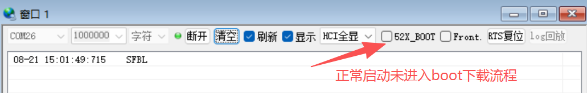
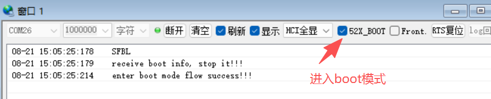
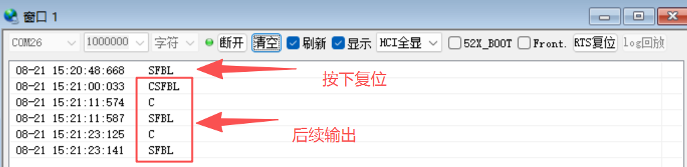
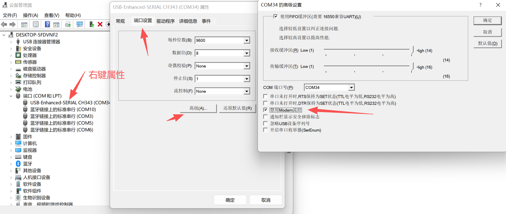
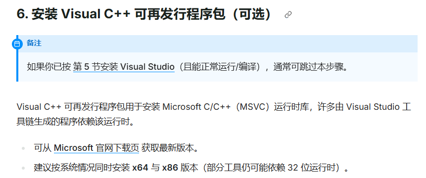

# SF32LB52x Self-Check Guide

:::{attention}
This document is intended for the hardware design self-check of the SF32LB52x series chips. After completing the hardware design, please check item by item against this document to ensure the hardware design meets specification requirements.
Before reading, please make sure you have completed:
[Hardware Design Guide](/hardware/SF32LB52B-E-G-J-HW-Application)&nbsp;&nbsp;
[Hardware Design Self-Check List](<https://downloads.sifli.com/hardware/files/documentation/SF32LB52%20Schematic%26PCB%20checklist_V1.0_20260121.xlsx>)
:::

## 1. Basic Introduction

This document is the hardware self-check guide for the SF32LB52x series chips, applicable to chips with numeric suffixes 0, 3, 5, and 7 (lithium battery-powered versions) as well as chips with letter suffixes B, E, and J (3.3V/1.8V powered versions).

This document targets SF32LB52x hardware whose prototype has been completed and boards have been returned. The focus is not to re-check the design scheme, but to confirm whether the board is capable of stable operation during power-up, download, communication, and use, through measured test points, an oscilloscope, a multimeter, and a serial port. Perform basic checks first, then locate problems through the exception FAQ.

:::{important}
**Before applying power, confirm the power supply method corresponding to the chip version you are using:**

- **Lithium battery-powered versions (0/3/5/7)**: An external lithium battery (VBAT/VCC) must be connected; otherwise the device cannot run normally. VBAT and VCC are the system main power supplies. The chip integrates an on-chip charging management module and supports USB charging. Even when powered via USB (VBUS), the battery must be connected to VBAT for the system to work stably.
- **Standard powered versions (B/E/J)**: No external battery is required. Simply connect a 2.97V ~ 3.63V external power source to the PVDD pin (1.71V ~ 1.98V for 52D). There is no on-chip charging management module and charging is not supported.
  :::

### 1. Recommended Tools

- Multimeter: for measuring supply voltages, test point voltages, and short circuits
- Oscilloscope: for observing clock waveforms, ripple, and power-up transients
- USB cable and serial port tools
- Backup power supply, replaceable battery, or charger

### 2. Test Conditions

- Before powering up the board, confirm there is no obvious short circuit, no reversed polarity, no solder whiskers or bridging
- Before testing, confirm the test points have been provided and are accessible
- Perform static measurements first, then dynamic power-up and communication tests

### 3. Pre-Power-On Checks

Perform visual inspection and simple electrical checks first to avoid chasing obvious problems after power-up.

- Check whether key components are missing, installed in reverse, cold-soldered, or obviously shorted
- Confirm the orientations of the power input connector, charging port, and battery connector are correct
- Confirm key test points (VBUS, VBAT, VCC, PVDD, BUCK_LX, BUCK_FB, etc.) have been provided and are measurable
- Confirm the reset, download, and debug pins are not mistakenly pulled low or high by peripherals

### 4. Key Component Selection Requirements

:::{important}
The parameter selection of the crystal and inductors directly affects chip startup, operating stability, and power quality. Mismatched parameters may cause failure to start, crashes, restarts, or power abnormalities. Please re-confirm that the component models and parameters used meet the following requirements.
:::

#### 48MHz Main Clock Crystal

| Parameter | Requirement | Description | Consequence if Abnormal |
| :----------- | :------------------------ | :--------------------------- | :------------------------------------------- |
| Frequency | 48MHz | Must be exactly matched | Oscillation fails to start, abnormal startup |
| Package | 1612 (1.6×1.2mm) or 2012 | Confirm matching with PCB pads | - |
| Load capacitance | 8.8pF recommended | Must match the recommended value in the chip datasheet | Large frequency deviation, abnormal RF communication; excessively large deviation directly affects startup |
| Frequency accuracy | ±10ppm or better | Insufficient accuracy causes communication baud rate deviation | Insufficient accuracy causes communication baud rate deviation |
| ESR | ≤40Ω | Too high may prevent oscillation from starting | Failure to start, no clock output after power-up |
| Operating temperature range | -40°C ~ +85°C | Must cover the product operating environment | - |

#### 32.768kHz RTC Crystal

| Parameter | Requirement | Description | Consequence if Abnormal |
| :----------- | :------------------------ | :--------------------------------- | :--------------------------------- |
| Frequency | 32.768kHz | Must be exactly matched | Inaccurate RTC timing, large deviation in low-power wake-up time |
| Package | 1610 (1.6×1.0mm) or 2012 | Confirm matching with PCB pads | - |
| Load capacitance | 7pF/11.5pF | The chip registers only support 7pF and 11.5pF | Difficulty starting oscillation, failure to wake up in low-power mode |
| Frequency accuracy | ±20ppm or better | Insufficient accuracy affects RTC timing accuracy | Affects RTC timing accuracy |
| ESR | ≤50kΩ | Too high may prevent oscillation or cause abnormal low-power wake-up | Failure to start, complete RTC function failure |
| Operating temperature range | -40°C ~ +85°C | Must cover the product operating environment | - |

#### DC-DC Inductor

| Parameter | Requirement | Description | Consequence if Abnormal |
| :-------------- | :------------------------ | :--------------------------- | :----------------------------------------------- |
| Inductance | 4.7μH (typical value) | Must match the recommended value in the chip datasheet | Increased output voltage ripple, reduced efficiency, possible undervoltage protection triggering |
| Saturation current | ≥450mA | Must meet peak load current requirements | Inductor saturation under heavy load, output voltage droop, chip reset or crash |
| DC resistance (DCR) | ≤0.4ohm | Too high reduces efficiency and generates heat | Reduced efficiency, severe heating, shortened battery life |
| Package | 0805 or 1008 | Confirm matching with PCB pads | - |
| Magnetic shielding | Shielded type preferred | Reduces EMI interference | - |
| Frequency characteristics | Suitable for 1MHz~3MHz switching frequency | Must match the chip DC-DC switching frequency | - |

## 2. Power Supply and Power-Up Self-Check

After power-up, first confirm that the main power supply is normal, then check whether the internal LDO/PMU outputs meet expectations. It is recommended to measure in the order of "input → intermediate nodes → load end".

### 2.1 Voltage Check Table

#### Lithium Battery Powered (520/3/5/7)

| Test Point | Normal Operation | Description |
| :---------: | :---------------------------------: | :-----------------------------------------------: |
|    VBUS    |             4.6V ~ 5.5V             |                   USB charging input                   |
|    VBAT    |             3.2V ~ 4.7V             |                   Battery power node                   |
|     VCC     | 3.2V ~ 4.7V (3.8V or above recommended for the first power-up) |                    System main power supply                    |
|    VSYS    |               approx. 3.3V               |                   RF power supply output                   |
|   BUCK_LX   |              approx. 1.25V              |                   BUCK inductor switching                   |
|   BUCK_FB   |              approx. 1.25V              |                     BUCK output                     |
|   VDD_RET   |               approx. 0.9V               |                    RET LDO output                    |
|   VDD_RTC   |               approx. 1.1V               |                   RTC LDO output                   |
|  VDD_VOUT1  |               approx. 1.1V               |                   Internal LDO1 output                   |
|  VDD_VOUT2  |               approx. 0.9V               |                   Internal LDO2 output                   |
| VDD18_VOUT |               approx. 1.8V               |              SIP power supply output, fixed at 1.8V              |
| VDD33_VOUT1 |               approx. 3.3V               | 3.3V LDO output 1, no output by default, requires software enable, fixed at 3.3V |
| VDD33_VOUT2 |               approx. 3.3V               | 3.3V LDO output 2, no output by default, requires software enable, fixed at 3.3V |
|  AVDD_BRF  |          approx. 2.97V ~ 3.63V          |                   RF power supply input                   |
| AVDD33_AUD |          approx. 2.97V ~ 3.63V          |                 3.3V audio power supply input                 |
|  MIC_BIAS  |           approx. 1.4V ~ 2.8V           |                Microphone bias power supply output                |

#### Standard Powered (52B/E/J/D)

| Test Point | Normal Operation | Description |
| :--------: | :--------------------------------------: | :-----------------------------------------------: |
|   VBATS   |                    -                    | VBATS is the battery voltage detection signal; battery voltage detection range 0 ~ 4.5V |
|    PVDD    |              2.97V ~ 3.63V              |   System main power supply input (B/E/J), 1.71V ~ 1.98V for 52D   |
|  BUCK_LX  |                 approx. 1.25V                 |                   BUCK inductor switching                   |
|  BUCK_FB  |                 approx. 1.25V                 |                     BUCK output                     |
|  VDD_RET  |                 approx. 0.9V                 |                    RET LDO output                    |
|  VDD_RTC  |                 approx. 1.1V                 |                   RTC LDO output                   |
|   VDDIOA   | 1.8V or 3.3V (3.3V for 52B, 1.8V for 52D/E/J) |         GPIO power supply input, voltage determined by chip model         |
|  VDD_SIP  | 1.8V or 3.3V (1.8V for 52D, 3.3V for 52B/E/J) |         Co-packaged memory power supply, voltage determined by chip model         |
| VDD_VOUT1 |                 approx. 1.1V                 |                   Internal LDO1 output                   |
| VDD_VOUT2 |                 approx. 0.9V                 |                   Internal LDO2 output                   |
|   AVDD33   |                 approx. 3.3V                 |            3.3V analog power supply input (B/E/J)            |
|  AVDD_BRF  |             approx. 2.97V ~ 3.63V             |                   RF power supply input                   |
| AVDD33_AUD |             approx. 2.97V ~ 3.63V             |                 3.3V audio power supply input                 |
|  MIC_BIAS  |              approx. 1.4V ~ 2.8V              |                Microphone bias power supply output                |

#### Power Supply Self-Check Points

- If VBUS has no voltage, first check the charging port, connector, charger, and protection components
- If VBAT/VCC is lower than expected, first check the battery connector, load switch, and power path
- If BUCK_LX/BUCK_FB is abnormal, suspect problems with DCDC-related components, the inductor, or the feedback network
- If VDD_VOUT1/VDD_VOUT2 have no voltage, first confirm whether the chip has powered up normally
- For lithium battery-powered versions, VDD18_VOUT is a fixed 1.8V output; VDD33_VOUT1/VDD33_VOUT2 are fixed 3.3V outputs with no output by default; voltage appears only after software enable
- For lithium battery-powered versions (0/3/5/7), VBAT/VCC is the system main power supply, and **an external lithium battery must be connected** for the device to run normally. Even when charging via USB (VBUS), the battery must be connected to VBAT
- For standard powered versions (B/E/J), no external battery is required; simply connect an external power source via PVDD. The voltages of VDDIOA and VDD_SIP depend on the chip model: 3.3V for 52B, and 3.3V for 52D/E/J; please verify against the chip model used to confirm the expected voltage

### 2.2 Flash Memory Power Supply Check

SF32LB52x supports internal co-packaged Flash/PSRAM and external Flash memory, in both lithium battery-powered and standard powered versions.

#### SF32LB52x Series (Lithium Battery Version, 0/3/5/7 Suffixes)

| Memory Type | Power Supply | Power Switch Required | Control Pin | Description |
| :--------------------------: | :----------------------------: | :--------------: | :------: | :-----------------------------: |
|   Internal co-packaged Flash (520Ux6)   | VDD33_VOUT1 powers VDD18_VOUT |      Not required      |    -    | Set the VDD18_VOUT internal LDO to the off state |
| Internal co-packaged PSRAM (523/5/7Ux6) |            Internal LDO            |      Not required      |    -    |     Just connect an external power source to VDD18_VOUT     |
|      External SPI Nor Flash      |      VDD33_VOUT1 (3.3V)      |      Not required      |    -    |     Direct power supply, no power switch needed     |
|     External SPI Nand Flash     |      VDD33_VOUT1 (3.3V)      |       Required       |   PA11   |     High level turns on, low level turns off     |
|      External SD Nand Flash      |      VDD33_VOUT1 (3.3V)      |       Required       |   PA11   |     High level turns on, low level turns off     |

#### SF32LB52X Series (Standard Powered Version, B/E/J/D Suffixes)

| Memory Type | Power Supply | Power Switch Required | Control Pin | Description |
| :-------------------------: | :----------------: | :--------------: | :------: | :--------------------: |
|  Internal co-packaged Flash (52AUx6)  |      VDD_SIP      |       Required       |   PA21   |     A power switch is mandatory     |
| Internal co-packaged PSRAM (PVDD=3.3V) | VDD_SIP (internal LDO) |      Optional      |    -    |  Not needed when powered by internal LDO  |
| Internal co-packaged PSRAM (PVDD=1.8V) |      VDD_SIP      |       Required       |   PA21   |   Mandatory when PVDD=1.8V   |
|        External memory        |   Independent of VDD_SIP   |       Required       |   PA21   |    Add a separate power switch    |
|  External ≥32MB SPI Nor Flash  |         -         |       Required       |   PA21   | Power-off is required to exit 4BYTE Mode |
|  External ≤16MB SPI Nor Flash  |         -         |      Not required      |    -    |        Can be powered continuously        |

:::{important}
**Flash power supply check points:**

1. **VDD_SIP voltage**: Power supply for co-packaged memory, range 1.71V~3.63V for standard powered versions (1.8V for 52D/E/J, 3.3V for 52B)
2. **PA21/PA11 control signals**: The power switch enable pins of all boot memories **must** be controlled by PA21/PA11; high level turns on, low level turns off
3. **Hibernate mode**: When using Hibernate mode, the VDD_SIP power supply must be turned off; otherwise there is a leakage current risk on the I/O of the co-packaged memory
4. **Large-capacity Flash**: When an external ≥32MB SPI Nor Flash is used, PA21 must be used to cut off power so that the Flash exits 4BYTE Mode
5. **Lithium battery versions**: VDD33_VOUT1/VDD33_VOUT2 have no output by default; voltage appears only after software enable
   :::

### 2.3 Power Ripple and Power-Up Sequence

- Use an oscilloscope to observe whether the main power supply and analog power supply show obvious droops or spikes at the moment of power-up
- Observe whether the power-up sequence shows reset jitter, supply hysteresis, or momentary short circuits
- If the board crashes or restarts immediately after power-up, first check the power ripple, reset release sequence, and load switch

## 3. Clocks

### 3.1 48MHz Main Clock

- Use an oscilloscope to observe whether stable oscillation exists at the nodes corresponding to the 48MHz crystal
- If there is no waveform, first check the crystal, load capacitors, bypass network, and corresponding test points
- If a waveform exists but the frequency deviates significantly, first check the crystal model, matching capacitors, and component mounting quality

### 3.2 32.768kHz RTC Clock

- Use an oscilloscope or frequency counter to confirm whether the 32.768kHz clock is stably present
- An abnormal RTC clock causes abnormal low-power wake-up, timing, and certain peripheral functions
- If the 48MHz clock is normal but the 32K clock is abnormal, first check the RTC crystal and its matching network

## 4. Serial Port Output

:::{important}

- The content of this chapter verifies that the chip boot output is normal

SiFli serial port tool: [SiFli_Trace tool download](https://downloads.sifli.com/tools/SiFli_Trace/SiFli_Trace_latest.7z)

:::

### 4.1 Serial Port Connection

1. Chip TX ↔ serial converter board RX; chip RX ↔ serial converter board TX. Reversed connection results directly in no communication and no output
2. Serial level matching: chip IO voltage = converter board voltage (1.8V to 1.8V, 3.3V to 3.3V)

### 4.2 Serial Communication Verification

:::{important}
**Even if there is no user program in the chip, the SF32LB52x automatically outputs boot logs containing the string "SFBL" through DBG_UART (PA19/TX) after power-up.** This is inherent behavior of the chip's internal ROM and can be used to verify that the serial communication link works properly.
:::

After connecting the serial tool (baud rate 1000000), power up and observe the serial output:

- If you can see output containing **"SFBL"**, the serial communication link is normal (TX/RX connected correctly, levels matched, baud rate correct), even if no program has been flashed into the chip yet
- If you see no output at all, troubleshoot in order:
  - Confirm whether TX/RX are reversed
  - Confirm whether the serial tool level matches the chip IO level (3.3V)
  - Confirm the baud rate is set to 1000000
  - Confirm the DBG_UART pins (PA18/RX, PA19/TX) are not occupied or shorted by peripherals
  - Confirm the chip power supply is normal and the chip has powered up normally

### 4.3 Reset Detection

:::{important}
The hardware reset of the SF32LB52 chip can be triggered by long-pressing the PA34 pin reset or by the serial tool RTS reset (see the serial auto-download design section). PA34 is designed as active-high — default pull-down to low, and pulled high after the button is pressed. This differs from the common active-low reset design, so special attention is required during self-checking.
:::

- After power-up, confirm the PA34 reset pin defaults to low level (not pressed), and the chip runs normally after the main power supply is stable
- **Long-press** the reset button (hold for about 10 seconds) and confirm the board can trigger a hardware reset and restart
- If there is no response after a long press, first check: whether PA34 is correctly connected to the button circuit (default pull-down to low, pulled high when pressed), whether the reset button works, and whether the main power supply is stable
- If the device restarts repeatedly on its own, the PA34 circuit design may be wrong; please check the pull-up/pull-down configuration against the power-on/off button circuit diagram in the hardware design guide

### 4.4 Bootloader Boot Output (SFBL, CSFBL, 8SFBL)

:::{important}
After reset, the internal BootROM of the SF32LB52x outputs boot identifiers through DBG_UART (PA19/TX). Depending on the chip configuration and boot mode, it outputs **SFBL** and **CSFBL**.
:::

#### SFBL — Normal SiFli BootLoader Boot Identifier

SFBL indicates that the chip's internal normal BootROM has started and is executing the standard boot flow.

**Normal boot flow (BOOT_MODE not pulled high):**

```text
Reset
  |
  +-- Output SFBL
  |
  +-- Check the user image in Flash
  |      +-- Image valid → boot user program
  |      +-- No valid image → automatically enter download mode
  |
  +-- [When entering download mode] Output:
         receive boot info, stop it!!!
         enter boot mode flow success!!!
```



**Download mode boot flow (BOOT_MODE pulled high by hardware, then reset):**

```text
Reset (BOOT_MODE=H)
  |
  +-- Output SFBL
  |
  +-- Wait for host handshake (about 2 seconds)
  |      receive boot info, stop it!!!
  |      enter boot mode flow success!!!
  |
  +-- Wait for download commands
```



#### CSFBL — Flash read failure, or no firmware for CSFBL

**After pressing reset, SFBL is output, followed by CSFBL after a wait:**



<!-- #### 8SFBL — incorrect pull-up resistor of the flash, and the **8SFBL** string appears

 -->

## 5. Firmware Flashing

:::{important}

- Please use the SiFli download tool for flashing; faults can be located through logs

Software download tool: [Impeller download](https://downloads.sifli.com/tools/Impeller_COMMON.7z)

Impeller: [User guide](https://wiki.sifli.com/tools/%E7%83%A7%E5%BD%95%E5%B7%A5%E5%85%B7.html)

:::

### 5.1 Flashing Logs

## 6. Common Fault FAQ

### 1. Serial Communication

#### FAQ1: No output after serial reset

A: Suggested troubleshooting

1. Serial TX-RX not connected in a crossed manner

2. Main power input, 48M crystal, or BUCK circuit fault

#### FAQ2: Garbled output after serial reset

A: Incorrect baud rate setting; always use the 1000000 baud rate

#### FAQ3: Repeatedly printing "enter boot mode flow error 1"

A: The chip TX is normal, but the RX path is open-circuited / cold-soldered / level mismatched

#### FAQ4: Repeated resets after power-up / periodic resets

Q: The device resets repeatedly

A: Check the power supply; lithium battery-powered versions require a connected battery.

Q: The device resets approximately once every 10s periodically

A: Confirm the reset pin PA34 is not pulled high

#### FAQ5: The chip contains a program, but after power-up reset it only outputs SFBL and does not run the program normally

R: The 52X_BOOT option is checked in the serial tool

A: Uncheck the 52X_BOOT option in the serial tool

#### FAQ6: The chip appears frozen after connecting the serial port

R: Some development boards, such as Huangshan Pi and SF32LB52-DevKit-Nano-N16R16, reset via the RTS pin of the on-board serial port. After the board is powered on again, connecting the serial port with the tool for the first time triggers a board reset, or during use the board may power off when the serial port is opened

A: Go to Device Manager -> right-click the port properties -> select Port Settings (Advanced) -> check "Disable modem flow control". The sifli_trace tool has an RTS reset function



#### Download Mode Troubleshooting Points

- If you only see **SFBL** but not the subsequent `receive boot info` and `enter boot mode flow success`, the link from the PC's TX to the MCU's RX is not working, or the BOOT option of SifliTrace is not properly enabled
- Confirm that the BOOT option of the SifliTrace tool is checked, then restart the chip to trigger entering Boot Mode
- The state of the BOOT_MODE pin determines the boot path: pulled high, it directly enters download mode; not pulled high, the Flash image is checked first

### 2. Flashing Failure

```text

Flashing failure → Step 1: check whether there is a progress bar
├─ No progress bar: serial/BOOT/wiring faults (handled uniformly)
│  ├─ Fails 1 second after clicking Flash → serial port occupied, COM conflict
│  ├─ Trace shows no output at all → main power/48M crystal/BUCK/TX-RX reversed/BOOT not entered
│  ├─ BOOT output present, but no reply after typing help → chip RX/converter board TX open circuit
│  └─ Driver loading fails → wrong chip model selected in the tool, missing Flash power supply, abnormal core voltage
├─ Enters BOOT but driver flashing fails
├─ Stuck mid-progress with a bar/fails at a fixed address: Chapter 4 (internal/external Flash distinction, Flash power supply, driver configuration, pull-up/pull-down, ID adaptation)
├─ Random probabilistic failures: Chapter 5 (crystal/inductor/power/serial/Flash component signals)
└─ 99% verification failure: xxx
```

#### 1.1 Viewing Logs

##### 1.1.1 Log Storage Path

```text

Impeller tool: <tool root directory>\log\channel\<date>\chanx_<date>.txt
```

##### 1.1.2 Quick Reference for Key Log Nodes

| Log Node | Key Log Content | Status Judgment | Description |
| :---------: | :----------------------------------: | :------------------: | :-----------------------: |
|   Stage 1.1   |       uart COMxx open success       |     Serial port opened normally     |    Serial wiring, serial port occupation    |
|   Stage 1.2   |        EnterDebugMode success        |     Successfully entered BOOT     |   BOOT operation, RX hardware fault   |
|   Stage 1.3   |      DownLoadFileRam over: PASS      | Flashing driver loaded successfully |    Chip model, core power supply    |
|   Stage 1.4   |     -SiFli Corporation version print     |  Chip core initialization completed  |   Power supply, crystal, BUCK inductor   |
|   Stage 2.1   |            id:0xXXXXXXXX            |  External Flash identified normally  | Storage pull-up/pull-down, QSPI/SDIO wiring |
|   Stage 2.1   |            id:0x00000000            |   External Flash not identified   | Flash power supply, wiring, driver configuration |
|   Stage 2.2   | download_image_simple_thread success |    Main image written successfully    | Flash power supply, wiring, driver configuration |
|   Stage 2.3   |        OTP_FACTORY_WRITE_PASS        |    MAC/SN written successfully    |    OTP power supply, SN/MAC configuration    |
|    End    |              FINAL_PASS              |   All flashing verifications passed   |          No fault          |

##### 1.1.3 Complete Flashing Log Sample

- Use the complete flashing sample to troubleshoot step by step

```text

workpath: D:\svn_tool\Impeller_x30_2022_m5\Release, 
toolpath: D:\svn_tool\Impeller_x30_2022_m5\Release
cur version 3.8, driver_external/internal_20251030
uart COM19 open success 
//---------------------------- 1.1 Up to this point, the serial port opened normally
RAM_PATCH: D:\svn_tool\Impeller_x30_2022_m5\Release\file\ram_patch_52X.bin
SIG_PUB: D:\svn_tool\Impeller_x30_2022_m5\Release\file\sig_pub.der
channel DownLoadUart start 
uart COM19 open success 
EnterDebugMode success: curbaund (1000000)
//---------------------------- 1.2 Up to this point, serial debugging opened normally
WriteMemSingle success: 0xf000edf0 0xa05f0003
ReadMemSingle success: 0xf000ee08 0x00000000
WriteMemSingle success: 0xf000ee08 0x00010000
WriteMemSingle success: 0xf000edfc 0x01000001
WriteMemSingle success: 0xf000ed0c 0x05fa0004
ReadMemSingle success: 0xf000edf0 0x02030003
ReadMemSingle success: 0xf000edf0 0x00030003
WriteMemSingle success: 0xf000edfc 0xa05f0003
WriteMemSingle success: 0xf000edfc 0x01000000
[R] PC: 0x000007d4  MSP: 0x20001020

DownLoadFileRam start
use driver: D:\svn_tool\Impeller_x30_2022_m5\Release\file\ram_patch_52X.bin
DownLoadFileRam over: PASS
//---------------------------- 1.3 Up to this point, the flashing driver was downloaded successfully
WriteMemSingle success: 0x5000202c 0xfffffc00
WriteMemSingle success: 0x50002030 0x00000000
[R] PC: 0x000007d4  MSP: 0x20001020
[R] PC: 0x2005a550  MSP: 0x20043920
[R] BMR: 0x00000001

fid:00000000 mtype:00000000 did:00000000
fid:00000085 mtype:00000020 did:00000018
fid:00000000 mtype:00000000 did:00000000

Serial:c2,Chip:4,Package:3,Rev:3  Reason:00000000
\ | /
- SiFli Corporation
/ | \     build on Oct 30 2025, 2.4.0 build 4f1f8907
2020 - 2022 Copyright by SiFli team
curent ver 20251030, otpbase 0x12000000
psram size:0x800000 addr:0x60000000
//---------------------------- 1.4 Up to this point, all initialization is complete and the main function is entered
burn_speed 3000000 1000
burn_speed 3000000 1000
OK

//---------------------------- 2 The following is the flashing flow
downloadfile: d:\007_watch_eh_lb523_nor_Keil\ota_manager.bin  addr: 0x120ae000  len: 377128 Byte
burn_erase_write 0x120ae000 0x5c128
burn_erase_write 0x120ae000 0x5c128
addr:0x120ae000 base:0x12000000 size:0x1000000 sector:0x1000 page:0x0 id:0x182085
ext_flash -1, g_base_addr 0x0, g_base_size 0x0
//---------------------------- 2.1 Check the corresponding flash/emmc information; NOR/NAND flash must have an id; 0 means not identified
RX_WAIT:0 0
[0] run thread 0 addr:0x120ae000 len:0x20000
RX_WAIT:1 1
[1] run thread 1 addr:0x120ce000 len:0x20000
RX_WAIT:0 2
[2] run thread 0 addr:0x120ee000 len:0x1c128
OK
burn_verify 0x120ae000 0x5c128 0x43330e70
burn_verify 0x120ae000 0x5c128 0x43330e70
addr:0x120ae000 base:0x12000000 size:0x1000000 sector:0x1000 page:0x0 id:0x182085
V: 0x43330e70 vs 0x43330e70, TIMR:0xff DCR:0x800000
OK
download_image_simple_thread success 
//---------------------------- 2.2 Up to this point, this image has been flashed
otpwrite: otp_factory_write 1 c80013140010
otp_factory_write 1 c80013140010
FACTORY_CFG_ID_MAC write ok with 6
OTP_FACTORY_WRITE_PASS
OTP_FACTORY_WRITE_PASS
//---------------------------- 2.3 Up to this point, the MAC was written successfully; other OTP operations are similar
burn_speed 1000000 1000
burn_speed 1000000 1000
OK
DownLoadUart success 
DownLoadUart() pass
FINAL_PASS
```


### 2. Flashing Without Progress Bar

#### FAQ7: Flashing fails before the serial port opens

R: Fails within 1 second; 90% of the causes are serial port occupation or COM conflicts

A: Free the serial port: close serial port assistants, other flashing software, and virtual serial port tools; confirm in Device Manager that the COM port is not occupied by multiple programs;

#### FAQ8: Enter DebugMode fails

R: Failed to enter BOOT mode

A: Check whether the BOOT mode is normal and whether the BOOT mode can be entered

### 3. Flashing Fails Midway

```text

The internal flash address is fixed; the external flash address is generated by the external storage and software definition:

SF32LB52B	0x10000000 ~ 0x11FFFFFF	The only model with built-in 52X flash

All other 52X (523/525/527/D/E/J)	No internal Flash	Entirely dependent on external storage

```
#### FAQ9: Failure at a fixed address, failure falls in the internal flash range

A: 1.	Re-measure the core power supply pin voltages; SF32LB52B	VDD_SIP	3.3V | SF32LB52D/52E/52J	VDD_SIP	1.8V | SF32LB523/525/527	VSYS	3.3V

2.	Confirm there is no voltage droop on the power supply corresponding to the internal Flash;

3.	Check the chip soldering and flashing address.

#### FAQ10: Failure at a fixed address, failure falls in the external flash range, power supply circuit abnormal

A: 1.	For continuously powered Flash circuits: if there is no voltage, directly check the LDO and open circuits;

2.	IO-controlled Flash power supply circuit:

•	Must measure in real time during flashing (the IO is pulled high to supply power only during flashing);

•	Temporary verification: fly-wire to power the Flash continuously, distinguishing hardware from driver configuration problems;

•	Fundamental solution: modify the driver with BurnDriverEx so that flashing automatically pulls the power IO high.


#### FAQ11: Failure at a fixed address, failure falls in the external flash range, flash id abnormal

Q: The corresponding flash id is not detected

A: Flash not adapted: refer to the [flash id configuration document](https://wiki.sifli.com/tools/flash/Flash%E9%85%8D%E7%BD%AE%E6%8C%87%E5%8D%97.html) 


####  FAQ12: Probabilistic random flashing failures

Q: A single board occasionally flashes successfully/fails, with no fixed reproduction conditions

A: 1. Core hardware component check (48M crystal, BUCK circuit, power filter capacitors)

2. Check power supply stability

3. Check serial communication

4. Flash hardware signals (excessively long PCB traces, defective chip)


####  FAQ13: Flashing stuck at 99%

R: Firmware writing completed, but data verification mismatched

A: 1.	Flash hardware distinction

•	Individual failures on a single board: the Flash has bad blocks; replace the Flash chip directly;

•	99% failures across an entire batch: the Flash driver clock frequency is configured too high; modify the driver read/write clock parameters
.
2.	OTP additional field interference verification: uncheck the [Flash MAC] and [Flash SN] options and test flashing firmware only; if it works normally after unchecking, the MAC/SN configuration parameters are wrong and the driver configuration file needs to be checked.


<!-- 
#### 1.2, FAQ: Flashing Without Progress

```text

Symptom: Clicking the Flash button pops up Fail directly after 1~20s, with no progress loading throughout; failure within 1 second is 90% caused by serial port occupation or COM conflicts.

Quick self-check:
1.	Free the serial port: close serial port assistants, other flashing software, and virtual serial port tools; confirm in Device Manager that the COM port is not occupied by multiple programs;
2.	Unify the baud rate: enforce 1000000 throughout the entire flow; custom baud rates for debugging are prohibited.


```


#### 1.3, FAQ Logs


#### FAQ1: Flashing

#### FAQ1: Log content is blank, the tool pops up an exception at startup and cannot start

Q: The PC lacks the VC++ runtime library, and the underlying flashing component fails to load

A: Refer to [Development Environment Configuration](https://docs.sifli.com/projects/solution/1.get-started/development_env.html) to install the corresponding version of the [Visual C++ Redistributable]




##### FAQ2:

| Symptom | Priority Check Items |
| :------------------------- | :----------------------------------------------------------------------------------- |
| No voltage at all after power-up | Charging port, main power path, load switch, protection components |
| VBUS normal but VCC abnormal | Battery connector, BUCK, feedback network, PMU output |
| No SFBL output on serial port | Whether TX/RX are reversed, level matching (3.3V), baud rate 1000000, whether PA18/PA19 are occupied, whether the power supply is normal |
| No response to long-press reset | PA34 button circuit (must be active-high), pull-up/pull-down configuration, whether the power supply is stable |
| No clock waveform | Crystal, matching network, corresponding test points, soldering quality |
| Device restarts repeatedly | Whether the VSYS voltage waveform is correct |
| Lithium battery version cannot power on without a battery | Whether VBAT/VCC is connected to an external lithium battery (the battery must be connected even when charging via USB) |
| Flash not recognized | VDD_SIP/VDD33_VOUT1 power supply, PA21 control signal, Flash soldering quality |
| Program cannot be downloaded to Flash | PA21 control signal, Flash power switch, 4BYTE Mode exit | -->
