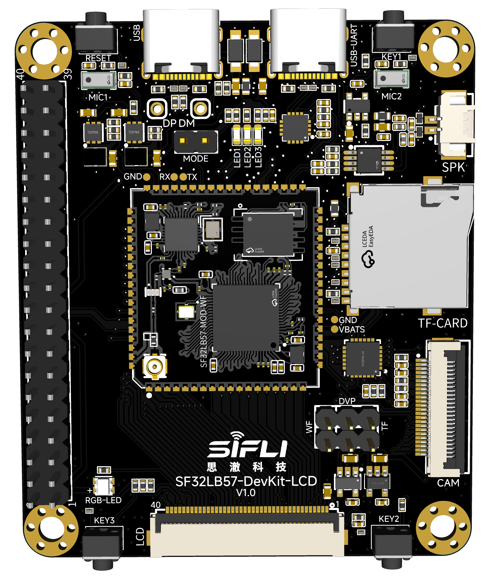
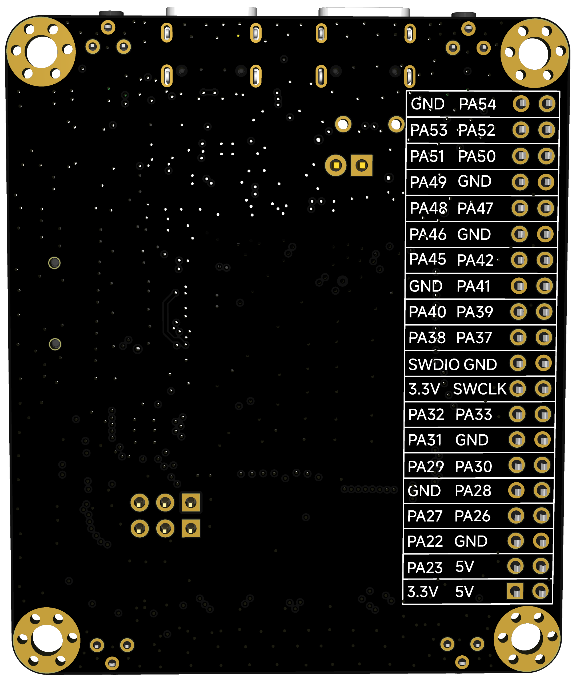
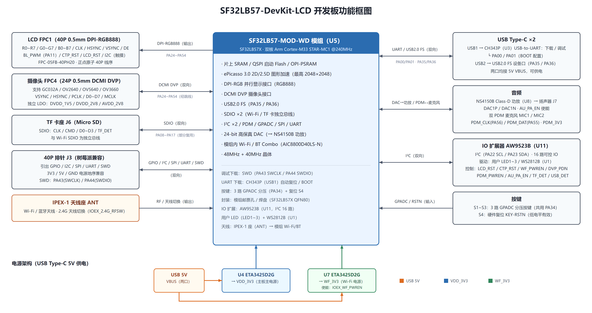
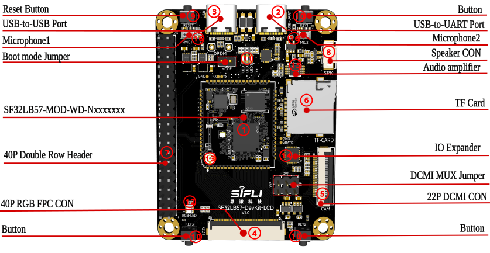
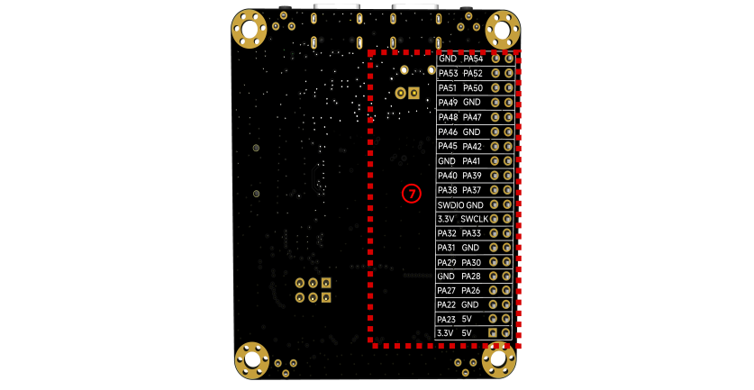
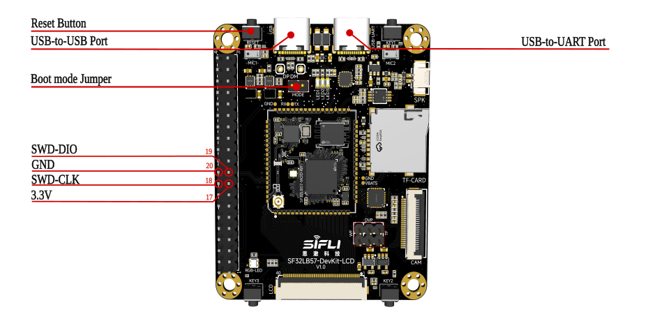
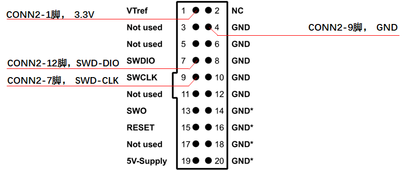
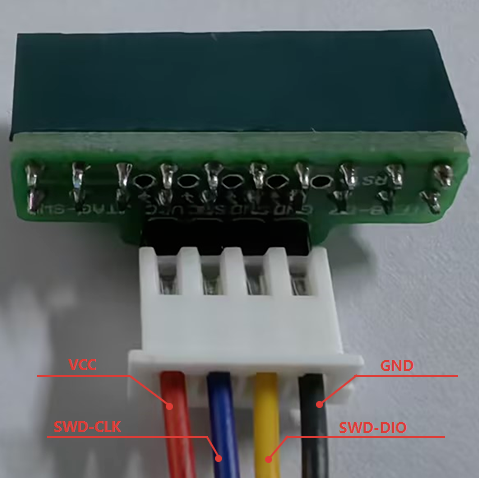
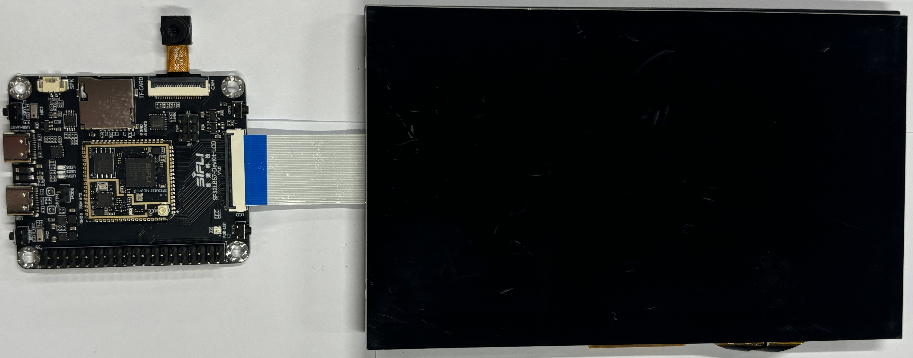
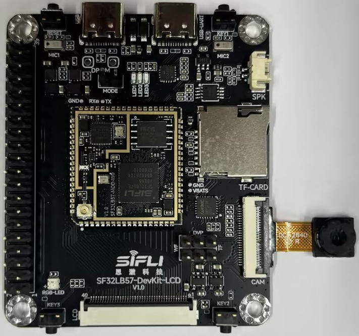

# SF32LB57-DevKit-LCD开发板使用指南

## 开发板概述

SF32LB57-DevKit-LCD开发板基于高性能 **SF32LB57-MOD-WD** 模组打造，专为 **DPI-RGB 并行显示**、**DCMI 摄像头**、**音频播放/录音** 及 **Wi-Fi** 等多媒体 AIoT 应用场景量身定制。该开发板集成了一颗双核 Arm Cortex-M33 STAR-MC1 @240MHz 的 SF32LB57 芯片，并板载 Wi-Fi / 蓝牙Combo、QSPI 启动 Flash、LCD 连接器、摄像头连接器、音频功放、PDM 麦克风、TF 卡座及树莓派兼容 40P 扩展排针，可充分满足智能 HMI、可视对讲、智能穿戴等产品的研发需求。

在硬件接口配置上，开发板提供了丰富的扩展资源：USB Type-C 串口调试、USB2.0 FS、40P 0.5mm 间距 DPI-RGB888 FPC 显示接口、24P 0.5mm 间距 DCMI 摄像头接口、TF 卡座、1.25mm 扬声器接口、双 PDM 麦克风、3 路 GPADC 按键、树莓派兼容 40P 2.54mm 双排针等，方便开发者进行程序调试、数据传输及外设扩展。

依托其完善的硬件架构与接口设计，该开发板可高效助力开发者完成各类接口外设的驱动开发工作，显著降低硬件开发难度、简化研发流程，进而缩短产品从研发到量产上市的周期。


 

<div align="center"> SF32LB57_DevKit-LCD开发板实物正面照 </div>   <br> <br>

 

<div align="center"> SF32LB57_DevKit-LCD开发板实物背面照 </div>   <br> <br>


### 特性列表

该开发板具有以下特性：

1. **核心模组**
   - 板载 **SF32LB57-MOD-WD** 模组，模组内部集成：
     - SF32LB57X 系列芯片（3.3V 供电系列），双核 Arm Cortex-M33 STAR-MC1 @240MHz，1968 CoreMark
     - 片上 SRAM **592KB**（HPSYS 512KB + LPSYS 80KB，全部 Retention）
     - 合封 QSPI-NOR Flash（启动 Flash）与可选 OPI-PSRAM（依具体模组料号）
     - 合封 **AIC8800D40LS-N 系列 Wi-Fi** 芯片，SDIO 接口
     - 48MHz 晶体(SF32LB57X) + 40MHz 晶体(AIC8800D40LS-N)
   - 模组封装为邮票孔/焊盘形式，便于直接贴片或焊接于底板
2. **显示接口**
   - 大核 **DPI-RGB 并行显示接口**，40P 0.5mm 间距 FPC 连接器（FPC1）
   - 正点原子标准 40P RGB 线序接口，支持FreeIO配置，QSPI、MCU8080、EPD和JDI接口都可以从这个40P的FPC上转接测试。
   - 默认支持 **RGB888**（24bit 数据），软件可配置为 RGB565 等位宽
   - 支持 ePicasso 3.0 2D/2.5D 图形硬件加速，最高 2048×2048、60fps 全屏刷新
3. **摄像头接口**
   - **DCMI DVP 摄像头接口**，24P 0.5mm 间距 FPC 连接器（FPC4）
   - 支持 GC032A、OV2640、OV5640、OV3660 等常见 DVP 摄像头模组
   - 板载摄像头电源：DVDD_1V5 / DVDD_2V8 / AVDD_2V8 独立 LDO
4. **音频接口**
   - 1× 24-bit 高保真 DAC 输出，经板载 Class-D 音频功放（NS4150B）驱动扬声器
   - 板载 1.25mm 间距 2P 扬声器连接器（J7）
   - 2× PDM 数字麦克风（MSM261DGT007 / 同封装兼容型号LMD4020T261-AC23），支持双麦阵列
5. **USB**
   - USB Type-C 接口 ×2：
     - 一个为 **USB-to-UART**（CH343P），用于程序下载和软件调试，同时可供电
     - 一个为 **USB2.0 FS**（直连芯片 PA35/PA36），用于 USB 从设备开发，可供电
6. **TF 卡**
   - 支持 1bit SDIO 接口的 TF 卡，板载 Micro SD 卡插槽（J6）
7. **蓝牙/Wi-Fi**
   - 模组内部集成 AIC8800D40LS-N 系列 Wi-Fi 芯片
   - 板载 IPEX-1 代天线座（ANT）
   - 预留 SDIO Wi-Fi 控制信号及 Host 唤醒、天线切换等 IO
8. **扩展接口**
   - 40pin-2.54mm 间距双排针（J3），兼容树莓派 40P 电源和地线序
   - 引出多路 GPIO、I2C、SPI、UART、SWD 调试信号
9. **人机交互**
   - 3 路 GPADC 电阻分压按键（KEY-1 / KEY-2 / KEY-3）
   - 1 个硬件复位按键（KEY-RSTN）
   - 3 个用户 LED（红 / 绿 / 蓝，由 IO 扩展器驱动）
   - 1 个 WS2812B 可寻址 RGB LED（PA11 驱动）
10. **电源**
    - 支持 USB Type-C 5V 供电
    - 主 3.3V 电源：ETA3425D2G Buck（U4）
    - 独立 Wi-Fi 3.3V 电源：ETA3425D2G Buck（U7），由 IOEX_WF_PWREN 控制
    - IO 扩展器：AW9523BTOR（U11），I2C 接口，扩展 16 路可控 IO

### 功能框图
  
 

<div align="center"> 开发板功能框图 </div>   <br> <br>  


## 组件介绍

SF32LB57-DevKit-LCD 开发板的主板是整个套件的核心，集成了 SF32LB57-MOD-WD 模组，并提供 DPI 显示、摄像头、音频、TF 卡、USB 等接口。
   
 

<div align="center"> 开发板正面组件标注 </div>   <br> <br>

 

<div align="center"> 开发板背面组件标注 </div>   <br> <br>

```{table}
:width: 100%
:align: center
| 标号 | 组件 | 说明 |
|:----:|:-----|:-----|
| 1 | SF32LB57-MOD-WD 模组 | 核心处理模组，集成 SF32LB57X 芯片、Wi-Fi/BT、启动 Flash、晶体 |
| 2 | USB Type-C 调试口 | CH343P USB-to-UART，用于固件下载与串口调试 |
| 3 | USB Type-C 设备口 | SF32LB57 原生 USB2.0 FS（PA35/PA36） |
| 4 | LCD FPC 连接器 FPC1 | 40P 0.5mm 间距，DPI-RGB888 显示接口 |
| 5 | 摄像头 FPC 连接器 FPC4 | 24P 0.5mm 间距，DCMI DVP 摄像头接口 |
| 6 | TF 卡座 J6 | Micro SD 卡槽，SDIO 接口 |
| 7 | 40P 双排针 J3 | 树莓派兼容扩展接口 |
| 8 | 扬声器座 J7 | MX1.25-2P，接外置扬声器 |
| 9 | 复位按键 S4 | KEY-RSTN，低电平复位 |
| 10 | GPADC 按键 S1~S3 | 3 路电阻分压按键，共用 PA34 |
| 11 | 用户 LED LED1~LED3 | 红 / 绿 / 蓝 LED，由 AW9523B 驱动 |
| 12 | WS2812B LED U1 | 可寻址 RGB LED，PA11 驱动 |
| 13 | IPEX 天线座 | Wi-Fi / 蓝牙天线接口 |
| 14 | AW9523B IO 扩展器 U11 | I2C 接口 16 路 IO 扩展 |
| 15 | 音频 PA U8 | NS4150B，驱动扬声器 |
| 16 | PDM 麦克风 MIC1/MIC2 | 双路数字麦克风 |
```

## 应用程序开发

本节主要介绍硬件和软件的设置方法，以及开发应用程序和烧录固件的说明。

### 必要硬件

- 1 x SF32LB57-DevKit-LCD 开发板
- 1 x DPI-RGB 接口 LCD 模组（40P 0.5mm FPC）
- 1 x USB2.0 数据线（标准 A 型转 Type-C 型）
- 1 x 电脑（Windows、Linux 或 macOS）

```{note}
  1. 如果既要通过 UART 调试，又要使用 USB2.0 FS 功能，需要两根 USB2.0 数据线；
  2. 请确保使用支持数据的 USB 数据线，部分数据线仅可用于充电，无法用于数据和程序烧录；
  3. 使用摄像头、扬声器、麦克风等外设时，请确认接口方向与线序定义一致。
```

### 可选硬件

- 1 x DCMI DVP 摄像头模组（GC032A / OV2640 / OV5640 / OV3660）
- 1 x TF 卡
- 1 x 8Ω 扬声器
- 1 x Wi-Fi / 蓝牙天线（IPEX-1 接口）

### 硬件设置

准备好开发板，加载第一个示例应用程序：

1. 将 LCD 模组连接至 FPC1 接口，注意 FPC 金手指朝向和 1 脚位置；
2. 如需联网，将 IPEX-1 天线安装到天线座；
3. 打开思澈的 SifliTrace 工具软件，选择正确的 COM 口；
4. 插入 USB 数据线，连接 PC 与开发板的 **USB-to-UART** 端口；
5. 屏幕上电后应显示默认画面，可用手指与触摸屏进行交互（如 LCD 模组带触摸功能）。

硬件设置完成，接下来可以进行软件设置。

### 软件设置

如何快速设置开发环境，请参考软件相关文档。通常流程包括：

1. 安装 Sifli SDK 及编译工具链；
2. 在 SDK 中选择 `SF32LB57-DevKit-LCD` 板级支持包；
3. 编译示例工程（如 `lvgl_demo`、`camera_demo`、`audio_player` 等）；
4. 通过 SifliTrace / Impeller 工具，选择对应的 COM 口下载固件；
5. 如需使用 USB2.0 FS，确认 PC 端已安装相应驱动。

## 硬件参考

本节提供关于开发板硬件的更多信息。

### 供电说明

SF32LB57-DevKit-LCD 开发板支持 USB Type-C 供电。板上两个 USB Type-C 接口均接入 5V VBUS，可给板子供电，但功能分工如下：

- **USB-to-UART 端口**：用于程序下载、串口调试及供电；
- **USB2.0 FS 端口**：用于 USB 从设备功能开发及供电。

下载和调试时，建议使用 **USB-to-UART** 端口。

电源树如下图所示（示意）：

```{table}
:width: 80%
:align: center
| 输入 | 电源芯片 | 输出 | 负载 |
|:----:|:---------|:----:|:-----|
| 5V USB | U4 ETA3425D2G | VDD_3V3 3.3V | 主板主电源、MCU、LCD、外设 |
| 5V USB | U7 ETA3425D2G | WF_3V3 3.3V | 模组内部 Wi-Fi / 蓝牙 Combo |
```

U7 的使能由 IO 扩展器信号 **IOEX_WF_PWREN** 控制，软件可独立关闭 Wi-Fi 电源以降低功耗。

### SF32LB57-MOD-WD 模组 GPIO 分配

下表为模组引出到开发板的主要管脚分配，用于控制开发板的特定组件或功能。

```{table}
:width: 100%
:align: center
| 管脚 | 管脚名称 | 功能 |
|:----:|:---------|:-----|
| 1 | GND | 地 |
| 2 | VDD_3V3 | 3.3V 电源输入 |
| 3 | VDD_1V8 | 1.8V 电源输出（内部 LDO） |
| 4 | RSTN | 复位信号，接复位按键 |
| 5~22 | PA_41 ~ PA_24 | GPIO / LCDC / SPI / SD / 调试复用 |
| 23~36 | PA_23 ~ PA_10 | GPIO / I2C / SD / USB / 音频 / 调试复用 |
| 37 | DAC1P | 音频 DAC 差分输出 P |
| 38 | DAC1N | 音频 DAC 差分输出 N |
| 39 | MICBIAS_PA56 | 麦克风偏置电源 / PDM_CLK |
| 40 | ADC1P_PA55 | 音频 ADC 输入 P / PDM_DAT |
| 41 | GND | 地 |
| 42 | PA_00 | GPIO / USB_DP |
| 43 | PA_01 | GPIO / USB_DM |
| 44~53 | PA_07 ~ PA_09, PA_06 | GPIO / SD / 触摸 / USB 检测 |
| 54 | GND | 地 |
| 55 | PA_42 | GPIO |
| 56 | PA_43 | SWCLK / GPIO |
| 57 | PA_44 | SWDIO / GPIO |
| 58~? | PA_45 ~ PA_57 | DPI-RGB 数据高位 / PDM / Wi-Fi 唤醒（仅 QFN80/BGA112 模组引出） |
```

> 注：具体模组封装（QFN80 / BGA112）决定 PA45~PA57 是否引出；本开发板使用具备完整 RGB888 及 DVP 接口的模组料号。

### 40P 排针接口定义

J3 为树莓派兼容 40P 2.54mm 双排针（S-2100S40P-S110），信号定义如下：

```{table}
:width: 100%
:align: center
| 管脚 | 管脚名称 | 功能 |
|:----:|:---------|:-----|
| 1 | 3V3 | 3.3V 电源 |
| 2 | 5V | 5V 电源 |
| 3 | IO2 / I2C_SDA | PA_23，I2C_SDA，DVP/CTP 触摸 I2C |
| 4 | 5V | 5V 电源 |
| 5 | IO3 / I2C_SCL | PA_22，I2C_SCL，DVP/CTP 触摸 I2C |
| 6 | GND | 地 |
| 7 | IO4 | PA_27，DPI_R3 |
| 8 | IO14 | PA_26，DPI_R2 / DVP_PCLK |
| 9 | GND | 地 |
| 10 | IO15 | PA_28，DPI_R4 / GPADC_CH0 |
| 11 | IO17 | PA_29，DPI_R5 / GPADC_CH1 |
| 12 | IO18 | PA_30，DPI_R6 / GPADC_CH2 |
| 13 | IO27 | PA_31，DPI_R7 |
| 14 | GND | 地 |
| 15 | IO22 | PA_32，DPI_G0 / DVP_D4 |
| 16 | IO23 | PA_33，DPI_G1 / DVP_D0 / WKUP |
| 17 | 3V3 | 3.3V 电源 |
| 18 | IO24 / SWCLK | PA_43，DPI_B0 / SWCLK / DVP_D3 |
| 19 | IO10 / SWDIO | PA_44，DPI_B1 / SWDIO / DVP_D1 |
| 20 | GND | 地 |
| 21 | IO9 | PA_38，DPI_G3 / SPI2_DI |
| 22 | IO25 | PA_37，DPI_G2 / SPI2_DIO |
| 23 | IO11 | PA_40，DPI_G5 / SPI2_CS |
| 24 | IO8 | PA_39，DPI_G4 / SPI2_CLK |
| 25 | GND | 地 |
| 26 | IO7 | PA_41，DPI_G6 |
| 27 | IO0 | PA_45，DPI_B2 / DVP_D2 |
| 28 | IO1 | PA_42，DPI_G7 |
| 29 | IO5 | PA_46，DPI_B6 |
| 30 | GND | 地 |
| 31 | IO6 | PA_48，DPI_CLK / SD2_CMD |
| 32 | IO12 | PA_47，DPI_B7 / SD2_CLK |
| 33 | IO13 | PA_49，DPI_HSYNC / SD2_DIO0 |
| 34 | GND | 地 |
| 35 | IO19 | PA_50，DPI_DE / SD2_DIO1 |
| 36 | IO16 | PA_51，DPI_VSYNC |
| 37 | IO26 | PA_52，DPI_B3 |
| 38 | IO20 | PA_53，DPI_B4 |
| 39 | GND | 地 |
| 40 | IO21 | PA_54，DPI_B5 |
```

> 注：40P 排针中的部分信号与 LCD DPI、摄像头 DVP、TF 卡 SDIO 或 Wi-Fi SDIO 存在复用关系，使用时请查阅 `芯片规格书` 并确认软件 Pinmux 配置，避免总线冲突。

### 40P DPI-RGB FPC 接口定义

FPC1 为 40P 0.5mm 间距上接/下接 FPC 座（FPC-05FB-40PH20），用于连接 DPI-RGB LCD 模组。

```{table}
:width: 100%
:align: center
| 管脚 | 管脚名称 | 功能 |
|:----:|:---------|:-----|
| 1 | 5V | 5V 电源输入（背光或屏驱升压） |
| 2 | GND | 地 |
| 3 | PA_24 | DPI_R0 |
| 4 | PA_25 | DPI_R1 |
| 5 | PA_26 | DPI_R2 |
| 6 | PA_27 | DPI_R3 |
| 7 | PA_28 | DPI_R4 |
| 8 | PA_29 | DPI_R5 |
| 9 | PA_30 | DPI_R6 |
| 10 | PA_31 | DPI_R7 |
| 11 | GND | 地 |
| 12 | GND | 地 |
| 13 | PA_32 | DPI_G0 |
| 14 | PA_33 | DPI_G1 |
| 15 | PA_34 | PWRKEY / GPADC_CH6（按键输入） |
| 16 | PA_35 | USB_DP（与 USB2.0 FS 复用） |
| 17 | PA_36 | USB_DM（与 USB2.0 FS 复用） |
| 18 | PA_37 | DPI_G2 |
| 19 | PA_38 | DPI_G3 |
| 20 | GND | 地 |
| 21 | PA_39 | DPI_G4 |
| 22 | PA_40 | DPI_G5 |
| 23 | PA_41 | DPI_G6 |
| 24 | PA_42 | DPI_G7 |
| 25 | PA_43 | DPI_B0 |
| 26 | PA_44 | DPI_B1 |
| 27 | PA_45 | DPI_B2 |
| 28 | PA_52 | DPI_B3 |
| 29 | PA_53 | DPI_B4 |
| 30 | PA_54 | DPI_B5 |
| 31 | PA_46 | DPI_B6 |
| 32 | PA_47 | DPI_B7 |
| 33 | PA_48 | DPI_CLK |
| 34 | PA_49 | DPI_HSYNC |
| 35 | PA_50 | DPI_DE |
| 36 | PA_51 | DPI_VSYNC |
| 37~40 | 控制信号 | PA_11（BL_PWM）、IOEX_CTP_RST、I2C_SDA（PA_23）、I2C_SCL（PA_22）、IOEX_LCD_RST 中的 4 路，具体线序请对照原理图 / ioconfig 确认 |
```

> 注：
>
> 1. RGB888 全位宽需要 QFN80 / BGA112 封装模组；若使用 RGB565 等低位宽模式，部分数据线可释放为 GPIO 或其他外设。
> 2. PA35/PA36 在 FPC1 上与 USB2.0 FS 设备口复用，接屏时请勿同时使用 USB 设备口功能。
> 3. Pins 37~40 控制信号区含 BL_PWM、CTP_RST、LCD_RST、I2C_SDA、I2C_SCL 共 5 路信号，而 FPC1 仅剩 4 个引脚，实际线序请以 `57x LCD-DevKit ioconfig-08192026.xlsx` 及最新版原理图为准。


### 24P DCMI 摄像头 FPC 接口定义

FPC4 为 24P 0.5mm 间距 FPC 座，用于连接 DVP 摄像头模组。

```{table}
:width: 100%
:align: center
| 管脚 | 管脚名称 | 功能 |
|:----:|:---------|:-----|
| 1 | NC | 悬空 |
| 2 | GND | 地 |
| 3 | I2C_SDA | 摄像头配置 I2C SDA |
| 4 | VDD_2V8 | 摄像头数字电源 2.8V |
| 5 | I2C_SCL | 摄像头配置 I2C SCL |
| 6 | RESET | 摄像头复位（IOEX_DVP_PDN/RESET 控制） |
| 7 | VSYNC | DVP 场同步 |
| 8 | PWDN | 摄像头掉电控制（IOEX_DVP_PDN） |
| 9 | HSYNC | DVP 行同步 |
| 10 | NC | 悬空 |
| 11 | D0 | DVP 数据位 0 |
| 12 | D1 | DVP 数据位 1 |
| 13 | D2 | DVP 数据位 2 |
| 14 | D3 | DVP 数据位 3 |
| 15 | D4 | DVP 数据位 4 |
| 16 | D5 | DVP 数据位 5 |
| 17 | D6 | DVP 数据位 6 |
| 18 | D7 | DVP 数据位 7 |
| 19 | MCLK | 摄像头主时钟 |
| 20 | PCLK | DVP 像素时钟 |
| 21 | GND | 地 |
| 22 | AVDD_2V8 | 摄像头模拟电源 2.8V |
| 23 | NC | 悬空 |
| 24 | GND | 地 |
```

> 注：DCMI 数据线通过跳线选择占用 Wi-Fi SDIO 或 TF 卡 SDIO 管脚，具体以实际 ioconfig 和软件配置为准。默认 ioconfig 中 DVP 与 Wi-Fi/TF 部分信号复用，不可同时使用。

### 按键与 LED

**按键**

```{table}
:width: 80%
:align: center
| 位号 | 名称 | 控制信号 | 说明 |
|:----:|:-----|:---------|:-----|
| S4 | KEY-RSTN | KEY_RSTN | 硬件复位，低电平有效 |
| S1 | KEY-1 | PA_34（GPADC_CH6） | 电阻分压按键，按下产生约 2.97V |
| S2 | KEY-2 | PA_34（GPADC_CH6） | 电阻分压按键，按下产生约 2.58V |
| S3 | KEY-3 | PA_34（GPADC_CH6） | 电阻分压按键，按下产生约 2.19V |
```

**LED**

```{table}
:width: 80%
:align: center
| 位号 | 名称 | 控制信号 | 颜色 |
|:----:|:-----|:---------|:-----|
| LED1 | IOEX_LED_R | AW9523B P1_1 | 红色 |
| LED2 | IOEX_LED_G | AW9523B P1_2 | 绿色 |
| LED3 | IOEX_LED_B | AW9523B P1_3 | 蓝色 |
| U1 | WS2812B | PA_11 | 可寻址 RGB |
```
```{note}
WS2812B在SF32LB57-DevKit-LCD-V1.0开发板上接的是PA_11，SF32LB57-DevKit-LCD-V1.1上修改为PA_08。
```

### IO 扩展器 AW9523B 默认状态

U11（AW9523BTOR）通过 I2C（PA_22 SCL / PA_23 SDA）与 SF32LB57 通信，扩展 16 路可控 IO。各端口默认状态如下：

```{table}
:width: 100%
:align: center
| 端口 | 信号名 | 默认状态 | 方向 | 用途 |
|:----:|:-------|:--------:|:----:|:-----|
| P1_0 | IOEX_2.4G_RFSW | 3.3V | 输出 | 2.4G 天线切换 |
| P1_1 | IOEX_LED_R | 3.3V | 输出 | 红色 LED |
| P1_2 | IOEX_LED_G | 3.3V | 输出 | 绿色 LED |
| P1_3 | IOEX_LED_B | 3.3V | 输出 | 蓝色 LED |
| P1_4 | IOEX_WF_PWRKEY | 0V | 输出 | Wi-Fi 模组电源键 |
| P1_5 | IOEX_WF_PWREN | 0V | 输出 | Wi-Fi 3.3V Buck 使能 |
| P1_6 | IOEX_CTP_RST | 0V | 输出 | 触摸屏复位 |
| P1_7 | IOEX_LCD_RESET | 0V | 输出 | LCD 复位 |
| P0_0 | IOEX_USB_DET | Hi-Z | 输入 | USB 插入检测 |
| P0_1 | IOEX_TF_DET | Hi-Z | 输入 | TF 卡插入检测 |
| P0_4 | IOEX_PDM_PWREN | 0V | 输出 | PDM 麦克风电源使能 |
| P0_5 | IOEX_AU_PA_EN | 0V | 输出 | 音频 PA 使能 |
| P0_6 | IOEX_DVP_PDN | 0V | 输出 | 摄像头掉电控制 |
| P0_7 | IOEX_HST_WAK_WF | 0V | 输出 | Host 唤醒 Wi-Fi |
```

### 调试接口

开发板支持两种调试/下载方式：

1. **USB-to-UART 下载（推荐）**
   - 使用 USB-to-UART Type-C 口连接 PC；
   - 通过 BOOT MODE 配置进入下载模式；
   - 使用 SifliTrace / Impeller 工具下载固件。
2. **SWD 调试**
   - SWDIO：PA_44
   - SWCLK：PA_43
   - 可外接 J-Link / DAP-Link 等调试器；
   - 调试器 VCC 接开发板 3.3V，GND 共地。

## 烧录测试固件

### 烧录测试固件 Impeller 下载

通过 USB-to-UART 端口连上 USB 线，打开思澈科技的程序下载工具，选取相应的 COM 口和程序。

1. **下载模式**
   - 插上 BOOT MODE 跳线帽（J1），上电，开机后进入下载模式，即可完成程序的下载。
2. **软件开发模式**
   - 去掉 BOOT MODE 跳线帽，上电，开机后进入运行模式，串口输出 log，便于软件调试。

**具体请参考**：[固件烧录工具 Impeller](https://wiki.sifli.com/tools/%E7%83%A7%E5%BD%95%E5%B7%A5%E5%85%B7.html)

### JLink SWD 工具下载与调试
 
 

<div align="center"> 开发板 JLink 调试接线图 </div>   <br> <br>
   
 

<div align="center"> Jlink调试器接线图 </div>   <br> <br>

 

<div align="center"> SWD调试器接线图 </div>   <br> <br>

为了方便连接，可将杜邦线的一端连接到 JLink 调试器，另一端连接到开发板 40P 排针中对应的管脚：SWDIO（PA_44）、SWCLK（PA_43），其中 VCC 即 3.3V 管脚，GND 接任意 GND。

### LCD 显示屏接口

SF32LB57-DevKit-LCD 支持 **DPI-RGB 并行显示接口**：

- 接口类型：40P 0.5mm 间距 FPC 座（FPC1）
- 默认支持 RGB888，软件可配置 RGB565 / RGB666
- 支持分辨率、刷新率依具体 LCD 模组规格而定，ePicasso 3.0 硬件加速最高支持 2048×2048
- 背光控制：PA_11 / BL_PWM

 

<div align="center"> 7寸 RGB 显示屏接线图 </div>   <br> <br>

**具体请参考：**[屏幕调试工具](https://wiki.sifli.com/tools/%E5%B1%8F%E5%B9%95%E6%A8%A1%E7%BB%84%E8%B0%83%E8%AF%95.html)

### 摄像头接口

SF32LB57-DevKit-LCD 支持 **DCMI DVP 摄像头接口**：

- 接口类型：24P 0.5mm 间距 FPC 座（FPC4）
- 已支持常见模组：GC032A、OV2640、OV5640、OV3660；默认支持OV2640和OV5640，其它模组请参考原理图注释修改相应供电
- 注意：DVP 数据线通过跳线与 Wi-Fi SDIO / TF SDIO 部分信号复用，使用摄像头时请确认 ioconfig 中对应 Case 配置

 

<div align="center"> 摄像头接线图 </div>   <br> <br>

### 音频接口

SF32LB57-DevKit-LCD 音频部分包含：

- **DAC 输出**：SF32LB57 内置 24-bit 高保真 DAC，经 U8（NS4150B）Class-D 功放驱动外置扬声器；
- **扬声器座 J7**：MX1.25-2P，默认接 8Ω 扬声器；
- **PDM 麦克风**：双路数字麦克风，由 IOEX_PDM_PWREN 控制电源，数据时钟分别为 PA_56（PDM_CLK）和 PA_55（PDM_DAT）。

## 样品获取

零售样品与小批量可直接在淘宝购买，批量客户可发邮件到 <sales@sifli.com> 或淘宝找客服获取销售联系方式。参与开源可以免费申请样品，可加入 QQ 群 674699679 进行交流。

## 相关文档

- [SF32LB57x 芯片规格书](https://wiki.sifli.com/silicon/product-index.html#sf32lb57x)
- [SF32LB57x 用户手册](https://downloads.sifli.com/user%20manual/)（待发布）
- [SF32LB57x 硬件设计指南](https://wiki.sifli.com/hardware/SF32LB57x-HW-Application.html)
- [SF32LB57x 芯片简介](https://wiki.sifli.com/silicon/product-index.html#sf32lb57x)

