# SF32LB57x-硬件设计指南

本文针对基于 SF32LB57x 系列芯片的硬件设计提供技术指引，着重梳理硬件设计核心规范与避坑要点，有效减轻开发工作量，加速产品推向市场。

## 1. 芯片基本介绍

SF32LB57x 为超低功耗 AIoT 专用高集成高性能 MCU，采用 Arm Cortex-M33 STAR-MC1 双大 + 小核架构，集成 2D/2.5D 图形引擎、AI 神经网络加速器、双模蓝牙 6.0 及音频编解码器，适用于腕戴穿戴设备、便携智能终端、智能家居等产品。

处理器外设资源如下：

- 最多64个 GPIO
- 3x UART
- 4x I2C
- 2x GPTIM (4CH) 
- 2x LPTIM
- 2x ATIM (3路差分或4路单端)
- 1x PWM (5CH) 
- 4x RTC时钟输出
- 4x 睡眠状态下低频时钟输出（16KHz Max）
- 2x SPI
- 2x I2S 音频接口
- 1x PTM (16CH)
- 2x SDIO
- 3x MPI 存储接口
- 2x PDM 音频接口
- 2x CAN
- 1x USB2.0 FS
- 1x GPADC (12CH)
- 1x 差分模拟音频输出
- 2x 差分模拟音频输入
- 1x LCDC (24bit DPI、16bit 8080、QSPI、16bit EPD、串行JDI和并行JDI)
- 1x DCMI (16bit DVP和4data QSPI)
- 10x 硬件唤醒源
- 支持 DBG-UART 和 SWD 调试
- 支持 DBG-UART、SWD、UART和USB 下载

### 1.1.芯片型号命名

<!-- 请参考芯片规格书。-->

  

<br> <br>

```{note}
SF32LB57x系列芯片包含两种类型：锂电池供电和3.3V常规供电。 \
570/3/5/6/7/8/9是锂电池供电版本，下文简称`电池供电系列`。 \
57Z/C/E/F/G/H/J是3.3V常规供电版本，下文简称`3.3V供电系列`。
```

### 1.2.封装尺寸


<div align="center"> 表1-2-1 封装信息表 </div>

```{table}
:align: center
:class: color-header-table

|封装名称|尺寸|芯片厚度|管脚间距|
|--|--|--|--|
|QFN68L | 7x7 mm     | 0.9 mm  | 0.35 mm |
|QFN68L | 7x7 mm     | 1.1 mm  | 0.35 mm |
|QFN80L | 8x8 mm     | 0.9 mm  | 0.35 mm |
|QFN80L | 8x8 mm     | 1.1 mm  | 0.35 mm |
<!-- |BGA112 | 5.4x4.4 mm | 0.98 mm | 0.4 mm  | -->
<!-- |BGA112 | 5.4x4.4 mm | 1.03 mm | 0.4 mm  | -->
```

```{note}
芯片的具体封装形式，参考规格书中订购信息中的描述。
```
### 1.3.Pinout


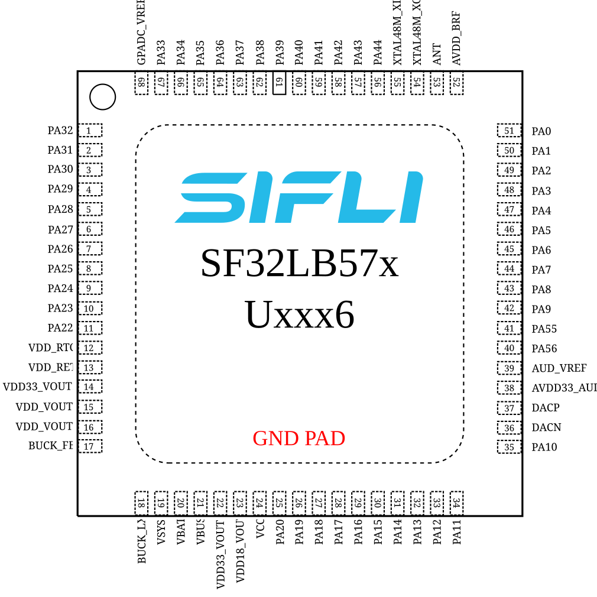  

<div align="center"> 图1-3-1 QFN68L 电池供电系列管脚分布 </div>  <br> <br>

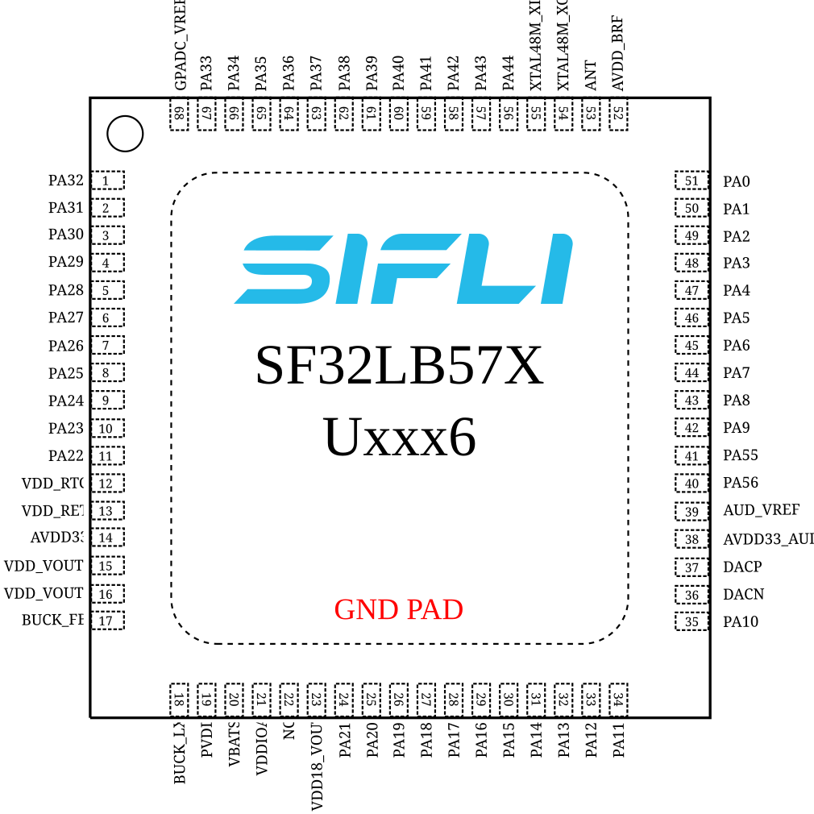  

<div align="center"> 图1-3-2 QFN68L 3.3V供电系列管脚分布 </div>  <br> <br>

  

<div align="center"> 图1-3-3 QFN80L 电池供电系列管脚分布 </div>  <br> <br>

  

<div align="center"> 图1-3-4 QFN80L 3.3V供电系列管脚分布 </div>  <br> <br>

<!--

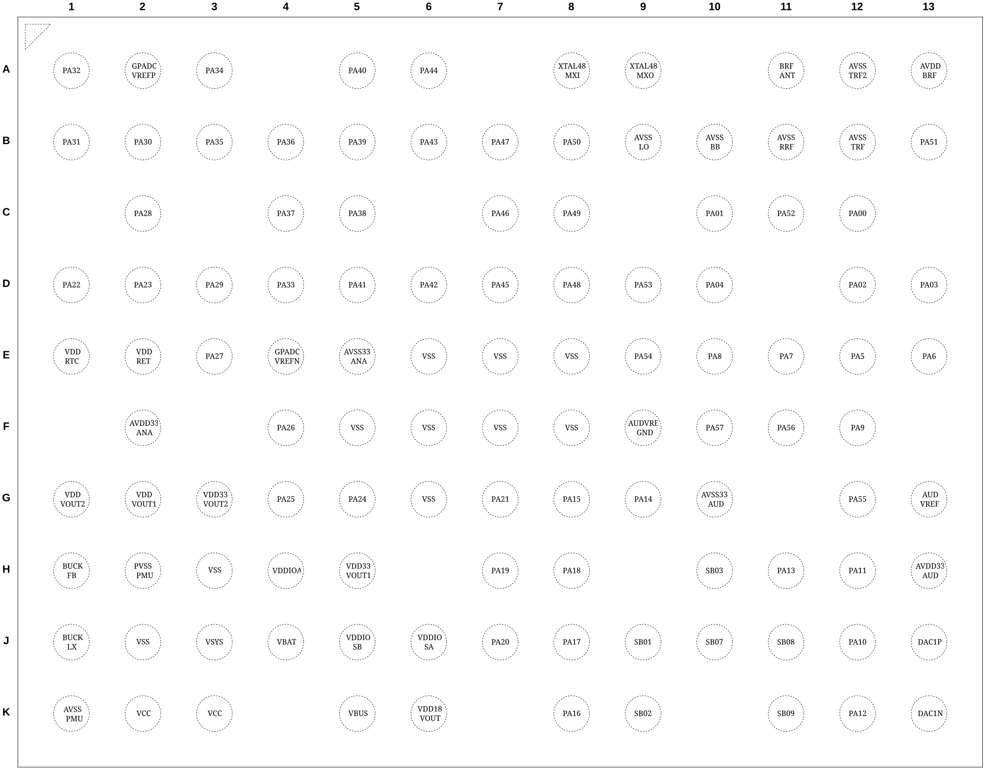  

<div align="center"> 图1-3-5 BGA112 电池供电系列管脚分布 </div>  <br> <br>

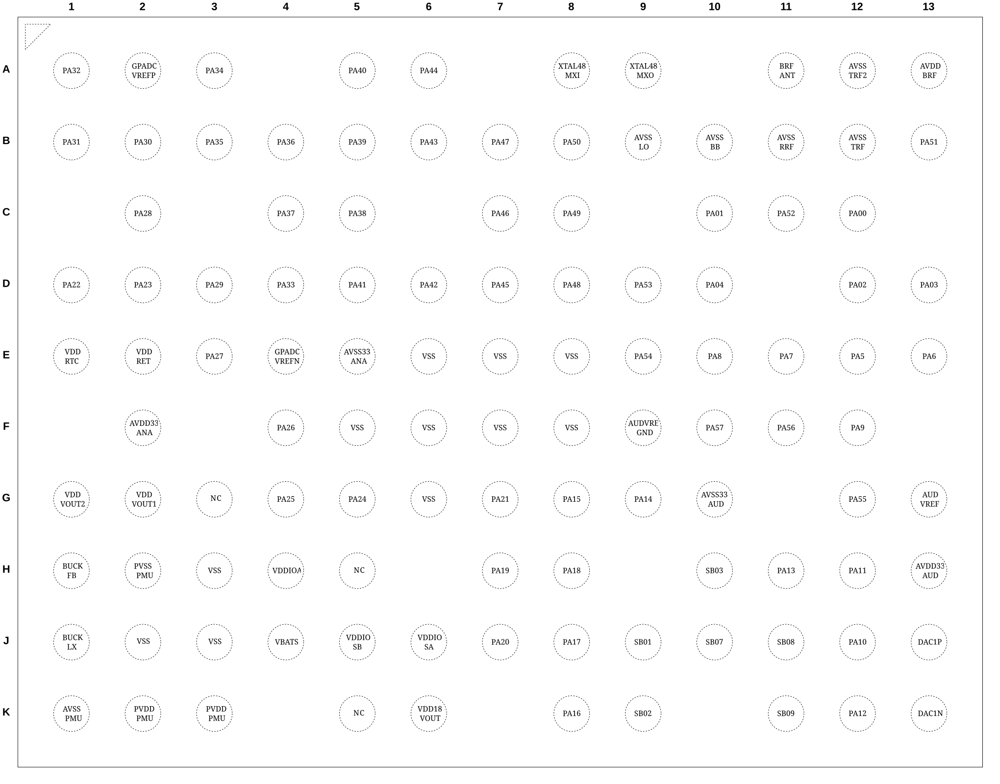  

<div align="center"> 图1-3-6 BGA112 3.3V供电系列管脚分布 </div>  <br> <br>

-->

```{note}
芯片的POD尺寸图，参考规格书中相关章节的描述。
```

## 2.原理图设计指导

### 2.1.电源

#### 2.1.1.QFN68L 封装芯片供电要求

<div align="center"> 表2-1-1 QFN68L 电池供电系列电源供电要求 </div>

```{table}
:align: center
:class: color-header-table

|电源管脚| 最小电压(V) | 典型电压(V) | 最大电压(V) | 最大电流(mA) |   详细描述 |
|:--|:--|:--|:--|:--|:----------------------------------------------------|
|VBUS       |4.5    |5.0    |5.5    |400    |VBUS 电源输入，内部充电模块的电源输入口 
|VBAT       |3.0    |-      |4.7    |400    |VBAT 电源输出，接电池,同时内部有ADC来检查电池电压值
|VSYS       |-      |3.3    |-      |150    |3.0V 电源输出，外挂电容到地<span style="color:red;">$^{[1]}$</span>
|BUCK_LX    |-      |3.3    |-      |50     |Buck 电感开关，接电感一端 
|BUCK_FB    |-      |1.25   |-      |50     |Buck 输出，接电感另一端并接电容到地 
|VDD_VOUT1  |-      |1.1    |-      |50     |内部 LDO，外挂电容，内部电源，不给外设供电 
|VDD_VOUT2  |-      |0.9    |-      |20     |内部 LDO，外挂电容，内部电源，不给外设供电 
|VDD_RET    |-      |0.9    |-      |1      |内部 LDO，外挂电容，内部电源，不给外设供电 
|VDD_RTC    |-      |1.1    |-      |1      |内部 LDO，外挂电容，内部电源，不给外设供电 
|VCC        |3.0    |-      |4.7    |200    |系统电源输入，接电池<span style="color:red;">$^{[2]}$</span>
|VDD18_VOUT |-      |1.8    |-      |30     |1.8V LDO 输出，内部电源，接电容到地，不给外设供电
|VDD33_VOUT1|-      |3.3    |-      |150    |3.3V LDO 输出 1 ，接电容到地，150mA 带载能力，默认打开有输出<span style="color:red;">$^{[3]}$</span>
|VDD33_VOUT2|-      |3.3    |-      |150    |3.3V LDO 输出 2 ，默认无输出，需要软件配置才有 3.3V 输出<span style="color:red;">$^{[4]}$</span>
|GPADC_VREF |-      |-      |-      |-      |GPADC VREF 输入，接电容到地，不用外供电源
|AVDD_BRF   |2.97   |3.3    |3.63   |100    |射频电源输入，接VSYS 
|AUD_VREF   |-      |-      |-      |-      |音频参考电压输入，接电容到地，不用外供电源
|AVDD33_AUD |2.97   |3.3    |3.63   |50     |音频电源输入，接VDD33_VOUT1 
|MIC_BIAS   |1.4    |-      |2.8    |2      |MIC 电源输出，接MIC电源
```

```{note} 
<span style="color:red;">[1]</span> ：VSYS 电源，给 AVDD_BRF 供电。 \
<span style="color:red;">[2]</span> ：VCC 电源输入，锂电池供电，开机电压3.5V±10%，默认软件设置低电电压 = 3.48V；恒压电源供电时，供电范围 3.6~4.7V，推荐 3.8V 供电。 \
<span style="color:red;">[3]</span> ：VDD33_VOUT1 的 LDO 内部有软启动限流功能，在使能 LDO 时，负载电流不能超过 30mA，否则会 LDO 会开启失败。当 LDO 完全使能后，有 150mA 带载能力，给外挂 Flash 和 AVDD33_AUD 供电。 \
<span style="color:red;">[4]</span> ：VDD33_VOUT2 的 LDO 内部有软启动限流功能，在使能 LDO 时，负载电流不能超过 30mA，否则会 LDO 会开启失败。当 LDO 完全使能后，有 150mA 带载能力，给马达或 LCD 屏供电。
```


<div align="center"> 表2-1-2 QFN68L 3.3V 供电系列电源供电要求 </div>

```{table}
:align: center
:class: color-header-table

|电源管脚| 最小电压(V) | 典型电压(V) | 最大电压(V) | 最大电流(mA) |   详细描述 |
|:--|:--|:--|:--|:--|:----------------------------------------------------|
|VDDIOA     |1.62   |1.8/3.3|3.63   |100    |GPIO 电源输入，接 1.8V 或 3.3V 电源 
|VBATS      |0      |-      |4.7    |1      |电池电压检测输入，内部有ADC来检查电池电压值
|PVDD       |2.97   |3.3    |3.63   |200    |PMU电源输入，接 3.3V 电源
|BUCK_LX    |-      |3.3    |-      |50     |Buck 电感开关，接电感一端 
|BUCK_FB    |-      |1.25   |-      |50     |Buck 输出，接电感另一端并接电容到地 
|VDD_VOUT1  |-      |1.1    |-      |50     |内部 LDO，外挂电容，内部电源，不给外设供电 
|VDD_VOUT2  |-      |0.9    |-      |20     |内部 LDO，外挂电容，内部电源，不给外设供电 
|VDD_RET    |-      |0.9    |-      |1      |内部 LDO，外挂电容，内部电源，不给外设供电 
|VDD_RTC    |-      |1.1    |-      |1      |内部 LDO，外挂电容，内部电源，不给外设供电 
|AVDD33     |2.97   |3.3    |3.63   |20     |模拟电源输入，接 3.3V 电源
|VDD18_VOUT |-      |1.8    |-      |30     |1.8V LDO 输出，内部电源，接电容到地，不给外设供电
|GPADC_VREF |-      |-      |-      |-      |GPADC VREF 输入，接电容到地，不用外供电源
|AVDD_BRF   |2.97   |3.3    |3.63   |100    |射频电源输入，接 3.3V 电源
|AUD_VREF   |-      |-      |-      |-      |音频参考电压输入，接电容到地，不用外供电源
|AVDD33_AUD |2.97   |3.3    |3.63   |50     |音频电源输入，接 3.3V 电源 
|MIC_BIAS   |1.4    |-      |2.8    |2      |MIC 电源输出，接MIC电源
```

```{note} 
VDDIOA 接1.8V时，内部Flash的读写速率要小于80MHz；VDDIOA 接.3.V时，内部Flash的读写速率可以配置默认的104MHz。
PVDD、AVDD33、AVDD_BRF和AVDD33_AUD都接 3.3V 电源，PCB走线时采用星型结构，都单独从电源拉线到相应管脚。
```

#### 2.1.2.QFN80L 封装芯片供电要求

<div align="center"> 表2-1-3 QFN80L 电池供电系列电源供电要求 </div>

```{table}
:align: center
:class: color-header-table

|电源管脚| 最小电压(V) | 典型电压(V) | 最大电压(V) | 最大电流(mA) |   详细描述 |
|:--|:--|:--|:--|:--|:----------------------------------------------------|
|VDDIOA     |1.62   |1.8/3.3|3.63   |100    |GPIO 电源输入，接 1.8V 或 3.3V 电源
|VBATS      |0      |-      |4.7    |1      |电池电压检测输入，内部有ADC来检查电池电压值
|VSYS       |-      |3.3    |-      |150    |3.0V 电源输出，外挂电容到地<span style="color:red;">$^{[1]}$</span>
|BUCK_LX    |-      |3.3    |-      |50     |Buck 电感开关，接电感一端 
|BUCK_FB    |-      |1.25   |-      |50     |Buck 输出，接电感另一端并接电容到地 
|VDD_VOUT1  |-      |1.1    |-      |50     |内部 LDO，外挂电容，内部电源，不给外设供电 
|VDD_VOUT2  |-      |0.9    |-      |20     |内部 LDO，外挂电容，内部电源，不给外设供电 
|VDD_RET    |-      |0.9    |-      |1      |内部 LDO，外挂电容，内部电源，不给外设供电 
|VDD_RTC    |-      |1.1    |-      |1      |内部 LDO，外挂电容，内部电源，不给外设供电 
|AVDD33     |2.97   |3.3    |3.63   |20     |模拟电源输入，接 3.3V 电源
|VCC        |3.0    |-      |4.7    |200    |系统电源输入，接电池<span style="color:red;">$^{[2]}$</span>
|VDD18_VOUT |-      |1.8    |-      |30     |1.8V LDO 输出，内部电源，接电容到地，不给外设供电
|VDD33_VOUT1|-      |3.3    |-      |150    |3.3V LDO 输出 1 ，接电容到地，150mA 带载能力，默认打开有输出<span style="color:red;">$^{[3]}$</span>
|GPADC_VREF |-      |-      |-      |-      |GPADC VREF 输入，接电容到地，不用外供电源
|AVDD_BRF   |2.97   |3.3    |3.63   |100    |射频电源输入，接VSYS 
|AUD_VREF   |-      |-      |-      |-      |音频参考电压输入，接电容到地，不用外供电源
|AVDD33_AUD |2.97   |3.3    |3.63   |50     |音频电源输入，接VDD33_VOUT1 
|MIC_BIAS   |1.4    |-      |2.8    |2      |MIC 电源输出，接MIC电源
```

```{note} 
<span style="color:red;">[1]</span> ：VSYS 电源，给 AVDD_BRF 供电。 \
<span style="color:red;">[2]</span> ：VCC 电源输入，锂电池供电，开机电压3.5V±10%，默认软件设置低电电压 = 3.48V；恒压电源供电时，供电范围 3.6~4.7V，推荐 3.8V 供电。 \
<span style="color:red;">[3]</span> ：VDD33_VOUT1 的 LDO 内部有软启动限流功能，在使能 LDO 时，负载电流不能超过 30mA，否则会 LDO 会开启失败。当 LDO 完全使能后，有 150mA 带载能力，给外挂 Flash 和 AVDD33_AUD 供电。该LDO会同时给内部 MPI2 或 MPI3 上合封的FLASH供电，具体请参照芯片型号定义说明。
```


<div align="center"> 表2-1-4 QFN80L 3.3V 供电系列电源供电要求 </div>

```{table}
:align: center
:class: color-header-table

|电源管脚| 最小电压(V) | 典型电压(V) | 最大电压(V) | 最大电流(mA) |   详细描述 |
|:--|:--|:--|:--|:--|:----------------------------------------------------|
|VDDIOA     |1.62   |3.3    |3.63   |100    |GPIO 电源输入，接 1.8V 或 3.3V 电源
|VBATS      |0      |-      |4.7    |1      |电池电压检测输入，内部有ADC来检查电池电压值
|BUCK_LX    |-      |3.3    |-      |50     |Buck 电感开关，接电感一端 
|BUCK_FB    |-      |1.25   |-      |50     |Buck 输出，接电感另一端并接电容到地 
|VDD_VOUT1  |-      |1.1    |-      |50     |内部 LDO，外挂电容，内部电源，不给外设供电 
|VDD_VOUT2  |-      |0.9    |-      |20     |内部 LDO，外挂电容，内部电源，不给外设供电 
|VDD_RET    |-      |0.9    |-      |1      |内部 LDO，外挂电容，内部电源，不给外设供电 
|VDD_RTC    |-      |1.1    |-      |1      |内部 LDO，外挂电容，内部电源，不给外设供电 
|AVDD33     |2.97   |3.3    |3.63   |20     |模拟电源输入，接 3.3V 电源
|PVDD       |2.97   |3.3    |3.63   |200    |PMU电源输入，接 3.3V 电源<span style="color:red;">$^{[1]}$</span>
|VDD18_VOUT |-      |1.8    |-      |30     |1.8V LDO 输出，内部电源，接电容到地，不给外设供电
|VDDIOSB    |-      |1.8/3.3|-      |30     |SIP SB IO 电源输入，电压随芯片型号存在差异，具体要求请查阅注释<span style="color:red;">$^{[2]}$</span>
|GPADC_VREF |-      |-      |-      |-      |GPADC VREF 输入，接电容到地，不用外供电源
|AVDD_BRF   |2.97   |3.3    |3.63   |100    |射频电源输入，接 3.3V 电源 
|AUD_VREF   |-      |-      |-      |-      |音频参考电压输入，接电容到地，不用外供电源
|AVDD33_AUD |2.97   |3.3    |3.63   |50     |音频电源输入，接 3.3V 电源
|MIC_BIAS   |1.4    |-      |2.8    |2      |MIC 电源输出，接MIC电源
```

```{note} 
<span style="color:red;">[1]</span> ：PVDD、AVDD33、AVDD_BRF、AVDD33_AUD和VDDIOA都接 3.3V 电源，PCB走线时采用星型结构，都单独从电源拉线到相应管脚。 \
<span style="color:red;">[2]</span> ：请参照芯片型号定义说明：MPI2、MPI3 型号若合封 PSRAM，VDDIOSB 接 1.8V 的 VDD18_VOUT 电源；合封 NOR Flash 则该引脚外供 3.3V 电源。
```

<!--

#### 2.1.3.BGA112 封装芯片供电要求

<div align="center"> 表2-1-5 BGA112 电池供电系列电源供电要求 </div>

```{table}
:align: center
:class: color-header-table

|电源管脚| 最小电压(V) | 典型电压(V) | 最大电压(V) | 最大电流(mA) |   详细描述 |
|:--|:--|:---|:--|:--|:----------------------------------------------------|
|VBUS        |4.5    |5.0    |5.5    |400    |VBUS 电源输入，内部充电模块的电源输入口 
|VBAT        |3.0    |-      |4.7    |400    |VBAT 电源输出，接电池,同时内部有ADC来检查电池电压值
|VSYS        |-      |3.3    |-      |150    |3.0V 电源输出，外挂电容到地<span style="color:red;">$^{[1]}$</span>
|BUCK_LX     |-      |3.3    |-      |50     |Buck 电感开关，接电感一端 
|BUCK_FB     |-      |1.25   |-      |50     |Buck 输出，接电感另一端并接电容到地 
|VDD_VOUT1   |-      |1.1    |-      |50     |内部 LDO，外挂电容，内部电源，不给外设供电 
|VDD_VOUT2   |-      |0.9    |-      |20     |内部 LDO，外挂电容，内部电源，不给外设供电 
|VDD_RET     |-      |0.9    |-      |1      |内部 LDO，外挂电容，内部电源，不给外设供电 
|VDD_RTC     |-      |1.1    |-      |1      |内部 LDO，外挂电容，内部电源，不给外设供电 
|VCC         |3.0    |-      |4.7    |200    |系统电源输入，接电池<span style="color:red;">$^{[2]}$</span>
|VDD18_VOUT  |-      |1.8    |-      |30     |1.8V LDO 输出，内部电源，接电容到地，不给外设供电
|VDD33_VOUT1 |-      |3.3    |-      |150    |3.3V LDO 输出 1 ，接电容到地，150mA 带载能力，默认打开有输出<span style="color:red;">$^{[3]}$</span>
|VDD33_VOUT2 |-      |3.3    |-      |150    |3.3V LDO 输出 2 ，默认无输出，需要软件配置才有 3.3V 输出<span style="color:red;">$^{[4]}$</span>
|PVSS_PMU    |-      |-      |-      |-      |PMU 电源地
|AVSS_PMU    |-      |-      |-      |-      |PMU 模拟电源地
|VDDIOA      |1.62   |1.8/3.3|3.63   |100    |GPIO 电源输入，接 1.8V 或 3.3V 电源
|VDDIOSA     |-      |1.8    |-      |30     |SIP SA IO 电源输入，接 VDD18_VOUT 电源
|VDDIOSB     |-      |1.8/3.3|-      |30     |SIP SB IO 电源输入，电压随芯片型号存在差异，具体要求请查阅注释<span style="color:red;">$^{[5]}$</span>
|AVDD33_ANA  |2.97   |3.3    |3.63   |20     |模拟电源输入，接 3.3V 电源
|AVSS33_ANA  |-      |-      |-      |-      |模拟地
|GPADC_VREFP |-      |-      |-      |-      |GPADC VREF 输入，接电容到地，不用外供电源
|GPADC_VREFN |-      |-      |-      |-      |GPADC VREF 输入，接地
|AVDD_BRF    |2.97   |3.3    |3.63   |100    |射频电源输入，接VSYS
|AVSS_BB、AVSS_LO、AVSS_RRF、AVSS_TRF 和 AVSS_TRF2 |-      |-      |-      |-      |射频地 
|AUD_VREF    |-      |-      |-      |-      |音频参考电压输入，接电容到地，不用外供电源
|AUD_VREF_GND|-      |-      |-      |-      |音频地
|AVDD33_AUD  |2.97   |3.3    |3.63   |50     |音频电源输入，接VDD33_VOUT1 
|AVSS33_AUD  |-      |-      |-      |-      |音频地 
|MIC_BIAS    |1.4    |-      |2.8    |2      |MIC 电源输出，接MIC电源
```

```{note} 
<span style="color:red;">[1]</span> ：VSYS 电源，给 AVDD_BRF 供电。 \
<span style="color:red;">[2]</span> ：VCC 电源输入，锂电池供电，开机电压3.5V±10%，默认软件设置低电电压 = 3.48V；恒压电源供电时，供电范围 3.6~4.7V，推荐 3.8V 供电。 \
<span style="color:red;">[3]</span> ：VDD33_VOUT1 的 LDO 内部有软启动限流功能，在使能 LDO 时，负载电流不能超过 30mA，否则会 LDO 会开启失败。当 LDO 完全使能后，有 150mA 带载能力，给外挂 Flash 和 AVDD33_AUD 供电。 \
<span style="color:red;">[4]</span> ：VDD33_VOUT2 的 LDO 内部有软启动限流功能，在使能 LDO 时，负载电流不能超过 30mA，否则会 LDO 会开启失败。当 LDO 完全使能后，有 150mA 带载能力，给马达或 LCD 屏供电。 \
<span style="color:red;">[5]</span> ：请参照芯片型号定义说明：MPI2、MPI3 型号若合封 PSRAM，VDDIOSB 接 1.8V 的 VDD18_VOUT 电源；合封 NOR Flash 则该引脚接 3.3V 的 VDD33_VOUT1 电源。
```


<div align="center"> 表2-1-6 BGA112 3.3V 供电系列电源供电要求 </div>

```{table}
:align: center
:class: color-header-table

|电源管脚| 最小电压(V) | 典型电压(V) | 最大电压(V) | 最大电流(mA) |   详细描述 |
|:--|:--|:---|:--|:--|:----------------------------------------------------|
|VBATS       |0      |-      |4.7    |1      |电池电压检测输入，内部有ADC来检查电池电压值
|BUCK_LX     |-      |3.3    |-      |50     |Buck 电感开关，接电感一端 
|BUCK_FB     |-      |1.25   |-      |50     |Buck 输出，接电感另一端并接电容到地 
|VDD_VOUT1   |-      |1.1    |-      |50     |内部 LDO，外挂电容，内部电源，不给外设供电 
|VDD_VOUT2   |-      |0.9    |-      |20     |内部 LDO，外挂电容，内部电源，不给外设供电 
|VDD_RET     |-      |0.9    |-      |1      |内部 LDO，外挂电容，内部电源，不给外设供电 
|VDD_RTC     |-      |1.1    |-      |1      |内部 LDO，外挂电容，内部电源，不给外设供电 
|PVDD_PMU    |2.97   |3.3    |3.63   |200    |PMU电源输入，接 3.3V 电源<span style="color:red;">$^{[1]}$</span>
|VDD18_VOUT  |-      |1.8    |-      |30     |1.8V LDO 输出，内部电源，接电容到地，不给外设供电
|PVSS_PMU    |-      |-      |-      |-      |PMU 电源地
|AVSS_PMU    |-      |-      |-      |-      |PMU 模拟电源地
|VDDIOA      |1.62   |1.8/3.3|3.63   |100    |GPIO 电源输入，接 1.8V 或 3.3V 电源
|VDDIOSA     |-      |1.8    |-      |30     |SIP SA IO 电源输入，接 VDD18_VOUT 电源
|VDDIOSB     |-      |1.8/3.3|-      |30     |SIP SB IO 电源输入，电压随芯片型号存在差异，具体要求请查阅注释<span style="color:red;">$^{[2]}$</span>
|AVDD33_ANA  |2.97   |3.3    |3.63   |20     |模拟电源输入，接 3.3V 电源
|AVSS33_ANA  |-      |-      |-      |-      |模拟地
|GPADC_VREFP |-      |-      |-      |-      |GPADC VREF 输入，接电容到地，不用外供电源
|GPADC_VREFN |-      |-      |-      |-      |GPADC VREF 输入，接地
|AVDD_BRF    |2.97   |3.3    |3.63   |100    |射频电源输入，接 3.3V 电源
|AVSS_BB、AVSS_LO、AVSS_RRF、AVSS_TRF 和 AVSS_TRF2 |-      |-      |-      |-      |射频地 
|AUD_VREF    |-      |-      |-      |-      |音频参考电压输入，接电容到地，不用外供电源
|AUD_VREF_GND|-      |-      |-      |-      |音频地
|AVDD33_AUD  |2.97   |3.3    |3.63   |50     |音频电源输入，接 3.3V 电源 
|AVSS33_AUD  |-      |-      |-      |-      |音频地 
|MIC_BIAS    |1.4    |-      |2.8    |2      |MIC 电源输出，接MIC电源
```

```{note} 
<span style="color:red;">[1]</span> ：PVDD、AVDD33、AVDD_BRF、AVDD33_AUD和VDDIOA都接 3.3V 电源，PCB走线时采用星型结构，都单独从电源拉线到相应管脚。 \
<span style="color:red;">[2]</span> ：请参照芯片型号定义说明：MPI2、MPI3 型号若合封 PSRAM，VDDIOSB 接 1.8V 的 VDD18_VOUT 电源；合封 NOR Flash 则该引脚外供 3.3V 电源。
```

-->

#### 2.1.4.上电时序

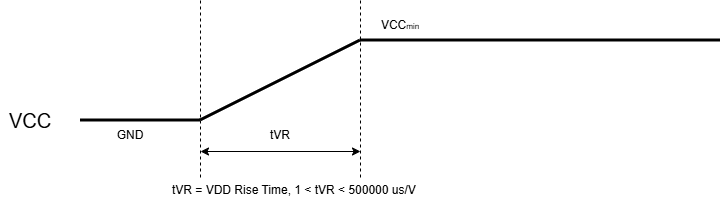  

<div align="center"> 图2-1-4-1 电池供电芯片上电时序图 </div>   <br>  <br>

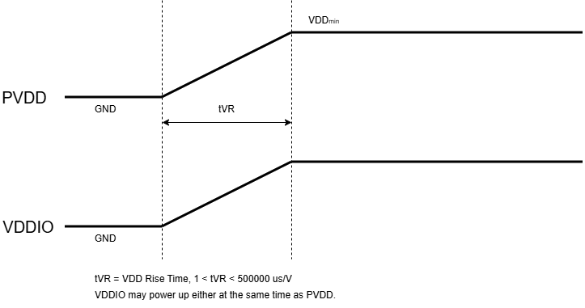  

<div align="center"> 图2-1-4-2 3.3V供电芯片上电时序图 </div>   <br>  <br>

#### 2.1.5.BUCK电感选择要求

**功率电感关键参数**
```{important}
L(电感值) = 4.7uH ± 20%，DCR(直流阻抗) ≦ 0.4 ohm，Isat(饱和电流) ≧ 450mA。
```

#### 2.1.6.电池及充电控制

充电电路分为两种应用方案：外置充电管理芯片方案、芯片内置充电管理模块方案。

##### 2.1.6.1.外部充电管理芯片

外置充电管理芯片分为不带电源路径管理（PPM）、带电源路径管理（PPM）两种类型：

1. 无 PPM 方案（典型电路参见`图2-1-6-1-1`）：电池直接给 SF32LB57x 的 VBAT、VCC 引脚供电；
2. 带 PPM 方案（典型电路参见`图2-1-6-1-2`）：充电芯片 VSYS 管脚为 SF32LB57x 的 VCC 引脚供电，充电芯片 VBAT 管脚同时接电池与 SF32LB57x 的 VBAT 引脚。

两种方案均依靠 VBAT 引脚检测电池电压，该引脚内置一路 GPADC，电压采样精度为 ±30mV。

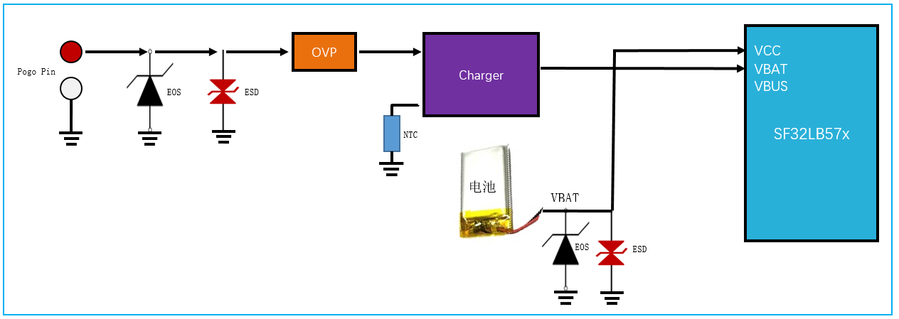  

<div align="center"> 图2-1-6-1-1 无 PPM 功能的外部充电芯片电路示意图 </div>   <br>  <br>

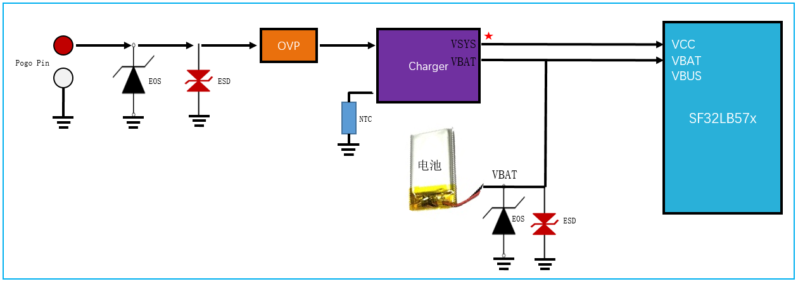  

<div align="center"> 图2-1-6-1-2 带 PPM 功能的外部充电芯片电路示意图 </div>   <br>  <br>

##### 2.1.6.2.片内集成充电管理模块

采用 SF32LB57x 芯片内置充电管理模块时（典型电路参见`图 2-1-6-2-1`），若设备因电池亏电关机，接入充电器后，需将电池充电至开机电压，系统方可正常上电启动并弹出充电显示界面。

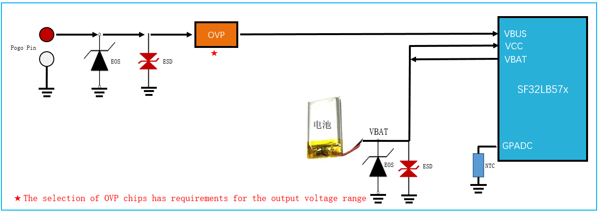  

<div align="center"> 图2-1-6-2-1 集成充电管理电路示意图 </div>   <br>  <br>

##### 2.1.6.3.使用片内集成充电管理模块时OVP芯片的选型

SF32LB57x 的 VBUS 引脚输入电压范围为 4.5V~5.5V，因此仅可选用以下两类 OVP 保护芯片:

- 支持 OVLO 可调的 OVP 芯片，参考型号：AW32905FCR
- 集成稳压输出功能的 OVP 芯片，参考型号：SGM4064YDE8G、LP5305AQVF

`图2-1-6-3-1` 为 OVLO 可调型 OVP 芯片的典型应用电路，OVP 芯片输出电压 VIN_OVLO 需设置在 5.2V～5.5V 区间内，参数计算过程中需要纳入芯片本身及分压电阻带来的误差影响，具体计算公式如下：


<div align="center"> 

$\Large V_{\mathrm{IN\_OVLO}} = \frac{R_1+R_2}{R_2} V_{\mathrm{OVLO\_TH}}$

</div>


**要求：其中VOVLO_TH要求误差≦3%，R1和R2的电阻误差≦1%**

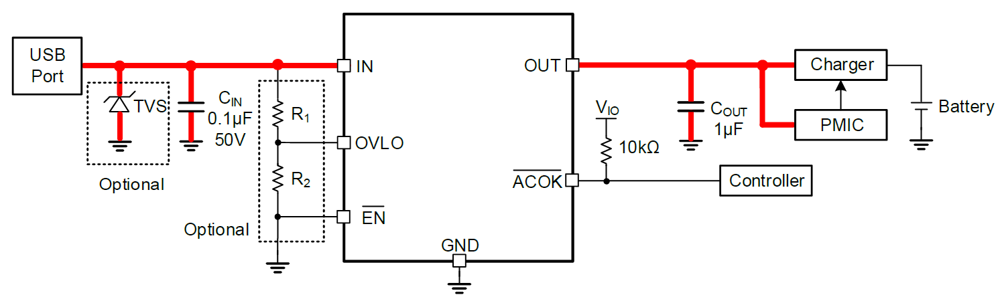  

<div align="center"> 图2-1-6-3-1 带 OVLO 可调的 OVP 芯片应用电路图 </div>   <br>  <br>

`图2-1-6-3-2` 为稳压输出型 OVP 芯片的典型应用电路，该类 OVP 芯片稳压输出电压需低于 5.5V，为 SF32LB57x 的 VBUS 引脚提供供电。

**要求：OVP芯片的LDO输出电压在4.5V ~ 5.4V**

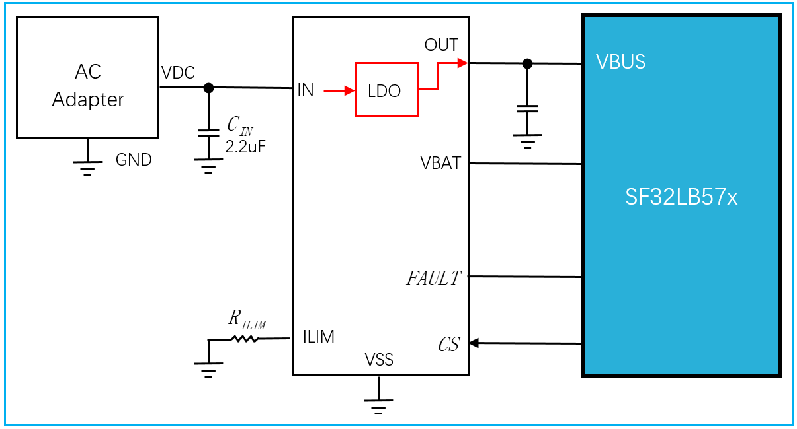  

<div align="center"> 图2-1-6-3-2 带 Regulator 输出的 OVP 芯片应用电路图 </div>   <br>  <br>


#### 2.1.7.如何降低待机功耗

为满足穿戴设备长续航设计需求，硬件端建议通过负载开关对各功能模块实施动态电源管理；针对常开启的模块或信号通路，需优选低静态电流规格器件以降低功耗。

如`图2-1-7-1` 所示，在 SF32LB57x 典型系统电源架构中，推荐电源分配方案如下：VDD33_VOUT2 用于电机供电，VDD33_VOUT1 为外部 Flash、传感器等外设供电，显示屏 LCD 需采用独立外置 LDO 供电。

硬件设计要点：

- 合理配置电源开关控制 GPIO 的默认电平，搭配兆欧级上下拉电阻，确保负载开关上电默认处于关闭状态；
- LDO、负载开关（Load Switch）选型需优先选用静态电流 Iq、关断电流 Istb 参数优异的器件，常开类电源芯片需重点核查静态电流 Iq 指标。

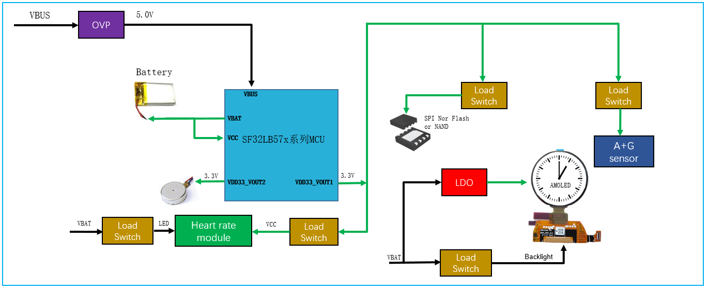  

<div align="center"> 图2-1-7-1 SF32LB57x 电池供电系统电源结构图 </div>   <br>  <br>

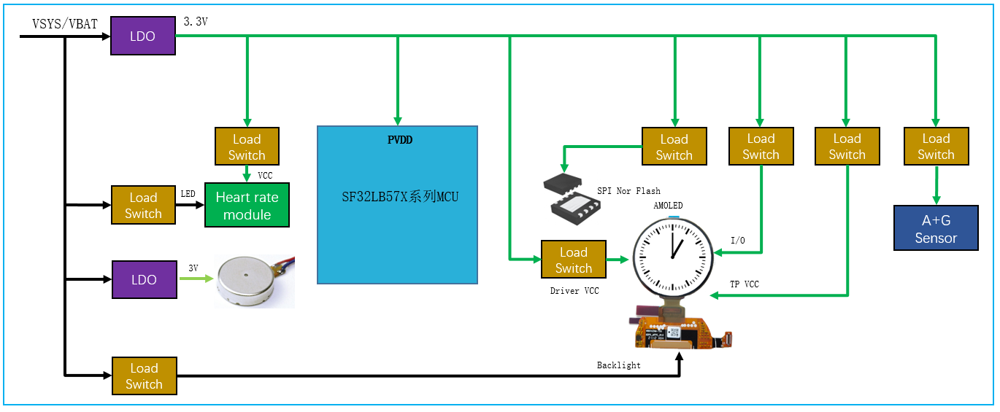  

<div align="center"> 图2-1-7-2 SF32LB57x 3.3V供电系统电源结构图 </div>   <br>  <br>

### 2.2.处理器工作模式及唤醒源

<div align="center"> 表2-2-1 CPU Mode Table </div>

```{table}
:align: center
:class: color-header-table

|工作模式|CPU |外设  |SRAM |IO   |LPTIM |唤醒源 |唤醒时间 |
|:--|:-------|:----|:----|:----|:---- |:---- |:----   |
|Active    |Run   |Run   |可访问           |可翻转   |Run   |- |- |
|Sleep     |Stop  |Run   |可访问           |可翻转   |Run   |任意中断                       |<0.5us |
|DeepSleep |Stop  |Stop  |不可访问，全保留 |电平保持 |Run   |RTC，唤醒IO，GPIO，LPTIM，蓝牙 |250us  |
|Standby   |Reset |Reset |不可访问，全保留 |电平保持 |Run   |RTC，唤醒IO，LPTIM，蓝牙       |1ms    |
|Hibernate |Reset |Reset |不可访问，不保留 |高阻     |Reset |RTC，唤醒IO                    |>2ms   |
```

如`表2-2-2`所示，全系列芯片支持 10 个 Standby 和 Hibernate 模式下可唤醒中断源。

<div align="center">表2-2-2 Interrupt wake up source Table </div>

```{table}
:align: center
:class: color-header-table

|中断源|管脚   |详细描述  |
|:--|:-------|:--------|
|WKUP_PIN0 |PA33 |中断信号0 |
|WKUP_PIN1 |PA34 |中断信号1 |
|WKUP_PIN2 |PA35 |中断信号2 |
|WKUP_PIN3 |PA36 |中断信号3 |
|WKUP_PIN4 |PA37 |中断信号4 |
|WKUP_PIN5 |PA38 |中断信号5 |
|WKUP_PIN6 |PA39 |中断信号6 |
|WKUP_PIN7 |PA40 |中断信号7 |
|WKUP_PIN8 |PA41 |中断信号8 |
|WKUP_PIN9 |PA42 |中断信号9 |
```

### 2.3.时钟

#### 2.3.1晶体
芯片需要外部提供2个时钟源，48MHz主晶体和32.768KHz RTC晶体，晶体的具体规格要求和选型如下：

<div align="center"> 表2-3-1-1 晶体规格要求 </div>

```{table}
:align: center
:class: color-header-table

|晶体|晶体规格要求   |详细描述  |
|:--|:-------|:--------|
|48MHz |7pF≦CL≦12pF（推荐值8.8pF） △F/F0≦±10ppm ESR≦30 ohms（推荐值22ohms）|晶体功耗和CL,ESR相关,CL和ESR越小功耗越低，为了最佳功耗性能，建议采用CL和ESR在要求范围内相对较小值的物料。晶体旁边预留并联匹配电容,当CL<12pF时，无需焊接电容|
|32.768KHz |CL=7pF 或 11.5pF（芯片默认11.5pF，7pF需要修改寄存器配置）△F/F0≦±20ppm ESR≦80k ohms（推荐值38Kohms）|晶体功耗和CL,ESR相关,CL和ESR越小功耗越低，为了最佳功耗性能，建议采用CL和ESR在要求范围内相对较小值的物料。晶体旁边预留并联匹配电容,7pF和11.5pF晶体不用焊接电容，其他规格晶体需自行测试需要匹配的电容值|
```

<div align="center"> 表2-3-1-2 推荐晶体列表 </div>

```{table}
:align: center
:class: color-header-table

|型号                 |厂家    |参数                                                                                                             |
| ------------------- | ------ | --------------------------------------------------------------------------------------------------------------- |
|E1SB48E001G00E       |Hosonic |F0 = 48.000000MHz，△F/F0 = -6 ~ 8 ppm，CL = 8.8 pF，ESR = 22 ohms Max TOPR = -30 ~ 85℃，Package =（2016 公制）  |
|ETST00327000LE       |Hosonic |F0 = 32.768KHz，△F/F0 = -20 ~ 20 ppm，CL = 7 pF，ESR = 70K ohms Max TOPR = -40 ~ 85℃，Package =（3215 公制）    |
|SX20Y048000B31T-8.8  |TKD     |F0 = 48.000000MHz，△F/F0 = -10 ~ 10 ppm，CL = 8.8 pF，ESR = 40 ohms Max TOPR = -20 ~ 75℃，Package =（2016 公制）|
|SF32K32768D71T01     |TKD     |F0 = 32.768KHz，△F/F0 = -20 ~ 20 ppm，CL = 7 pF，ESR = 70K ohms Max TOPR = -40 ~ 85℃，Package =（3215 公制）    |
|SF32WK32768D71T005   |TKD     |F0 = 32.768KHz，△F/F0 = -20 ~ 20 ppm，CL = 7 pF，ESR = 70K ohms Max TOPR = -40 ~ 85℃，Package =（3215 公制）    |
|CN4048M000885C822000 |JWT     |F0 = 48.000000MHz，△F/F0 = -8 ~ 8 ppm，CL = 8.8 pF，ESR = 22 ohms Max TOPR = -30 ~ 85℃，Package =（2016 公制）  |
|DH2032K76807T2719002 |JWT     |F0 = 32.768KHz，△F/F0 = -20 ~ 20 ppm，CL = 7 pF，ESR = 70K ohms Max TOPR = -40 ~ 85℃，Package =（3215 公制）    |
```

```{note}
- SX20Y048000B31T-8.8的ESR略大，静态功耗也会略大些。 \
- PCB走线时，在晶体下面至少挖掉第二层的GND铜来减少时钟信号上的寄生负载电容。
- 32.768KHz晶体CL对应的寄存器设置：
    - 7pF:   PMUC->LXT_CR->CAP_SEL = 0;
    - 11.5pF PMUC->LXT_CR->CAP_SEL = 1;
```

详细的物料认证信息，请参考：
[SIFLI-MCU-AVL-认证表](index)

#### 2.3.2低功耗时钟输出

芯片在 Sleep、DeepSleep、Standby 和 Hibernate 模式下，PA24 ~ PA27 管脚可以输出 RC10K 或 32.768KHz 时钟信号。

芯片在 Sleep、DeepSleep 和 Standby 模式下，PA24 ~ PA27 管脚可以输出 LPTIM2 定时器设定的 PWM 时钟，最高频率到16KHz。


### 2.4.存储
#### 2.4.1.存储器连接接口描述

芯片支持外挂 SPI Nor Flash、SPI NAND Flash、SD NAND Flash和eMMC 四种存储介质。

如`表2-4-1-1`所示，只有 PA12 ~ PA17 管脚上的 MPI3 接口支持 SPI Nor Flash 和 SPI NAND Flash 存储器。

<div align="center"> 表2-4-1-1 SPI Nor/Nand Flash信号连接 </div>

```{table}
:align: center
:class: color-header-table

| Flash 信号 | I/O信号 | 详细描述                                    |
| ---------- | ------- | ------------------------------------------- |
| CS#        | PA12    | Chip select, active low.                    |
| SO         | PA13    | Data Input (Data Input Output 1)            |
| WP#        | PA14    | Write Protect Output (Data Input Output  2) |
| SI         | PA15    | Data Output (Data Input Output 0)           |
| SCLK       | PA16    | Serial Clock Output                         |
| Hold#      | PA17    | Data Output (Data Input Output 3)           |
```

任何一组 SDIO 接口都可以接 SD Nand Flash 和 eMMC 存储，默认推荐 P12 ~ PA17 管脚，如`表2-4-1-2`所示。

<div align="center"> 表2-4-1-2 SD Nand Flash和eMMC信号连接 </div>

```{table}
:align: center
:class: color-header-table

| Flash 信号 | I/O信号 | 详细描述 |
| ---------- | ------- | -------- |
| SD2_CMD    | PA15    | 命令信号 |
| SD2_D1     | PA17    | 数据1    |
| SD2_D0     | PA16    | 数据0    |
| SD2_CLK    | PA14    | 时钟信号 |
| SD2_D2     | PA12    | 数据2    |
| SD2_D3     | PA13    | 数据3    |
```

```{note}
eMMC芯片有VCC和VCCQ两种电源域，方式1：可以2个电源一起做控制，关机功耗低，但eMMC在sleep时恢复慢，CPU平均功耗高；方式2：可以单独控制VCC，VCCQ常供不断电，关机功耗比方式1高，但eMMC在sleep时恢复快，CPU平均功耗比方式1低。
```

#### 2.4.2.启动设置

芯片可通过下述介质实现启动：内置合封 SPI Nor Flash、外接 SPI Nor Flash、外接 SPI Nand Flash 和外接 SD Nand Flash，详细介绍如下：
- 内置合封 SPI Nor Flash 的芯片型号，默认从片内合封 Flash 启动；
- 未内置合封 SPI Nor Flash 的芯片型号，仅可通过外接存储介质实现启动。

<!-- 这里的图片需要修改，A3和B3要不同的版本 -->

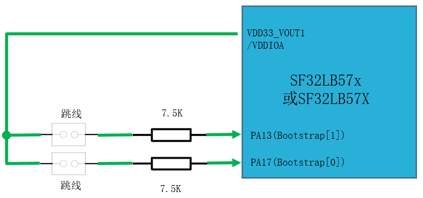  

<div align="center"> 图2-4-2-1 Bootstrap管脚推荐电路图 </div>   <br>  <br>


<div align="center"> 表2-4-2-1 启动选项设置 </div>

```{table}
:align: center
:class: color-header-table

|Bootstrap[1] (PA13) |Bootstrap[0] (PA17)    |Boot From ext memory  |
| ------------ | ------------ | -------------- |
| L            | L            | SPI Nor Flash  |
| L            | H            | SPI Nand Flash |
| H            | L            | SD Nand Flash  |
| H            | H            | eMMC           |
```

#### 2.4.3.启动存储介质电源控制
芯片支持启动存储介质的电源开关控制功能，可有效降低设备关机功耗。电源开关的使能引脚固定采用 PA21，控制电平逻辑为高电平开启、低电平关闭。

```{important}
- 电池供电系列芯片：外接启动介质为`NOR FLASH`时，存储介质电源采用`VDD33_VOUT1`供电；外接启动介质为`SPI NAND FLASH`时，需在`VDD33_VOUT1`后端增加电源开关电路后供电。
- 电池供电系列芯片：外接启动介质为`SD NAND FLASH`或`eMMC`时，存储介质电源采用外部`LDO`供电，LDO 使能引脚推荐使用`PA21`控制；无`PA21`引脚的封装型号，可选用默认上拉的引脚作为控制引脚。
- 3.3V供电系列芯片：外接启动存储介质统一采用外部`LDO`供电，LDO 使能引脚推荐使用`PA21`控制。
- 参考设计中`PA13`、`PA17` 引脚均预留上拉电阻位，可根据实际选用的存储介质类型选配适配电阻，推荐阻值为`7.5kΩ`。
```


### 2.5.射频

射频走线需按照`50Ω`特征阻抗进行设计。若天线已完成阻抗匹配，射频线路无需额外增设匹配器件。为适配杂散滤波及天线调试匹配需求，设计过程中建议预留π型匹配网络。

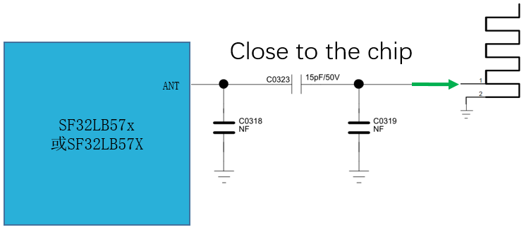  

<div align="center"> 图2-5-1 射频电路图 </div>   <br>  <br>


### 2.6.GPIO

芯片可通过 IO 复用表（IO MUX）或引脚矩阵表（Matrix table）完成 GPIO 功能配置：
- IO MUX 为 GPIO 外设专用配置通道，支持功能复用编号 0～15；
- Matrix table 可实现矩阵输入、输出引脚的任意互连，支持信号灵活引脚分配；
- 功能复用编号 16～175 均通过 Matrix table 通道配置，涉及外设包括 I2C、SPI、UART、CAN、PTA/BT、通用定时器、低功耗定时器、高级定时器、PWM、I2S、PTM、LCD 控制器、PDM、DCMI；
- IO MUX 与 GPIO 引脚交换矩阵的详细配置说明，可查阅芯片规格书及用户手册中 IO MUX 与 Matrix table 相关章节。

详细的引脚复用配置信息可参见 `表2-6-1` 、 `表2-6-2` 和 `表2-6-3` 。

<div align="center"> 表2-6-1 IO MUX 表 </div>

```{table}
:align: center
:class: color-header-table

| PAD  | PUPD | Function 0       | Function 1       | Function 2  | Function 3 | Function 4 | Function 5    | Function 6     | Function 15 | Function 16 ~ 255  |
| ---- | ---- | ------------     | ---------------- | ----------- | ---------- | ---------- | ------------- | -------------- | ----------- | ------------------ |
| PA00 | PD   | **GPIO_A0**      | LCDC1_SPI_RSTB   |             | SD2_DIO2   |            |               |                |             | Matrix Index Table |
| PA01 | PD   | **GPIO_A1**      |                  |             | SD2_DIO3   |            |               |                |             | Matrix Index Table |
| PA02 | PD   | **GPIO_A2**      | LCDC1_SPI_TE     |             | SD2_CLK    |            |               |                |             | Matrix Index Table |
| PA03 | PU   | **GPIO_A3**      | LCDC1_SPI_CS     |             | SD2_CMD    |            |               |                |             | Matrix Index Table |
| PA04 | PD   | **GPIO_A4**      | LCDC1_SPI_CLK    |             | SD2_DIO0   |            |               |                |             | Matrix Index Table |
| PA05 | PD   | **GPIO_A5**      | LCDC1_SPI_DIO0   |             | SD2_DIO1   |            |               |                |             | Matrix Index Table |
| PA06 | PD   | **GPIO_A6**      | LCDC1_SPI_DIO1   | SD1_DIO2    |            |            |               |                |             | Matrix Index Table |
| PA07 | PD   | **GPIO_A7**      | LCDC1_SPI_DIO2   | SD1_DIO3    |            |            |               |                |             | Matrix Index Table |
| PA08 | PD   | **GPIO_A8**      | LCDC1_SPI_DIO3   | SD1_CLK     |            |            |               |                |             | Matrix Index Table |
| PA09 | PD   | **GPIO_A9**      |                  | SD1_CMD     |            |            |               |                | #ADC1N      | Matrix Index Table |
| PA10 | PD   | **GPIO_A10**     |                  | SD1_DIO0    |            |            |               |                | #ADC2P      | Matrix Index Table |
| PA11 | PU   | **GPIO_A11**     | MPI3_CS2         | SD1_DIO1    |            |            |               |                | #ADC2N      | Matrix Index Table |
| PA12 | PU   | **GPIO_A12**     | MPI3_CS          | SD1_DIO2    |            |            |               |                |             | Matrix Index Table |
| PA13 | PD   | **GPIO_A13**     | MPI3_DIO1        | SD1_DIO3    |            |            |               |                |             | Matrix Index Table |
| PA14 | PD   | **GPIO_A14**     | MPI3_DIO2        | SD1_CLK     |            |            |               |                |             | Matrix Index Table |
| PA15 | PD   | **GPIO_A15**     | MPI3_DIO0        | SD1_CMD     |            |            |               |                |             | Matrix Index Table |
| PA16 | PD   | **GPIO_A16**     | MPI3_CLK         | SD1_DIO0    |            |            |               |                |             | Matrix Index Table |
| PA17 | PD   | **GPIO_A17**     | MPI3_DIO3        | SD1_DIO1    |            |            |               |                |             | Matrix Index Table |
| PA18 | PU   | GPIO_A18         | **USART1_RXD**   | SWCLK       |            |            |               |                |             | Matrix Index Table |
| PA19 | PU   | GPIO_A19         | **USART1_TXD**   | SWDIO       |            |            |               |                |             | Matrix Index Table |
| PA20 | PD   | **GPIO_A20**     | SWO              |             |            |            |               |                |             | Matrix Index Table |
| PA21 | PD   | **GPIO_A21**     |                  |             |            |            |               |                |             | Matrix Index Table |
| PA22 | -    | **GPIO_A22**     |                  | SD1_DIO2    | SD2_DIO2   |            |               |                | #XTAL32K_XI | Matrix Index Table |
| PA23 | -    | **GPIO_A23**     |                  | SD1_DIO3    | SD2_DIO3   |            |               |                | #XTAL32K_XO | Matrix Index Table |
| PA24 | PD   | **GPIO_A24**     | SPI1_DIO         | SD1_CLK     | SD2_CLK    | #RTC_CLK   | #LPTIM2_OUT   | #LPTIM2_OUTB   |             | Matrix Index Table |
| PA25 | PD   | **GPIO_A25**     | SPI1_DI          | SD1_CMD     | SD2_CMD    | #RTC_CLK   | #LPTIM2_OUT   | #LPTIM2_OUTB   | #XTAL32K_EXT| Matrix Index Table |
| PA26 | PU   | **GPIO_A26**     |                  | SD1_DIO0    | SD2_DIO0   | #RTC_CLK   | #LPTIM2_OUT   | #LPTIM2_OUTB   |             | Matrix Index Table |
| PA27 | PU   | **GPIO_A27**     |                  | SD1_DIO1    | SD2_DIO1   | #RTC_CLK   | #LPTIM2_OUT   | #LPTIM2_OUTB   |             | Matrix Index Table |
| PA28 | PD   | **GPIO_A28**     | SPI1_CLK         |             | SD2_DIO2   |            |               |                | #GPADC_CH0  | Matrix Index Table |
| PA29 | PD   | **GPIO_A29**     | SPI1_CS          |             | SD2_DIO3   |            |               |                | #GPADC_CH1  | Matrix Index Table |
| PA30 | PD   | **GPIO_A30**     |                  |             | SD2_CLK    | #EFUSE_PWR |               |                | #GPADC_CH2  | Matrix Index Table |
| PA31 | PD   | **GPIO_A31**     |                  |             | SD2_CMD    |            |               |                | #GPADC_CH3  | Matrix Index Table |
| PA32 | PD   | **GPIO_A32**     |                  |             | SD2_DIO0   |            |               |                | #GPADC_CH4  | Matrix Index Table |
| PA33 | PD   | **GPIO_A33**     |                  |             | SD2_DIO1   | #WKUP_PIN  |               |                | #GPADC_CH5  | Matrix Index Table |
| PA34 | PD   | **GPIO_A34**     |                  |             |            | #WKUP_PIN  |               |                | #GPADC_CH6  | Matrix Index Table |
| PA35 | PD   | **GPIO_A35**     |                  |             | USB_DP     | #WKUP_PIN  |               |                | #GPADC_CH7  | Matrix Index Table |
| PA36 | PD   | **GPIO_A36**     |                  |             | USB_DM     | #WKUP_PIN  |               |                | #GPADC_CH8  | Matrix Index Table |
| PA37 | PD   | **GPIO_A37**     | SPI2_DIO         | SD1_DIO2    |            | #WKUP_PIN  |               |                | #GPADC_CH9  | Matrix Index Table |
| PA38 | PD   | **GPIO_A38**     | SPI2_DI          | SD1_DIO3    |            | #WKUP_PIN  |               |                | #GPADC_CH10 | Matrix Index Table |
| PA39 | PU   | **GPIO_A39**     | SPI2_CLK         | SD1_CLK     |            | #WKUP_PIN  |               |                |             | Matrix Index Table |
| PA40 | PU   | **GPIO_A40**     | SPI2_CS          | SD1_CMD     |            | #WKUP_PIN  |               |                |             | Matrix Index Table |
| PA41 | PU   | **GPIO_A41**     |                  | SD1_DIO0    |            | #WKUP_PIN  |               |                |             | Matrix Index Table |
| PA42 | PU   | **GPIO_A42**     |                  | SD1_DIO1    |            | #WKUP_PIN  |               |                |             | Matrix Index Table |
| PA43 | PD   | GPIO_A43         | **SWCLK**        |             |            |            |               |                |             | Matrix Index Table |
| PA44 | PD   | GPIO_A44         | **SWDIO**        |             |            |            |               |                |             | Matrix Index Table |
| PA45 | PD   | **GPIO_A45**     |                  |             | SD2_DIO2   |            |               |                |             | Matrix Index Table |
| PA46 | PD   | **GPIO_A46**     |                  |             | SD2_DIO3   |            |               |                |             | Matrix Index Table |
| PA47 | PD   | **GPIO_A47**     |                  |             | SD2_CLK    |            |               |                |             | Matrix Index Table |
| PA48 | PD   | **GPIO_A48**     |                  |             | SD2_CMD    |            |               |                |             | Matrix Index Table |
| PA49 | PD   | **GPIO_A49**     |                  |             | SD2_DIO0   |            |               |                |             | Matrix Index Table |
| PA50 | PD   | **GPIO_A50**     |                  |             | SD2_DIO1   |            |               |                |             | Matrix Index Table |
| PA51 | PD   | **GPIO_A51**     |                  |             |            |            |               |                |             | Matrix Index Table |
| PA52 | PD   | **GPIO_A52**     |                  |             |            |            |               |                |             | Matrix Index Table |
| PA53 | PD   | **GPIO_A53**     |                  |             |            |            |               |                |             | Matrix Index Table |
| PA54 | PD   | **GPIO_A54**     |                  |             |            |            |               |                |             | Matrix Index Table |
| PA55 | PD   | **GPIO_A55**     |                  |             |            |            |               |                | #ADC1P      | Matrix Index Table |
| PA56 | PD   | **GPIO_A56**     |                  |             |            |            |               |                | #MICBIAS    | Matrix Index Table |
| PA57 | PD   | **GPIO_A57**     |                  |             |            |            |               |                |             | Matrix Index Table |

```

<div align="center"> 表2-6-2 matrix table 表 </div>

```{table}
:align: center
:class: color-header-table

| module  | bit | index | sub index | func           |
| ------- | --- | ----- | --------- | -------------- |
| I2C     | 8   | 16    | 0         | I2C1_SCL       |
|         |     | 17    | 1         | I2C1_SDA       |
|         |     | 18    | 2         | I2C2_SCL       |
|         |     | 19    | 3         | I2C2_SDA       |
|         |     | 20    | 4         | I2C3_SCL       |
|         |     | 21    | 5         | I2C3_SDA       |
|         |     | 22    | 6         | I2C4_SCL       |
|         |     | 23    | 7         | I2C4_SDA       |
| SPI     | 8   | 24    | 8         | SPI1_CLK       |
|         |     | 25    | 9         | SPI1_CS        |
|         |     | 26    | 10        | SPI1_DI        |
|         |     | 27    | 11        | SPI1_DIO       |
|         |     | 28    | 12        | SPI2_CLK       |
|         |     | 29    | 13        | SPI2_CS        |
|         |     | 30    | 14        | SPI2_DI        |
|         |     | 31    | 15        | SPI2_DIO       |
| UART    | 12  | 32    | 16        | UART1_TXD      |
|         |     | 33    | 17        | UART1_RXD      |
|         |     | 34    | 18        | UART1_RTS      |
|         |     | 35    | 19        | UART1_CTS      |
|         |     | 36    | 20        | UART2_TXD      |
|         |     | 37    | 21        | UART2_RXD      |
|         |     | 38    | 22        | UART2_RTS      |
|         |     | 39    | 23        | UART2_CTS      |
|         |     | 40    | 24        | UART3_TXD      |
|         |     | 41    | 25        | UART3_RXD      |
|         |     | 42    | 26        | UART3_RTS      |
|         |     | 43    | 27        | UART3_CTS      |
| CAN     | 4   | 44    | 28        | CAN1_TXD       |
|         |     | 45    | 29        | CAN1_RXD       |
|         |     | 46    | 30        | CAN2_TXD       |
|         |     | 47    | 31        | CAN2_RXD       |
| PTA/BT  | 6   | 48    | 32        | BT_ACTIVE      |
|         |     | 49    | 33        | BT_PRIORITY    |
|         |     | 50    | 34        | BT_COLLISION   |
|         |     | 51    | 35        | WLAN_ACTIVE    |
|         |     | 52    | 36        | BT_TX          |
|         |     | 53    | 37        | BT_RX          |
| GPTIM   | 10  | 54    | 38        | GPTIM1_CH1     |
|         |     | 55    | 39        | GPTIM1_CH2     |
|         |     | 56    | 40        | GPTIM1_CH3     |
|         |     | 57    | 41        | GPTIM1_CH4     |
|         |     | 58    | 42        | GPTIM1_ETR     |
|         |     | 59    | 43        | GPTIM2_CH1     |
|         |     | 60    | 44        | GPTIM2_CH2     |
|         |     | 61    | 45        | GPTIM2_CH3     |
|         |     | 62    | 46        | GPTIM2_CH4     |
|         |     | 63    | 47        | GPTIM2_ETR     |
| LPTIM   | 6   | 64    | 48        | LPTIM1_IN      |
|         |     | 65    | 49        | LPTIM1_OUT     |
|         |     | 66    | 50        | LPTIM1_ETR     |
|         |     | 67    | 51        | LPTIM2_IN      |
|         |     | 68    | 52        | LPTIM2_OUT     |
|         |     | 69    | 53        | LPTIM2_ETR     |
| ATIM    | 20  | 70    | 54        | ATIM1_CH1      |
|         |     | 71    | 55        | ATIM1_CH2      |
|         |     | 72    | 56        | ATIM1_CH3      |
|         |     | 73    | 57        | ATIM1_CH4      |
|         |     | 74    | 58        | ATIM1_ETR      |
|         |     | 75    | 59        | ATIM1_CH1N     |
|         |     | 76    | 60        | ATIM1_CH2N     |
|         |     | 77    | 61        | ATIM1_CH3N     |
|         |     | 78    | 62        | ATIM1_BK       |
|         |     | 79    | 63        | ATIM1_BK2      |
|         |     | 80    | 64        | ATIM2_CH1      |
|         |     | 81    | 65        | ATIM2_CH2      |
|         |     | 82    | 66        | ATIM2_CH3      |
|         |     | 83    | 67        | ATIM2_CH4      |
|         |     | 84    | 68        | ATIM2_ETR      |
|         |     | 85    | 69        | ATIM2_CH1N     |
|         |     | 86    | 70        | ATIM2_CH2N     |
|         |     | 87    | 71        | ATIM2_CH3N     |
|         |     | 88    | 72        | ATIM2_BK       |
|         |     | 89    | 73        | ATIM2_BK2      |
| PWM     | 5   | 90    | 74        | PWM1_CH1       |
|         |     | 91    | 75        | PWM1_CH2       |
|         |     | 92    | 76        | PWM1_CH3       |
|         |     | 93    | 77        | PWM1_CH4       |
|         |     | 94    | 78        | PWM1_CH5       |
| I2S     | 10  | 95    | 79        | I2S1_MCLK      |
|         |     | 96    | 80        | I2S1_SDO       |
|         |     | 97    | 81        | I2S1_SDI       |
|         |     | 98    | 82        | I2S1_BCK       |
|         |     | 99    | 83        | I2S1_LRCK      |
|         |     | 100   | 84        | I2S2_MCLK      |
|         |     | 101   | 85        | I2S2_SDO       |
|         |     | 102   | 86        | I2S2_SDI       |
|         |     | 103   | 87        | I2S2_BCK       |
|         |     | 104   | 88        | I2S2_LRCK      |
| PTM     | 16  | 105   | 89        | PTM1_CH0       |
|         |     | 106   | 90        | PTM1_CH1       |
|         |     | 107   | 91        | PTM1_CH2       |
|         |     | 108   | 92        | PTM1_CH3       |
|         |     | 109   | 93        | PTM1_CH4       |
|         |     | 110   | 94        | PTM1_CH5       |
|         |     | 111   | 95        | PTM1_CH6       |
|         |     | 112   | 96        | PTM1_CH7       |
|         |     | 113   | 97        | PTM1_CH8       |
|         |     | 114   | 98        | PTM1_CH9       |
|         |     | 115   | 99        | PTM1_CH10      |
|         |     | 116   | 100       | PTM1_CH11      |
|         |     | 117   | 101       | PTM1_CH12      |
|         |     | 118   | 102       | PTM1_CH13      |
|         |     | 119   | 103       | PTM1_CH14      |
|         |     | 120   | 104       | PTM1_CH15      |
| LDCD    | 30  | 121   | 105       | LCDC_IF0       |
|         |     | 122   | 106       | LCDC_IF1       |
|         |     | 123   | 107       | LCDC_IF2       |
|         |     | 124   | 108       | LCDC_IF3       |
|         |     | 125   | 109       | LCDC_IF4       |
|         |     | 126   | 110       | LCDC_IF5       |
|         |     | 127   | 111       | LCDC_IF6       |
|         |     | 128   | 112       | LCDC_IF7       |
|         |     | 129   | 113       | LCDC_IF8       |
|         |     | 130   | 114       | LCDC_IF9       |
|         |     | 131   | 115       | LCDC_IF10      |
|         |     | 132   | 116       | LCDC_IF11      |
|         |     | 133   | 117       | LCDC_IF12      |
|         |     | 134   | 118       | LCDC_IF13      |
|         |     | 135   | 119       | LCDC_IF14      |
|         |     | 136   | 120       | LCDC_IF15      |
|         |     | 137   | 121       | LCDC_IF16      |
|         |     | 138   | 122       | LCDC_IF17      |
|         |     | 139   | 123       | LCDC_IF18      |
|         |     | 140   | 124       | LCDC_IF19      |
|         |     | 141   | 125       | LCDC_IF20      |
|         |     | 142   | 126       | LCDC_IF21      |
|         |     | 143   | 127       | LCDC_IF22      |
|         |     | 144   | 128       | LCDC_IF23      |
|         |     | 145   | 129       | LCDC_IF24      |
|         |     | 146   | 130       | LCDC_IF25      |
|         |     | 147   | 131       | LCDC_IF26      |
|         |     | 148   | 132       | LCDC_IF27      |
|         |     | 149   | 133       | LCDC_IF28      |
|         |     | 150   | 134       | LCDC_IF29      |
| PDM     | 6   | 151   | 135       | PDM1_CLK       |
|         |     | 152   | 136       | PDM2_CLK       |
|         |     | 153   | 137       | PDM1_DATA      |
|         |     | 154   | 138       | PDM1_DATA2     |
|         |     | 155   | 139       | PDM2_DATA      |
|         |     | 156   | 140       | PDM2_DATA2     |
| DCMI    | 19  | 157   | 141       | DCMI_CLK       |
|         |     | 158   | 142       | DCMI_HSYNC     |
|         |     | 159   | 143       | DCMI_VSYNC     |
|         |     | 160   | 144       | DCMI_DI0       |
|         |     | 161   | 145       | DCMI_DI1       |
|         |     | 162   | 146       | DCMI_DI2       |
|         |     | 163   | 147       | DCMI_DI3       |
|         |     | 164   | 148       | DCMI_DI4       |
|         |     | 165   | 149       | DCMI_DI5       |
|         |     | 166   | 150       | DCMI_DI6       |
|         |     | 167   | 151       | DCMI_DI7       |
|         |     | 168   | 152       | DCMI_DI8       |
|         |     | 169   | 153       | DCMI_DI9       |
|         |     | 170   | 154       | DCMI_DI10      |
|         |     | 171   | 155       | DCMI_DI11      |
|         |     | 172   | 156       | DCMI_DI12      |
|         |     | 173   | 157       | DCMI_DI13      |
|         |     | 174   | 158       | DCMI_DI14      |
|         |     | 175   | 159       | DCMI_DI15      |

```

<div align="center"> 表2-6-3 matrix table - LCDC sub MUX 表 </div>

```{table}
:align: center
:class: color-header-table

| Matrix sig | SPI (IF_SEL = 0) | JDI (IF_SEL = 0)  | EPD (IF_SEL = 1)  | DBI (IF_SEL = 2) | DPI (IF_SEL = 3) |
| ---------- | ---------------- | ----------------- | ----------------- | ---------------- | ---------------- |
| LCDC_IF0   | LCDC_SPI_TE      |                   | LCDC_TCON_GDSP    | LCDC_8080_TE     | LCDC_DPI_CLK     |
| LCDC_IF1   | LCDC_SPI_RSTB    |                   | LCDC_TCON_GDCLK   | LCDC_8080_RSTB   | LCDC_DPI_HSYNC   |
| LCDC_IF2   | LCDC_SPI_CS      |                   | LCDC_TCON_SDCLK   | LCDC_8080_CS     | LCDC_DPI_VSYNC   |
| LCDC_IF3   | LCDC_SPI_CLK     |                   | LCDC_TCON_SDSTL   | LCDC_8080_WR     | LCDC_DPI_DE      |
| LCDC_IF4   |                  |                   | LCDC_TCON_SDLE    | LCDC_8080_RD     | LCDC_DPI_SD      |
| LCDC_IF5   |                  |                   | LCDC_TCON_SDOE    | LCDC_8080_DC     | LCDC_DPI_CM      |
| LCDC_IF6   | LCDC_SPI_DIO0    |                   | LCDC_TCON_SDAT0   | LCDC_8080_DIO0   | LCDC_DPI_R0      |
| LCDC_IF7   | LCDC_SPI_DIO1    |                   | LCDC_TCON_SDAT1   | LCDC_8080_DIO1   | LCDC_DPI_R1      |
| LCDC_IF8   | LCDC_SPI_DIO2    |                   | LCDC_TCON_SDAT2   | LCDC_8080_DIO2   | LCDC_DPI_R2      |
| LCDC_IF9   | LCDC_SPI_DIO3    |                   | LCDC_TCON_SDAT3   | LCDC_8080_DIO3   | LCDC_DPI_R3      |
| LCDC_IF10  |                  | LCDC_JDI_SCS      | LCDC_TCON_SDAT4   | LCDC_8080_DIO4   | LCDC_DPI_R4      |
| LCDC_IF11  |                  | LCDC_JDI_SCLK     | LCDC_TCON_SDAT5   | LCDC_8080_DIO5   | LCDC_DPI_R5      |
| LCDC_IF12  |                  | LCDC_JDI_SO       | LCDC_TCON_SDAT6   | LCDC_8080_DIO6   | LCDC_DPI_R6      |
| LCDC_IF13  |                  | LCDC_JDI_DISP     | LCDC_TCON_SDAT7   | LCDC_8080_DIO7   | LCDC_DPI_R7      |
| LCDC_IF14  |                  | LCDC_JDI_EXTCOMIN | LCDC_TCON_SDAT8   | LCDC_8080_DIO8   | LCDC_DPI_G0      |
| LCDC_IF15  |                  |                   | LCDC_TCON_SDAT9   | LCDC_8080_DIO9   | LCDC_DPI_G1      |
| LCDC_IF16  |                  |                   | LCDC_TCON_SDAT10  | LCDC_8080_DIO10  | LCDC_DPI_G2      |
| LCDC_IF17  |                  |                   | LCDC_TCON_SDAT11  | LCDC_8080_DIO11  | LCDC_DPI_G3      |
| LCDC_IF18  |                  | LCDC_JDI_VCK      | LCDC_TCON_SDAT12  | LCDC_8080_DIO12  | LCDC_DPI_G4      |
| LCDC_IF19  |                  | LCDC_JDI_XRST     | LCDC_TCON_SDAT13  | LCDC_8080_DIO13  | LCDC_DPI_G5      |
| LCDC_IF20  |                  | LCDC_JDI_HCK      | LCDC_TCON_SDAT14  | LCDC_8080_DIO14  | LCDC_DPI_G6      |
| LCDC_IF21  |                  | LCDC_JDI_HST      | LCDC_TCON_SDAT15  | LCDC_8080_DIO15  | LCDC_DPI_G7      |
| LCDC_IF22  |                  | LCDC_JDI_ENB      |                   | LCDC_8080_RWN    | LCDC_DPI_B0      |
| LCDC_IF23  |                  | LCDC_JDI_VST      |                   | LCDC_8080_CS2    | LCDC_DPI_B1      |
| LCDC_IF24  |                  | LCDC_JDI_R1       |                   |                  | LCDC_DPI_B2      |
| LCDC_IF25  |                  | LCDC_JDI_G1       |                   |                  | LCDC_DPI_B3      |
| LCDC_IF26  |                  | LCDC_JDI_B1       |                   |                  | LCDC_DPI_B4      |
| LCDC_IF27  |                  | LCDC_JDI_R2       |                   |                  | LCDC_DPI_B5      |
| LCDC_IF28  |                  | LCDC_JDI_G2       |                   |                  | LCDC_DPI_B6      |
| LCDC_IF29  |                  | LCDC_JDI_B2       |                   |                  | LCDC_DPI_B7      |

```

```{note}
- 模拟信号仅可通过 IO MUX 表中 `function 0 ~ 15` 进行配置；
- 仅 `PA11 ~ PA17` 和 `SB01 ~ SB09` 引脚支持 MPI 接口；
- 设备进入睡眠模式后，仅有 `PA24 ~ PA27` 引脚可正常输出信号；
- PA18、PA19 为专用调试引脚，支持 `DBG-UART` 与 `SWD` 调试功能；
- PA43、PA44 作为备用调试引脚，仅支持 `SWD` 调试功能；
- 可通过 PA00、PA01 引脚配置设备下载模式并完成 `SWD` 功能切换，具体说明参见文档 2.9 章节。
```

### 2.7.多媒体

#### 2.7.1.显示接口

芯片支持`3-Line SPI`、`4-Line SPI`、`Dual data SPI`、`Quad data SPI`、`16bit RGB`、`16bit MCU 8080`、`16bit EPD电子纸`和`串并行JDI`接口。
显示色彩深度支持 RGB888（1670 万色）、RGB666（262K 色）、RGB565（65K 色）及 RGB111（8 色）模式，最高支持1024RGBx1024分辨率。
LCD driver支持列表如`表2-7-1-1`所示:

<div align="center"> 表2-7-1-1 LCD driver支持列表 </div>

```{table}
:align: center
:class: color-header-table

| 型号   | 厂家  | 分辨率  | 类型   | 接口 |
| :-- | :-- | :-- | :-- | :-- |
| RM69090  | Raydium    | 368*448 | Amoled | 3-Line SPI，4-Line  SPI，Dual data SPI，  Quad data SPI，MIPI-DSI |
| RM69330  | Raydium    | 454*454 | Amoled | 3-Line SPI，4-Line  SPI，Dual data SPI，  Quad data SPI，8-bits  8080-Series MCU ，MIPI-DSI |
| ILI8688E | ILITEK     | 368*448 | Amoled | Quad data SPI，MIPI-DSI                                      |
| SH8601A  | 晟合技术    | 454*454 | Amoled | 3-Line SPI，4-Line  SPI，Dual data SPI，  Quad data SPI，8-bits  8080-Series MCU ，MIPI-DSI |
| SPD2012  | Solomon    | 356*400 | TFT    | Quad data SPI                                                |
| GC9C01   | Galaxycore | 360*360 | TFT    | Quad data SPI                                                |
| GC9B71   | Galaxycore | 320*380 | TFT    | Quad data SPI                                                |
| ST77903  | Sitronix   | 400*400 | TFT    | Quad data SPI                                                |
| ICNA3311 | Chipone    | 454*454 | Amoled | Quad data SPI                                                |
| FT2308   | FocalTech  | 410*494 | Amoled | Quad data SPI                                                |
```


##### 2.7.1.1.SPI/QSPI显示接口

芯片支持 `3/4-wire SPI` 和 `Quad-SPI` 显示屏接口，各接口信号的接线方式可参见 `表2-7-1-1-1` 所示:

<div align="center"> 表2-7-1-1-1 SPI/QSPI 显示屏信号接线表 </div>

```{table}
:align: center
:class: color-header-table

|SPI Panel Sig |57x Sig Name |Description |
|--------|---------------|---------------------------------------------------------------------------------------|
|CSx     |LCDC1_SPI_CS   |Chip select signal                                                                     |
|WRx_SCL |LCDC1_SPI_CLK  |Clock signal                                                                           |
|DCx     |LCDC1_SPI_DIO1 |Data/command select signal in 4-wire SPI mode; DATA1 in Quad-SPI mode                  |
|SDI_RDx |LCDC1_SPI_DIO0 |Data input signal in 3/4-wire SPI mode; DATA0 in Quad‑SPI mode                         |
|SDO     |LCDC1_SPI_DIO0 |Data output signal in 3/4-wire SPI mode; connect this pin to SDI_RDx with a short wire |
|D[0]    |LCDC1_SPI_DIO2 |DATA2 in Quad‑SPI mode                                                                 |
|D[1]    |LCDC1_SPI_DIO3 |DATA3 in Quad‑SPI mode                                                                 |
|RESET   |LCDC1_SPI_RSTB |Reset signal                                                                           |
|TE      |LCDC1_SPI_TE   |Tearing effect to MCU frame signal                                                     |
```

```{note}
- 优先使用 `表2-6-1` 里 function1 里的专用 LCDC1_SPI_* 复用信号管脚;
- 若使用 matrix table 映射表里 function index 121 ~ 150 的SPI mode 复用信号管脚时，时钟要限制到50MHz以内；
- GPIO的驱动能力配置参数设置为`DS1 = 0, DS0 = 1`。
```

##### 2.7.1.2.RGB 显示接口

芯片支持 RGB888、RGB565 两种类型的 RGB 显示屏接口，各接口信号的接线方式可参见 `表2-7-1-2-1` 所示:

<div align="center"> 表2-7-1-2-1 RGB显示屏信号接线表 </div>

```{table}
:align: center
:class: color-header-table

|RGB888 Panel Sig |RGB565 Panel Sig |57x Sig Name |Description |
| ------- | ------- | -------------- | -------------------------------------- |
| CLK     | CLK     | LCDC_DPI_CLK   | Clock Signal                           |
| DE      | DE      | LCDC_DPI_DE    | Data Enable signal when DE mode        |
| HSYNC   | HSYNC   | LCDC_DPI_HSYNC | Horizontal sync signal                 |
| VSYNC   | VSYNC   | LCDC_DPI_VSYNC | Vertical sync signal                   |
| R0      | -       | LCDC_DPI_R0    | Red data 0                             |
| R1      | -       | LCDC_DPI_R1    | Red data 1                             |
| R2      | -       | LCDC_DPI_R2    | Red data 2                             |
| R3      | R0      | LCDC_DPI_R3    | Red data 3                             |
| R4      | R1      | LCDC_DPI_R4    | Red data 4                             |
| R5      | R2      | LCDC_DPI_R5    | Red data 5                             |
| R6      | R3      | LCDC_DPI_R6    | Red data 6                             |
| R7      | R4      | LCDC_DPI_R7    | Red data 7                             |
| G0      | -       | LCDC_DPI_G0    | Green data 0                           |
| G1      | -       | LCDC_DPI_G1    | Green data 1                           |
| G2      | G0      | LCDC_DPI_G2    | Green data 2                           |
| G3      | G1      | LCDC_DPI_G3    | Green data 3                           |
| G4      | G2      | LCDC_DPI_G4    | Green data 4                           |
| G5      | G3      | LCDC_DPI_G5    | Green data 5                           |
| G6      | G4      | LCDC_DPI_G6    | Green data 6                           |
| G7      | G5      | LCDC_DPI_G7    | Green data 7                           |
| B0      | -       | LCDC_DPI_B0    | Blue data 0                            |
| B1      | -       | LCDC_DPI_B1    | Blue data 1                            |
| B2      | -       | LCDC_DPI_B2    | Blue data 2                            |
| B3      | B0      | LCDC_DPI_B3    | Blue data 3                            |
| B4      | B1      | LCDC_DPI_B4    | Blue data 4                            |
| B5      | B2      | LCDC_DPI_B5    | Blue data 5                            |
| B6      | B3      | LCDC_DPI_B6    | Blue data 6                            |
| B7      | B4      | LCDC_DPI_B7    | Blue data 7                            |
```

<div align="center"> 表2-7-1-2-2 RGB 模式配置表 </div>

```{table}
:align: center
:class: color-header-table

| mode      | 0(rgb565 conf1) | 1(rgb565 conf2) | 2(rgb565 conf3) | 3(rgb666 conf1) | 4(rgb666 conf2) | 5(rgb888) | 6(rgb666 over 8bit) | 7(rgb888 over 8bit) |
| --------- | --------------- | --------------- | --------------- | --------------- | --------------- | --------- | ------------------- | ------------------- |
| LCDC_IF0  | B0              | B0              |                 | B0              | B0              | B0        | R0/G0/B0            | R0/G0/B0            |
| LCDC_IF1  | B1              | B1              | B0              | B1              | B1              | B1        | R1/G1/B1            | R1/G1/B1            |
| LCDC_IF2  | B2              | B2              | B1              | B2              | B2              | B2        | R2/G2/B2            | R2/G2/B2            |
| LCDC_IF3  | B3              | B3              | B2              | B3              | B3              | B3        | R3/G3/B3            | R3/G3/B3            |
| LCDC_IF4  | B4              | B4              | B3              | B4              | B4              | B4        | R4/G4/B4            | R4/G4/B4            |
| LCDC_IF5  | G0              |                 | B4              | B5              | B5              | B5        | R5/G5/B5            | R5/G5/B5            |
| LCDC_IF6  | G1              |                 |                 | G0              |                 | B6        |                     | R6/G6/B6            |
| LCDC_IF7  | G2              |                 |                 | G1              |                 | B7        |                     | R7/G7/B7            |
| LCDC_IF8  | G3              | G0              | G0              | G2              | G0              | G0        |                     |                     |
| LCDC_IF9  | G4              | G1              | G1              | G3              | G1              | G1        |                     |                     |
| LCDC_IF10 | G5              | G2              | G2              | G4              | G2              | G2        |                     |                     |
| LCDC_IF11 | R0              | G3              | G3              | G5              | G3              | G3        |                     |                     |
| LCDC_IF12 | R1              | G4              | G4              | R0              | G4              | G4        |                     |                     |
| LCDC_IF13 | R2              | G5              | G5              | R1              | G5              | G5        |                     |                     |
| LCDC_IF14 | R3              |                 |                 | R2              |                 | G6        |                     |                     |
| LCDC_IF15 | R4              |                 |                 | R3              |                 | G7        |                     |                     |
| LCDC_IF16 |                 | R0              |                 | R4              | R0              | R0        |                     |                     |
| LCDC_IF17 |                 | R1              | R0              | R5              | R1              | R1        |                     |                     |
| LCDC_IF18 |                 | R2              | R1              |                 | R2              | R2        |                     |                     |
| LCDC_IF19 |                 | R3              | R2              |                 | R3              | R3        |                     |                     |
| LCDC_IF20 |                 | R4              | R3              |                 | R4              | R4        |                     |                     |
| LCDC_IF21 |                 |                 | R4              |                 | R5              | R5        |                     |                     |
| LCDC_IF22 |                 |                 |                 |                 |                 | R6        |                     |                     |
| LCDC_IF23 |                 |                 |                 |                 |                 | R7        |                     |                     |
| LCDC_IF24 |                 |                 |                 |                 |                 |           |                     |                     |
| LCDC_IF25 |                 |                 |                 |                 |                 |           |                     |                     |
| LCDC_IF26 |                 |                 |                 |                 |                 |           |                     |                     |
| LCDC_IF27 |                 |                 |                 |                 |                 |           |                     |                     |
| LCDC_IF28 |                 |                 |                 |                 |                 |           |                     |                     |
| LCDC_IF29 |                 |                 |                 |                 |                 |           |                     |                     |
```

##### 2.7.1.3.MCU 显示接口

芯片支持 8/16bit MCU8080 显示屏接口，各接口信号的接线方式可参见`表2-7-1-3-1`所示:

<div align="center"> 表2-7-1-3-1 MCU8080 显示屏信号接线表 </div>

```{table}
 :align: center
 :class: color-header-table

|MCU8080 16bit Panel Sig |MCU8080 8bit Panel Sig |57x Sig Name |Description |
| ----------- | ----------- | --------------- | ----------------------------------- |
| CSX         | CSX         | LCDC_8080_CS    | Chip select                         |
| WR          | WR          | LCDC_8080_WR    | Writes strobe signal to  write data |
| DC          | DC          | LCDC_8080_DC    | Display data / command  selection   |
| RD          | RD          | LCDC_8080_RD    | Reads strobe signal to write  data  |
| D[0]        | D[0]        | LCDC_8080_DIO0  | Data 0                              |
| D[1]        | D[1]        | LCDC_8080_DIO1  | Data 1                              |
| D[2]        | D[2]        | LCDC_8080_DIO2  | Data 2                              |
| D[3]        | D[3]        | LCDC_8080_DIO3  | Data 3                              |
| D[4]        | D[4]        | LCDC_8080_DIO4  | Data 4                              |
| D[5]        | D[5]        | LCDC_8080_DIO5  | Data 5                              |
| D[6]        | D[6]        | LCDC_8080_DIO6  | Data 6                              |
| D[7]        | D[7]        | LCDC_8080_DIO7  | Data 7                              |
| D[8]        | -           | LCDC_8080_DIO8  | Data 8                              |
| D[9]        | -           | LCDC_8080_DIO9  | Data 9                              |
| D[10]       | -           | LCDC_8080_DIO10 | Data 10                             |
| D[11]       | -           | LCDC_8080_DIO11 | Data 11                             |
| D[12]       | -           | LCDC_8080_DIO12 | Data 12                             |
| D[13]       | -           | LCDC_8080_DIO13 | Data 13                             |
| D[14]       | -           | LCDC_8080_DIO14 | Data 14                             |
| D[15]       | -           | LCDC_8080_DIO15 | Data 15                             |
| RESET       | RESET       | LCDC_8080_RSTB  | Reset                               |
| TE          | TE          | LCDC_8080_TE    | Tearing effect to MCU frame signal  |
```

##### 2.7.1.4.EPD 电子纸显示接口

芯片支持 8/16bit 并口 EPD 电子纸显示屏接口，各接口信号的接线方式可参见`表2-7-1-4-1`所示:

<div align="center"> 表2-7-1-4-1 EPD 电子纸显示屏信号接线表 </div>

```{table}
:align: center
:class: color-header-table

|EPD 16bit Panel Sig |EPD 8bit Panel Sig |57x Sig Name |Description |
| ------------ | ------------ | ---------------- | ----------------------------------------------------- |
| CLK          | CLK          | LCDC_TCON_SDCLK  | Clock source driver                                   |
| CKV/CPV      | CKV/CPV      | LCDC_TCON_GDCLK  | Clock gate driver                                     |
| SPH          | SPH          | LCDC_TCON_SDSTL  | Start pulse source driver                             |
| SPV/STV      | SPV/STV      | LCDC_TCON_GDSP   | Start pulse gate driver                               |
| LE           | LE           | LCDC_TCON_SDLE   | Latch enable source driver                            |
| OE           | OE           | LCDC_TCON_SDOE   | Output enable source driver                           |
| D0           | D0           | LCDC_TCON_SDAT0  | Data signal source driver bit0                        |
| D1           | D1           | LCDC_TCON_SDAT1  | Data signal source driver bit1                        |
| D2           | D2           | LCDC_TCON_SDAT2  | Data signal source driver bit2                        |
| D3           | D3           | LCDC_TCON_SDAT3  | Data signal source driver bit3                        |
| D4           | D4           | LCDC_TCON_SDAT4  | Data signal source driver bit4                        |
| D5           | D5           | LCDC_TCON_SDAT5  | Data signal source driver bit5                        |
| D6           | D6           | LCDC_TCON_SDAT6  | Data signal source driver bit6                        |
| D7           | D7           | LCDC_TCON_SDAT7  | Data signal source driver bit7                        |
| D8           | D8           | LCDC_TCON_SDAT8  | Data signal source driver bit8                        |
| D9           | -            | LCDC_TCON_SDAT9  | Data signal source driver bit9                        |
| D10          | -            | LCDC_TCON_SDAT10 | Data signal source driver bit10                       |
| D11          | -            | LCDC_TCON_SDAT11 | Data signal source driver bit11                       |
| D12          | -            | LCDC_TCON_SDAT12 | Data signal source driver bit12                       |
| D13          | -            | LCDC_TCON_SDAT13 | Data signal source driver bit13                       |
| D14          | -            | LCDC_TCON_SDAT14 | Data signal source driver bit14                       |
| D15          | -            | LCDC_TCON_SDAT15 | Data signal source driver bit15                       |
| GMODE        | GMODE        | Any GPIO         | Output mode selection gate driver                     |
| VPOS         | VPOS         | -                | EPD PMIC Sig , Positive power supply source driver    |
| VNEG         | VNEG         | -                | EPD PMIC Sig , Negative power supply source driver    |
| VGH          | VGH          | -                | EPD PMIC Sig , Positive power supply gate driver      |
| VGL          | VGL          | -                | EPD PMIC Sig , Negative power supply gate driver      |
| VCOM         | VCOM         | -                | EPD PMIC Sig , Common connection                      |
| WAKEUP       | WAKEUP       | Any GPIO         | EPD PMIC wake up                                      |
| PWRUP        | PWRUP        | Any GPIO         | EPD PMIC power up                                     |
| I2C_SDA      | I2C_SDA      | Any GPIO         | EPD PMIC I2C sda                                      |
| I2C_SCL      | I2C_SCL      | Any GPIO         | EPD PMIC I2C scl                                      |
| PWRCOM       | PWRCOM       | Any GPIO         | EPD PMIC VCOM_CTRL,vcom enable                        |
| GOOD         | GOOD         | Any GPIO         | EPD PMIC power good output                            |
```

```{note}
RGB、MCU8080、电子墨水屏（EPD）接口 GPIO 选型设计要点：
- 信号速率低于 30MHz 时，全部引脚均可配置为 LCDC 相关信号;
- 信号速率高于 30MHz 时，矩阵映射分配的 LCDC 信号可选用 PA22～PA50 任意引脚；PA52～PA54 引脚仅可分配 B1～B6 信号；
- GPIO 驱动能力统一配置为：`DS1 = 0, DS0 = 1`。
```

##### 2.7.1.5.JDI 显示接口

芯片支持 JDI 显示屏接口，各接口信号的接线方式可参见 `表2-7-1-5-1` 和 `表2-7-1-5-2` 所示:

<div align="center"> 表2-7-1-5-1 并口 JDI 屏信号接线表 </div>

```{table}
:align: center
:class: color-header-table

|Parallel JDI  Panel Sig |57x Sig Name |Description |
| --------- | ------------- | ---------------------------------------------------- |
| VST/GSP   | LCDC_JDI_VST  | Start signal for the vertical driver                 |
| ENB/GEN   | LCDC_JDI_ENB  | Write enable signal for the pixel memory             |
| FRP/VA    | #LPTIM2_OUTB  | Liquid crystal driving signal ("Off" pixel)          |
| HST/BSP   | LCDC_JDI_HST  | Start signal for the horizontal driver               |
| R1        | LCDC_JDI_R1   | Red image data (odd pixels)                          |
| G1        | LCDC_JDI_G1   | Green image data (odd pixels)                        |
| B1        | LCDC_JDI_B1   | Blue image data (odd pixels)                         |
| VCOM      | #LPTIM2_OUT   | Common electrode driving signal                      |
| B2        | LCDC_JDI_B2   | Blue image data (even pixels)                        |
| G2        | LCDC_JDI_G2   | Green image data (even pixels)                       |
| R2        | LCDC_JDI_R2   | Red image data (even pixels)                         |
| HCK/BCK   | LCDC_JDI_HCK  | Shift  clock for the horizontal driver               |
| XFRP/VB   | #LPTIM2_OUT   | Liquid crystal driving signal ("On" pixel)           |
| XRST/INTB | LCDC_JDI_XRST | Reset signal for the horizontal and  vertical driver |
| VCK/GCK   | LCDC_JDI_VCK  | Shift clock for the vertical driver                  |
```

<div align="center"> 表2-7-1-5-2 串口 JDI 屏信号接线表 </div>

```{table}
:align: center
:class: color-header-table

|Serial JDI  Panel Sig |57x Sig Name |Description |
| --------- | ------------------ | ------------------------------------ |
| SCLK      | LCDC_JDI_SCLK      | Serial Clock Signal                  |
| SI        | LCDC_JDI_SO        | Serial Data Input Signal             |
| SCS       | LCDC_JDI_SCS       | Chip Select Signal                   |
| EXTCOMIN  | LCDC_JDI_EXTCOMIN  | COM Inversion Polarity Input         |
| DISP      | LCDC_JDI_DISP      | Display ON/OFF Switching Signal      |
```

#### 2.7.2.触摸和背光接口

芯片支持 I2C 通信方式的触摸屏控制接口以及可用于系统唤醒的触摸状态中断输入；同时可提供 1 路 PWM 信号，用于背光电源开关控制与背光亮度调节，具体参数与引脚配置详见`表2-7-2-1`:

<div align="center"> 表2-7-2-1 触摸和背光信号接线表 </div>

```{table}
:align: center
:class: color-header-table

|CTP Panel Sig |57x Sig Name | Description                                     |
| ------------ | ----------- | ----------------------------------------------- |
| Interrupt    | Any GPIO    | Touch Status Interrupt Signal (Wake-up Capable) |
| I2C1_SCL     | Any GPIO    | Touch Screen I2C Clock Signal                   |
| I2C1_SDA     | Any GPIO    | Touch Screen I2C Data  Signal                   |
| BL_PWM       | Any GPIO    | Backlight PWM Control Signal                    |
| Reset        | Any GPIO    | Reset Signal                                    |
```

#### 2.7.3.音频

芯片音频接口规格：
- 提供 2 路模拟 ADC 输入，支持差分、单端两种输入方式，可外接模拟麦克风；
- 提供 1 路差分模拟 DAC 输出，需搭配音频功放，用于驱动扬声器或耳机；
- 集成 2 路 PDM 数字麦克风控制器，最多可同时挂载 4 路数字麦克风。

<div align="center"> 表2-7-3-1 音频信号连接方式 </div>

```{table}
:align: center
:class: color-header-table

|Audio Sig |57x Sig Name | Description                                                                          |
| -------- | ----------- | ------------------------------------------------------------------------------------ |
|MIC_BIAS  |PA56         |Microphone Power Supply                                                               |
|ADC1P     |PA55         |Single-ended Analog Microphone Signal, Differential Analog Microphone Positive Signal |
|ADC1N     |PA09         |Differential Analog Microphone Negative Signal                                        |
|ADC2P     |PA10         |Single-ended Analog Microphone Signal, Differential Analog Microphone Positive Signal |
|ADC2N     |PA11         |Differential Analog Microphone Negative Signal                                        |
|PDM1_CLK  |Any GPIO     |PDM Clock Signal                                                                      |
|PDM1_DATA |Any GPIO     |PDM Data Signal                                                                       |
|PDM2_CLK  |Any GPIO     |PDM Clock Signal                                                                      |
|PDM2_DATA |Any GPIO     |PDM Data Signal                                                                       |
|DAC1P     |DACP         |Differential Analog Audio Output Positive Signal                                      |
|DAC1N     |DACN         |Differential Analog Audio Output Negative Signal                                      |
```

模拟麦克风参考设计电路参见`图2-7-3-1`，PDM 数字麦克风参考设计电路参见`图2-7-3-2`。

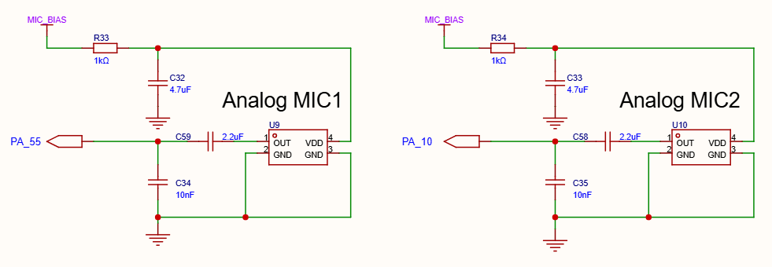  

<div align="center"> 图2-7-3-1 模拟 MIC单端输入电路图 </div>   <br>  <br>


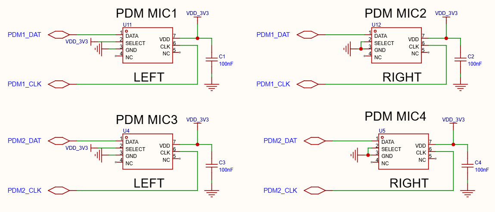  

<div align="center"> 图2-7-3-2 PDM 数字MIC输入电路图 </div>   <br>  <br>

模拟音频输出可参考 `图2-7-3-3` 所示推荐电路进行设计，需注意：虚线框内的差分低通滤波器必须靠近芯片引脚端布局，以此抑制高频干扰，提升音频输出信噪比。

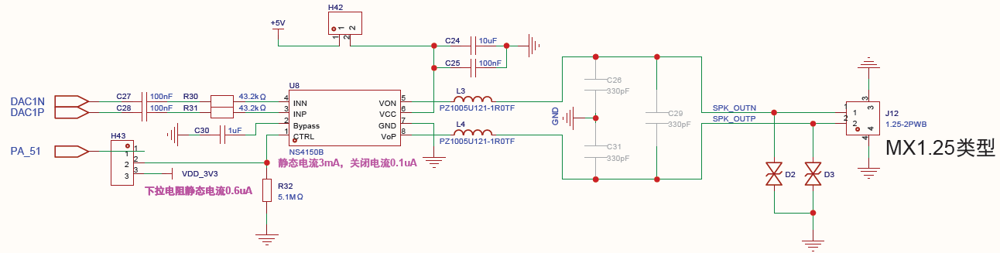  

<div align="center"> 图2-7-3-3 模拟音频PA电路图 </div>   <br>  <br>

#### 2.7.4.摄像头

芯片摄像头接口规格：
- 最高 16bits DVP接口摄像头；
- 2 data 和 4 data SPI接口摄像头。

<div align="center"> 表2-7-4-1 摄像头接口信号接线表  </div>

```{table}
:align: center
:class: color-header-table

| GC032A SPI4 | GC032A DVP8 | GC2145 DVP8 | OV2640 DVP10 | 57x Sig Name    | Description                               |
|-------------|-------------|-------------|--------------| --------------- | ----------------------------------------- |
| SBDA        | SBDA        | SIO-D       | SIO-D        | Any GPIO        | I2C Data  Signal                          |
| SBCL        | SBCL        | SIO-C       | SIO-C        | Any GPIO        | I2C Clock Signal                          |
| RESET       | RESET       | RESET       | RESET        | Any GPIO        | Reset Signal output                       |
| NC          | VSYNC       | VSYNC       | VSYNC        | DCMI_VSYNC      | Vertical synchronization Signal input     |
| PWDN        | PWDN        | PWDN        | PWDN         | Any GPIO        | Power Down Signal (active high) output    |
| NC          | HSYNC       | HREF        | HREF         | DCMI_HSYNC      | Horizontal synchronization Signal input   |
| NC          | D7          | D7          | Y9           | DCMI_DI7        | YUV/RGB video port bit [7] input          |
| MCLK        | MCLK        | MCLK        | MCLK         | Any GPIO(GPTIM) | System clock output                       |
| NC          | D6          | D6          | Y8           | DCMI_DI6        | YUV/RGB video port bit [6] input          |
| NC          | D5          | D5          | Y7           | DCMI_DI5        | YUV/RGB video port bit [5] input          |
| SCK         | PCLK/SCK    | PCLK        | PCLK         | DCMI_CLK        | Pixel clock input                         |
| NC          | D4          | D4          | Y6           | DCMI_DI4        | YUV/RGB video port bit [4] input          |
| SD0         | D0          | D0          | Y2           | DCMI_DI0        | YUV/RGB video port bit [0] input          |
| SD3         | D3          | D3          | Y5           | DCMI_DI3        | YUV/RGB video port bit [3] input          |
| SD1         | D1          | D1          | Y3           | DCMI_DI1        | YUV/RGB video port bit [1] input          |
| SD2         | D2          | D2          | Y4           | DCMI_DI2        | YUV/RGB video port bit [2] input          |
| NC          | NC          | NC          | Y1           | NC              | -                                         |
| NC          | NC          | NC          | Y0           | NC              | -                                         |
```

```{note}
为节约 GPIO 引脚资源，10 位 DVP 摄像头建议采用 8 位模式进行硬件连接；若硬件 GPIO 资源充裕，可将数据引脚一对一完整对接使用。
```

### 2.8.通用接口

#### 2.8.1.按键

##### 2.8.1.1.开关机按键

芯片 PA34 引脚支持长按复位，可复用为开关机按键实现开关机与长按复位功能；该引脚长按复位为高电平有效，硬件默认下拉至低电平，按下按键后引脚置高，电路设计参考`图2-8-1-2-1`。

##### 2.8.1.2.GPADC 按键

芯片支持 GPADC 电阻分压式按键设计，依靠不同分压电压区分按键，需在靠近引脚位置放置 0.1μF 对地滤波电容来提升采样精度，电路可参考`图2-8-1-2-1`。

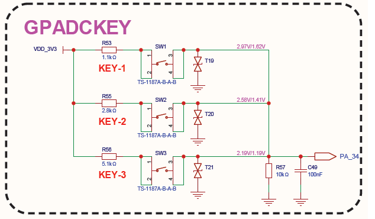  

<div align="center">图2-8-1-2-1 开关机及GPADC按键电路图 </div>   <br>  <br>

#### 2.8.2.UART

芯片提供三组 UART 接口，均支持全双工模式，提供高达 6Mbps 的波特率和多种可配置的数据格式，引脚复用分配详见`表2-6-2`，可选用 Function 0 ~ 15 范围内的复用引脚，也可通过 matrix table 配置表将 UART 功能灵活映射至任意 GPIO 引脚。

```{note}
- PA18、PA19 为默认调试串口 DBG-UART 引脚，上电自动配置为 USART1 接收、发送引脚；
- 若需预留频繁插拔的 UART 测试接口，推荐选用 PA18、PA19、PA43、PA44 引脚，该组 GPIO 最高耐压可达 5.5V，可避免过电应力损坏 IO 口；
- 测试引线较长时，需在信号线上串联 100Ω 电阻抑制信号过冲。
```

#### 2.8.3.I2C

芯片提供四组 I2C 接口，均支持主机、从机两种工作模式，引脚复用分配详见`表2-6-2`，通过 matrix table 配置表可以将 I2C 功能灵活映射至任意 GPIO 引脚。

```{note}
- I2C 信号为开漏双向总线，必须接外部上拉电阻：
    - 标准模式（Sm：100kHz）：推荐 4.7kΩ
    - 快速模式（Fm：400kHz）：推荐 2.2kΩ ~ 3.3kΩ
    - 高速模式（Fm+：1MHz）：推荐 1kΩ ~ 2.2kΩ
- 一组 I2C 总线上接多个从设备，只需在靠近主机位置放置一组上拉电阻，不需要每个从设备都上拉，且各从设备的设备地址要区分开。
```

#### 2.8.4.SPI

芯片提供两组 SPI 接口，均支持主机、从机两种工作模式，引脚复用分配详见`表2-6-1`，可选用 Function 0 ~ 15 范围内的复用引脚，也可通过 matrix table 配置表将 SPI 功能灵活映射至任意 GPIO 引脚。

```{note}
- 当 SPI 时钟低于 30MHz 时，可以通过 matrix table 配置表将 SPI 功能灵活映射至任意 GPIO 引脚；
- 当 SPI 时钟高于 30MHz 时，优先使用 Function 0 ~ 15 范围内的复用引脚。
- 靠近驱动端串接 22~27Ω 电阻，时钟信号线预留对地电容封装位，用于抑制高速信号产生的振铃与过冲现象，优化接口信号完整性。
```

#### 2.8.5.SDIO


芯片内置两路 SD/MMC 主机控制器，仅可作为主机使用，不支持从机模式；该控制器可外接 SD 卡、SDIO 外设以及 eMMC 存储芯片。

SDIO 相关信号通过引脚复用器固定映射至对应 GPIO 引脚，详细的引脚复用配置可查阅 `表2-6-1`。

```{note}
- 当 SDIO 时钟配置为 24MHz 时，可依靠芯片 GPIO 内部上拉，CMD、Data0~Data3 引脚无需额外添加外部上拉电阻；
- 当 SDIO 时钟配置为 48MHz 及以上高频时，需在 CMD、Data0~Data3 引脚外接 10kΩ 上拉电阻；
- 所有 SDIO 信号线均需串联 27Ω～33Ω 限流电阻；时钟信号线预留对地电容封装位，用于抑制高速信号产生的振铃与过冲现象，优化接口信号完整性；
- 外接 TF 卡座场景：卡检测 DET 引脚需外接 10kΩ 电阻上拉至 3.3V，对应 MCU 引脚配置为内部上拉输入模式；
- 外接 TF 卡座时，SDIO 信号线与供电电源回路必须增加 ESD 防护器件，提升静电防护能力。
```

#### 2.8.6.USB

芯片内置一路 USB2.0 FS 控制器，相关信号的硬件连接参考`表2-8-6-1`。

<div align="center"> 表2-8-6-1 USB 引脚分配表 </div>

```{table}
:align: center
:class: color-header-table

| USB Sig  | GPIO PIN |
| -------- | -------- |
| USB_DP   | PA35     |
| USB_DM   | PA36     |
```

```{note}
- 默认引脚分配：PA36 为 USB_DM（D-）、PA35 为 USB_DP（D+），该组引脚不支持功能重映射；
- 最高通信速率为 USB2.0 全速模式（FS，12Mbps）；
- 接口采用 3.3V 单端电平标准；
- 芯片内置识别电阻，可通过软件配置 USB 工作模式，自动在 DP 或 DM 引脚接入 1.5kΩ 上拉电阻，以此识别接入设备为全速设备或低速设备。
- 在 USB_DP、USB_DM 信号线上建议预留串联电阻，推荐初始取值 22Ω 或 33Ω；同时预留对地电容位，该电容可先不贴装。上述阻容元件需靠近芯片引脚端布局，用来抑制信号反射、改善信号完整性；
- USB_DP 与 USB_DM 两条差分信号线必须设计 ESD 防护电路，用来抵御静电浪涌冲击，防止芯片内部 USB 控制器因静电损坏，保障接口工作可靠性。
```

#### 2.8.7.CAN

芯片提供两组 CAN 接口，均兼容 CAN 2.0b 规范，引脚复用分配详见`表2-6-2`，通过 matrix table 配置表可以将 CAN 功能灵活映射至任意 GPIO 引脚。

#### 2.8.9.GPADC

GPADC 功能所对应的 GPIO 引脚分配详情参见`表2-8-9-1`

<div align="center"> 表2-8-9-1 GPADC 引脚分配表 </div>

```{table}
:align: center
:class: color-header-table

| GPIO PIN  | ADC Function |
| --------- | ------------ |
|PA28       |#GPADC_CH0    |
|PA29       |#GPADC_CH1    |
|PA30       |#GPADC_CH2    |
|PA31       |#GPADC_CH3    |
|PA32       |#GPADC_CH4    |
|PA33       |#GPADC_CH5    |
|PA34       |#GPADC_CH6    |
|PA35       |#GPADC_CH7    |
|PA36       |#GPADC_CH8    |
|PA37       |#GPADC_CH9    |
|PA38       |#GPADC_CH10   |
|VBAT/VBATS |#GPADC_CH11，该引脚隶属于电池电压域，其电压测试量程与通用 GPADC 引脚存在差异。   |
```
使用 ADC 功能时，请靠近管脚添加 0.1 μF 的对地滤波电容，精度会更准确一些。

### 2.9.调试和下载接口

芯片支持 DBG-UART 与 SWD 两种单步调试方式，PA18、PA19 为默认 DBG-UART 调试引脚，PA43、PA44 为默认 SWD 调试引脚，SWD 功能也可复用至 PA18、PA19 引脚。

<div align="center">表2-9-1 默认调试口连接方式 </div>

```{table}
:align: center
:class: color-header-table

|Debug Sig    | Pin   | Net Name  |
| ----------- | ------| --------- |
|DBG_UART_RXD |PA18   |USART1_RXD |
|DBG_UART_TXD |PA19   |USART1_TXD |
|SWD_CLK      |PA43   |SWCLK      |
|SWD_DIO      |PA44   |SWDIO      |
```

芯片共支持 DBG-UART、SWD、普通 UART、USB 四种程序下载方式；常规启动模式下仅可通过 DBG-UART、SWD 接口完成程序下载，BOOT 启动模式可启用全部四种下载接口，具体启动方式配置方法及各模式对应的下载接口参数设置，请详见'表2-9-2'。

<div align="center">表2-9-2 启动方式和下载口信息表 </div>

```{table}
:align: center
:class: color-header-table

|PA00      |BOOT REG  | PA01     | 上位机BOOT开关 |   启动分支                 |
| -------- | -------- | -------- | -------------- | -------------------------- |
| L        | L        | H        | 任意           | 常规启动，PA19不输出启动信息，PA18/PA19由DBG-UART切换到SWD，PA43/PA44的SWD功能失效  |
| L        | L        | L        | 关闭           | 常规启动，PA19输出启动信息，PA18/PA19是DBG-UART，PA43/PA44是SWD  |
| L        | L        | L        | 开启           | BOOT MODE，PA19输出启动信息，支持DBG-UART/SWD/UART/USB烧录，PA18/PA19是DBG-UART，PA43/PA44是SWD  |
| PA00和BOOT寄存器任何一项为1| PA00和BOOT寄存器任何一项为1| L | 任意 | BOOT MODE，PA19输出启动信息，支持DBG-UART/SWD/UART/USB烧录，PA18/PA19是DBG-UART，PA43/PA44是SWD  |
| PA00和BOOT寄存器任何一项为1| PA00和BOOT寄存器任何一项为1| H | 任意 | BOOT MODE，PA19不输出启动信息，支持SWD/USB烧录，PA18/PA19由DBG-UART切换到SWD，PA43/PA44的SWD功能失效  |
```
下载工具参考 [软硬件工具汇总](https://wiki.sifli.com/tools/index.html)

### 2.10.产线烧录和晶体校准

思澈科技提供脱机下载器来完成产线程序的烧录和晶体校准，硬件设计时，请注意至少预留测试点：VBAT、PVDD、GND、AVDD33、DB_UART_RXD、DB_UART_RXD、PA00 和 PA01。

详细的烧录和晶体校准参考 [软硬件工具汇总](https://wiki.sifli.com/tools/index.html)。


### 2.11.最小系统原理图

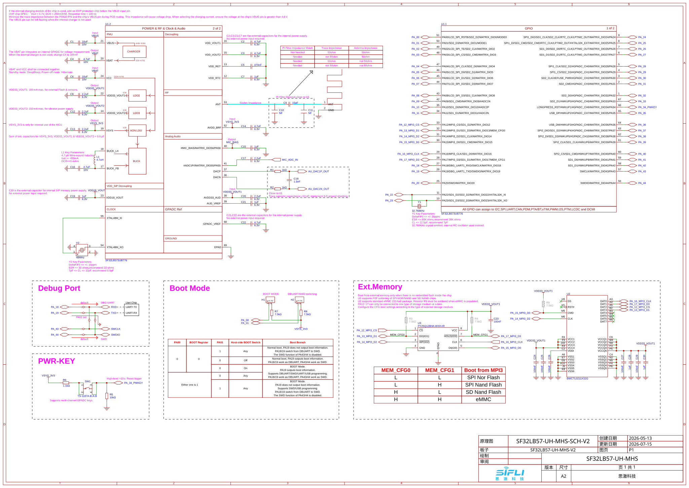  

<div align="center"> 图2-11-1 QFN68L 电池供电系列芯片最小系统原理图 </div>   <br>  <br>

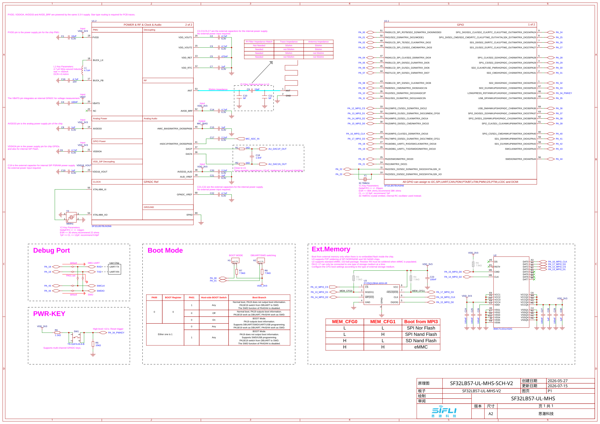  

<div align="center"> 图2-11-2 QFN68L 3.3V供电系列芯片最小系统原理图 </div>   <br>  <br>

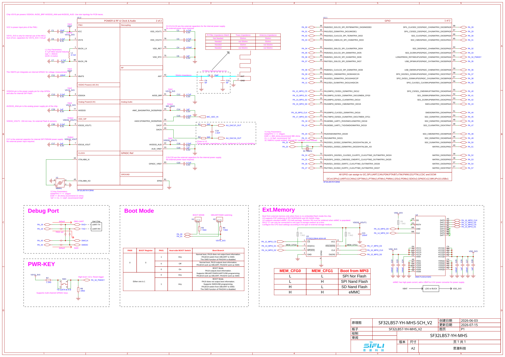  

<div align="center"> 图2-11-3 QFN80L 电池供电系列芯片最小系统原理图 </div>   <br>  <br>

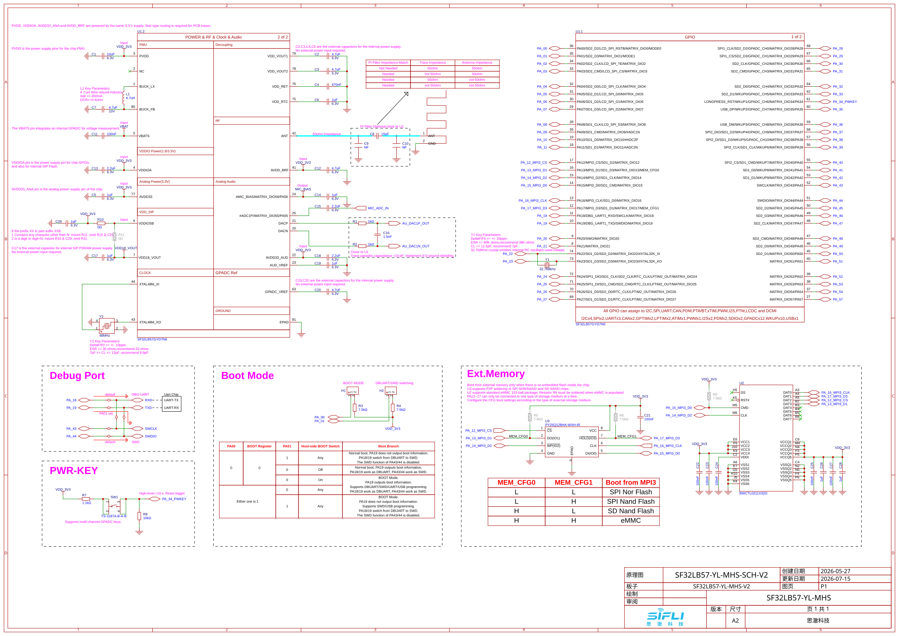  

<div align="center"> 图2-11-4 QFN80L 3.3V供电系列芯片最小系统原理图 </div>   <br>  <br>

<!--

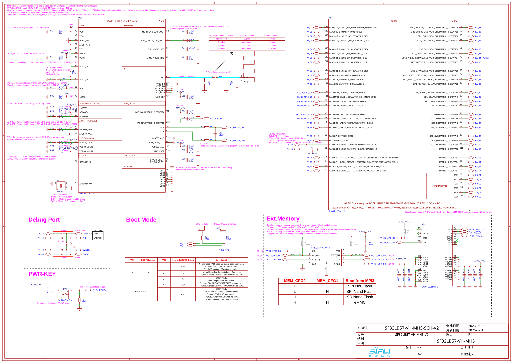  

<div align="center"> 图2-11-5 BGA112 电池供电系列芯片最小系统原理图 </div>   <br>  <br>

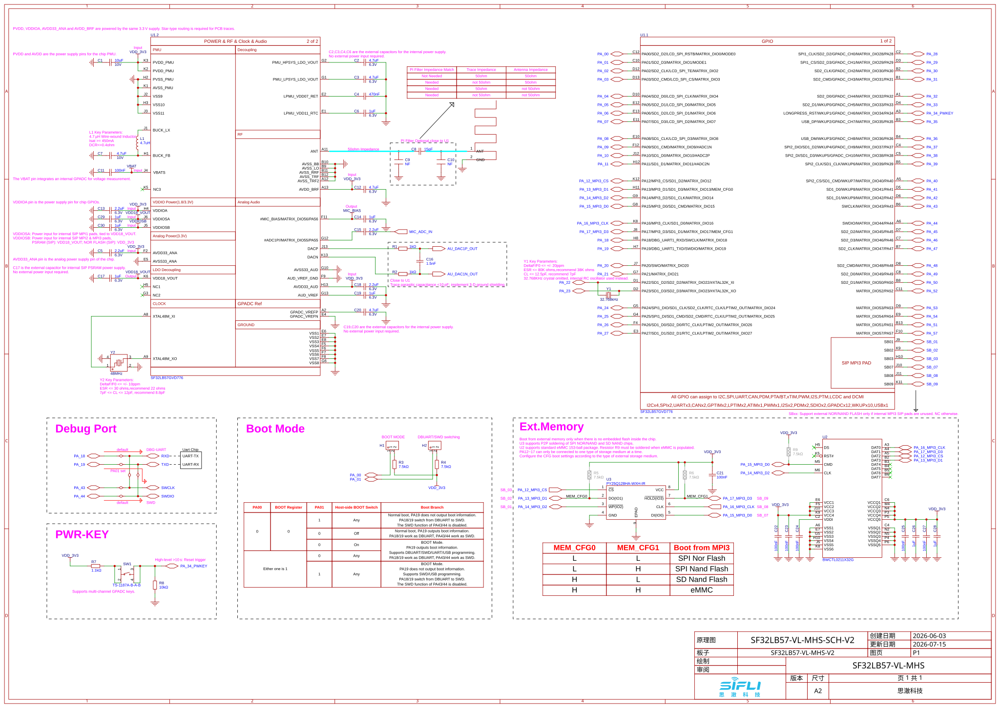  

<div align="center"> 图2-11-6 BGA112 3.3V供电系列芯片最小系统原理图 </div>   <br>  <br>

-->

## 3.PCB设计指导

### 3.1.PCB基础设置

#### 3.1.1.封装设计

SF32LB57x系列芯片的QFN68L封装尺寸：7mmX7mm；管脚数：68；PIN 间距：0.35mm。 封装尺寸、PCB 焊盘和钢网设计尺寸参考`图3-1-1-1` ~ `图3-1-1-4`。

  

<div align="center"> 图3-1-1-1 QFN68L-7x7-0.9mm封装尺寸图 </div>   <br>  <br>

  

<div align="center"> 图3-1-1-2 QFN68L-7x7-1.1mm封装尺寸图 </div>   <br>  <br>

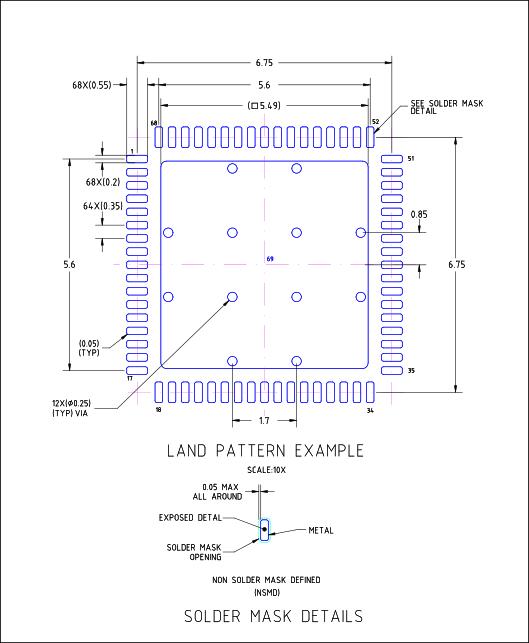  

<div align="center"> 图3-1-1-3 QFN68L封装PCB焊盘设计参考图 </div>   <br>  <br>

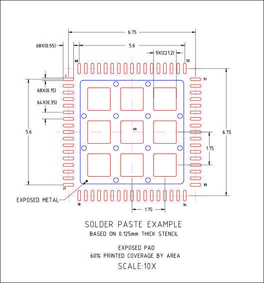  

<div align="center"> 图3-1-1-4 QFN68L封装PCB钢网设计参考图 </div>   <br>  <br>

SF32LB57x系列芯片的QFN80L封装尺寸：8mmX8mm；管脚数：80；PIN 间距：0.35mm。 封装尺寸、PCB 焊盘和钢网设计尺寸参考`图3-1-1-5` ~ `图3-1-1-8`。

  

<div align="center"> 图3-1-1-5 QFN80L-8x8-0.9mm封装尺寸图 </div>   <br>  <br>

  

<div align="center"> 图3-1-1-6 QFN80L-8x8-1.1mm封装尺寸图 </div>   <br>  <br>

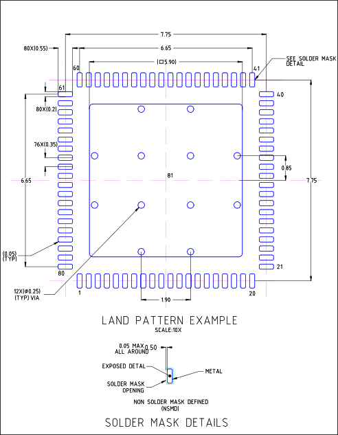  

<div align="center"> 图3-1-1-7 QFN80L封装PCB焊盘设计参考图 </div>   <br>  <br>

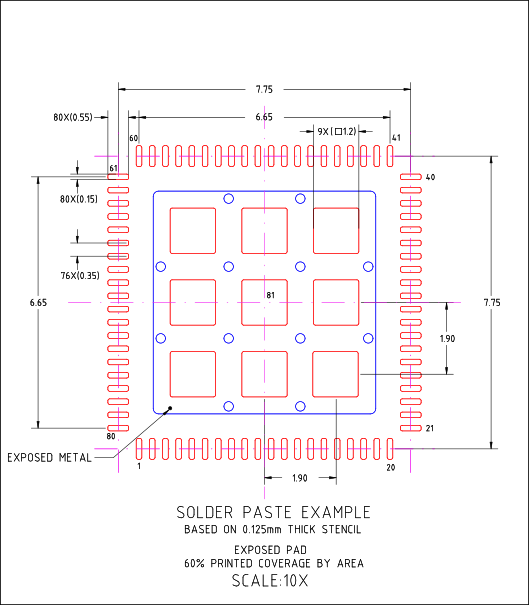  

<div align="center"> 图3-1-1-8 QFN80L封装PCB钢网设计参考图 </div>   <br>  <br>

<!--

SF32LB57x系列芯片的BGA112封装尺寸：5.4mmX4.4mm；管脚数：112；PIN 间距：0.4mm。 封装尺寸、PCB 焊盘和钢网设计尺寸参考`图3-1-1-9` ~ `图3-1-1-12`。

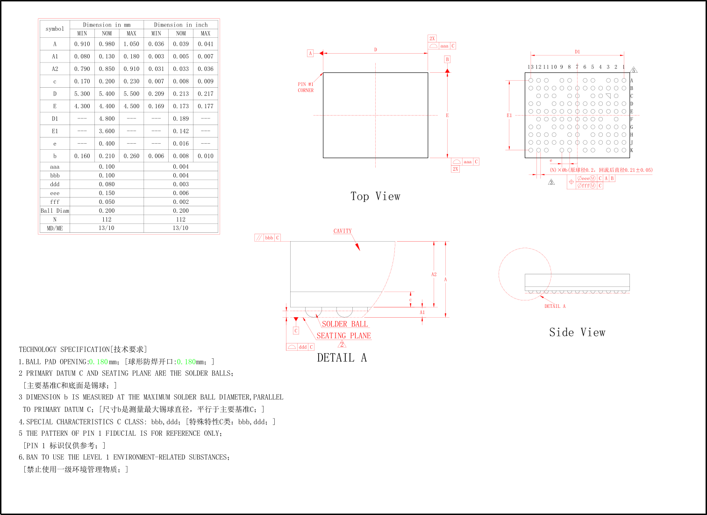  

<div align="center"> 图3-1-1-9 BGA112-5.4x4.4-0.98mm封装尺寸图 </div>   <br>  <br>

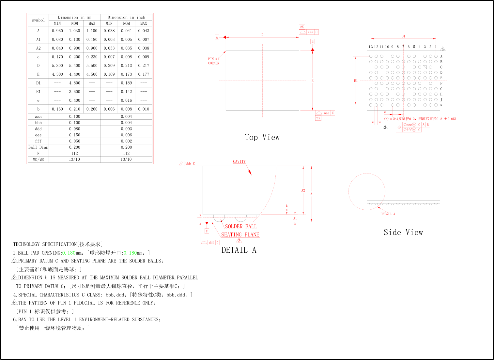  

<div align="center"> 图3-1-1-10 BGA112-5.4x4.4-1.03mm封装尺寸图 </div>   <br>  <br>

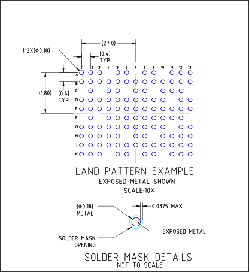  

<div align="center"> 图3-1-1-11 BGA112封装PCB焊盘设计参考图 </div>   <br>  <br>

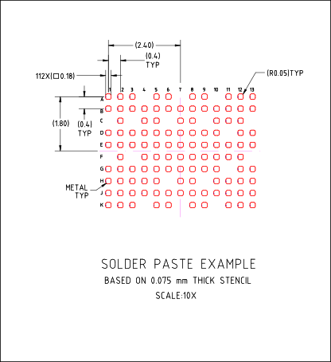  

<div align="center"> 图3-1-1-12 BGA112封装PCB钢网设计参考图 </div>   <br>  <br>

-->

#### 3.1.2.叠层设计

SF32LB57x QFN 系列芯片支持单双面 PCB 布局，元器件可全部放置在单面，也可将电容等器件布置于芯片背面。PCB 支持 PTH 通孔工艺，建议选用 4 层 PTH 板材，推荐叠层结构详见`图 3-1-2-1` 和 `图 3-1-2-2`。

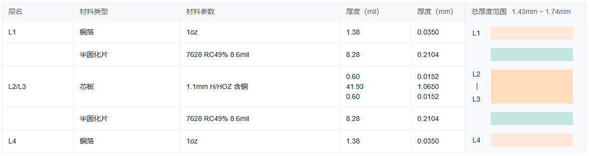  

<div align="center"> 图3-1-2-1 QFN封装板厚1.6mm PCB参考叠层结构图 </div>   <br>  <br>

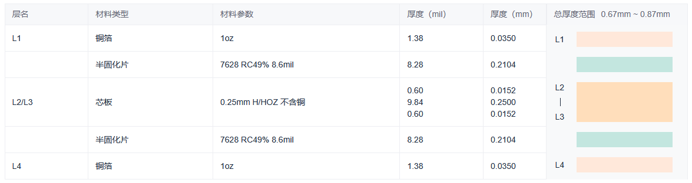  

<div align="center"> 图3-1-2-2 QFN封装板厚0.8mm PCB参考叠层结构图 </div>   <br>  <br>

<!--

SF32LB57x BGA 系列支持 PCB 单双面布局，元器件可单面放置，也可将电容类器件布局在芯片背面。硬件设计可采用一阶 HDI 盲埋孔工艺，PCB 层数最少为 4 层，推荐叠层结构参考`图 3-1-2-3`和`图 3-1-2-4`。

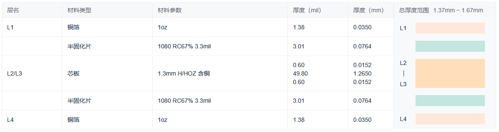  

<div align="center"> 图3-1-2-3 BGA封装板厚1.6mm PCB参考叠层结构图 </div>   <br>  <br>

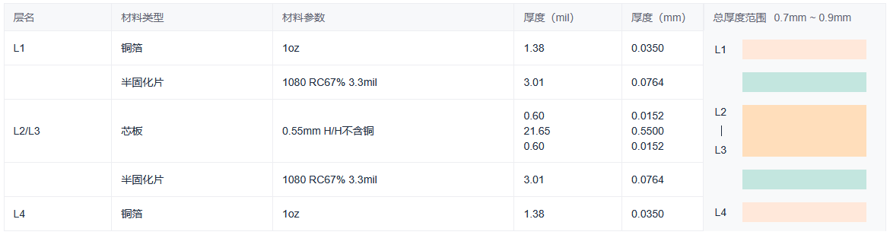  

<div align="center"> 图3-1-2-4 BGA封装板厚0.8mm PCB参考叠层结构图 </div>   <br>  <br>

-->

四层 PCB 叠层设计要求：
- 第一层（顶层）：整层铺地铜，主要用于元器件摆放与信号走线。
- 第二层（地层）：完整地平面铺铜，不布设任何信号线，保证参考地的完整性。
- 第三层（电源层）：可铺铜分割各类电源区域，既用来布设电源线路，也允许走信号线。
- 第四层（底层）：整层铺地铜，可布设各类信号线。


#### 3.1.3.通用设计规则

PTH 工艺 PCB 需按照`图3-1-3-1` 执行通用线宽、线距设计规范，过孔相关设计参数与布局要求参照`图3-1-3-2` 执行。

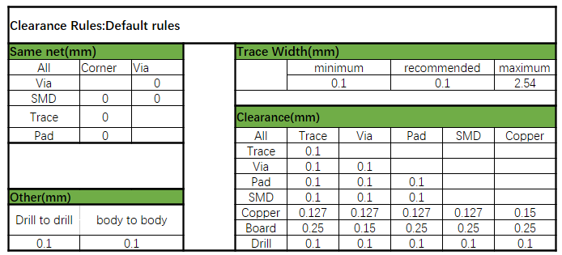  

<div align="center"> 图3-1-3-1 PTH 板通用设计规则 </div>   <br>  <br>

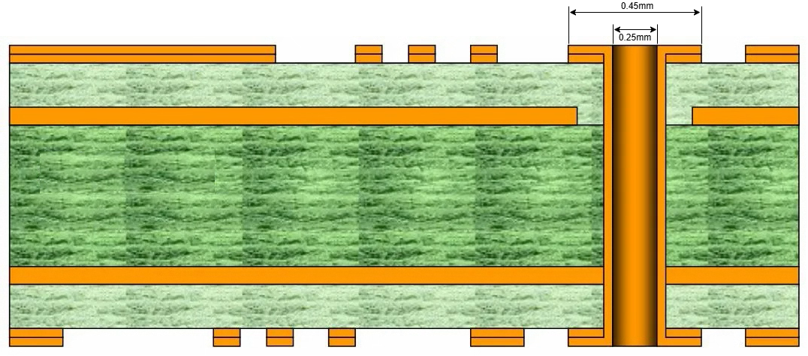  

<div align="center"> 图3-1-3-2 PTH 板VIA设计规则 </div>   <br>  <br>

HDI 工艺 PCB 需按照`图3-1-3-3` 执行通用线宽、线距设计规范，过孔相关设计参数与布局要求参照`图3-1-3-4` 执行。

  

<div align="center"> 图3-1-3-3 HDI 板通用设计规则 </div>   <br>  <br>

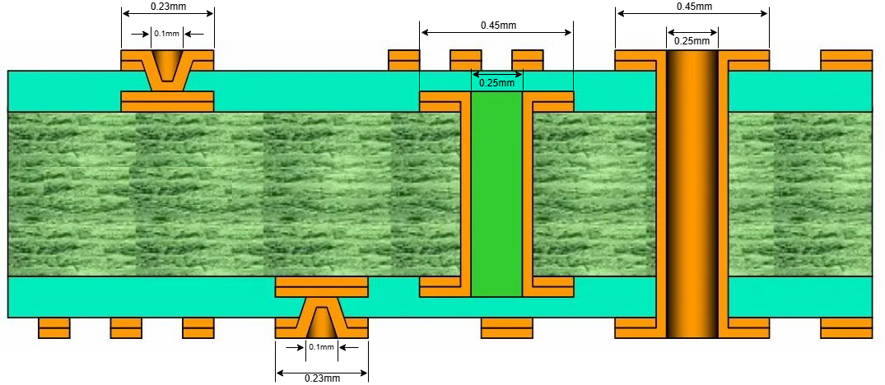  

<div align="center"> 图3-1-3-4 HDI 板通用设计规则 </div>   <br>  <br>


#### 3.1.4.走线扇出

QFN68、QFN80 <!-- 和 BGA112 --> 封装信号扇出，参考`图3-1-4-1` ~ `图3-1-4-3`。

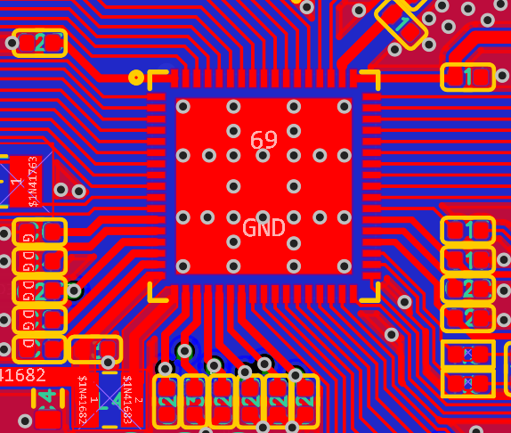  

<div align="center"> 图3-1-4-1 QFN68 表层扇出参考图 </div>   <br>  <br>

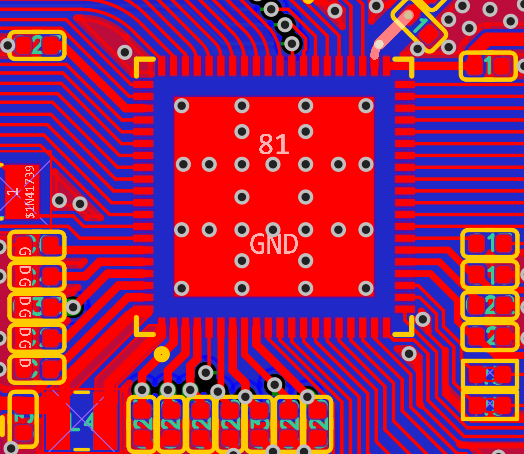  

<div align="center"> 图3-1-4-2 QFN80 表层扇出参考图 </div>   <br>  <br>

<!--

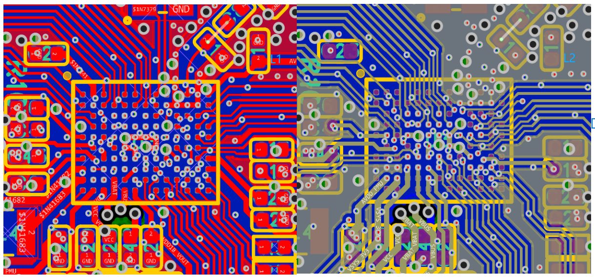  

<div align="center"> 图3-1-4-3 BGA112 扇出参考图 </div>   <br>  <br>

-->

### 3.2.电源

#### 3.2.1.主电源

VCC 与 PVDD 是芯片内置 PMU 模块的电源输入引脚，二者配套电容必须就近放置，电源走线宽度不小于 0.4mm，仅对 VCC 做电路图示，PVDD 参照同等规则设计即可。

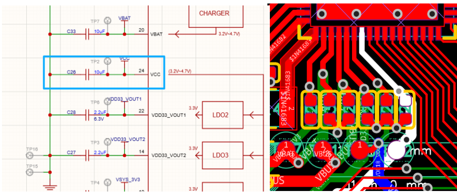  

<div align="center"> 图3-2-1-1 QFN封装 VCC 电源走线图 </div>   <br>  <br>

<!--

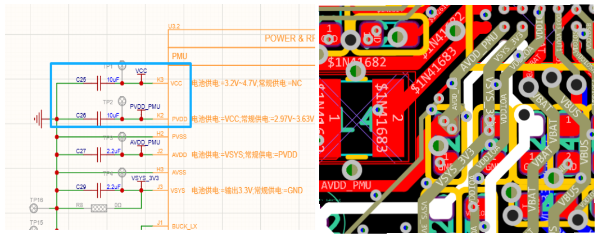  

<div align="center"> 图3-2-1-2 BGA封装 VCC 电源走线图 </div>   <br>  <br>

-->

VDD_VOUT1、VDD_VOUT2、VDD_RET、VDD_RTC、VDD18_VOUT、VDD33_VOUT1、VDD33_VOUT2、AVDD33_AUD、AVDD_BRF 等引脚的滤波电容需就近布置，电源线需依据输入电流设计为短粗走线，降低电源纹波，提升系统工作稳定性。

```{important}
PVDD、AVDD_BRF、AVDD33、AVDD33_AUD 共用一路电源时，需采用星型布线方式，从电源源头各自独立引出走线分别供电，禁止共用一段前置电源线。
```


#### 3.2.2.充电电路走线

VBUS、VBAT 为芯片内置充电模块的输入、输出引脚，二者滤波电容需就近摆放；因充电回路电流较大，引脚走线宽度至少 0.4mm，敏感信号线不可与其平行布线，走线采用星形布局，不与其他线路共用路径，防止充电过程对其他电路造成干扰。

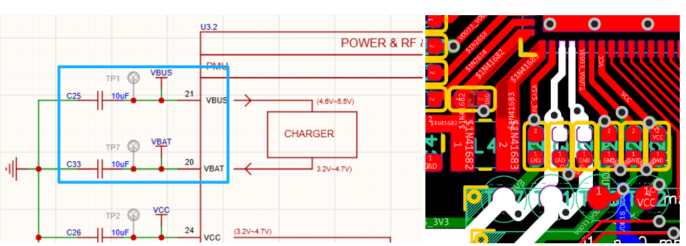  

<div align="center"> 图3-2-2-1 QFN封装 VBUS&VBAT 电源走线图 </div>   <br>  <br>

<!--

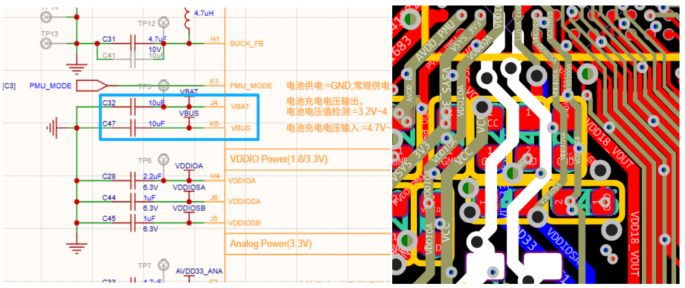  

<div align="center"> 图3-2-2-2 BGA封装 VBUS&VBAT 电源走线图 </div>   <br>  <br>

-->

#### 3.2.3.DCDC电路

DC-DC 电路的功率电感与滤波电容需紧贴芯片引脚放置，BUCK_LX 走线短而粗以减小功率回路电感，BUCK_FB 反馈走线宽度需大于 0.25mm；所有 DC-DC 输出滤波电容接地端多打接地过孔连接主地平面，功率电感所在表层禁止铺铜，相邻层需设置完整参考地平面，且不允许其他信号线从电感区域布线。

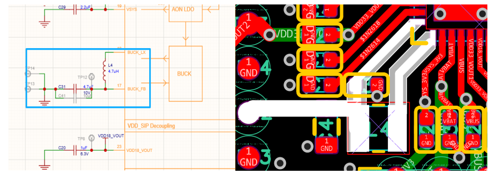  

<div align="center"> 图3-2-3-1 QFN封装 DCDC 电源走线图 </div>   <br>  <br>

<!--

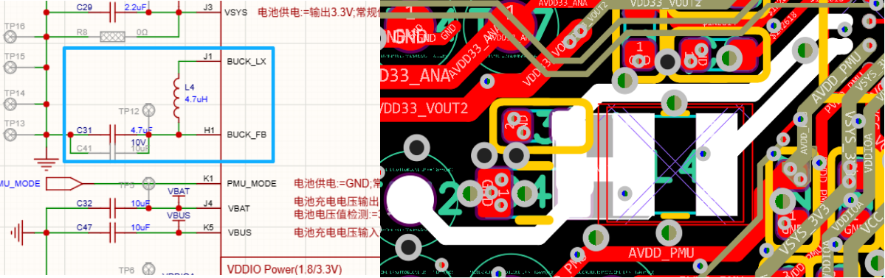  

<div align="center"> 图3-2-3-2 BGA封装 DCDC 电源走线图 </div>   <br>  <br>

-->

### 3.3.时钟接口走线

晶体设计应遵循以下规范：
- 地平面要求
    - 射频电路、晶体区域、主控芯片下方必须保留完整连续的参考地平面，禁止地平面分割、开槽破坏地完整性。
- 晶体布局间距要求
    - 晶体器件需与芯片时钟引脚保持至少1.5mm间距，避免近距离耦合造成时钟干扰、频偏异常；
    - 晶体距 PCB 板框大于 1mm，且与 PA、充电、PMU 等大功率发热器件间距不小于 5mm，避免温升造成频偏。
- 晶体走线规则
    - 晶体 XI/XO 时钟走线仅允许在顶层布设，禁止换层打孔布线；
    - 在 PCB 顶层的晶体外围划定禁止铺铜区域，将晶体器件与周边接地铜皮做隔离处理，一方面能够有效减小线路寄生电容，另一方面可阻隔热量传导，避免温度变化引发晶体频偏，保障时钟频率稳定性；
    - 时钟线路全程立体包地处理，线路两侧密集布置接地过孔做屏蔽隔离；
    - 走线两侧电源过孔需尽量远离时钟信号线，最大化保证包地屏蔽效果。
- 外围器件布局规范
    - 晶体两端对地负载电容布置在晶体两侧，放置于时钟走线靠近晶体的末端位置；电容接地焊盘就近连接晶体地焊盘，缩短接地路径。
- 区域屏蔽与禁布要求
    - 晶体正下方区域禁止布设高频数字信号线，最优设计为该区域不布置任何走线；
    - 晶体周边严禁放置功率电感等磁感应类器件，依托大面积完整地平面实现抗干扰，保证时钟信号纯净。


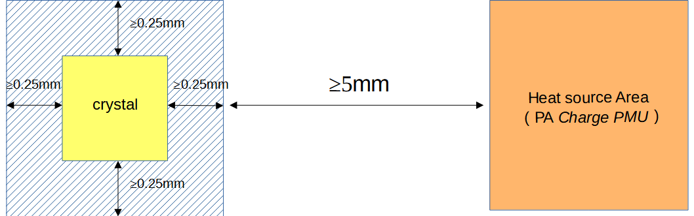  

<div align="center"> 图3-3-1 晶体布局图 </div>   <br>  <br>


48MHz 晶体建议走表层布线，走线长度控制在 3~10mm、线宽 0.1mm，需做立体包地处理，同时远离 VBAT、DC/DC 以及各类高速信号线；晶体所在区域的表层与相邻层设置禁布区，不允许其他线路穿过该区域。
<!-- 48MHz晶体走线模型 -->
  

<div align="center"> 图3-3-2 48MHz 晶体走线模型 </div>   <br>  <br>

<!-- 48MHz晶体原理图+PCB走线 -->
  

<div align="center"> 图3-3-3 48MHz 晶体走线参考 </div>   <br>  <br>


32.768KHz 晶体建议表层布线，走线长度不超过 10mm、线宽 0.1mm，32K_XI 与 32K_XO 平行走线间距≥0.15mm，需做立体包地处理；晶体区域的表层及相邻层设置禁布区，禁止其他线路穿过该区域。

<!-- 32KHz晶体走线模型 -->
  

<div align="center"> 图3-3-4 32.768KHz 晶体走线模型 </div>   <br>  <br>

<!-- 32KHz晶体原理图+PCB走线 -->
  

<div align="center"> 图3-3-5 32.768KHz 晶体走线参考 </div>   <br>  <br>


### 3.4.射频

射频匹配电路需靠近芯片端布局，远离天线端；AVDD_BRF 射频电源的滤波电容紧贴芯片引脚放置，电容接地引脚直接打过孔连接主地平面，RF 信号 π 型匹配网络的原理图与 PCB 布局可分别参考`图3-4-1`、`图3-4-2`。

<!-- 原理图+PCB走线 -->
  

<div align="center"> 图3-4-1 π型网络布局和走线参考 </div>   <br>  <br>


射频信号线建议表层布线，尽量不换层打孔，线宽建议大于 10mil，做立体包地处理，走线禁止锐角、直角设计；射频线路需做 50Ω 阻抗控制，线路两侧密集布设屏蔽地孔。

<!-- 原理图+PCB走线 -->
  

<div align="center"> 图3-4-2 RF信号走线参考 </div>   <br>  <br>

```{note}
- 射频走线需结合 PCB 叠层结构进行 50Ω 阻抗精准控制；
- 射频路径上匹配器件焊盘与走线宽度差异易引发阻抗不连续，可对器件焊盘下方参考地层按焊盘尺寸做挖空处理优化阻抗连续性；
- 若使用 IPEX 天线座，天线座下方所有 PCB 层均需做禁止铺铜挖空处理；
- PCB 天线需经过仿真与实板调试，建议增设一组 CLC 匹配电路，并将该电路尽量靠近天线端放置。
```

### 3.5.模拟信号

#### 3.5.1.音频

AVDD33_AUD、MIC_BIAS、AUD_VREF 引脚的滤波电容均需就近布置在芯片引脚旁，保证电容接地端可靠接入 PCB 主地，优化音频电源滤波效果。

<!-- 原理图+PCB走线 -->
  

<div align="center"> 图3-5-1-1 音频相关电源滤波电路PCB参考走线 </div>   <br>  <br>


ADCP 模拟信号输入端外围器件需紧靠芯片引脚摆放，走线尽可能缩短并做立体包地处理，同时远离各类强干扰信号线。

<!-- 原理图+PCB走线 -->
  

<div align="center"> 图3-5-1-2 模拟音频输入PCB参考走线 </div>   <br>  <br>

DACP、DACN 模拟差分输出引脚的外围器件需紧靠芯片引脚布局，每组 P、N 信号按差分规则布线，走线尽量缩短，控制寄生电容小于 10pF，做立体包地处理，并远离各类强干扰信号。

<!-- 原理图+PCB走线 -->
  

<div align="center"> 图3-5-1-3 模拟音频输出PCB参考走线 </div>   <br>  <br>

#### 3.5.2.GPADC

配置为 GPADC 功能的引脚走线需做立体包地处理，远离电池检测、温度检测等干扰电路。

### 3.6.高速信号

#### 3.6.1.MPI

MPI 信号线尽量集中布线不要分散铺设，整体走线长度不超过 20mm，同组内各信号线长度误差控制在 3mm 以内，时钟、数据及命令信号线均需做立体包地处理。

#### 3.6.2.SDIO

SDIO 信号线尽量集中布线不要分散铺设，整体走线长度不超过 50mm，同组内各信号线长度误差控制在 6mm 以内，时钟、数据及命令信号线均需做立体包地处理。

  

<div align="center"> 图3-6-2-1 SDIO信号走线模型 </div>   <br>  <br>

<!-- 原理图+PCB走线 -->
  

<div align="center"> 图3-6-2-2 SDIO PCB参考走线 </div>   <br>  <br>

#### 3.6.3.USB

USB 差分信号 PA35（USB_DP）、PA36（USB_DN）需先经过 ESD 防护器件再接入芯片，ESD 器件接地引脚可靠连接主地；信号线按差分布线并做 90Ω 差分阻抗控制，同时进行立体包地处理。

  

<div align="center"> 图3-6-3-1 USB信号器件布局参考 </div>   <br>  <br>

  

<div align="center"> 图3-6-3-2 USB信号走线模型 </div>   <br>  <br>

<!-- 原理图+PCB走线 -->
  

<div align="center"> 图3-6-3-3 USB信号PCB参考走线 </div>   <br>  <br>

### 3.7.EMI&ESD

- 屏蔽罩外部表层不要对时钟、电源这类干扰信号做长距离布线，该类信号尽量布置在内层，禁止在表层走线。
- ESD 防护器件需紧邻连接器对应引脚布设，信号线必须先经过 ESD 器件再接入后端电路，严禁信号在未经过 ESD 防护前出现分支走线。
- ESD 防护器件接地引脚需通过过孔直接连接主地，接地焊盘采用短粗走线布局，降低接地阻抗，提升 ESD 防护性能。

USB 充电线路的测试点布置在 TVS 防护管前端；电池座对应的 TVS 管安装在芯片电路前端，走线要求信号先经过 TVS 管再接入芯片引脚。

  

<div align="center"> 图3-7-1 电源TVS布局参考 </div>   <br>  <br>  <br>

  

<div align="center"> 图3-7-2 TVS参考走线 </div>   <br>  <br>  <br>


## 4.设计自查

### 4.1.封装

<div align="center"> 表4-1-1 封装相关自查表 </div>

```{table}
:align: center
:class: checklist-table

|序号|事项|确认(Yes/No)|适用芯片|备注|
| -- |--|--|--|--|
|1   |原理图库是否正确            | - |所有型号 | - |
|2   |PCB封装是否安规格书要求制作 | - |所有型号 | - |
```

### 4.2.电源

#### 4.2.1.供电

<div align="center"> 表4-2-1-1 供电相关自查表 </div>

```{table}
:align: center
:class: checklist-table

| 序号 | 核查事项 | 确认(Yes/No) | 适用芯片 | 核查要点 |
| ---- | -------- | ------------ | -------- | -------- |
| 1  | VBUS 输入电压范围核查               |  | 电池供电系列型号 | VBUS 引脚输入供电电压应严格控制在 4.6V～5.5V，禁止超出该电压范围输入，避免器件损坏 |
| 2  | VBAT 接的电池规格核查               |  | 电池供电系列型号 | VBAT 充电适配电池额定电压范围为 4.2V～4.45V；预充电电流 40mA，最大充电电流为 1C（400mA） |
| 3  | VCC 供电电压范围核查                |  | 电池供电系列型号 | VCC 引脚供电电压额定工作范围为 3.45V～4.7V；其中 3.45V 为硬件开机电压阈值，2.7V 为硬件关机电压阈值 |
| 4  | VSYS 电源负载规范核查               |  | 电池供电系列型号 | VSYS 为芯片内部专用供电电源，仅可给 AVDD_BRF、GPIO 上拉回路供电，禁止驱动所有外部外设 |
| 5  | VDD33_VOUT1 供电用途与负载约束核查  |  | 电池供电系列型号 | VDD33_VOUT1 供电负载仅限内置合封 Flash、外部 Nor/Nand Flash 与 AVDD33_AUD，禁止驱动其他所有外设 |
| 6  | VDD33_VOUT2 供电用途与负载约束核查  |  | 电池供电系列型号 | VDD33_VOUT2 软启动限流 30mA，电压稳定至 3.3V 后带载能力 150mA；可通过软件关闭软启动限流，需校核外接外设上电电流是否匹配本电源推荐规格 |
| 7  | AVDD_BRF 供电来源核查               |  | 电池供电系列型号 | AVDD_BRF 由 VSYS 电源域供电 |
| 8  | AVDD33_AUD 供电来源核查             |  | 电池供电系列型号 | AVDD33_AUD 由 VDD33_VOUT1 电源域供电 |
| 9  | PVDD 输入电压范围核查               |  | 3.3V供电系列型号 | PVDD 引脚额定供电电压范围为 2.93V～3.63V，典型默认工作电压 3.3V |
| 10 | VBATS 输入电压采样范围核查          |  | 3.3V供电系列型号 | VBATS 电池电压检测采样范围为 0~4.5V，禁止超量程电压输入 |
| 11 | AVDD_BRF 供电来源核查               |  | 3.3V供电系列型号 | AVDD_BRF 采用外部 3.3V 电源供电 |
| 12 | AVDD33_AUD 供电来源核查             |  | 3.3V供电系列型号 | AVDD33_AUD 采用外部 3.3V 电源供电 |
| 13 | AVDD33_ANA 供电来源核查             |  | 3.3V供电系列型号 | AVDD33_ANA 采用外部 3.3V 电源供电 |
| 14 | VDDIOA 供电来源核查                 |  | 3.3V供电系列型号 | VDDIOA 的输入供电电压范围需以对应订购型号为准，具体参数请查阅规格书内的型号说明 |
| 15 | 电池电压检测电路核查                |  | 所有型号         | 芯片内部已分配一路 GPADC 通道连接至 VBAT/VBATS 引脚，无需再接到其他 GPADC 通道来检测 |
| 16 | BUCK_LX、BUCK_FB硬件接线正确性核查  |  | 所有型号         | 需确认 BUCK 开关引脚与反馈引脚的接线方式严格遵循芯片硬件设计规范要求 |
| 17 | VDD18_VOUT 供电用途核查             |  | 所有型号         | VDD18_VOUT 仅用于为芯片内置合封 PSRAM 供电，严禁为外部 1.8V 外设供电 |
| 18 | GPADC_VREF 连接核查                 |  | 所有型号         | GPADC_VREF 为芯片 GPADC 模块内部参考电压输出引脚，仅允许外接电容，禁止接入外部电压信号 |
| 19 | AUD_VREF 连接核查                   |  | 所有型号         | AUD_VREF 是芯片音频模块的内部参考电压输出引脚，仅允许外接电容，严禁接入外部电压 |
| 20 | VBUS 电容容值核查                   |  | 电池供电系列型号 | VBUS 引脚需外接容量不小于 10μF/10V 的电容，且电容需靠近引脚摆放 |
| 21 | VBAT 电容容值核查                   |  | 电池供电系列型号 | VBAT 引脚外接电容容量不小于 4.7μF/10V，电容需紧邻引脚放置 |
| 22 | VCC 电容规格核查                    |  | 电池供电系列型号 | VCC 引脚外接电容容量不小于 10μF/10V，电容需靠近引脚放置 |
| 23 | VSYS 电容规格核查                   |  | 电池供电系列型号 | VSYS 引脚需外接 2.2μF/6.3V 电容，该电源域内全部电容的总容值之和不可超过 9.6μF，且电容需靠近引脚摆放 |
| 24 | VDD33_VOUT1 电容规格核查            |  | 电池供电系列型号 | VDD33_VOUT1 引脚需外接 2.2μF/6.3V 电容，该电源域内全部电容的总容值之和不可超过 9.6μF，且电容需靠近引脚摆放 |
| 25 | VDD33_VOUT2 电容规格核查            |  | 电池供电系列型号 | VDD33_VOUT1 引脚需外接 2.2μF/6.3V 电容，该电源域内全部电容的总容值之和不可超过 9.6μF，且电容需靠近引脚摆放 |
| 26 | PVDD 电容规格核查                   |  | 3.3V供电系列型号 | PVDD 引脚需外接容量不小于 10μF/6.3V 的电容，且电容需靠近引脚摆放 |
| 27 | VBATS 电容规格核查                  |  | 3.3V供电系列型号 | VBATS 引脚需外接 0.1μF/10V 去耦电容，且电容需靠近引脚摆放 |
| 28 | VDDIOA 电容规格核查                 |  | 3.3V供电系列型号 | VDDIOA 引脚需外接 4.7μF/6.3V 电容，且电容需靠近引脚摆放 |
| 29 | AVDD33_ANA 电容规格核查             |  | 3.3V供电系列型号 | AVDD33_ANA 引脚需外接 1μF/6.3V 电容，且电容需靠近引脚摆放 |
| 30 | BUCK_FB 电容规格核查                |  | 所有型号         | BUCK_FB端配置4.7μF电容，放置在电感和芯片管脚之间 |
| 31 | VDD_VOUT1 电容规格核查              |  | 所有型号         | VDD_VOUT1 引脚需外接 4.7μF/6.3V 电容，且电容需靠近引脚摆放 |
| 32 | VDD_VOUT2 电容规格核查              |  | 所有型号         | VDD_VOUT2 引脚需外接 4.7μF/6.3V 电容，且电容需靠近引脚摆放 |
| 33 | VDD_RET 电容规格核查                |  | 所有型号         | VDD_RET 引脚需外接 0.47μF/6.3V 电容，且电容需靠近引脚摆放 |
| 34 | VDD_RTC 电容规格核查                |  | 所有型号         | VDD_RTC 引脚需外接 1μF/6.3V 电容，且电容需靠近引脚摆放 |
| 35 | MIC_BIAS 电容规格核查               |  | 所有型号         | MIC_BIAS 引脚需外接 1μF/6.3V 电容，且电容需靠近引脚摆放 |
| 36 | AVDD_BRF 电容规格核查               |  | 所有型号         | AVDD_BRF 引脚需外接 4.7μF/6.3V 电容，且电容需靠近引脚摆放 |
| 37 | AVDD33_AUD 电容规格核查             |  | 所有型号         | AVDD33_AUD 引脚需外接 2.2μF/6.3V 电容，且电容需靠近引脚摆放 |
| 38 | AUD_VREF 电容规格核查               |  | 所有型号         | AUD_VREF 引脚需外接 1μF/6.3V 电容，且电容需靠近引脚摆放 |
| 39 | GPADC_VREF 电容规格核查             |  | 所有型号         | GPADC_VREF 引脚需外接 4.7μF/6.3V 电容，且电容需靠近引脚摆放 |
| 40 | BUCK 电感型号合规性核查             |  | 所有型号         | 优先选用 AVL 表内推荐的电感型号；若选用其他型号，需满足以下参数要求：电感值 4.7μH，直流阻抗 DCR≤0.4Ω，饱和电流 Isat≥450mA |
| 41 | BUCK_LX 抗干扰预留设计核查          |  | 所有型号         | 搭载 GPS 等敏感外设的机型，需在 BUCK_LX 引脚预留接地电容焊盘，所选电容容值应小于 100pF，最终容值以整机 EMC 调试结果为准 |
| 42 | VBUS 电源线宽核查                   |  | 电池供电系列型号 | VBUS 供电走线线宽不小于 16mil |
| 43 | VBAT 电源线宽核查                   |  | 电池供电系列型号 | VBAT 供电走线线宽不小于 16mil |
| 44 | VCC 电源线宽核查                    |  | 电池供电系列型号 | VCC 供电走线线宽不小于 12mil |
| 45 | VDD33_VOUT1 电源线宽核查            |  | 电池供电系列型号 | VDD33_VOUT1 供电走线线宽不小于 10mil |
| 46 | VDD33_VOUT1 电源线宽核查            |  | 电池供电系列型号 | VDD33_VOUT2 供电走线线宽不小于 10mil |
| 47 | PVDD 电源线宽核查                   |  | 3.3V供电系列型号 | VCC 供电走线线宽不小于 12mil |
| 48 | VDDIOA 电源线宽核查                 |  | 3.3V供电系列型号 | VDDIOA 供电走线线宽不小于 10mil |
| 49 | BUCK_LX 和 BUCK_FB 电源线宽核查     |  | 所有型号         | 该部分供电走线线宽不得小于 10mil，走线尽可能短 |
| 50 | AVDD_BRF 电源线宽核查               |  | 所有型号         | AVDD_BRF 供电走线线宽不小于 8mil |
| 51 | AVDD33_AUD 电源线宽核查             |  | 所有型号         | AVDD33_AUD 供电走线线宽不小于 8mil |
| 52 | 充电接口防护电路核查                |  | 电池供电系列型号 | 充电输入接口必须设计 OVP 过压保护电路 |
| 53 | 充电即刻亮屏方案充电芯片选型核查    |  | 电池供电系列型号 | 若要求接入充电器后设备立即亮屏，不可使用芯片内置充电方案，必须选用具备电源路径管理功能的外置充电芯片 |
| 54 | 内置充电器使用场景合规性核查        |  | 电池供电系列型号 | 仅允许在电池电压充至 3.6V 后通过软件开机亮屏的场景下，选用芯片内置充电方案 |
| 55 | OVP 过压保护芯片选型参数核查        |  | 电池供电系列型号 | 推荐选用带 LDO 输出的 OVP 器件（如 LP5305AQVF）；要求 LDO 输出电压范围 4.7V~5.4V，带载能力不低于 0.5A，过流保护阈值 Iocp 不低于 0.7A |
| 56 | 可调 OVLO 型 OVP 电路参数核查       |  | 电池供电系列型号 | 分压电阻需选用精度 1% 的规格，OVLO 阈值误差小于 3%，电压调节范围设置为 5.15V~5.55V |
| 57 | 未使用内置充电时 VBUS 电路设计核查  |  | 电池供电系列型号 | 未使用片内充电器时，VBUS 引脚可做悬空处理，可省略 VBUS 端外接电容；该场景下 VBAT 不具备对外输出能力 |
```

#### 4.2.2.功耗

<div align="center"> 表4-2-2-1 功耗相关自查表 </div>

```{table}
:align: center
:class: checklist-table

| 序号 | 核查事项 | 确认(Yes/No) | 适用芯片 | 核查要点 |
| ---- | -------- | ------------ | -------- | -------- |
| 1 | LDO、DCDC电源芯片选型与使能引脚设计检查 |  | 所有型号 | 选用EN引脚高电平有效规格的电源芯片；默认关断输出时，EN引脚需下拉1MΩ~5.1MΩ电阻至地，阻值根据整机低功耗需求选型确定 |
| 2 | MOS管电源开关电路设计检查               |  | 所有型号 | 电源开关采用PMOS+NMOS组合拓扑，控制引脚高电平开启电源、低电平关断电源；控制引脚固定下拉1MΩ电阻至地 |
| 3 | 外部启动介质电源控制引脚核查            |  | 所有型号 | 外部启动介质供电电源开关由PA21引脚单独控制 |
| 4 | VSYS作为GPIO上拉电源功耗合规性检查      |  | 电池供电系列型号 | VSYS为常供电电源，采用VSYS作为GPIO上拉电源时，需充分评估静态功耗，确认满足整机低功耗指标要求 |
| 5 | LDO2/LDO3作为GPIO上拉电源场景兼容性检查 |  | 电池供电系列型号 | 选用LDO2或LDO3作为GPIO上拉电源时，需评估两路LDO下电场景，确认不会出现漏电、IO电平异常等设计风险 |
| 6 | I2C总线上拉电源控制逻辑检查             |  | 所有型号 | I2C上拉供电电源必须与对应外设IO域电源同步通断，防止系统休眠期间产生漏电流 |
| 7 | Deep Sleep模式整机底电流指标核查        |  | 所有型号 | 确认项目规定的Deep Sleep模式静态电流上限指标 |
| 8 | Deep Sleep模式外围器件总功耗核查        |  | 所有型号 | 统计所有外围器件在Deep Sleep模式下的静态电流总和，校验是否满足项目功耗指标要求 |
| 9 | Standby模式整机底电流指标核查           |  | 所有型号 | 确认项目规定的Standby模式静态电流上限指标 |
| 10 | Standby模式外围器件总功耗核查          |  | 所有型号 | 统计所有外围器件在Standby模式下的静态电流总和，校验是否满足项目功耗指标要求 |
```

### 4.3.时钟

<div align="center"> 表4-3-1 时钟相关自查表 </div>

```{table} 
:align: center
:class: checklist-table

| 序号 | 核查事项 | 确认(Yes/No) | 适用芯片 | 核查要点 |
| ---- | -------- | ------------ | -------- | -------- |
| 1 | 48MHz主时钟晶体型号合规性检查       |  | 所有型号 | 选用晶体型号需为Sifli官方推荐规格 |
| 2 | 非推荐款48MHz主时钟晶体参数检查     |  | 所有型号 | 负载电容7pF≤CL≤12pF（推荐8.8pF）；频率偏差≤±10ppm；等效串联电阻ESR≤30Ω（推荐22Ω） |
| 3 | 32.768KHz RTC时钟晶体型号合规性检查 |  | 所有型号 | 选用晶体型号需为Sifli官方推荐规格 |
| 4 | 非推荐款32.768KHz RTC晶体参数检查   |  | 所有型号 | 负载电容是否7pF或11.5pF（推荐7pF）；频率偏差≤±20ppm；等效串联电阻ESR≤80kΩ（推荐38kΩ） |
| 5 | 晶体器件布局位置检查                |  | 所有型号 | 晶体器件需紧邻芯片对应晶体引脚放置，缩短走线长度 |
| 6 | 晶体周边接地屏蔽设计检查            |  | 所有型号 | 晶体器件及振荡走线区域需完整布设GND屏蔽保护 |
| 7 | 晶体下方地层禁止铺铜区域检查        |  | 所有型号 | 4层PTH板：TOP层晶体下方做铜皮避让；6层HDI板：TOP层、第2层均需做铜皮避让处理 |
| 8 | 振荡走线与接地铜皮间距检查          |  | 所有型号 | 晶体振荡信号线与周边GND包铜的间距需大于1.5倍走线线宽 |
| 9 | 32K RTC晶体平行走线间距检查         |  | 所有型号 | 32.768KHz晶体相关平行走线之间的线间距需大于2倍基础线宽 |
```

### 4.4.存储

<div align="center"> 表4-4-1 存储相关自查表 </div>

```{table} 
:align: center
:class: checklist-table

| 序号 | 核查事项 | 确认(Yes/No) | 适用芯片 | 核查要点 |
| ---- | -------- | ------------ | -------- | -------- |
| 1 | MPI3 外接 SPI NOR Flash 引脚上拉检查   |  | 所有型号 | PA13(MPI D1)、PA17(MPI D3) 无需上拉电阻 |
| 2 | MPI3 外接 SPI NAND Flash 引脚上拉检查  |  | 所有型号 | PA13(MPI D1) 无需上拉；PA17(MPI D3) 必须接7.5kΩ上拉电阻 |
| 3 | MPI3 外接 SD NAND Flash 引脚上拉检查   |  | 所有型号 | PA13(SD D3)、PA15(SD CMD) 必须接7.5kΩ上拉电阻；PA17(SD D1) 无需上拉 |
| 4 | MPI3 外接 eMMC 引脚上拉检查            |  | 所有型号 | PA13(SD D3)、PA17(SD D1)、PA15(SD CMD) 全部必须接7.5kΩ上拉电阻 |
| 5 | 合封存储占用 MPI3 时外部介质兼容性核查 |  | 所有型号 | 芯片合封存储占用MPI3通道后，外部MPI3仅支持SD NAND / eMMC，禁止挂载SPI NOR/SPI NAND |
| 6 | MPI3 外接存储电源控制电路核查          |  | 所有型号 | 1. SPI NOR Flash：可常供电；<br>2. SPI NAND / SD NAND / eMMC：必须增加电源开关控制；<br>3. 外部介质启动场景：存储电源默认上电导通 |
| 7 | 外接存储颗粒型号合规性核查             |  | 所有型号 | 选用的存储颗粒型号需在项目AVL认证清单内 |
| 8 | 存储颗粒IO电平匹配核查                 |  | 所有型号 | 存储颗粒工作电压范围与主芯片IO供电电平保持一致 |
```
### 4.5.射频

<div align="center"> 表4-5-1 射频相关自查表 </div>

```{table} 
:align: center
:class: checklist-table

| 序号 | 核查事项 | 确认(Yes/No) | 适用芯片 | 核查要点 |
| ---- | -------- | ------------ | -------- | -------- |
| 1 | ANT信号阻抗标注检查            |  | 所有型号 | ANT信号线已明确标注单端50Ω特征阻抗设计约束 |
| 2 | ANT端PI型匹配网络设计检查      |  | 所有型号 | 信号链路预留PI型匹配网络，并联位为NC电容，串联位放置15pF电容 |
| 3 | RF射频走线阻抗设计检查         |  | 所有型号 | 全部RF走线按照单端50Ω特征阻抗规则完成PCB阻抗控制 |
| 4 | 射频走线两侧接地屏蔽检查       |  | 所有型号 | 射频线路两侧接地铜皮宽度不低于60mil，通过多个接地过孔可靠连接至主地层 |
| 5 | 天线PI型匹配网络布局位置检查   |  | 所有型号 | 预留的PI型匹配网络必须靠近射频芯片引脚端摆放 |
| 6 | 射频走线下方地层完整性检查     |  | 所有型号 | 射频信号走线正下方必须铺设连续、无分割的完整GND屏蔽地层 |
| 7 | 射频区域高速数字信号隔离检查   |  | 所有型号 | 射频信号走线正下方禁止布设任意高速数字信号线 |
| 8 | 射频区域大功率电源信号隔离检查 |  | 所有型号 | 射频信号走线正下方禁止布设电流波动较大的电源类信号线 |
```

### 4.6.多媒体

#### 4.6.1.显示

<div align="center"> 表4-6-1-1 显示相关自查表 </div>

```{table} 
:align: center
:class: checklist-table

| 序号 | 核查事项 | 确认(Yes/No) | 适用芯片 | 核查要点 |
| ---- | -------- | ------------ | -------- | -------- |
| 1 | QSPI接口显示屏引脚分配检查       |  | 所有型号 | 优先选用PA00~PA08引脚组的专用复用管脚进行线路连接 |
| 2 | RGB接口显示屏引脚分配检查        |  | 所有型号 | 常规速率下可任意GPIO分配；信号速率超30MHz时，仅可在PA22~PA50、PA52~PA54（B1~B6）范围内分配引脚 |
| 3 | MCU 8080接口显示屏引脚分配检查   |  | 所有型号 | 引脚分配规则同RGB接口，高速场景限定使用PA22~PA50、PA52~PA54引脚组 |
| 4 | EPD电子纸显示屏引脚分配检查      |  | 所有型号 | 引脚分配规则同RGB接口，高速场景限定使用PA22~PA50、PA52~PA54引脚组 |
| 5 | 显示屏高速信号线EMI抑制设计检查  |  | 所有型号 | 时钟信号线串联阻值≤50Ω的限流电阻，预留并联NC封装电容焊位，通过RC电路抑制电磁辐射干扰 |
| 6 | 显示屏高速PCB走线布局检查        |  | 所有型号 | 高速信号线优先布置于PCB内层；屏幕连接器、FPC排线需远离射频天线区域布置 |
| 7 | 显示屏电源及背光电路控制检查     |  | 所有型号 | 屏幕功耗较高，必须设计电源开关控制电路；常亮屏方案以外，屏幕供电、背光电源默认上电关闭 |
| 8 | 显示屏、触摸芯片IO电平兼容性检查 |  | 所有型号 | 屏幕、触摸器件的工作电压范围需与主控芯片IO域供电电平保持匹配 |
```

#### 4.6.2.音频

<div align="center"> 表4-6-2-1 模拟音频相关自查表 </div>

```{table} 
:align: center
:class: checklist-table

| 序号 | 核查事项 | 确认(Yes/No) | 适用芯片 | 核查要点 |
| ---- | -------- | ------------ | -------- | -------- |
| 1  | MEMS麦克风硬件接线正确性检查             |  | 所有型号 | 确认MEMS MIC信号、偏置等引脚接线方式符合硬件设计规范 |
| 2  | MEMS麦克风供电电源检查                   |  | 所有型号 | MEMS MIC必须采用芯片MIC_BIAS作为供电偏置电源 |
| 3  | 单端模拟ECM麦克风硬件接线正确性检查      |  | 所有型号 | 确认单端ECM麦克风信号、偏置等引脚接线方式符合硬件设计规范 |
| 4  | 单端模拟ECM麦克风供电电源检查            |  | 所有型号 | 单端ECM MIC必须采用芯片MIC_BIAS作为供电偏置电源 |
| 5  | 音频ADC输入隔直电容设计检查              |  | 所有型号 | 所有音频ADC输入通道必须串联容量≥2.2μF的隔直电容 |
| 6  | 音频DAC输出端阻容匹配电路检查            |  | 所有型号 | DACP、DACN信号靠近芯片端各串联1kΩ电阻，两路信号之间并联1.5nF电容 |
| 7  | ADCP信号线接地屏蔽设计检查               |  | 所有型号 | ADCP走线区域需完成立体包地屏蔽处理，抑制外部电磁干扰 |
| 8  | DACP/DACN差分走线及接地屏蔽检查          |  | 所有型号 | DACP、DACN严格按照差分等长规则布线，走线区域做完整立体包地处理 |
| 9  | DACP/DACN走线长度与寄生电容约束检查      |  | 所有型号 | 控制DACP/DACN走线总长度，保证线路寄生电容参数小于10pF |
| 10 | AVDD_BRF、AVDD33_AUD模拟电源走线设计检查 |  | 所有型号 | 两路模拟电源走线需做包地屏蔽处理，布线位置远离大电流线路、强干扰类信号线路 |
| 11 | ADC1P复用引脚PA55配置检查                |  | 所有型号 | ADC1P与PA55为引脚复用功能，当启用ADC1P模拟输入功能时，需将PA55配置为高阻输入模式，避免功能冲突、信号异常 |
| 12 | ADC2P复用引脚PA10配置检查                |  | 所有型号 | ADC2P与PA10为引脚复用功能，当启用ADC2P模拟输入功能时，需将PA10配置为高阻输入模式，避免功能冲突、信号异常 |
| 13 | MICBIAS复用引脚PA56配置检查              |  | 所有型号 | MICBIAS偏置电源与PA56为引脚复用功能，当启用MICBIAS功能时，需将PA56配置为高阻输入模式，防止引脚功能冲突引发漏电或电路故障 |
```

#### 4.6.3.摄像头

<div align="center"> 表4-6-3-1 摄像头相关自查表 </div>

```{table} 
:align: center
:class: checklist-table

| 序号 | 核查事项 | 确认(Yes/No) | 适用芯片 | 核查要点 |
| ---- | -------- | ------------ | -------- | -------- |
| 1  | 摄像头的硬件接线正确性检查             |  | 所有型号 | 确认摄像头的信号和电源等引脚接线方式符合硬件设计规范 |
| 2  | 摄像头供电电源检查                     |  | 所有型号 | 确保不同型号的摄像头的核电源供电符合规格书的要求 |
```

### 4.7.通用接口

#### 4.7.1.按键

<div align="center"> 表4-7-1-1 按键相关自查表 </div>

```{table} 
:align: center
:class: checklist-table

| 序号 | 核查事项 | 确认(Yes/No) | 适用芯片 | 核查要点 |
| ---- | -------- | ------------ | -------- | -------- |
| 1 | 按键硬件唤醒功能需求核查         |  | 所有型号 | 根据产品方案确认按键是否需要配置硬件唤醒功能，完成对应电路与软件配置设计 |
| 2 | 普通按键电路接线规范性检查       |  | 所有型号 | 确认按键上拉电路设计合规，包含上拉电阻阻值选型正确、上拉电压域与IO供电域匹配 |
| 3 | 开关机按键专用引脚与电路设计检查 |  | 所有型号 | 开关机按键必须选用PA34引脚，电平配置为高电平有效；支持长按10s硬件复位功能；10kΩ下拉电阻必须布置在主板端 |
| 4 | 全部按键信号ESD防护电路检查      |  | 所有型号 | 所有按键输入信号线均需配套ESD防护器件且靠近按键放置，满足静电防护设计规范要求 |
```

#### 4.7.2.UART

<div align="center"> 表4-7-2-1 UART接口相关自查表 </div>

```{table} 
:align: center
:class: checklist-table

| 序号 | 核查事项 | 确认(Yes/No) | 适用芯片 | 核查要点 |
| ---- | -------- | ------------ | -------- | -------- |
| 1 | UART接口收发引脚接线正确性检查       |  | 所有型号 | 遵循交叉接线规则：MCU端RXD连接外设TXD，MCU端TXD连接外设RXD |
| 2 | PA35、PA36复用UART复位状态可靠性检查 |  | 所有型号 | 主控复位期间，需保证该两路引脚外接外设处于掉电状态，或通过软件配置将PA35、PA36拉低，避免异常电平引发器件误动作 |
| 3 | UART外设IO电平兼容性检查             |  | 所有型号 | 外接设备IO工作电压范围需与主控芯片对应IO域供电电平保持一致 |
```

#### 4.7.3.I2C

<div align="center"> 表4-7-3-1 I2C接口相关自查表 </div>

```{table} 
:align: center
:class: checklist-table

| 序号 | 核查事项 | 确认(Yes/No) | 适用芯片 | 核查要点 |
| ---- | -------- | ------------ | -------- | -------- |
| 1 | I2C总线上拉电阻设计检查     |  | 所有型号 | I2C的SDA、SCL引脚必须配置上拉电阻；通信速率400K时推荐选用2.2kΩ电阻；上拉电压域需采用外设设备端供电，关机状态下上拉电压随设备电源同步关断 |
| 2 | I2C中断唤醒功能配置检查     |  | 所有型号 | 确认I2C配套中断引脚是否需要开启硬件唤醒功能，并按需求完成对应配置设计 |
| 3 | I2C类传感器数据读取方式检查 |  | 所有型号 | 挂载在I2C总线上的加速度、心率、地磁等传感器，需支持单次连续批量读取全部寄存器数据 |
| 4 | 多设备I2C总线地址分配检查   |  | 所有型号 | 单路I2C总线挂载多个外设时，所有器件必须具备唯一从设备地址，不存在地址冲突 |
```

#### 4.7.4.SPI

<div align="center"> 表4-7-4-1 SPI接口相关自查表 </div>

```{table} 
:align: center
:class: checklist-table

| 序号 | 核查事项 | 确认(Yes/No) | 适用芯片 | 核查要点 |
| ---- | -------- | ------------ | -------- | -------- |
| 1 | SPI接口硬件接线正确性检查 |  | 所有型号 | 严格遵循交叉接线规则：主控SDO连接外设SDI，主控SDI连接外设SDO，CLK、CS片选信号直连 |
| 2 | SPI通信时序参数兼容性检查 |  | 所有型号 | 主控配置的时钟频率、相位、极性等时序参数，需完全匹配外设器件规格要求 |
| 3 | SPI外设IO电平匹配性检查   |  | 所有型号 | 外设工作IO电压范围需与主控芯片对应IO域供电电平保持一致 |
```

#### 4.7.5.GPADC

<div align="center"> 表4-7-5-1 GPADC相关自查表 </div>

```{table} 
:align: center
:class: checklist-table

| 序号 | 核查事项 | 确认(Yes/No) | 适用芯片 | 核查要点 |
| ---- | -------- | ------------ | -------- | -------- |
| 1 | GPADC引脚复用分配检查           |  | 所有型号 | 确认GPADC输入信号仅接入PA28~PA38这11路可复用GPIO引脚，未使用其他非支持引脚 |
| 2 | GPADC输入电压范围合规性检查     |  | 所有型号 | 输入至GPADC通道的模拟电压必须控制在0~3.3V额定工作区间内，禁止超压输入 |
| 3 | 分压采样电路与滤波电路设计检查  |  | 所有型号 | 采用电阻分压采样的通道，分压电阻精度需选用1%规格；每一路GPADC输入必须在靠近芯片引脚位置放置100nF滤波电容 |
| 4 | GPADC模拟走线屏蔽与布线隔离检查 |  | 所有型号 | GPADC模拟走线需远离高速平行信号线，走线区域做包地屏蔽处理，避免数字噪声干扰采样精度 |
```

#### 4.7.6.USB

<div align="center"> 表4-7-6-1 USB相关自查表 </div>

```{table} 
:align: center
:class: checklist-table

| 序号 | 核查事项 | 确认(Yes/No) | 适用芯片 | 核查要点 |
| ---- | -------- | ------------ | -------- | -------- |
| 1 | USB接口硬件接线正确性检查         |  | 所有型号 | 确认USB差分信号、电源、地等引脚接线方式符合USB硬件设计规范，接线定义无错位、短接问题 |
| 2 | USB接口静电防护设计检查           |  | 所有型号 | USB数据线、VBUS等关键引脚均需配置ESD防护器件，满足整机静电防护设计要求 |
| 3 | 正常工作模式下USB插拔检测功能检查 |  | 所有型号 | MCU处于非睡眠状态时，保持USB使能开启，可通过USB协议正常识别设备的插入、拔出动作 |
| 4 | MCU睡眠模式下USB插拔唤醒电路检查  |  | 所有型号 | 若需要在MCU休眠时识别USB插拔事件，必须增加VBUS电阻分压电路，分压后输出与IO域电平匹配的电压接入MCU硬件唤醒引脚，该检测引脚建议与充电器插入检测引脚复用 |
| 5 | USB_DP复用引脚PA35配置检查        |  | 所有型号 | USB_DP与PA35为引脚复用功能，启用USB_DP功能时，需将PA35配置为高阻输入模式，规避引脚功能冲突、信号干扰及漏电问题 |
| 6 | USB_DM复用引脚PA36配置检查        |  | 所有型号 | USB_DM与PA36为引脚复用功能，启用USB_DM功能时，需将PA36配置为高阻输入模式，防止复用功能冲突导致USB通信异常 |
```

### 4.7.7.硬件外部唤醒

<div align="center"> 表4-7-7-1 硬件外部唤醒相关自查表 </div>

```{table} 
:align: center
:class: checklist-table

| 序号 | 核查事项 | 确认(Yes/No) | 适用芯片 | 核查要点 |
| ---- | -------- | ------------ | -------- | -------- |
| 1 | 硬件外部唤醒中断源引脚范围合规性检查 |  | 所有型号 | 外部硬件唤醒中断仅可选用PA33~PA42范围内共10路GPIO引脚，需确认所用唤醒引脚在该指定区间内，未使用其他非支持引脚作为外部唤醒中断源 |
```

### 4.7.8.调试和下载

<div align="center"> 表4-7-8-1 下载和调试口相关自查表 </div>

```{table} 
:align: center
:class: checklist-table

| 序号 | 核查事项 | 确认(Yes/No) | 适用芯片 | 核查要点 |
| ---- | -------- | ------------ | -------- | -------- |
| 1 | DBG_UART调试下载接口硬件设计检查 |  | 所有型号 | PA18(RXD)、PA19(TXD)默认为程序下载调试接口，确认TXD和RXD是否使用正确 |
| 2 | SWD默认调试下载接口硬件设计检查  |  | 所有型号 | PA43、PA44作为默认SWD程序调试下载引脚，必须预留可焊接测试点，方便烧录、调试使用 |
| 3 | Boot启动模式配置引脚硬件设计检查 |  | 所有型号 | PA00为Boot模式选择引脚，需预留上拉电阻，同时配套预留测试点，用于启动模式配置与测试 |
| 4 | SWD引脚位置切换引脚硬件设计检查  |  | 所有型号 | PA01用于SWD接口位置切换，可根据产品实际设计需求，选择性预留上拉电阻及测试点 |
```

### 4.7.9.EOS&ESD

<div align="center"> 表4-7-9-1 EOS&ESD相关自查表 </div>

```{table} 
:align: center
:class: checklist-table

| 序号 | 核查事项 | 确认(Yes/No) | 适用芯片 | 核查要点 |
| ---- | -------- | ------------ | -------- | -------- |
| 1 | 充电接口防护电路设计检查           |  | 所有型号 | 充电接口需完整配置EOS浪涌防护、ESD静电防护、OVP过压防护三类保护器件，满足电气可靠性要求 |
| 2 | 电池接口静电防护设计检查           |  | 所有型号 | 电池接口电源、信号引脚均需部署ESD防护器件，防止静电损坏芯片及电池 |
| 3 | 天线接口静电防护设计检查           |  | 所有型号 | 射频天线信号引脚需配置专用ESD防护器件，避免静电造成射频性能衰减或芯片损坏 |
| 4 | LCD、触摸屏电源接口静电防护检查    |  | 所有型号 | LCD与TP的供电电源引脚必须加装ESD防护器件，抑制静电干扰与浪涌冲击 |
| 5 | 触摸屏通信与控制引脚静电防护检查   |  | 所有型号 | TP的I2C总线、复位RST、中断INT信号线全部需要配置ESD防护器件 |
| 6 | 心率传感器电源及信号线静电防护检查 |  | 所有型号 | 心率模块的供电引脚、所有信号传输引脚均需配置ESD防护器件 |
```

### 4.8.产线

<div align="center"> 表4-8-1 产线相关自查表 </div>

```{table} 
:align: center
:class: checklist-table

| 序号 | 核查事项 | 确认(Yes/No) | 适用芯片 | 核查要点 |
| ---- | -------- | ------------ | -------- | -------- |
| 1 | 程序下载调试必备测试点完整性检查 |  | 电池供电系列型号 | 必须预留VBAT或3.3V、GND、PA18(DBG_UART_RXD)、PA19(DBG_UART_TXD)、VSYS（3.3V供电系列无）、PA34引脚对应的测试点 |
| 2 | 调试测试点布局位置合理性检查     |  | 所有型号 | 所有预留测试点的布局位置需便于人工探针测试、手工焊接操作，无遮挡、布线拥挤等不易操作的问题 |
| 3 | 量产夹具专用测试点规格符合性检查 |  | 所有型号 | VBAT或3.3V、GND、PA18、PA19、VDD33_VOUT1（3.3V供电系列无）、PA00、PA01、PA34等夹具用到的测试点，焊盘尺寸、排布间距、放置方位均需匹配量产工装夹具的探针规格要求 |
```

## 修订历史

```{table}
:align: left
:name: SF32LB57x-history

|版本 |日期   |发布说明 |
|---|---|---|
|0.0.1 |6/2026 |初始版本 |

```
